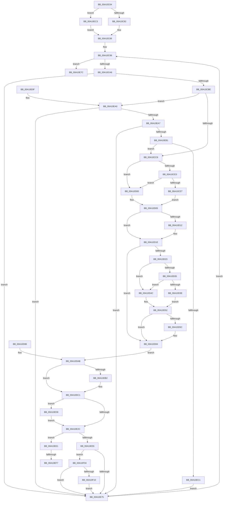

# DbgkSendSystemDllMessages

- RVA: `0x00A10C04`–`0x00A10F1C` (길이 `792` bytes)
- VA: `0x0000000140A10C04`
- 실행 섹션: `PAGE`
- PDB 이름 있음: `예`; PDB Function 태그: `예`
- unwind 정보 RVA: `0x000A92F0`
- 디코드: `184`개 명령, `792/792` bytes 표시
- 미해석 바이트: `0` (있으면 어셈블리에 `.byte`로 보존)

> 이 문서는 커널 이미지의 기계어와 PDB 기호를 분석해 생성했습니다. 4번과 5번은 함수 원형과 자료형을 바이너리 사용 방식에서 추정한 C 해석이며 원본 소스 복구 결과는 아닙니다.

## 1. Dependencies

- 직접 호출 지점: **12**; 고유 호출 대상: **11**
- 직접 호출자로 확인된 함수: **2**
- RIP 상대 이미지 참조: **1**

### Outgoing calls
- `0x00A10CA8` → [PsQuerySystemDllInfo](../8D/PsQuerySystemDllInfo_function_008D20F8.md) (function, `0x008D20F8`)
- `0x00A10CF9` → [KiStackAttachProcess](../../text/21/KiStackAttachProcess_function_00216820.md) (function, `0x00216820`)
- `0x00A10D08` → [RtlImageNtHeader](../../text/44/RtlImageNtHeader_function_00443B60.md) (function, `0x00443B60`)
- `0x00A10D74` → [RtlStringCbCopyW](../../text/43/RtlStringCbCopyW_function_0043B910.md) (function, `0x0043B910`)
- `0x00A10DBC` → [KiUnstackDetachProcess](../../text/21/KiUnstackDetachProcess_function_00217D30.md) (function, `0x00217D30`)
- `0x00A10E1F` → [ZwOpenFile](../../text/6A/ZwOpenFile_function_006AD730.md) (function, `0x006AD730`)
- `0x00A10E68` → [DbgkpQueueMessage](../8A/DbgkpQueueMessage_function_008A31C0.md) (function, `0x008A31C0`)
- `0x00A10E87` → [_security_check_cookie](../../text/6A/_security_check_cookie_function_006AC640.md) (function, `0x006AC640`)
- `0x00A10EB4` → [PsWow64GetProcessNtdllType](../8C/PsWow64GetProcessNtdllType_function_008CE464.md) (function, `0x008CE464`)
- `0x00A10EE6` → [DbgkpSendApiMessage](../A7/DbgkpSendApiMessage_function_00A79458.md) (function, `0x00A79458`)
- `0x00A10EF9` → [ObCloseHandle](../8A/ObCloseHandle_function_008A1870.md) (function, `0x008A1870`)
- `0x00A10F12` → [ObCloseHandle](../8A/ObCloseHandle_function_008A1870.md) (function, `0x008A1870`)

### Direct callers
- [DbgkpPostFakeThreadMessages](DbgkpPostFakeThreadMessages_function_00A108CC.md) at `0x00A10AB4`
- [sub_00B1BA80](../B1/Unknown_function_00B1BA80.md) at `0x00B1BB95`

### Static image references
- `0x00A10C19` → RVA `0x00E0A740` (`.data`; read)

## 2. Other-region calls and transfers

- 다른 실행 섹션으로 향하는 call: **6**
  - `0x00A10CF9` → [KiStackAttachProcess](../../text/21/KiStackAttachProcess_function_00216820.md) (`PAGE` → `.text`)
  - `0x00A10D08` → [RtlImageNtHeader](../../text/44/RtlImageNtHeader_function_00443B60.md) (`PAGE` → `.text`)
  - `0x00A10D74` → [RtlStringCbCopyW](../../text/43/RtlStringCbCopyW_function_0043B910.md) (`PAGE` → `.text`)
  - `0x00A10DBC` → [KiUnstackDetachProcess](../../text/21/KiUnstackDetachProcess_function_00217D30.md) (`PAGE` → `.text`)
  - `0x00A10E1F` → [ZwOpenFile](../../text/6A/ZwOpenFile_function_006AD730.md) (`PAGE` → `.text`)
  - `0x00A10E87` → [_security_check_cookie](../../text/6A/_security_check_cookie_function_006AC640.md) (`PAGE` → `.text`)
- call이 아닌 외부 분기/꼬리 이동: **2**
  - `0x00A10EF1` → [sub_00B36C58](../B3/Unknown_function_00B36C58.md) (`tail-transfer`)
  - `0x00A10EFF` → [sub_00B36C58](../B3/Unknown_function_00B36C58.md) (`tail-transfer`)

## 3. Assembly (complete function range)

```asm
00A10C04  4C 8B DC                        mov r11, rsp
00A10C07  53                              push rbx
00A10C08  56                              push rsi
00A10C09  57                              push rdi
00A10C0A  41 54                           push r12
00A10C0C  41 55                           push r13
00A10C0E  41 56                           push r14
00A10C10  41 57                           push r15
00A10C12  48 81 EC F0 00 00 00            sub rsp, 0xf0
00A10C19  48 8B 05 20 9B 3F 00            mov rax, qword ptr [rip + 0x3f9b20]
00A10C20  48 33 C4                        xor rax, rsp
00A10C23  48 89 84 24 E8 00 00 00         mov qword ptr [rsp + 0xe8], rax
00A10C2B  4D 8B E0                        mov r12, r8
00A10C2E  4C 8B E9                        mov r13, rcx
00A10C31  48 89 4C 24 58                  mov qword ptr [rsp + 0x58], rcx
00A10C36  48 89 54 24 70                  mov qword ptr [rsp + 0x70], rdx
00A10C3B  4C 89 44 24 60                  mov qword ptr [rsp + 0x60], r8
00A10C40  0F 57 C0                        xorps xmm0, xmm0
00A10C43  41 0F 11 43 90                  movups xmmword ptr [r11 - 0x70], xmm0
00A10C48  41 0F 11 43 A0                  movups xmmword ptr [r11 - 0x60], xmm0
00A10C4D  41 0F 11 43 B0                  movups xmmword ptr [r11 - 0x50], xmm0
00A10C52  41 0F 11 43 80                  movups xmmword ptr [r11 - 0x80], xmm0
00A10C57  33 C0                           xor eax, eax
00A10C59  0F 11 44 24 78                  movups xmmword ptr [rsp + 0x78], xmm0
00A10C5E  0F 11 84 24 88 00 00 00         movups xmmword ptr [rsp + 0x88], xmm0
00A10C66  49 89 83 70 FF FF FF            mov qword ptr [r11 - 0x90], rax
00A10C6D  89 84 24 A0 00 00 00            mov dword ptr [rsp + 0xa0], eax
00A10C74  48 21 44 24 38                  and qword ptr [rsp + 0x38], rax
00A10C79  48 85 C9                        test rcx, rcx
00A10C7C  0F 84 41 02 00 00               je 0x140a10ec3
00A10C82  4C 8B B1 20 02 00 00            mov r14, qword ptr [rcx + 0x220]
00A10C89  4C 89 74 24 40                  mov qword ptr [rsp + 0x40], r14
00A10C8E  49 8D 78 30                     lea rdi, [r8 + 0x30]
00A10C92  48 89 7C 24 50                  mov qword ptr [rsp + 0x50], rdi
00A10C97  33 F6                           xor esi, esi
00A10C99  89 74 24 34                     mov dword ptr [rsp + 0x34], esi
00A10C9D  83 FE 06                        cmp esi, 6
00A10CA0  0F 8D D6 01 00 00               jge 0x140a10e7c
00A10CA6  8B CE                           mov ecx, esi
00A10CA8  E8 4B 14 EC FF                  call 0x1408d20f8
00A10CAD  48 8B D0                        mov rdx, rax
00A10CB0  48 89 44 24 48                  mov qword ptr [rsp + 0x48], rax
00A10CB5  48 85 C0                        test rax, rax
00A10CB8  0F 84 B7 01 00 00               je 0x140a10e75
00A10CBE  85 F6                           test esi, esi
00A10CC0  0F 8F DA 01 00 00               jg 0x140a10ea0
00A10CC6  0F 57 C0                        xorps xmm0, xmm0
00A10CC9  0F 11 07                        movups xmmword ptr [rdi], xmm0
00A10CCC  0F 11 47 10                     movups xmmword ptr [rdi + 0x10], xmm0
00A10CD0  48 83 64 24 38 00               and qword ptr [rsp + 0x38], 0
00A10CD6  48 8B 5A 18                     mov rbx, qword ptr [rdx + 0x18]
00A10CDA  48 89 5F 08                     mov qword ptr [rdi + 8], rbx
00A10CDE  4D 85 ED                        test r13, r13
00A10CE1  74 1D                           je 0x140a10d00
00A10CE3  85 F6                           test esi, esi
00A10CE5  74 19                           je 0x140a10d00
00A10CE7  C6 44 24 30 01                  mov byte ptr [rsp + 0x30], 1
00A10CEC  4C 8D 84 24 B8 00 00 00         lea r8, [rsp + 0xb8]
00A10CF4  33 D2                           xor edx, edx
00A10CF6  49 8B CE                        mov rcx, r14
00A10CF9  E8 22 5B 80 FF                  call 0x140216820
00A10CFE  EB 05                           jmp 0x140a10d05
00A10D00  C6 44 24 30 00                  mov byte ptr [rsp + 0x30], 0
00A10D05  48 8B CB                        mov rcx, rbx
00A10D08  E8 53 2E A3 FF                  call 0x140443b60
00A10D0D  48 85 C0                        test rax, rax
00A10D10  74 0C                           je 0x140a10d1e
00A10D12  8B 48 0C                        mov ecx, dword ptr [rax + 0xc]
00A10D15  89 4F 10                        mov dword ptr [rdi + 0x10], ecx
00A10D18  8B 40 10                        mov eax, dword ptr [rax + 0x10]
00A10D1B  89 47 14                        mov dword ptr [rdi + 0x14], eax
00A10D1E  4D 85 ED                        test r13, r13
00A10D21  75 61                           jne 0x140a10d84
00A10D23  65 48 8B 0C 25 88 01 00 00      mov rcx, qword ptr gs:[0x188]
00A10D2C  F7 41 74 00 04 00 00            test dword ptr [rcx + 0x74], 0x400
00A10D33  75 17                           jne 0x140a10d4c
00A10D35  80 B9 4A 02 00 00 01            cmp byte ptr [rcx + 0x24a], 1
00A10D3C  74 0E                           je 0x140a10d4c
00A10D3E  48 8B 81 F0 00 00 00            mov rax, qword ptr [rcx + 0xf0]
00A10D45  48 89 44 24 38                  mov qword ptr [rsp + 0x38], rax
00A10D4A  EB 06                           jmp 0x140a10d52
00A10D4C  48 83 64 24 38 00               and qword ptr [rsp + 0x38], 0
00A10D52  4C 8B 7C 24 38                  mov r15, qword ptr [rsp + 0x38]
00A10D57  4D 85 FF                        test r15, r15
00A10D5A  74 28                           je 0x140a10d84
00A10D5C  49 8D 9F 68 12 00 00            lea rbx, [r15 + 0x1268]
00A10D63  4C 8B 44 24 48                  mov r8, qword ptr [rsp + 0x48]
00A10D68  4D 8B 40 28                     mov r8, qword ptr [r8 + 0x28]
00A10D6C  BA 0A 02 00 00                  mov edx, 0x20a
00A10D71  48 8B CB                        mov rcx, rbx
00A10D74  E8 97 AB A2 FF                  call 0x14043b910
00A10D79  49 8D 47 28                     lea rax, [r15 + 0x28]
00A10D7D  48 89 18                        mov qword ptr [rax], rbx
00A10D80  48 89 47 18                     mov qword ptr [rdi + 0x18], rax
00A10D84  EB 25                           jmp 0x140a10dab
00A10D86  48 8B 7C 24 50                  mov rdi, qword ptr [rsp + 0x50]
00A10D8B  83 67 10 00                     and dword ptr [rdi + 0x10], 0
00A10D8F  83 67 14 00                     and dword ptr [rdi + 0x14], 0
00A10D93  48 83 67 18 00                  and qword ptr [rdi + 0x18], 0
00A10D98  8B 74 24 34                     mov esi, dword ptr [rsp + 0x34]
00A10D9C  4C 8B 74 24 40                  mov r14, qword ptr [rsp + 0x40]
00A10DA1  4C 8B 6C 24 58                  mov r13, qword ptr [rsp + 0x58]
00A10DA6  4C 8B 64 24 60                  mov r12, qword ptr [rsp + 0x60]
00A10DAB  80 7C 24 30 00                  cmp byte ptr [rsp + 0x30], 0
00A10DB0  74 0F                           je 0x140a10dc1
00A10DB2  33 D2                           xor edx, edx
00A10DB4  48 8D 8C 24 B8 00 00 00         lea rcx, [rsp + 0xb8]
00A10DBC  E8 6F 6F 80 FF                  call 0x140217d30
00A10DC1  48 8B 44 24 48                  mov rax, qword ptr [rsp + 0x48]
00A10DC6  48 83 C0 08                     add rax, 8
00A10DCA  C7 44 24 78 30 00 00 00         mov dword ptr [rsp + 0x78], 0x30
00A10DD2  48 83 A4 24 80 00 00 00 00      and qword ptr [rsp + 0x80], 0
00A10DDB  C7 84 24 90 00 00 00 40 06 00 00  mov dword ptr [rsp + 0x90], 0x640
00A10DE6  48 89 84 24 88 00 00 00         mov qword ptr [rsp + 0x88], rax
00A10DEE  0F 57 C0                        xorps xmm0, xmm0
00A10DF1  F3 0F 7F 84 24 98 00 00 00      movdqu xmmword ptr [rsp + 0x98], xmm0
00A10DFA  C7 44 24 28 20 00 00 00         mov dword ptr [rsp + 0x28], 0x20
00A10E02  C7 44 24 20 07 00 00 00         mov dword ptr [rsp + 0x20], 7
00A10E0A  4C 8D 8C 24 A8 00 00 00         lea r9, [rsp + 0xa8]
00A10E12  4C 8D 44 24 78                  lea r8, [rsp + 0x78]
00A10E17  BA 00 00 10 80                  mov edx, 0x80100000
00A10E1C  48 8B CF                        mov rcx, rdi
00A10E1F  E8 0C C9 C9 FF                  call 0x1406ad730
00A10E24  85 C0                           test eax, eax
00A10E26  0F 88 AC 00 00 00               js 0x140a10ed8
00A10E2C  41 C7 04 24 28 00 50 00         mov dword ptr [r12], 0x500028
00A10E34  41 C7 44 24 04 08 00 00 00      mov dword ptr [r12 + 4], 8
00A10E3D  41 C7 44 24 28 05 00 00 00      mov dword ptr [r12 + 0x28], 5
00A10E46  4D 8B C4                        mov r8, r12
00A10E49  49 8B CE                        mov rcx, r14
00A10E4C  4D 85 ED                        test r13, r13
00A10E4F  0F 84 8C 00 00 00               je 0x140a10ee1
00A10E55  48 8B 44 24 70                  mov rax, qword ptr [rsp + 0x70]
00A10E5A  48 89 44 24 20                  mov qword ptr [rsp + 0x20], rax
00A10E5F  41 B9 02 00 00 00               mov r9d, 2
00A10E65  49 8B D5                        mov rdx, r13
00A10E68  E8 53 23 E9 FF                  call 0x1408a31c0
00A10E6D  85 C0                           test eax, eax
00A10E6F  0F 88 8F 00 00 00               js 0x140a10f04
00A10E75  FF C6                           inc esi
00A10E77  E9 1D FE FF FF                  jmp 0x140a10c99
00A10E7C  48 8B 8C 24 E8 00 00 00         mov rcx, qword ptr [rsp + 0xe8]
00A10E84  48 33 CC                        xor rcx, rsp
00A10E87  E8 B4 B7 C9 FF                  call 0x1406ac640
00A10E8C  48 81 C4 F0 00 00 00            add rsp, 0xf0
00A10E93  41 5F                           pop r15
00A10E95  41 5E                           pop r14
00A10E97  41 5D                           pop r13
00A10E99  41 5C                           pop r12
00A10E9B  5F                              pop rdi
00A10E9C  5E                              pop rsi
00A10E9D  5B                              pop rbx
00A10E9E  C3                              ret
00A10E9F  CC                              int3
00A10EA0  8B 08                           mov ecx, dword ptr [rax]
00A10EA2  F6 C1 08                        test cl, 8
00A10EA5  74 CE                           je 0x140a10e75
00A10EA7  49 83 BE 10 03 00 00 00         cmp qword ptr [r14 + 0x310], 0
00A10EAF  74 C4                           je 0x140a10e75
00A10EB1  49 8B CE                        mov rcx, r14
00A10EB4  E8 AB D5 EB FF                  call 0x1408ce464
00A10EB9  3B F0                           cmp esi, eax
00A10EBB  0F 84 05 FE FF FF               je 0x140a10cc6
00A10EC1  EB B2                           jmp 0x140a10e75
00A10EC3  65 48 8B 04 25 88 01 00 00      mov rax, qword ptr gs:[0x188]
00A10ECC  4C 8B B0 B8 00 00 00            mov r14, qword ptr [rax + 0xb8]
00A10ED3  E9 B1 FD FF FF                  jmp 0x140a10c89
00A10ED8  48 83 27 00                     and qword ptr [rdi], 0
00A10EDC  E9 4B FF FF FF                  jmp 0x140a10e2c
00A10EE1  BA 03 00 00 00                  mov edx, 3
00A10EE6  E8 6D 85 06 00                  call 0x140a79458
00A10EEB  48 8B 0F                        mov rcx, qword ptr [rdi]
00A10EEE  48 85 C9                        test rcx, rcx
00A10EF1  0F 84 61 5D 12 00               je 0x140b36c58
00A10EF7  33 D2                           xor edx, edx
00A10EF9  E8 72 09 E9 FF                  call 0x1408a1870
00A10EFE  90                              nop
00A10EFF  E9 54 5D 12 00                  jmp 0x140b36c58
00A10F04  48 8B 0F                        mov rcx, qword ptr [rdi]
00A10F07  48 85 C9                        test rcx, rcx
00A10F0A  0F 84 65 FF FF FF               je 0x140a10e75
00A10F10  33 D2                           xor edx, edx
00A10F12  E8 59 09 E9 FF                  call 0x1408a1870
00A10F17  E9 59 FF FF FF                  jmp 0x140a10e75
```

## 4. C-style interpretation (structured pseudocode)

```c
__int64 __fastcall DbgkSendSystemDllMessages(__int64 a1, __int64 a2, __int64 a3)
{
    __int64 result;
    __int64 v_rbx;
    __int64 v_rsi;
    __int64 v_rsp;
    unsigned int v_stack_m100;
    unsigned int v_stack_m108;
    unsigned __int64 v_stack_m40;
    unsigned __int64 v_stack_m70;
    unsigned __int64 v_stack_m80;
    unsigned int v_stack_m88;
    unsigned __int64 v_stack_m90;
    unsigned int v_stack_m98;
    unsigned __int64 v_stack_mA0;
    unsigned __int64 v_stack_mA8;
    unsigned __int64 v_stack_mB0;
    unsigned __int64 v_stack_mB8;
    unsigned __int64 v_stack_mC8;
    unsigned __int64 v_stack_mD0;
    unsigned __int64 v_stack_mD8;
    unsigned __int64 v_stack_mE0;
    unsigned __int64 v_stack_mE8;
    unsigned __int64 v_stack_mF0;
    unsigned int v_stack_mF4;
    unsigned __int8 v_stack_mF8;

    v_rsp = (v_rsp) - (240);
    result = (*(unsigned __int64 *)(v_rip + 4168480)) ^ (v_rsp);
    v_stack_m40 = result;
    v_stack_mD0 = a1;
    v_stack_mB8 = a2;
    v_stack_mC8 = a3;
    *(unsigned __int64 *)(v_rsp - 112) = v_xmm0;
    *(unsigned __int64 *)(v_rsp - 96) = v_xmm0;
    *(unsigned __int64 *)(v_rsp - 80) = v_xmm0;
    *(unsigned __int64 *)(v_rsp - 128) = v_xmm0;
    result = 0;
    v_stack_mB0 = v_xmm0;
    v_stack_mA0 = v_xmm0;
    *(unsigned __int64 *)(v_rsp - 144) = 0;
    v_stack_m88 = 0;
    if (a1 == 0) goto loc_00A10EC3;
loc_00A10C89:
    v_stack_mE8 = *(unsigned __int64 *)(a1 + 544);
    v_stack_mD8 = a3 + 48;
    v_rsi = 0;
loc_00A10C99:
    v_stack_mF4 = 0;
    if (0 >= 6) goto loc_00A10E7C;
    result = PsQuerySystemDllInfo(0, a2, a3, a4);
    v_stack_mE0 = result;
    if (result == 0) goto loc_00A10E75;
    if (condition_is_greater) goto loc_00A10EA0;
loc_00A10CC6:
    *(unsigned __int64 *)(a3 + 48) = v_xmm0;
    *(unsigned __int64 *)(a3 + 48 + 16) = v_xmm0;
    *(unsigned __int64 *)(a3 + 48 + 8) = *(unsigned __int64 *)(result + 24);
    if (a1 == 0) goto loc_00A10D00;
    if (0 == 0) goto loc_00A10D00;
    v_stack_mF8 = 1;
    a2 = 0;
    result = KiStackAttachProcess(*(unsigned __int64 *)(a1 + 544), a2, v_stack_m70, a4);
    goto loc_00A10D05;
loc_00A10D00:
    v_stack_mF8 = 0;
loc_00A10D05:
    result = RtlImageNtHeader(*(unsigned __int64 *)(result + 24), a2, v_stack_m70, a4);
    if (result != 0) {
        a1 = *(unsigned int *)(result + 12);
        *(unsigned int *)(a3 + 48 + 16) = (unsigned int)(a1);
        result = *(unsigned int *)(result + 16);
        *(unsigned int *)(a3 + 48 + 20) = (unsigned int)(result);
    }
    if (a1 != 0) goto loc_00A10D84;
    if (((*(unsigned int *)(*(unsigned __int64 *)(gs_base + (0 + 392)) + 116)) & (0x400ULL)) != 0) goto loc_00A10D4C;
    if ((*(unsigned __int8 *)(*(unsigned __int64 *)(gs_base + (0 + 392)) + 586)) == 1) goto loc_00A10D4C;
    v_stack_mF0 = *(unsigned __int64 *)(*(unsigned __int64 *)(gs_base + (0 + 392)) + 240);
    goto loc_00A10D52;
loc_00A10D4C:
loc_00A10D52:
    result = *(unsigned __int64 *)(*(unsigned __int64 *)(gs_base + (0 + 392)) + 240);
    v_rbx = *(unsigned __int64 *)(result + 24);
    if (v_stack_mF0 != 0) {
        v_rbx = v_stack_mF0 + 4712;
        a3 = v_stack_mE0;
        a3 = *(unsigned __int64 *)(a3 + 40);
        a2 = 522;
        a1 = v_rbx;
        result = RtlStringCbCopyW(a1, a2, a3, a4);
        result = v_stack_mF0 + 40;
        *(unsigned __int64 *)(result) = v_rbx;
        *(unsigned __int64 *)(a3 + 48 + 24) = result;
    }
    goto loc_00A10DAB;
loc_00A10DAB:
    if (v_stack_mF8 != 0) {
        a2 = 0;
        a1 = v_stack_m70;
        result = KiUnstackDetachProcess(a1, a2, a3, a4);
    }
    result = (v_stack_mE0) + (8);
    v_stack_mB0 = 48;
    v_stack_m98 = 0x640ULL;
    v_stack_mA0 = result;
    v_stack_m90 = v_xmm0;
    v_stack_m100 = 32;
    v_stack_m108 = 7;
    result = ZwOpenFile(a3 + 48, (unsigned int)(0x80100000ULL), v_stack_mB0, v_stack_m80);
    if (sign_flag) goto loc_00A10ED8;
loc_00A10E2C:
    *(unsigned int *)(a3) = 0x500028ULL;
    *(unsigned int *)(a3 + 4) = 8;
    *(unsigned int *)(a3 + 40) = 5;
    if (a1 == 0) goto loc_00A10EE1;
    v_stack_m108 = v_stack_mB8;
    result = DbgkpQueueMessage(*(unsigned __int64 *)(a1 + 544), a1, a3, 2);
    if (sign_flag) goto loc_00A10F04;
loc_00A10E75:
    v_rsi = (unsigned int)((v_rsi) + 1);
    goto loc_00A10C99;
loc_00A10E7C:
    a1 = (v_stack_m40) ^ (v_rsp);
    result = _security_check_cookie(a1, a1, a3, 2);
    v_rsp = (v_rsp) + (240);
    return result;
loc_00A10EA0:
    if ((((unsigned __int8)((unsigned int)(*(unsigned int *)(result)))) & (8)) == 0) goto loc_00A10E75;
    if ((*(unsigned __int64 *)(*(unsigned __int64 *)(a1 + 544) + 784)) == 0) goto loc_00A10E75;
    result = PsWow64GetProcessNtdllType(*(unsigned __int64 *)(a1 + 544), a1, a3, 2);
    if (((unsigned int)(v_rsi)) == ((unsigned int)(result))) goto loc_00A10CC6;
    goto loc_00A10E75;
loc_00A10EC3:
    goto loc_00A10C89;
loc_00A10ED8:
    goto loc_00A10E2C;
loc_00A10EE1:
    result = DbgkpSendApiMessage(*(unsigned __int64 *)(a1 + 544), 3, a3, 2);
    a2 = 0;
    result = ObCloseHandle(*(unsigned __int64 *)(a3 + 48), a2, a3, 2);
loc_00A10F04:
    if (*(unsigned __int64 *)(a3 + 48) == 0) goto loc_00A10E75;
    a2 = 0;
    result = ObCloseHandle(*(unsigned __int64 *)(a3 + 48), a2, a3, 2);
    goto loc_00A10E75;
}
```

## 5. (Beta) C Style

```c
int64_t DbgkSendSystemDllMessages(int64_t Arg1, int64_t Arg2, void *Arg3)
{
    uint8_t *arg3 = (uint8_t *)Arg3;

    int64_t result;
    int64_t local_rbx;
    int64_t local_rsi;
    int64_t local_rsp;
    uint32_t v_stack_m100;
    uint32_t v_stack_m108;
    uint64_t v_stack_m40;
    uint64_t v_stack_m70;
    uint64_t v_stack_m80;
    uint32_t v_stack_m88;
    uint64_t v_stack_m90;
    uint32_t v_stack_m98;
    uint64_t v_stack_mA0;
    uint64_t v_stack_mA8;
    uint64_t v_stack_mB0;
    uint64_t v_stack_mB8;
    uint64_t v_stack_mC8;
    uint64_t v_stack_mD0;
    uint64_t v_stack_mD8;
    uint64_t v_stack_mE0;
    uint64_t v_stack_mE8;
    uint64_t v_stack_mF0;
    uint32_t v_stack_mF4;
    uint8_t v_stack_mF8;

    local_rsp = (local_rsp) - (240);
    result = (*(uint64_t *)(v_rip + 0x3F9B20)) ^ (local_rsp);
    v_stack_m40 = result;
    v_stack_mD0 = Arg1;
    v_stack_mB8 = Arg2;
    v_stack_mC8 = Arg3;
    *(uint64_t *)(local_rsp - 0x70) = v_xmm0;
    *(uint64_t *)(local_rsp - 0x60) = v_xmm0;
    *(uint64_t *)(local_rsp - 0x50) = v_xmm0;
    *(uint64_t *)(local_rsp - 0x80) = v_xmm0;
    result = 0;
    v_stack_mB0 = v_xmm0;
    v_stack_mA0 = v_xmm0;
    *(uint64_t *)(local_rsp - 0x90) = 0;
    v_stack_m88 = 0;
    if (Arg1 == 0) goto loc_00A10EC3;
loc_00A10C89:
    v_stack_mE8 = *(uint64_t *)(Arg1 + 0x220);
    v_stack_mD8 = Arg3 + 48;
    local_rsi = 0;
loc_00A10C99:
    v_stack_mF4 = 0;
    if (0 >= 6) goto loc_00A10E7C;
    result = PsQuerySystemDllInfo(0, Arg2, Arg3, a4);
    v_stack_mE0 = result;
    if (result == 0) goto loc_00A10E75;
    if (condition_is_greater) goto loc_00A10EA0;
loc_00A10CC6:
    *(uint64_t *)(arg3 + 0x30) = v_xmm0;
    *(uint64_t *)(arg3 + 0x30 + 0x10) = v_xmm0;
    *(uint64_t *)(arg3 + 0x30 + 0x8) = *(uint64_t *)(result + 0x18);
    if (Arg1 == 0) goto loc_00A10D00;
    if (0 == 0) goto loc_00A10D00;
    v_stack_mF8 = 1;
    Arg2 = 0;
    result = KiStackAttachProcess(*(uint64_t *)(Arg1 + 0x220), Arg2, v_stack_m70, a4);
    goto loc_00A10D05;
loc_00A10D00:
    v_stack_mF8 = 0;
loc_00A10D05:
    result = RtlImageNtHeader(*(uint64_t *)(result + 0x18), Arg2, v_stack_m70, a4);
    if (result != 0) {
        Arg1 = *(uint32_t *)(result + 0xC);
        *(uint32_t *)(arg3 + 0x30 + 0x10) = (uint32_t)(Arg1);
        result = *(uint32_t *)(result + 0x10);
        *(uint32_t *)(arg3 + 0x30 + 0x14) = (uint32_t)(result);
    }
    if (Arg1 != 0) goto loc_00A10D84;
    if (((*(uint32_t *)(*(uint64_t *)(gs_base + (0 + 0x188)) + 0x74)) & (0x400ULL)) != 0) goto loc_00A10D4C;
    if ((*(uint8_t *)(*(uint64_t *)(gs_base + (0 + 0x188)) + 0x24A)) == 1) goto loc_00A10D4C;
    v_stack_mF0 = *(uint64_t *)(*(uint64_t *)(gs_base + (0 + 0x188)) + 0xF0);
    goto loc_00A10D52;
loc_00A10D4C:
loc_00A10D52:
    result = *(uint64_t *)(*(uint64_t *)(gs_base + (0 + 0x188)) + 0xF0);
    local_rbx = *(uint64_t *)(result + 0x18);
    if (v_stack_mF0 != 0) {
        local_rbx = v_stack_mF0 + 4712;
        Arg3 = v_stack_mE0;
        Arg3 = *(uint64_t *)(arg3 + 0x28);
        Arg2 = 522;
        Arg1 = local_rbx;
        result = RtlStringCbCopyW(Arg1, Arg2, Arg3, a4);
        result = v_stack_mF0 + 40;
        *(uint64_t *)(result) = local_rbx;
        *(uint64_t *)(arg3 + 0x30 + 0x18) = result;
    }
    goto loc_00A10DAB;
loc_00A10DAB:
    if (v_stack_mF8 != 0) {
        Arg2 = 0;
        Arg1 = v_stack_m70;
        result = KiUnstackDetachProcess(Arg1, Arg2, Arg3, a4);
    }
    result = (v_stack_mE0) + (8);
    v_stack_mB0 = 48;
    v_stack_m98 = 0x640ULL;
    v_stack_mA0 = result;
    v_stack_m90 = v_xmm0;
    v_stack_m100 = 32;
    v_stack_m108 = 7;
    result = ZwOpenFile(Arg3 + 48, (uint32_t)(0x80100000ULL), v_stack_mB0, v_stack_m80);
    if (sign_flag) goto loc_00A10ED8;
loc_00A10E2C:
    *(uint32_t *)(arg3) = 0x500028ULL;
    *(uint32_t *)(arg3 + 0x4) = 8;
    *(uint32_t *)(arg3 + 0x28) = 5;
    if (Arg1 == 0) goto loc_00A10EE1;
    v_stack_m108 = v_stack_mB8;
    result = DbgkpQueueMessage(*(uint64_t *)(Arg1 + 0x220), Arg1, Arg3, 2);
    if (sign_flag) goto loc_00A10F04;
loc_00A10E75:
    local_rsi = (uint32_t)((local_rsi) + 1);
    goto loc_00A10C99;
loc_00A10E7C:
    Arg1 = (v_stack_m40) ^ (local_rsp);
    result = _security_check_cookie(Arg1, Arg1, Arg3, 2);
    local_rsp = (local_rsp) + (240);
    return result;
loc_00A10EA0:
    if ((((uint8_t)((uint32_t)(*(uint32_t *)(result)))) & (8)) == 0) goto loc_00A10E75;
    if ((*(uint64_t *)(*(uint64_t *)(Arg1 + 0x220) + 0x310)) == 0) goto loc_00A10E75;
    result = PsWow64GetProcessNtdllType(*(uint64_t *)(Arg1 + 0x220), Arg1, Arg3, 2);
    if (((uint32_t)(local_rsi)) == ((uint32_t)(result))) goto loc_00A10CC6;
    goto loc_00A10E75;
loc_00A10EC3:
    goto loc_00A10C89;
loc_00A10ED8:
    goto loc_00A10E2C;
loc_00A10EE1:
    result = DbgkpSendApiMessage(*(uint64_t *)(Arg1 + 0x220), 3, Arg3, 2);
    Arg2 = 0;
    result = ObCloseHandle(*(uint64_t *)(arg3 + 0x30), Arg2, Arg3, 2);
loc_00A10F04:
    if (*(uint64_t *)(arg3 + 0x30) == 0) goto loc_00A10E75;
    Arg2 = 0;
    result = ObCloseHandle(*(uint64_t *)(arg3 + 0x30), Arg2, Arg3, 2);
    goto loc_00A10E75;
}
```

### 관측된 메모리 오프셋

구조체 형식이 확인되지 않은 접근은 인자 기준의 오프셋으로만 기록했습니다.

| 기준 인자 | 오프셋 표현 | 폭 (bit) | 접근 |
|---|---:|---:|---|
| `Arg3` | `+ 0x0` | `32` | `W` |
| `Arg3` | `+ 0x0` | `64` | `R` |
| `Arg3` | `+ 0x0` | `64` | `R/W` |
| `Arg3` | `+ 0x0` | `128` | `R` |
| `Arg3` | `+ 0x4` | `32` | `W` |
| `Arg3` | `+ 0x8` | `64` | `W` |
| `Arg3` | `+ 0x10` | `32` | `W` |
| `Arg3` | `+ 0x10` | `128` | `R` |
| `Arg3` | `+ 0x14` | `32` | `W` |
| `Arg3` | `+ 0x18` | `64` | `W` |
| `Arg3` | `+ 0x28` | `32` | `W` |
| `Arg3` | `+ 0x30` | `64` | `R` |

## 6. Execution-region graph

[열기: 2D/3D 그래프와 함수 탐색 컨트롤 패널](../../../control-panel.html?section=page&rva=0x00A10C04&view=graph)

- 2D 그래프는 위에서 아래로 흐르고, 3D 그래프는 빈 공간을 드래그해 회전합니다. Shift+드래그는 이동, 휠은 확대·축소, 함수 노드 선택은 대상 보고서 이동입니다.

### Static fallback


