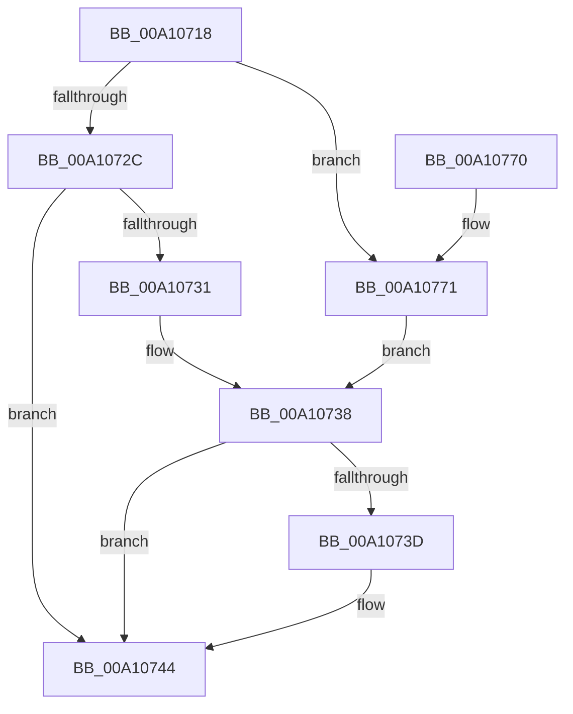

# DbgkpFreeDebugEvent

- RVA: `0x00A10718`–`0x00A1077A` (길이 `98` bytes)
- VA: `0x0000000140A10718`
- 실행 섹션: `PAGE`
- PDB 이름 있음: `예`; PDB Function 태그: `아니요`
- unwind 정보 RVA: `0x00060BD8`
- 디코드: `28`개 명령, `98/98` bytes 표시
- 미해석 바이트: `0` (있으면 어셈블리에 `.byte`로 보존)

> 이 문서는 커널 이미지의 기계어와 PDB 기호를 분석해 생성했습니다. 4번과 5번은 함수 원형과 자료형을 바이너리 사용 방식에서 추정한 C 해석이며 원본 소스 복구 결과는 아닙니다.

## 1. Dependencies

- 직접 호출 지점: **4**; 고유 호출 대상: **3**
- 직접 호출자로 확인된 함수: **1**
- RIP 상대 이미지 참조: **0**

### Outgoing calls
- `0x00A1073F` → [ObCloseHandle](../8A/ObCloseHandle_function_008A1870.md) (function, `0x008A1870`)
- `0x00A1074D` → [ObfDereferenceObjectWithTag](../../text/2F/ObfDereferenceObjectWithTag_function_002F78E0.md) (function, `0x002F78E0`)
- `0x00A1075B` → [ObfDereferenceObjectWithTag](../../text/2F/ObfDereferenceObjectWithTag_function_002F78E0.md) (function, `0x002F78E0`)
- `0x00A10765` → [ExFreePoolWithTag](../../poolcode/B8/ExFreePoolWithTag_function_00B82870.md) (function, `0x00B82870`)

### Direct callers
- [DbgkpWakeTarget](DbgkpWakeTarget_function_00A106AC.md) at `0x00A106E3`

### Static image references
- 디코드된 RIP-relative 메모리 참조가 없습니다.

## 2. Other-region calls and transfers

- 다른 실행 섹션으로 향하는 call: **3**
  - `0x00A1074D` → [ObfDereferenceObjectWithTag](../../text/2F/ObfDereferenceObjectWithTag_function_002F78E0.md) (`PAGE` → `.text`)
  - `0x00A1075B` → [ObfDereferenceObjectWithTag](../../text/2F/ObfDereferenceObjectWithTag_function_002F78E0.md) (`PAGE` → `.text`)
  - `0x00A10765` → [ExFreePoolWithTag](../../poolcode/B8/ExFreePoolWithTag_function_00B82870.md) (`PAGE` → `POOLCODE`)
- 별도 외부 분기/꼬리 이동을 확인하지 못했습니다.

## 3. Assembly (complete function range)

```asm
00A10718  40 53                           push rbx
00A1071A  48 83 EC 20                     sub rsp, 0x20
00A1071E  8B 81 80 00 00 00               mov eax, dword ptr [rcx + 0x80]
00A10724  48 8B D9                        mov rbx, rcx
00A10727  83 F8 02                        cmp eax, 2
00A1072A  74 45                           je 0x140a10771
00A1072C  83 F8 05                        cmp eax, 5
00A1072F  75 13                           jne 0x140a10744
00A10731  48 8B 89 88 00 00 00            mov rcx, qword ptr [rcx + 0x88]
00A10738  48 85 C9                        test rcx, rcx
00A1073B  74 07                           je 0x140a10744
00A1073D  33 D2                           xor edx, edx
00A1073F  E8 2C 11 E9 FF                  call 0x1408a1870
00A10744  48 8B 4B 38                     mov rcx, qword ptr [rbx + 0x38]
00A10748  BA 44 62 67 4F                  mov edx, 0x4f676244
00A1074D  E8 8E 71 8E FF                  call 0x1402f78e0
00A10752  48 8B 4B 40                     mov rcx, qword ptr [rbx + 0x40]
00A10756  BA 44 62 67 4F                  mov edx, 0x4f676244
00A1075B  E8 80 71 8E FF                  call 0x1402f78e0
00A10760  33 D2                           xor edx, edx
00A10762  48 8B CB                        mov rcx, rbx
00A10765  E8 06 21 17 00                  call 0x140b82870
00A1076A  48 83 C4 20                     add rsp, 0x20
00A1076E  5B                              pop rbx
00A1076F  C3                              ret
00A10770  CC                              int3
00A10771  48 8B 89 90 00 00 00            mov rcx, qword ptr [rcx + 0x90]
00A10778  EB BE                           jmp 0x140a10738
```

## 4. C-style interpretation (structured pseudocode)

```c
__int64 __fastcall DbgkpFreeDebugEvent(__int64 a1, int a2)
{
    __int64 result;
    __int64 v_rsp;

    v_rsp = (v_rsp) - (32);
    if (((unsigned int)((unsigned int)(*(unsigned int *)(a1 + 128)))) == 2) goto loc_00A10771;
    if (((unsigned int)((unsigned int)(*(unsigned int *)(a1 + 128)))) != 5) goto loc_00A10744;
loc_00A10738:
    result = (unsigned int)(*(unsigned int *)(a1 + 128));
    if (*(unsigned __int64 *)(a1 + 136) != 0) {
        a2 = 0;
        result = ObCloseHandle(*(unsigned __int64 *)(a1 + 136), a2, a3, a4);
    }
    result = ObfDereferenceObjectWithTag(*(unsigned __int64 *)(a1 + 56), (unsigned int)(0x4F676244ULL), a3, a4);
    result = ObfDereferenceObjectWithTag(*(unsigned __int64 *)(a1 + 64), (unsigned int)(0x4F676244ULL), a3, a4);
    a2 = 0;
    result = ExFreePoolWithTag(a1, a2, a3, a4);
    v_rsp = (v_rsp) + (32);
    return result;
loc_00A10771:
    goto loc_00A10738;
}
```

## 5. (Beta) C Style

```c
int64_t DbgkpFreeDebugEvent(void *Arg1, int32_t Arg2)
{
    uint8_t *arg1 = (uint8_t *)Arg1;

    int64_t result;
    int64_t local_rsp;

    local_rsp = (local_rsp) - (32);
    if (((uint32_t)((uint32_t)(*(uint32_t *)(arg1 + 0x80)))) == 2) goto loc_00A10771;
    if (((uint32_t)((uint32_t)(*(uint32_t *)(arg1 + 0x80)))) != 5) goto loc_00A10744;
loc_00A10738:
    result = (uint32_t)(*(uint32_t *)(arg1 + 0x80));
    if (*(uint64_t *)(arg1 + 0x88) != 0) {
        Arg2 = 0;
        result = ObCloseHandle(*(uint64_t *)(arg1 + 0x88), Arg2, a3, a4);
    }
    result = ObfDereferenceObjectWithTag(*(uint64_t *)(arg1 + 0x38), (uint32_t)(0x4F676244ULL), a3, a4);
    result = ObfDereferenceObjectWithTag(*(uint64_t *)(arg1 + 0x40), (uint32_t)(0x4F676244ULL), a3, a4);
    Arg2 = 0;
    result = ExFreePoolWithTag(Arg1, Arg2, a3, a4);
    local_rsp = (local_rsp) + (32);
    return result;
loc_00A10771:
    goto loc_00A10738;
}
```

### 관측된 메모리 오프셋

구조체 형식이 확인되지 않은 접근은 인자 기준의 오프셋으로만 기록했습니다.

| 기준 인자 | 오프셋 표현 | 폭 (bit) | 접근 |
|---|---:|---:|---|
| `Arg1` | `+ 0x38` | `64` | `R` |
| `Arg1` | `+ 0x40` | `64` | `R` |
| `Arg1` | `+ 0x80` | `32` | `R` |
| `Arg1` | `+ 0x88` | `64` | `R` |
| `Arg1` | `+ 0x90` | `64` | `R` |

## 6. Execution-region graph

[열기: 2D/3D 그래프와 함수 탐색 컨트롤 패널](../../../control-panel.html?section=page&rva=0x00A10718&view=graph)

- 2D 그래프는 위에서 아래로 흐르고, 3D 그래프는 빈 공간을 드래그해 회전합니다. Shift+드래그는 이동, 휠은 확대·축소, 함수 노드 선택은 대상 보고서 이동입니다.

### Static fallback


