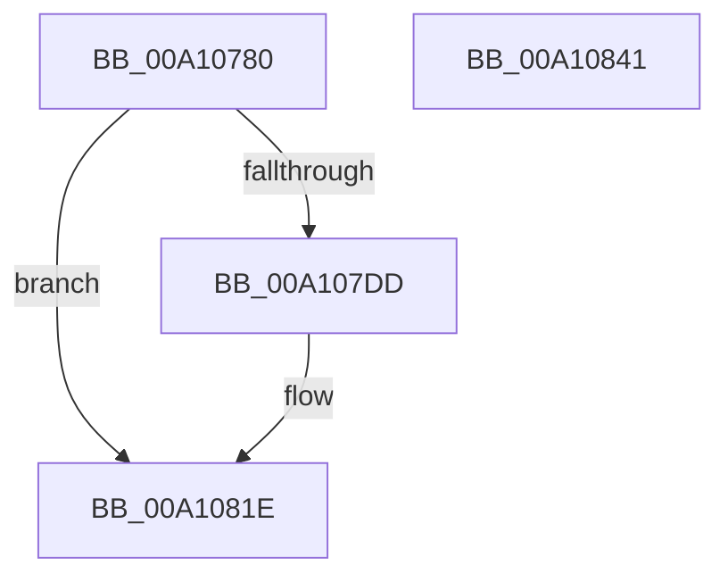

# DbgkpPostFakeProcessCreateMessages

- RVA: `0x00A10780`–`0x00A10842` (길이 `194` bytes)
- VA: `0x0000000140A10780`
- 실행 섹션: `PAGE`
- PDB 이름 있음: `예`; PDB Function 태그: `아니요`
- unwind 정보 RVA: `0x000A9280`
- 디코드: `53`개 명령, `194/194` bytes 표시
- 미해석 바이트: `0` (있으면 어셈블리에 `.byte`로 보존)

> 이 문서는 커널 이미지의 기계어와 PDB 기호를 분석해 생성했습니다. 4번과 5번은 함수 원형과 자료형을 바이너리 사용 방식에서 추정한 C 해석이며 원본 소스 복구 결과는 아닙니다.

## 1. Dependencies

- 직접 호출 지점: **6**; 고유 호출 대상: **6**
- 직접 호출자로 확인된 함수: **1**
- RIP 상대 이미지 참조: **1**

### Outgoing calls
- `0x00A107D4` → [DbgkpPostFakeThreadMessages](DbgkpPostFakeThreadMessages_function_00A108CC.md) (function, `0x00A108CC`)
- `0x00A107E7` → [KiStackAttachProcess](../../text/21/KiStackAttachProcess_function_00216820.md) (function, `0x00216820`)
- `0x00A107F7` → [DbgkpPostModuleMessages](../A5/DbgkpPostModuleMessages_function_00A5F86C.md) (function, `0x00A5F86C`)
- `0x00A10803` → [KiUnstackDetachProcess](../../text/21/KiUnstackDetachProcess_function_00217D30.md) (function, `0x00217D30`)
- `0x00A10812` → [ObfDereferenceObjectWithTag](../../text/2F/ObfDereferenceObjectWithTag_function_002F78E0.md) (function, `0x002F78E0`)
- `0x00A10829` → [_security_check_cookie](../../text/6A/_security_check_cookie_function_006AC640.md) (function, `0x006AC640`)

### Direct callers
- [NtDebugActiveProcess](../A0/NtDebugActiveProcess_function_00A0FC60.md) at `0x00A0FD91`

### Static image references
- `0x00A10791` → RVA `0x00E0A740` (`.data`; read)

## 2. Other-region calls and transfers

- 다른 실행 섹션으로 향하는 call: **4**
  - `0x00A107E7` → [KiStackAttachProcess](../../text/21/KiStackAttachProcess_function_00216820.md) (`PAGE` → `.text`)
  - `0x00A10803` → [KiUnstackDetachProcess](../../text/21/KiUnstackDetachProcess_function_00217D30.md) (`PAGE` → `.text`)
  - `0x00A10812` → [ObfDereferenceObjectWithTag](../../text/2F/ObfDereferenceObjectWithTag_function_002F78E0.md) (`PAGE` → `.text`)
  - `0x00A10829` → [_security_check_cookie](../../text/6A/_security_check_cookie_function_006AC640.md) (`PAGE` → `.text`)
- 별도 외부 분기/꼬리 이동을 확인하지 못했습니다.

## 3. Assembly (complete function range)

```asm
00A10780  4C 8B DC                        mov r11, rsp
00A10783  49 89 5B 20                     mov qword ptr [r11 + 0x20], rbx
00A10787  55                              push rbp
00A10788  56                              push rsi
00A10789  57                              push rdi
00A1078A  48 81 EC 80 00 00 00            sub rsp, 0x80
00A10791  48 8B 05 A8 9F 3F 00            mov rax, qword ptr [rip + 0x3f9fa8]
00A10798  48 33 C4                        xor rax, rsp
00A1079B  48 89 44 24 70                  mov qword ptr [rsp + 0x70], rax
00A107A0  0F 57 C0                        xorps xmm0, xmm0
00A107A3  49 8D 43 A0                     lea rax, [r11 - 0x60]
00A107A7  49 8B F8                        mov rdi, r8
00A107AA  49 89 43 88                     mov qword ptr [r11 - 0x78], rax
00A107AE  33 DB                           xor ebx, ebx
00A107B0  4D 8D 4B 98                     lea r9, [r11 - 0x68]
00A107B4  45 33 C0                        xor r8d, r8d
00A107B7  49 89 5B 98                     mov qword ptr [r11 - 0x68], rbx
00A107BB  0F 11 44 24 40                  movups xmmword ptr [rsp + 0x40], xmm0
00A107C0  49 89 5B A0                     mov qword ptr [r11 - 0x60], rbx
00A107C4  48 8B EA                        mov rbp, rdx
00A107C7  0F 11 44 24 50                  movups xmmword ptr [rsp + 0x50], xmm0
00A107CC  48 8B F1                        mov rsi, rcx
00A107CF  0F 11 44 24 60                  movups xmmword ptr [rsp + 0x60], xmm0
00A107D4  E8 F3 00 00 00                  call 0x140a108cc
00A107D9  85 C0                           test eax, eax
00A107DB  78 41                           js 0x140a1081e
00A107DD  4C 8D 44 24 40                  lea r8, [rsp + 0x40]
00A107E2  33 D2                           xor edx, edx
00A107E4  48 8B CE                        mov rcx, rsi
00A107E7  E8 34 60 80 FF                  call 0x140216820
00A107EC  48 8B 54 24 30                  mov rdx, qword ptr [rsp + 0x30]
00A107F1  4C 8B C5                        mov r8, rbp
00A107F4  48 8B CE                        mov rcx, rsi
00A107F7  E8 70 F0 04 00                  call 0x140a5f86c
00A107FC  33 D2                           xor edx, edx
00A107FE  48 8D 4C 24 40                  lea rcx, [rsp + 0x40]
00A10803  E8 28 75 80 FF                  call 0x140217d30
00A10808  48 8B 4C 24 30                  mov rcx, qword ptr [rsp + 0x30]
00A1080D  BA 44 62 67 4F                  mov edx, 0x4f676244
00A10812  E8 C9 70 8E FF                  call 0x1402f78e0
00A10817  8B C3                           mov eax, ebx
00A10819  48 8B 5C 24 38                  mov rbx, qword ptr [rsp + 0x38]
00A1081E  48 89 1F                        mov qword ptr [rdi], rbx
00A10821  48 8B 4C 24 70                  mov rcx, qword ptr [rsp + 0x70]
00A10826  48 33 CC                        xor rcx, rsp
00A10829  E8 12 BE C9 FF                  call 0x1406ac640
00A1082E  48 8B 9C 24 B8 00 00 00         mov rbx, qword ptr [rsp + 0xb8]
00A10836  48 81 C4 80 00 00 00            add rsp, 0x80
00A1083D  5F                              pop rdi
00A1083E  5E                              pop rsi
00A1083F  5D                              pop rbp
00A10840  C3                              ret
00A10841  CC                              int3
```

## 4. C-style interpretation (structured pseudocode)

```c
__int64 __fastcall DbgkpPostFakeProcessCreateMessages(__int64 a1, __int64 a2, __int64 a3)
{
    __int64 result;
    __int64 v_rbx;
    __int64 v_rsp;
    unsigned __int64 v_stack_m28;
    unsigned __int64 v_stack_m38;
    unsigned __int64 v_stack_m48;
    unsigned __int64 v_stack_m58;
    unsigned __int64 v_stack_m60;
    unsigned __int64 v_stack_m68;
    unsigned __int64 v_stack_p20;

    *(unsigned __int64 *)(v_rsp + 32) = v_rbx;
    v_rsp = (v_rsp) - (128);
    result = (*(unsigned __int64 *)(v_rip + 4169640)) ^ (v_rsp);
    v_stack_m28 = result;
    *(unsigned __int64 *)(v_rsp - 120) = v_rsp - 96;
    v_rbx = 0;
    a3 = 0;
    *(unsigned __int64 *)(v_rsp - 104) = 0;
    v_stack_m58 = v_xmm0;
    *(unsigned __int64 *)(v_rsp - 96) = 0;
    v_stack_m48 = v_xmm0;
    v_stack_m38 = v_xmm0;
    result = DbgkpPostFakeThreadMessages(a1, a2, a3, v_rsp - 104);
    if (!(sign_flag)) {
        a3 = v_stack_m58;
        a2 = 0;
        a1 = a1;
        result = KiStackAttachProcess(a1, a2, a3, v_rsp - 104);
        a2 = v_stack_m68;
        a3 = a2;
        a1 = a1;
        result = DbgkpPostModuleMessages(a1, a2, a3, v_rsp - 104);
        a2 = 0;
        a1 = v_stack_m58;
        result = KiUnstackDetachProcess(a1, a2, a3, v_rsp - 104);
        a1 = v_stack_m68;
        a2 = 0x4F676244ULL;
        result = ObfDereferenceObjectWithTag(a1, a2, a3, v_rsp - 104);
        result = 0;
        v_rbx = v_stack_m60;
    }
    *(unsigned __int64 *)(a3) = v_rbx;
    a1 = (v_stack_m28) ^ (v_rsp);
    result = _security_check_cookie(a1, a2, a3, v_rsp - 104);
    v_rsp = (v_rsp) + (128);
    return result;
}
```

## 5. (Beta) C Style

```c
int64_t DbgkpPostFakeProcessCreateMessages(int64_t Arg1, int64_t Arg2, void *Arg3)
{
    uint8_t *arg3 = (uint8_t *)Arg3;

    int64_t result;
    int64_t local_rbx;
    int64_t local_rsp;
    uint64_t v_stack_m28;
    uint64_t v_stack_m38;
    uint64_t v_stack_m48;
    uint64_t v_stack_m58;
    uint64_t v_stack_m60;
    uint64_t v_stack_m68;
    uint64_t v_stack_p20;

    *(uint64_t *)(local_rsp + 0x20) = local_rbx;
    local_rsp = (local_rsp) - (128);
    result = (*(uint64_t *)(v_rip + 0x3F9FA8)) ^ (local_rsp);
    v_stack_m28 = result;
    *(uint64_t *)(local_rsp - 0x78) = local_rsp - 96;
    local_rbx = 0;
    Arg3 = 0;
    *(uint64_t *)(local_rsp - 0x68) = 0;
    v_stack_m58 = v_xmm0;
    *(uint64_t *)(local_rsp - 0x60) = 0;
    v_stack_m48 = v_xmm0;
    v_stack_m38 = v_xmm0;
    result = DbgkpPostFakeThreadMessages(Arg1, Arg2, Arg3, local_rsp - 104);
    if (!(sign_flag)) {
        Arg3 = v_stack_m58;
        Arg2 = 0;
        Arg1 = Arg1;
        result = KiStackAttachProcess(Arg1, Arg2, Arg3, local_rsp - 104);
        Arg2 = v_stack_m68;
        Arg3 = Arg2;
        Arg1 = Arg1;
        result = DbgkpPostModuleMessages(Arg1, Arg2, Arg3, local_rsp - 104);
        Arg2 = 0;
        Arg1 = v_stack_m58;
        result = KiUnstackDetachProcess(Arg1, Arg2, Arg3, local_rsp - 104);
        Arg1 = v_stack_m68;
        Arg2 = 0x4F676244ULL;
        result = ObfDereferenceObjectWithTag(Arg1, Arg2, Arg3, local_rsp - 104);
        result = 0;
        local_rbx = v_stack_m60;
    }
    *(uint64_t *)(arg3) = local_rbx;
    Arg1 = (v_stack_m28) ^ (local_rsp);
    result = _security_check_cookie(Arg1, Arg2, Arg3, local_rsp - 104);
    local_rsp = (local_rsp) + (128);
    return result;
}
```

### 관측된 메모리 오프셋

구조체 형식이 확인되지 않은 접근은 인자 기준의 오프셋으로만 기록했습니다.

| 기준 인자 | 오프셋 표현 | 폭 (bit) | 접근 |
|---|---:|---:|---|
| `Arg3` | `+ 0x0` | `64` | `W` |

## 6. Execution-region graph

[열기: 2D/3D 그래프와 함수 탐색 컨트롤 패널](../../../control-panel.html?section=page&rva=0x00A10780&view=graph)

- 2D 그래프는 위에서 아래로 흐르고, 3D 그래프는 빈 공간을 드래그해 회전합니다. Shift+드래그는 이동, 휠은 확대·축소, 함수 노드 선택은 대상 보고서 이동입니다.

### Static fallback


