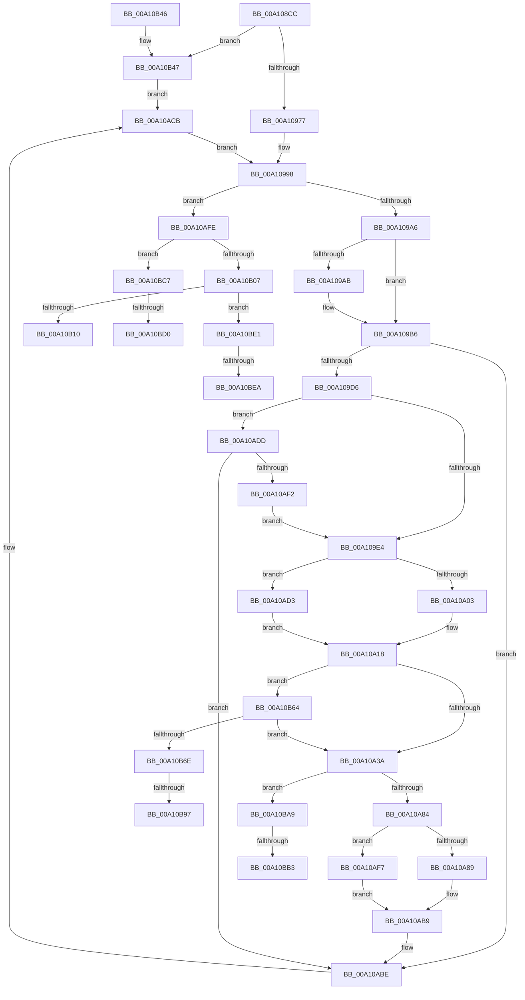

# DbgkpPostFakeThreadMessages

- RVA: `0x00A108CC`–`0x00A10BFB` (길이 `815` bytes)
- VA: `0x0000000140A108CC`
- 실행 섹션: `PAGE`
- PDB 이름 있음: `예`; PDB Function 태그: `예`
- unwind 정보 RVA: `0x000A92A8`
- 디코드: `191`개 명령, `815/815` bytes 표시
- 미해석 바이트: `0` (있으면 어셈블리에 `.byte`로 보존)

> 이 문서는 커널 이미지의 기계어와 PDB 기호를 분석해 생성했습니다. 4번과 5번은 함수 원형과 자료형을 바이너리 사용 방식에서 추정한 C 해석이며 원본 소스 복구 결과는 아닙니다.

## 1. Dependencies

- 직접 호출 지점: **18**; 고유 호출 대상: **12**
- 직접 호출자로 확인된 함수: **2**
- RIP 상대 이미지 참조: **1**

### Outgoing calls
- `0x00A1094B` → [memset](../../text/6C/memset_function_006C6C40.md) (function, `0x006C6C40`)
- `0x00A10993` → [ObfReferenceObjectWithTag](../../text/21/ObfReferenceObjectWithTag_function_00210710.md) (function, `0x00210710`)
- `0x00A109B1` → [ObfDereferenceObjectWithTag](../../text/2F/ObfDereferenceObjectWithTag_function_002F78E0.md) (function, `0x002F78E0`)
- `0x00A109C4` → [ObfReferenceObjectWithTag](../../text/21/ObfReferenceObjectWithTag_function_00210710.md) (function, `0x00210710`)
- `0x00A109F6` → [ExAcquireRundownProtection](../../text/21/ExAcquireRundownProtection_function_00216620.md) (function, `0x00216620`)
- `0x00A10A08` → [PsSuspendThread](PsSuspendThread_function_00A110D0.md) (function, `0x00A110D0`)
- `0x00A10A2C` → [memset](../../text/6C/memset_function_006C6C40.md) (function, `0x006C6C40`)
- `0x00A10A74` → [DbgkpQueueMessage](../8A/DbgkpQueueMessage_function_008A31C0.md) (function, `0x008A31C0`)
- `0x00A10A97` → [ObfReferenceObjectWithTag](../../text/21/ObfReferenceObjectWithTag_function_00210710.md) (function, `0x00210710`)
- `0x00A10AB4` → [DbgkSendSystemDllMessages](DbgkSendSystemDllMessages_function_00A10C04.md) (function, `0x00A10C04`)
- `0x00A10AC6` → [PsGetNextProcessThread](../8C/PsGetNextProcessThread_function_008C9CF0.md) (function, `0x008C9CF0`)
- `0x00A10AE3` → [PsSynchronizeWithThreadInsertion](PsSynchronizeWithThreadInsertion_function_00A111DC.md) (function, `0x00A111DC`)
- `0x00A10B2E` → [_security_check_cookie](../../text/6A/_security_check_cookie_function_006AC640.md) (function, `0x006AC640`)
- `0x00A10B4C` → [PsGetNextProcessThread](../8C/PsGetNextProcessThread_function_008C9CF0.md) (function, `0x008C9CF0`)
- `0x00A10B97` → [DbgkpSectionToFileHandle](../A9/DbgkpSectionToFileHandle_function_00A9AE08.md) (function, `0x00A9AE08`)
- `0x00A10BBC` → [PsMultiResumeThread](../../text/20/PsMultiResumeThread_function_002027C4.md) (function, `0x002027C4`)
- `0x00A10BD6` → [ObfDereferenceObjectWithTag](../../text/2F/ObfDereferenceObjectWithTag_function_002F78E0.md) (function, `0x002F78E0`)
- `0x00A10BF0` → [ObfDereferenceObjectWithTag](../../text/2F/ObfDereferenceObjectWithTag_function_002F78E0.md) (function, `0x002F78E0`)

### Direct callers
- [DbgkpPostFakeProcessCreateMessages](DbgkpPostFakeProcessCreateMessages_function_00A10780.md) at `0x00A107D4`
- [sub_00B36A42](../B3/Unknown_function_00B36A42.md) at `0x00B36AC4`

### Static image references
- `0x00A108E1` → RVA `0x00E0A740` (`.data`; read)

## 2. Other-region calls and transfers

- 다른 실행 섹션으로 향하는 call: **11**
  - `0x00A1094B` → [memset](../../text/6C/memset_function_006C6C40.md) (`PAGE` → `.text`)
  - `0x00A10993` → [ObfReferenceObjectWithTag](../../text/21/ObfReferenceObjectWithTag_function_00210710.md) (`PAGE` → `.text`)
  - `0x00A109B1` → [ObfDereferenceObjectWithTag](../../text/2F/ObfDereferenceObjectWithTag_function_002F78E0.md) (`PAGE` → `.text`)
  - `0x00A109C4` → [ObfReferenceObjectWithTag](../../text/21/ObfReferenceObjectWithTag_function_00210710.md) (`PAGE` → `.text`)
  - `0x00A109F6` → [ExAcquireRundownProtection](../../text/21/ExAcquireRundownProtection_function_00216620.md) (`PAGE` → `.text`)
  - `0x00A10A2C` → [memset](../../text/6C/memset_function_006C6C40.md) (`PAGE` → `.text`)
  - `0x00A10A97` → [ObfReferenceObjectWithTag](../../text/21/ObfReferenceObjectWithTag_function_00210710.md) (`PAGE` → `.text`)
  - `0x00A10B2E` → [_security_check_cookie](../../text/6A/_security_check_cookie_function_006AC640.md) (`PAGE` → `.text`)
  - `0x00A10BBC` → [PsMultiResumeThread](../../text/20/PsMultiResumeThread_function_002027C4.md) (`PAGE` → `.text`)
  - `0x00A10BD6` → [ObfDereferenceObjectWithTag](../../text/2F/ObfDereferenceObjectWithTag_function_002F78E0.md) (`PAGE` → `.text`)
  - `0x00A10BF0` → [ObfDereferenceObjectWithTag](../../text/2F/ObfDereferenceObjectWithTag_function_002F78E0.md) (`PAGE` → `.text`)
- call이 아닌 외부 분기/꼬리 이동: **8**
  - `0x00A10B91` → [sub_00B36B22](../B3/Unknown_function_00B36B22.md) (`tail-transfer`)
  - `0x00A10BA4` → [sub_00B36B22 + 0x9](../B3/Unknown_function_00B36B22.md) (`tail-transfer`)
  - `0x00A10BAD` → [sub_00B36B22 + 0xCD](../B3/Unknown_function_00B36B22.md) (`tail-transfer`)
  - `0x00A10BC2` → [sub_00B36B22 + 0xCD](../B3/Unknown_function_00B36B22.md) (`tail-transfer`)
  - `0x00A10BCA` → [sub_00B36B22 + 0x111](../B3/Unknown_function_00B36B22.md) (`tail-transfer`)
  - `0x00A10BDC` → [sub_00B36B22 + 0x111](../B3/Unknown_function_00B36B22.md) (`tail-transfer`)
  - `0x00A10BE4` → [sub_00B36B22 + 0x12B](../B3/Unknown_function_00B36B22.md) (`tail-transfer`)
  - `0x00A10BF6` → [sub_00B36B22 + 0x12B](../B3/Unknown_function_00B36B22.md) (`tail-transfer`)

## 3. Assembly (complete function range)

```asm
00A108CC  4C 8B DC                        mov r11, rsp
00A108CF  53                              push rbx
00A108D0  56                              push rsi
00A108D1  57                              push rdi
00A108D2  41 54                           push r12
00A108D4  41 55                           push r13
00A108D6  41 56                           push r14
00A108D8  41 57                           push r15
00A108DA  48 81 EC F0 01 00 00            sub rsp, 0x1f0
00A108E1  48 8B 05 58 9E 3F 00            mov rax, qword ptr [rip + 0x3f9e58]
00A108E8  48 33 C4                        xor rax, rsp
00A108EB  48 89 84 24 E0 01 00 00         mov qword ptr [rsp + 0x1e0], rax
00A108F3  4C 89 4C 24 60                  mov qword ptr [rsp + 0x60], r9
00A108F8  49 8B D8                        mov rbx, r8
00A108FB  48 89 54 24 48                  mov qword ptr [rsp + 0x48], rdx
00A10900  4C 8B F9                        mov r15, rcx
00A10903  48 89 4C 24 38                  mov qword ptr [rsp + 0x38], rcx
00A10908  48 89 4C 24 78                  mov qword ptr [rsp + 0x78], rcx
00A1090D  48 89 94 24 80 00 00 00         mov qword ptr [rsp + 0x80], rdx
00A10915  4C 89 8C 24 88 00 00 00         mov qword ptr [rsp + 0x88], r9
00A1091D  48 8B 84 24 50 02 00 00         mov rax, qword ptr [rsp + 0x250]
00A10925  48 89 44 24 68                  mov qword ptr [rsp + 0x68], rax
00A1092A  0F 57 C0                        xorps xmm0, xmm0
00A1092D  41 0F 11 43 88                  movups xmmword ptr [r11 - 0x78], xmm0
00A10932  41 0F 11 43 98                  movups xmmword ptr [r11 - 0x68], xmm0
00A10937  41 0F 11 43 A8                  movups xmmword ptr [r11 - 0x58], xmm0
00A1093C  33 D2                           xor edx, edx
00A1093E  41 B8 10 01 00 00               mov r8d, 0x110
00A10944  49 8D 8B 78 FE FF FF            lea rcx, [r11 - 0x188]
00A1094B  E8 F0 62 CB FF                  call 0x1406c6c40
00A10950  45 33 F6                        xor r14d, r14d
00A10953  4C 89 74 24 40                  mov qword ptr [rsp + 0x40], r14
00A10958  33 FF                           xor edi, edi
00A1095A  65 48 8B 34 25 88 01 00 00      mov rsi, qword ptr gs:[0x188]
00A10963  48 89 74 24 50                  mov qword ptr [rsp + 0x50], rsi
00A10968  41 BC 01 00 00 C0               mov r12d, 0xc0000001
00A1096E  48 85 DB                        test rbx, rbx
00A10971  0F 84 D0 01 00 00               je 0x140a10b47
00A10977  45 32 ED                        xor r13b, r13b
00A1097A  44 88 6C 24 30                  mov byte ptr [rsp + 0x30], r13b
00A1097F  4C 8B F3                        mov r14, rbx
00A10982  48 89 5C 24 40                  mov qword ptr [rsp + 0x40], rbx
00A10987  41 BF 44 62 67 4F               mov r15d, 0x4f676244
00A1098D  41 8B D7                        mov edx, r15d
00A10990  48 8B CB                        mov rcx, rbx
00A10993  E8 78 FD 7F FF                  call 0x140210710
00A10998  48 89 5C 24 58                  mov qword ptr [rsp + 0x58], rbx
00A1099D  48 85 DB                        test rbx, rbx
00A109A0  0F 84 58 01 00 00               je 0x140a10afe
00A109A6  48 85 FF                        test rdi, rdi
00A109A9  74 0B                           je 0x140a109b6
00A109AB  41 8B D7                        mov edx, r15d
00A109AE  48 8B CF                        mov rcx, rdi
00A109B1  E8 2A 6F 8E FF                  call 0x1402f78e0
00A109B6  48 8B FB                        mov rdi, rbx
00A109B9  48 89 5C 24 70                  mov qword ptr [rsp + 0x70], rbx
00A109BE  41 8B D7                        mov edx, r15d
00A109C1  48 8B CB                        mov rcx, rbx
00A109C4  E8 47 FD 7F FF                  call 0x140210710
00A109C9  F7 43 74 00 04 00 00            test dword ptr [rbx + 0x74], 0x400
00A109D0  0F 85 E8 00 00 00               jne 0x140a10abe
00A109D6  8B 83 A0 05 00 00               mov eax, dword ptr [rbx + 0x5a0]
00A109DC  A8 02                           test al, 2
00A109DE  0F 84 F9 00 00 00               je 0x140a10add
00A109E4  48 8D 83 88 05 00 00            lea rax, [rbx + 0x588]
00A109EB  48 89 84 24 90 00 00 00         mov qword ptr [rsp + 0x90], rax
00A109F3  48 8B C8                        mov rcx, rax
00A109F6  E8 25 5C 80 FF                  call 0x140216620
00A109FB  84 C0                           test al, al
00A109FD  0F 84 D0 00 00 00               je 0x140a10ad3
00A10A03  33 D2                           xor edx, edx
00A10A05  48 8B CB                        mov rcx, rbx
00A10A08  E8 C3 06 00 00                  call 0x140a110d0
00A10A0D  8B F0                           mov esi, eax
00A10A0F  C1 FE 1F                        sar esi, 0x1f
00A10A12  83 E6 E0                        and esi, 0xffffffe0
00A10A15  83 C6 2A                        add esi, 0x2a
00A10A18  89 74 24 34                     mov dword ptr [rsp + 0x34], esi
00A10A1C  33 D2                           xor edx, edx
00A10A1E  41 B8 10 01 00 00               mov r8d, 0x110
00A10A24  48 8D 8C 24 A0 00 00 00         lea rcx, [rsp + 0xa0]
00A10A2C  E8 0F 62 CB FF                  call 0x1406c6c40
00A10A31  45 84 ED                        test r13b, r13b
00A10A34  0F 85 2A 01 00 00               jne 0x140a10b64
00A10A3A  45 32 ED                        xor r13b, r13b
00A10A3D  C7 84 24 C8 00 00 00 01 00 00 00  mov dword ptr [rsp + 0xc8], 1
00A10A48  48 8B 83 60 05 00 00            mov rax, qword ptr [rbx + 0x560]
00A10A4F  48 89 84 24 D8 00 00 00         mov qword ptr [rsp + 0xd8], rax
00A10A57  48 8B 44 24 48                  mov rax, qword ptr [rsp + 0x48]
00A10A5C  48 89 44 24 20                  mov qword ptr [rsp + 0x20], rax
00A10A61  44 8B CE                        mov r9d, esi
00A10A64  4C 8D 84 24 A0 00 00 00         lea r8, [rsp + 0xa0]
00A10A6C  48 8B D3                        mov rdx, rbx
00A10A6F  48 8B 4C 24 38                  mov rcx, qword ptr [rsp + 0x38]
00A10A74  E8 47 27 E9 FF                  call 0x1408a31c0
00A10A79  44 8B E0                        mov r12d, eax
00A10A7C  85 C0                           test eax, eax
00A10A7E  0F 88 25 01 00 00               js 0x140a10ba9
00A10A84  45 84 ED                        test r13b, r13b
00A10A87  74 6E                           je 0x140a10af7
00A10A89  45 32 ED                        xor r13b, r13b
00A10A8C  44 88 6C 24 30                  mov byte ptr [rsp + 0x30], r13b
00A10A91  41 8B D7                        mov edx, r15d
00A10A94  48 8B CB                        mov rcx, rbx
00A10A97  E8 74 FC 7F FF                  call 0x140210710
00A10A9C  4C 8B F3                        mov r14, rbx
00A10A9F  48 89 5C 24 40                  mov qword ptr [rsp + 0x40], rbx
00A10AA4  4C 8D 84 24 A0 00 00 00         lea r8, [rsp + 0xa0]
00A10AAC  48 8B 54 24 48                  mov rdx, qword ptr [rsp + 0x48]
00A10AB1  48 8B CB                        mov rcx, rbx
00A10AB4  E8 4B 01 00 00                  call 0x140a10c04
00A10AB9  48 8B 74 24 50                  mov rsi, qword ptr [rsp + 0x50]
00A10ABE  48 8B D3                        mov rdx, rbx
00A10AC1  48 8B 4C 24 38                  mov rcx, qword ptr [rsp + 0x38]
00A10AC6  E8 25 92 EB FF                  call 0x1408c9cf0
00A10ACB  48 8B D8                        mov rbx, rax
00A10ACE  E9 C5 FE FF FF                  jmp 0x140a10998
00A10AD3  BE 12 00 00 00                  mov esi, 0x12
00A10AD8  E9 3B FF FF FF                  jmp 0x140a10a18
00A10ADD  48 8B D6                        mov rdx, rsi
00A10AE0  48 8B CB                        mov rcx, rbx
00A10AE3  E8 F4 06 00 00                  call 0x140a111dc
00A10AE8  8B 83 A0 05 00 00               mov eax, dword ptr [rbx + 0x5a0]
00A10AEE  A8 02                           test al, 2
00A10AF0  74 CC                           je 0x140a10abe
00A10AF2  E9 ED FE FF FF                  jmp 0x140a109e4
00A10AF7  44 8A 6C 24 30                  mov r13b, byte ptr [rsp + 0x30]
00A10AFC  EB BB                           jmp 0x140a10ab9
00A10AFE  45 85 E4                        test r12d, r12d
00A10B01  0F 88 C0 00 00 00               js 0x140a10bc7
00A10B07  4D 85 F6                        test r14, r14
00A10B0A  0F 84 D1 00 00 00               je 0x140a10be1
00A10B10  48 8B 44 24 60                  mov rax, qword ptr [rsp + 0x60]
00A10B15  4C 89 30                        mov qword ptr [rax], r14
00A10B18  48 8B 44 24 68                  mov rax, qword ptr [rsp + 0x68]
00A10B1D  48 89 38                        mov qword ptr [rax], rdi
00A10B20  41 8B C4                        mov eax, r12d
00A10B23  48 8B 8C 24 E0 01 00 00         mov rcx, qword ptr [rsp + 0x1e0]
00A10B2B  48 33 CC                        xor rcx, rsp
00A10B2E  E8 0D BB C9 FF                  call 0x1406ac640
00A10B33  48 81 C4 F0 01 00 00            add rsp, 0x1f0
00A10B3A  41 5F                           pop r15
00A10B3C  41 5E                           pop r14
00A10B3E  41 5D                           pop r13
00A10B40  41 5C                           pop r12
00A10B42  5F                              pop rdi
00A10B43  5E                              pop rsi
00A10B44  5B                              pop rbx
00A10B45  C3                              ret
00A10B46  CC                              int3
00A10B47  33 D2                           xor edx, edx
00A10B49  49 8B CF                        mov rcx, r15
00A10B4C  E8 9F 91 EB FF                  call 0x1408c9cf0
00A10B51  41 B5 01                        mov r13b, 1
00A10B54  44 88 6C 24 30                  mov byte ptr [rsp + 0x30], r13b
00A10B59  41 BF 44 62 67 4F               mov r15d, 0x4f676244
00A10B5F  E9 67 FF FF FF                  jmp 0x140a10acb
00A10B64  40 F6 C6 10                     test sil, 0x10
00A10B68  0F 85 CC FE FF FF               jne 0x140a10a3a
00A10B6E  41 B5 01                        mov r13b, 1
00A10B71  44 88 6C 24 31                  mov byte ptr [rsp + 0x31], r13b
00A10B76  C7 84 24 C8 00 00 00 02 00 00 00  mov dword ptr [rsp + 0xc8], 2
00A10B81  4C 8B 64 24 38                  mov r12, qword ptr [rsp + 0x38]
00A10B86  49 8B 8C 24 A8 02 00 00         mov rcx, qword ptr [r12 + 0x2a8]
00A10B8E  48 85 C9                        test rcx, rcx
00A10B91  0F 84 8B 5F 12 00               je 0x140b36b22
00A10B97  E8 6C A2 08 00                  call 0x140a9ae08
00A10B9C  48 89 84 24 D8 00 00 00         mov qword ptr [rsp + 0xd8], rax
00A10BA4  E9 82 5F 12 00                  jmp 0x140b36b2b
00A10BA9  40 F6 C6 20                     test sil, 0x20
00A10BAD  0F 84 3C 60 12 00               je 0x140b36bef
00A10BB3  33 D2                           xor edx, edx
00A10BB5  44 8D 42 01                     lea r8d, [rdx + 1]
00A10BB9  48 8B CB                        mov rcx, rbx
00A10BBC  E8 03 1C 7F FF                  call 0x1402027c4
00A10BC1  90                              nop
00A10BC2  E9 28 60 12 00                  jmp 0x140b36bef
00A10BC7  4D 85 F6                        test r14, r14
00A10BCA  0F 84 63 60 12 00               je 0x140b36c33
00A10BD0  41 8B D7                        mov edx, r15d
00A10BD3  49 8B CE                        mov rcx, r14
00A10BD6  E8 05 6D 8E FF                  call 0x1402f78e0
00A10BDB  90                              nop
00A10BDC  E9 52 60 12 00                  jmp 0x140b36c33
00A10BE1  48 85 FF                        test rdi, rdi
00A10BE4  0F 84 63 60 12 00               je 0x140b36c4d
00A10BEA  41 8B D7                        mov edx, r15d
00A10BED  48 8B CF                        mov rcx, rdi
00A10BF0  E8 EB 6C 8E FF                  call 0x1402f78e0
00A10BF5  90                              nop
00A10BF6  E9 52 60 12 00                  jmp 0x140b36c4d
```

## 4. C-style interpretation (structured pseudocode)

```c
__int64 __fastcall DbgkpPostFakeThreadMessages(__int64 a1, __int64 a2, __int64 a3, __int64 a4, __int64 a5)
{
    __int64 result;
    __int64 v_r13;
    __int64 v_r14;
    __int64 v_rdi;
    __int64 v_rsi;
    __int64 v_rsp;
    unsigned __int64 v_stack_m150;
    unsigned int v_stack_m160;
    unsigned __int64 v_stack_m188;
    unsigned __int64 v_stack_m198;
    unsigned __int64 v_stack_m1A0;
    unsigned __int64 v_stack_m1A8;
    unsigned __int64 v_stack_m1B0;
    unsigned __int64 v_stack_m1B8;
    unsigned __int64 v_stack_m1C0;
    unsigned __int64 v_stack_m1C8;
    unsigned __int64 v_stack_m1D0;
    unsigned __int64 v_stack_m1D8;
    unsigned __int64 v_stack_m1E0;
    unsigned __int64 v_stack_m1E8;
    unsigned __int64 v_stack_m1F0;
    unsigned int v_stack_m1F4;
    unsigned __int8 v_stack_m1F8;
    unsigned __int64 v_stack_m208;
    unsigned __int64 v_stack_m48;
    unsigned __int8 v_stack_p30;
    unsigned __int8 v_stack_p31;
    unsigned __int64 v_stack_p38;
    unsigned int v_stack_pC8;
    unsigned __int64 v_stack_pD8;

    v_rsp = (v_rsp) - (496);
    result = (*(unsigned __int64 *)(v_rip + 4169304)) ^ (v_rsp);
    v_stack_m48 = result;
    v_stack_m1C8 = a4;
    v_stack_m1E0 = a2;
    v_stack_m1F0 = a1;
    v_stack_m1B0 = a1;
    v_stack_m1A8 = a2;
    v_stack_m1A0 = a4;
    v_stack_m1C0 = a5;
    *(unsigned __int64 *)(v_rsp - 120) = v_xmm0;
    *(unsigned __int64 *)(v_rsp - 104) = v_xmm0;
    *(unsigned __int64 *)(v_rsp - 88) = v_xmm0;
    a2 = 0;
    result = memset(v_rsp - 392, a2, 272, a4);
    v_r14 = 0;
    v_stack_m1E8 = 0;
    v_rdi = 0;
    v_stack_m1D8 = *(unsigned __int64 *)(gs_base + (0 + 392));
    if (a3 == 0) goto loc_00A10B47;
    v_r13 = 0;
    v_stack_m1F8 = 0;
    v_stack_m1E8 = a3;
    result = ObfReferenceObjectWithTag(a3, (unsigned int)((unsigned int)((unsigned int)(0x4F676244ULL))), 272, a4);
loc_00A10998:
    v_stack_m1D0 = a3;
    if (a3 == 0) goto loc_00A10AFE;
    if (0 != 0) {
        a2 = (unsigned int)((unsigned int)(0x4F676244ULL));
        a1 = 0;
        result = ObfDereferenceObjectWithTag(a1, a2, 272, a4);
    }
    v_stack_m1B8 = a3;
    result = ObfReferenceObjectWithTag(a3, (unsigned int)((unsigned int)((unsigned int)(0x4F676244ULL))), 272, a4);
    if (((*(unsigned int *)(a3 + 116)) & (0x400ULL)) != 0) goto loc_00A10ABE;
    if ((((unsigned __int8)((unsigned int)(*(unsigned int *)(a3 + 1440)))) & (2)) == 0) goto loc_00A10ADD;
loc_00A109E4:
    v_stack_m198 = a3 + 1416;
    result = ExAcquireRundownProtection(a3 + 1416, (unsigned int)((unsigned int)((unsigned int)(0x4F676244ULL))), 272, a4);
    if ((unsigned __int8)(result) == 0) goto loc_00A10AD3;
    a2 = 0;
    result = PsSuspendThread(a3, a2, 272, a4);
    v_rsi = (unsigned int)(((unsigned int)((unsigned int)(result))) >> (31));
    v_rsi = (unsigned int)((v_rsi) & (0xFFFFFFE0ULL));
    v_rsi = (unsigned int)((v_rsi) + (42));
loc_00A10A18:
    v_stack_m1F4 = (unsigned int)(v_rsi);
    a2 = 0;
    result = memset(v_stack_m188, a2, 272, a4);
    if (0 != 0) goto loc_00A10B64;
loc_00A10A3A:
    v_r13 = 0;
    v_stack_m160 = 1;
    v_stack_m150 = *(unsigned __int64 *)(a3 + 1376);
    v_stack_m208 = v_stack_m1E0;
    result = DbgkpQueueMessage(v_stack_m1F0, a3, v_stack_m188, (unsigned int)((unsigned int)(v_rsi)));
    if (sign_flag) goto loc_00A10BA9;
    if (0 == 0) goto loc_00A10AF7;
    v_r13 = 0;
    v_stack_m1F8 = 0;
    result = ObfReferenceObjectWithTag(a3, (unsigned int)((unsigned int)((unsigned int)(0x4F676244ULL))), v_stack_m188, (unsigned int)((unsigned int)(v_rsi)));
    v_stack_m1E8 = a3;
    result = DbgkSendSystemDllMessages(a3, v_stack_m1E0, v_stack_m188, (unsigned int)((unsigned int)(v_rsi)));
loc_00A10AB9:
loc_00A10ABE:
    result = PsGetNextProcessThread(v_stack_m1F0, a3, v_stack_m188, (unsigned int)((unsigned int)(v_rsi)));
loc_00A10ACB:
    goto loc_00A10998;
loc_00A10AD3:
    goto loc_00A10A18;
loc_00A10ADD:
    result = PsSynchronizeWithThreadInsertion(result, 18, v_stack_m188, (unsigned int)((unsigned int)(v_rsi)));
    if ((((unsigned __int8)((unsigned int)(*(unsigned int *)(result + 1440)))) & (2)) == 0) goto loc_00A10ABE;
    goto loc_00A109E4;
loc_00A10AF7:
    goto loc_00A10AB9;
loc_00A10AFE:
    if (sign_flag) goto loc_00A10BC7;
    if (a3 == 0) goto loc_00A10BE1;
    *(unsigned __int64 *)(v_stack_m1C8) = a3;
    *(unsigned __int64 *)(v_stack_m1C0) = a3;
    a1 = (v_stack_m48) ^ (v_rsp);
    result = _security_check_cookie(a1, 18, v_stack_m188, (unsigned int)((unsigned int)(v_rsi)));
    v_rsp = (v_rsp) + (496);
    return result;
loc_00A10B47:
    a2 = 0;
    result = PsGetNextProcessThread((unsigned int)(0x4F676244ULL), a2, v_stack_m188, (unsigned int)((unsigned int)(v_rsi)));
    v_stack_p30 = 1;
    goto loc_00A10ACB;
loc_00A10B64:
    if (((18) & (16)) != 0) goto loc_00A10A3A;
    v_stack_p31 = 1;
    v_stack_pC8 = 2;
    result = DbgkpSectionToFileHandle(*(unsigned __int64 *)(v_stack_p38 + 680), a2, v_stack_m188, (unsigned int)((unsigned int)(v_rsi)));
    v_stack_pD8 = result;
loc_00A10BA9:
    a2 = 0;
    result = PsMultiResumeThread(result, a2, a2 + 1, (unsigned int)((unsigned int)(v_rsi)));
loc_00A10BC7:
    result = ObfDereferenceObjectWithTag(a3, (unsigned int)((unsigned int)((unsigned int)(0x4F676244ULL))), a2 + 1, (unsigned int)((unsigned int)(v_rsi)));
loc_00A10BE1:
    result = ObfDereferenceObjectWithTag(a3, (unsigned int)((unsigned int)((unsigned int)(0x4F676244ULL))), a2 + 1, (unsigned int)((unsigned int)(v_rsi)));
}
```

## 5. (Beta) C Style

```c
int64_t DbgkpPostFakeThreadMessages(int64_t Arg1, int64_t Arg2, int64_t Arg3, int64_t Arg4, int64_t Arg5)
{
    int64_t result;
    int64_t local_r13;
    int64_t local_r14;
    int64_t local_rdi;
    int64_t local_rsi;
    int64_t local_rsp;
    uint64_t v_stack_m150;
    uint32_t v_stack_m160;
    uint64_t v_stack_m188;
    uint64_t v_stack_m198;
    uint64_t v_stack_m1A0;
    uint64_t v_stack_m1A8;
    uint64_t v_stack_m1B0;
    uint64_t v_stack_m1B8;
    uint64_t v_stack_m1C0;
    uint64_t v_stack_m1C8;
    uint64_t v_stack_m1D0;
    uint64_t v_stack_m1D8;
    uint64_t v_stack_m1E0;
    uint64_t v_stack_m1E8;
    uint64_t v_stack_m1F0;
    uint32_t v_stack_m1F4;
    uint8_t v_stack_m1F8;
    uint64_t v_stack_m208;
    uint64_t v_stack_m48;
    uint8_t v_stack_p30;
    uint8_t v_stack_p31;
    uint64_t v_stack_p38;
    uint32_t v_stack_pC8;
    uint64_t v_stack_pD8;

    local_rsp = (local_rsp) - (496);
    result = (*(uint64_t *)(v_rip + 0x3F9E58)) ^ (local_rsp);
    v_stack_m48 = result;
    v_stack_m1C8 = Arg4;
    v_stack_m1E0 = Arg2;
    v_stack_m1F0 = Arg1;
    v_stack_m1B0 = Arg1;
    v_stack_m1A8 = Arg2;
    v_stack_m1A0 = Arg4;
    v_stack_m1C0 = Arg5;
    *(uint64_t *)(local_rsp - 0x78) = v_xmm0;
    *(uint64_t *)(local_rsp - 0x68) = v_xmm0;
    *(uint64_t *)(local_rsp - 0x58) = v_xmm0;
    Arg2 = 0;
    result = memset(local_rsp - 392, Arg2, 272, Arg4);
    local_r14 = 0;
    v_stack_m1E8 = 0;
    local_rdi = 0;
    v_stack_m1D8 = *(uint64_t *)(gs_base + (0 + 0x188));
    if (Arg3 == 0) goto loc_00A10B47;
    local_r13 = 0;
    v_stack_m1F8 = 0;
    v_stack_m1E8 = Arg3;
    result = ObfReferenceObjectWithTag(Arg3, (uint32_t)((uint32_t)((uint32_t)(0x4F676244ULL))), 272, Arg4);
loc_00A10998:
    v_stack_m1D0 = Arg3;
    if (Arg3 == 0) goto loc_00A10AFE;
    if (0 != 0) {
        Arg2 = (uint32_t)((uint32_t)(0x4F676244ULL));
        Arg1 = 0;
        result = ObfDereferenceObjectWithTag(Arg1, Arg2, 272, Arg4);
    }
    v_stack_m1B8 = Arg3;
    result = ObfReferenceObjectWithTag(Arg3, (uint32_t)((uint32_t)((uint32_t)(0x4F676244ULL))), 272, Arg4);
    if (((*(uint32_t *)(Arg3 + 0x74)) & (0x400ULL)) != 0) goto loc_00A10ABE;
    if ((((uint8_t)((uint32_t)(*(uint32_t *)(Arg3 + 0x5A0)))) & (2)) == 0) goto loc_00A10ADD;
loc_00A109E4:
    v_stack_m198 = Arg3 + 1416;
    result = ExAcquireRundownProtection(Arg3 + 1416, (uint32_t)((uint32_t)((uint32_t)(0x4F676244ULL))), 272, Arg4);
    if ((uint8_t)(result) == 0) goto loc_00A10AD3;
    Arg2 = 0;
    result = PsSuspendThread(Arg3, Arg2, 272, Arg4);
    local_rsi = (uint32_t)(((uint32_t)((uint32_t)(result))) >> (31));
    local_rsi = (uint32_t)((local_rsi) & (0xFFFFFFE0ULL));
    local_rsi = (uint32_t)((local_rsi) + (42));
loc_00A10A18:
    v_stack_m1F4 = (uint32_t)(local_rsi);
    Arg2 = 0;
    result = memset(v_stack_m188, Arg2, 272, Arg4);
    if (0 != 0) goto loc_00A10B64;
loc_00A10A3A:
    local_r13 = 0;
    v_stack_m160 = 1;
    v_stack_m150 = *(uint64_t *)(Arg3 + 0x560);
    v_stack_m208 = v_stack_m1E0;
    result = DbgkpQueueMessage(v_stack_m1F0, Arg3, v_stack_m188, (uint32_t)((uint32_t)(local_rsi)));
    if (sign_flag) goto loc_00A10BA9;
    if (0 == 0) goto loc_00A10AF7;
    local_r13 = 0;
    v_stack_m1F8 = 0;
    result = ObfReferenceObjectWithTag(Arg3, (uint32_t)((uint32_t)((uint32_t)(0x4F676244ULL))), v_stack_m188, (uint32_t)((uint32_t)(local_rsi)));
    v_stack_m1E8 = Arg3;
    result = DbgkSendSystemDllMessages(Arg3, v_stack_m1E0, v_stack_m188, (uint32_t)((uint32_t)(local_rsi)));
loc_00A10AB9:
loc_00A10ABE:
    result = PsGetNextProcessThread(v_stack_m1F0, Arg3, v_stack_m188, (uint32_t)((uint32_t)(local_rsi)));
loc_00A10ACB:
    goto loc_00A10998;
loc_00A10AD3:
    goto loc_00A10A18;
loc_00A10ADD:
    result = PsSynchronizeWithThreadInsertion(result, 18, v_stack_m188, (uint32_t)((uint32_t)(local_rsi)));
    if ((((uint8_t)((uint32_t)(*(uint32_t *)(result + 0x5A0)))) & (2)) == 0) goto loc_00A10ABE;
    goto loc_00A109E4;
loc_00A10AF7:
    goto loc_00A10AB9;
loc_00A10AFE:
    if (sign_flag) goto loc_00A10BC7;
    if (Arg3 == 0) goto loc_00A10BE1;
    *(uint64_t *)(v_stack_m1C8) = Arg3;
    *(uint64_t *)(v_stack_m1C0) = Arg3;
    Arg1 = (v_stack_m48) ^ (local_rsp);
    result = _security_check_cookie(Arg1, 18, v_stack_m188, (uint32_t)((uint32_t)(local_rsi)));
    local_rsp = (local_rsp) + (496);
    return result;
loc_00A10B47:
    Arg2 = 0;
    result = PsGetNextProcessThread((uint32_t)(0x4F676244ULL), Arg2, v_stack_m188, (uint32_t)((uint32_t)(local_rsi)));
    v_stack_p30 = 1;
    goto loc_00A10ACB;
loc_00A10B64:
    if (((18) & (16)) != 0) goto loc_00A10A3A;
    v_stack_p31 = 1;
    v_stack_pC8 = 2;
    result = DbgkpSectionToFileHandle(*(uint64_t *)(v_stack_p38 + 0x2A8), Arg2, v_stack_m188, (uint32_t)((uint32_t)(local_rsi)));
    v_stack_pD8 = result;
loc_00A10BA9:
    Arg2 = 0;
    result = PsMultiResumeThread(result, Arg2, Arg2 + 1, (uint32_t)((uint32_t)(local_rsi)));
loc_00A10BC7:
    result = ObfDereferenceObjectWithTag(Arg3, (uint32_t)((uint32_t)((uint32_t)(0x4F676244ULL))), Arg2 + 1, (uint32_t)((uint32_t)(local_rsi)));
loc_00A10BE1:
    result = ObfDereferenceObjectWithTag(Arg3, (uint32_t)((uint32_t)((uint32_t)(0x4F676244ULL))), Arg2 + 1, (uint32_t)((uint32_t)(local_rsi)));
}
```

## 6. Execution-region graph

[열기: 2D/3D 그래프와 함수 탐색 컨트롤 패널](../../../control-panel.html?section=page&rva=0x00A108CC&view=graph)

- 2D 그래프는 위에서 아래로 흐르고, 3D 그래프는 빈 공간을 드래그해 회전합니다. Shift+드래그는 이동, 휠은 확대·축소, 함수 노드 선택은 대상 보고서 이동입니다.

### Static fallback


