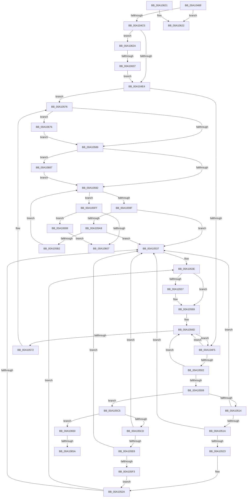

# DbgkpSetProcessDebugObject

- RVA: `0x00A10468`–`0x00A106A6` (길이 `574` bytes)
- VA: `0x0000000140A10468`
- 실행 섹션: `PAGE`
- PDB 이름 있음: `예`; PDB Function 태그: `예`
- unwind 정보 RVA: `0x000A9254`
- 디코드: `155`개 명령, `574/574` bytes 표시
- 미해석 바이트: `0` (있으면 어셈블리에 `.byte`로 보존)

> 이 문서는 커널 이미지의 기계어와 PDB 기호를 분석해 생성했습니다. 4번과 5번은 함수 원형과 자료형을 바이너리 사용 방식에서 추정한 C 해석이며 원본 소스 복구 결과는 아닙니다.

## 1. Dependencies

- 직접 호출 지점: **9**; 고유 호출 대상: **8**
- 직접 호출자로 확인된 함수: **1**
- RIP 상대 이미지 참조: **1**

### Outgoing calls
- `0x00A104D7` → [ExAcquireFastMutex](../../text/20/ExAcquireFastMutex_function_0020E5A0.md) (function, `0x0020E5A0`)
- `0x00A10564` → [ExReleaseRundownProtection](../../text/34/ExReleaseRundownProtection_function_00349E80.md) (function, `0x00349E80`)
- `0x00A1057A` → [ExReleaseFastMutex](../../text/25/ExReleaseFastMutex_function_002519C0.md) (function, `0x002519C0`)
- `0x00A105BE` → [DbgkpWakeTarget](DbgkpWakeTarget_function_00A106AC.md) (function, `0x00A106AC`)
- `0x00A10642` → [ObfReferenceObject](../../text/20/ObfReferenceObject_function_0020FA20.md) (function, `0x0020FA20`)
- `0x00A10668` → [KeSetEvent](../../text/33/KeSetEvent_function_0033F310.md) (function, `0x0033F310`)
- `0x00A1067D` → [ExReleaseFastMutex](../../text/25/ExReleaseFastMutex_function_002519C0.md) (function, `0x002519C0`)
- `0x00A1068F` → [ObfDereferenceObjectWithTag](../../text/2F/ObfDereferenceObjectWithTag_function_002F78E0.md) (function, `0x002F78E0`)
- `0x00A1069C` → [DbgkpMarkProcessPeb](../AC/DbgkpMarkProcessPeb_function_00AC8D0C.md) (function, `0x00AC8D0C`)

### Direct callers
- [NtDebugActiveProcess](../A0/NtDebugActiveProcess_function_00A0FC60.md) at `0x00A0FDA3`

### Static image references
- `0x00A10676` → RVA `0x00F8F220` (`.data`; read)

## 2. Other-region calls and transfers

- 다른 실행 섹션으로 향하는 call: **7**
  - `0x00A104D7` → [ExAcquireFastMutex](../../text/20/ExAcquireFastMutex_function_0020E5A0.md) (`PAGE` → `.text`)
  - `0x00A10564` → [ExReleaseRundownProtection](../../text/34/ExReleaseRundownProtection_function_00349E80.md) (`PAGE` → `.text`)
  - `0x00A1057A` → [ExReleaseFastMutex](../../text/25/ExReleaseFastMutex_function_002519C0.md) (`PAGE` → `.text`)
  - `0x00A10642` → [ObfReferenceObject](../../text/20/ObfReferenceObject_function_0020FA20.md) (`PAGE` → `.text`)
  - `0x00A10668` → [KeSetEvent](../../text/33/KeSetEvent_function_0033F310.md) (`PAGE` → `.text`)
  - `0x00A1067D` → [ExReleaseFastMutex](../../text/25/ExReleaseFastMutex_function_002519C0.md) (`PAGE` → `.text`)
  - `0x00A1068F` → [ObfDereferenceObjectWithTag](../../text/2F/ObfDereferenceObjectWithTag_function_002F78E0.md) (`PAGE` → `.text`)
- call이 아닌 외부 분기/꼬리 이동: **4**
  - `0x00A10625` → [sub_00B36A42](../B3/Unknown_function_00B36A42.md) (`tail-transfer`)
  - `0x00A10631` → [sub_00B36A42 + 0xBC](../B3/Unknown_function_00B36A42.md) (`tail-transfer`)
  - `0x00A10654` → [sub_00B36A42 + 0xCD](../B3/Unknown_function_00B36A42.md) (`tail-transfer`)
  - `0x00A10671` → [sub_00B36A42 + 0xCD](../B3/Unknown_function_00B36A42.md) (`tail-transfer`)

## 3. Assembly (complete function range)

```asm
00A10468  48 89 5C 24 08                  mov qword ptr [rsp + 8], rbx
00A1046D  4C 89 4C 24 20                  mov qword ptr [rsp + 0x20], r9
00A10472  55                              push rbp
00A10473  56                              push rsi
00A10474  57                              push rdi
00A10475  41 54                           push r12
00A10477  41 55                           push r13
00A10479  41 56                           push r14
00A1047B  41 57                           push r15
00A1047D  48 8B EC                        mov rbp, rsp
00A10480  48 83 EC 60                     sub rsp, 0x60
00A10484  65 4C 8B 2C 25 88 01 00 00      mov r13, qword ptr gs:[0x188]
00A1048D  48 8D 45 E8                     lea rax, [rbp - 0x18]
00A10491  45 33 E4                        xor r12d, r12d
00A10494  48 89 45 F0                     mov qword ptr [rbp - 0x10], rax
00A10498  4C 89 65 D0                     mov qword ptr [rbp - 0x30], r12
00A1049C  48 8D 45 E8                     lea rax, [rbp - 0x18]
00A104A0  48 89 45 E8                     mov qword ptr [rbp - 0x18], rax
00A104A4  41 B6 01                        mov r14b, 1
00A104A7  4C 89 6D D8                     mov qword ptr [rbp - 0x28], r13
00A104AB  41 8B F8                        mov edi, r8d
00A104AE  44 88 75 48                     mov byte ptr [rbp + 0x48], r14b
00A104B2  4C 8B FA                        mov r15, rdx
00A104B5  44 88 65 50                     mov byte ptr [rbp + 0x50], r12b
00A104B9  48 8B F1                        mov rsi, rcx
00A104BC  45 85 C0                        test r8d, r8d
00A104BF  0F 89 5D 01 00 00               jns 0x140a10622
00A104C5  41 8B DC                        mov ebx, r12d
00A104C8  48 89 5D 58                     mov qword ptr [rbp + 0x58], rbx
00A104CC  49 8D 47 18                     lea rax, [r15 + 0x18]
00A104D0  48 8B C8                        mov rcx, rax
00A104D3  48 89 45 E0                     mov qword ptr [rbp - 0x20], rax
00A104D7  E8 C4 E0 7F FF                  call 0x14020e5a0
00A104DC  85 FF                           test edi, edi
00A104DE  0F 89 46 01 00 00               jns 0x140a1062a
00A104E4  4D 8D 67 50                     lea r12, [r15 + 0x50]
00A104E8  4D 8B 34 24                     mov r14, qword ptr [r12]
00A104EC  4D 3B F4                        cmp r14, r12
00A104EF  0F 84 81 00 00 00               je 0x140a10576
00A104F5  49 8B DE                        mov rbx, r14
00A104F8  4D 8B 36                        mov r14, qword ptr [r14]
00A104FB  8B 43 4C                        mov eax, dword ptr [rbx + 0x4c]
00A104FE  A8 04                           test al, 4
00A10500  74 6B                           je 0x140a1056d
00A10502  4C 39 6B 50                     cmp qword ptr [rbx + 0x50], r13
00A10506  75 65                           jne 0x140a1056d
00A10508  4C 8B 6B 40                     mov r13, qword ptr [rbx + 0x40]
00A1050C  85 FF                           test edi, edi
00A1050E  0F 89 B1 00 00 00               jns 0x140a105c5
00A10514  49 39 5E 08                     cmp qword ptr [r14 + 8], rbx
00A10518  75 1D                           jne 0x140a10537
00A1051A  48 8B 43 08                     mov rax, qword ptr [rbx + 8]
00A1051E  48 39 18                        cmp qword ptr [rax], rbx
00A10521  75 14                           jne 0x140a10537
00A10523  4C 89 30                        mov qword ptr [rax], r14
00A10526  49 89 46 08                     mov qword ptr [r14 + 8], rax
00A1052A  48 8B 45 F0                     mov rax, qword ptr [rbp - 0x10]
00A1052E  48 8D 4D E8                     lea rcx, [rbp - 0x18]
00A10532  48 39 08                        cmp qword ptr [rax], rcx
00A10535  74 07                           je 0x140a1053e
00A10537  B9 03 00 00 00                  mov ecx, 3
00A1053C  CD 29                           int 0x29
00A1053E  48 8D 4D E8                     lea rcx, [rbp - 0x18]
00A10542  48 89 0B                        mov qword ptr [rbx], rcx
00A10545  48 89 43 08                     mov qword ptr [rbx + 8], rax
00A10549  48 89 18                        mov qword ptr [rax], rbx
00A1054C  48 89 5D F0                     mov qword ptr [rbp - 0x10], rbx
00A10550  8B 43 4C                        mov eax, dword ptr [rbx + 0x4c]
00A10553  A8 08                           test al, 8
00A10555  74 12                           je 0x140a10569
00A10557  83 E0 F7                        and eax, 0xfffffff7
00A1055A  49 8D 8D 88 05 00 00            lea rcx, [r13 + 0x588]
00A10561  89 43 4C                        mov dword ptr [rbx + 0x4c], eax
00A10564  E8 17 99 93 FF                  call 0x140349e80
00A10569  4C 8B 6D D8                     mov r13, qword ptr [rbp - 0x28]
00A1056D  4D 3B F4                        cmp r14, r12
00A10570  75 83                           jne 0x140a104f5
00A10572  48 8B 5D 58                     mov rbx, qword ptr [rbp + 0x58]
00A10576  48 8B 4D E0                     mov rcx, qword ptr [rbp - 0x20]
00A1057A  E8 41 14 84 FF                  call 0x1402519c0
00A1057F  80 7D 50 00                     cmp byte ptr [rbp + 0x50], 0
00A10583  0F 85 ED 00 00 00               jne 0x140a10676
00A10589  48 85 DB                        test rbx, rbx
00A1058C  0F 85 F5 00 00 00               jne 0x140a10687
00A10592  48 8B 4D E8                     mov rcx, qword ptr [rbp - 0x18]
00A10596  48 8D 45 E8                     lea rax, [rbp - 0x18]
00A1059A  48 3B C8                        cmp rcx, rax
00A1059D  74 60                           je 0x140a105ff
00A1059F  48 8D 45 E8                     lea rax, [rbp - 0x18]
00A105A3  48 39 41 08                     cmp qword ptr [rcx + 8], rax
00A105A7  75 8E                           jne 0x140a10537
00A105A9  48 8B 01                        mov rax, qword ptr [rcx]
00A105AC  48 39 48 08                     cmp qword ptr [rax + 8], rcx
00A105B0  75 85                           jne 0x140a10537
00A105B2  48 8D 55 E8                     lea rdx, [rbp - 0x18]
00A105B6  48 89 45 E8                     mov qword ptr [rbp - 0x18], rax
00A105BA  48 89 50 08                     mov qword ptr [rax + 8], rdx
00A105BE  E8 E9 00 00 00                  call 0x140a106ac
00A105C3  EB CD                           jmp 0x140a10592
00A105C5  A8 10                           test al, 0x10
00A105C7  0F 84 83 00 00 00               je 0x140a10650
00A105CD  F0 41 81 8D A0 05 00 00 80 00 00 00  lock or dword ptr [r13 + 0x5a0], 0x80
00A105D9  48 8B 0B                        mov rcx, qword ptr [rbx]
00A105DC  48 39 59 08                     cmp qword ptr [rcx + 8], rbx
00A105E0  0F 85 51 FF FF FF               jne 0x140a10537
00A105E6  48 8B 43 08                     mov rax, qword ptr [rbx + 8]
00A105EA  48 39 18                        cmp qword ptr [rax], rbx
00A105ED  0F 85 44 FF FF FF               jne 0x140a10537
00A105F3  48 89 08                        mov qword ptr [rax], rcx
00A105F6  48 89 41 08                     mov qword ptr [rcx + 8], rax
00A105FA  E9 2B FF FF FF                  jmp 0x140a1052a
00A105FF  85 FF                           test edi, edi
00A10601  0F 89 92 00 00 00               jns 0x140a10699
00A10607  48 8B 9C 24 A0 00 00 00         mov rbx, qword ptr [rsp + 0xa0]
00A1060F  8B C7                           mov eax, edi
00A10611  48 83 C4 60                     add rsp, 0x60
00A10615  41 5F                           pop r15
00A10617  41 5E                           pop r14
00A10619  41 5D                           pop r13
00A1061B  41 5C                           pop r12
00A1061D  5F                              pop rdi
00A1061E  5E                              pop rsi
00A1061F  5D                              pop rbp
00A10620  C3                              ret
00A10621  CC                              int3
00A10622  41 8B FC                        mov edi, r12d
00A10625  E9 18 64 12 00                  jmp 0x140b36a42
00A1062A  41 8B 47 60                     mov eax, dword ptr [r15 + 0x60]
00A1062E  41 84 C6                        test r14b, al
00A10631  0F 85 C7 64 12 00               jne 0x140b36afe
00A10637  F0 83 8E F4 01 00 00 03         lock or dword ptr [rsi + 0x1f4], 3
00A1063F  49 8B CF                        mov rcx, r15
00A10642  E8 D9 F3 7F FF                  call 0x14020fa20
00A10647  48 8B 5D 58                     mov rbx, qword ptr [rbp + 0x58]
00A1064B  E9 94 FE FF FF                  jmp 0x140a104e4
00A10650  80 7D 48 00                     cmp byte ptr [rbp + 0x48], 0
00A10654  0F 84 B5 64 12 00               je 0x140b36b0f
00A1065A  83 E0 FB                        and eax, 0xfffffffb
00A1065D  45 33 C0                        xor r8d, r8d
00A10660  33 D2                           xor edx, edx
00A10662  89 43 4C                        mov dword ptr [rbx + 0x4c], eax
00A10665  49 8B CF                        mov rcx, r15
00A10668  E8 A3 EC 92 FF                  call 0x14033f310
00A1066D  C6 45 48 00                     mov byte ptr [rbp + 0x48], 0
00A10671  E9 99 64 12 00                  jmp 0x140b36b0f
00A10676  48 8D 0D A3 EB 57 00            lea rcx, [rip + 0x57eba3]
00A1067D  E8 3E 13 84 FF                  call 0x1402519c0
00A10682  E9 02 FF FF FF                  jmp 0x140a10589
00A10687  BA 44 62 67 4F                  mov edx, 0x4f676244
00A1068C  48 8B CB                        mov rcx, rbx
00A1068F  E8 4C 72 8E FF                  call 0x1402f78e0
00A10694  E9 F9 FE FF FF                  jmp 0x140a10592
00A10699  48 8B CE                        mov rcx, rsi
00A1069C  E8 6B 86 0B 00                  call 0x140ac8d0c
00A106A1  E9 61 FF FF FF                  jmp 0x140a10607
```

## 4. C-style interpretation (structured pseudocode)

```c
__int64 __fastcall DbgkpSetProcessDebugObject(__int64 a1, __int64 a2, int a3, __int64 a4)
{
    __int64 result;
    __int64 v_r12;
    __int64 v_rsp;
    unsigned __int64 v_stack_m48;
    unsigned __int64 v_stack_m50;
    unsigned __int64 v_stack_m58;
    unsigned __int64 v_stack_m60;
    unsigned __int64 v_stack_m68;
    unsigned __int8 v_stack_p10;
    unsigned __int8 v_stack_p18;
    unsigned __int64 v_stack_p20;
    unsigned __int64 v_stack_p8;

    v_stack_p8 = v_rbx;
    v_stack_p20 = a4;
    v_rsp = (v_rsp) - (96);
    v_r12 = 0;
    v_stack_m48 = v_stack_m50;
    v_stack_m68 = 0;
    v_stack_m50 = v_stack_m50;
    v_stack_m60 = *(unsigned __int64 *)(gs_base + (0 + 392));
    v_stack_p10 = 1;
    v_stack_p18 = 0;
    if (!sign_flag) goto loc_00A10622;
    v_stack_p20 = 0;
    v_stack_m58 = a2 + 24;
    result = ExAcquireFastMutex(a2 + 24, a2, a3, a4);
    if (!sign_flag) goto loc_00A1062A;
loc_00A104E4:
    if ((*(unsigned __int64 *)(a2 + 80)) == (a2 + 80)) goto loc_00A10576;
loc_00A104F5:
    if ((((unsigned __int8)((unsigned int)(*(unsigned int *)(*(unsigned __int64 *)(a2 + 80) + 76)))) & (4)) == 0) goto loc_00A1056D;
    if ((*(unsigned __int64 *)(*(unsigned __int64 *)(a2 + 80) + 80)) != (*(unsigned __int64 *)(gs_base + (0 + 392)))) goto loc_00A1056D;
    if (!sign_flag) goto loc_00A105C5;
    if ((*(unsigned __int64 *)(*(unsigned __int64 *)(*(unsigned __int64 *)(a2 + 80)) + 8)) != (*(unsigned __int64 *)(a2 + 80))) goto loc_00A10537;
    if ((*(unsigned __int64 *)(*(unsigned __int64 *)(*(unsigned __int64 *)(a2 + 80) + 8))) != (*(unsigned __int64 *)(a2 + 80))) goto loc_00A10537;
    *(unsigned __int64 *)(*(unsigned __int64 *)(*(unsigned __int64 *)(a2 + 80) + 8)) = *(unsigned __int64 *)(*(unsigned __int64 *)(a2 + 80));
    *(unsigned __int64 *)(*(unsigned __int64 *)(*(unsigned __int64 *)(a2 + 80)) + 8) = *(unsigned __int64 *)(*(unsigned __int64 *)(a2 + 80) + 8);
loc_00A1052A:
    if ((*(unsigned __int64 *)(v_stack_m48)) != v_stack_m50) {
        a1 = 3;
    }
    *(unsigned __int64 *)(*(unsigned __int64 *)(a2 + 80)) = v_stack_m50;
    *(unsigned __int64 *)(*(unsigned __int64 *)(a2 + 80) + 8) = v_stack_m48;
    *(unsigned __int64 *)(v_stack_m48) = *(unsigned __int64 *)(a2 + 80);
    v_stack_m48 = *(unsigned __int64 *)(a2 + 80);
    result = (unsigned int)(*(unsigned int *)(*(unsigned __int64 *)(a2 + 80) + 76));
    if ((((unsigned __int8)((unsigned int)(*(unsigned int *)(*(unsigned __int64 *)(a2 + 80) + 76)))) & (8)) != 0) {
        result = (unsigned int)(((unsigned int)(*(unsigned int *)(*(unsigned __int64 *)(a2 + 80) + 76))) & (0xFFFFFFF7ULL));
        a1 = *(unsigned __int64 *)(*(unsigned __int64 *)(a2 + 80) + 64) + 1416;
        *(unsigned int *)(*(unsigned __int64 *)(a2 + 80) + 76) = (unsigned int)(result);
        result = ExReleaseRundownProtection(a1, a2, a3, a4);
    }
loc_00A1056D:
    if ((*(unsigned __int64 *)(*(unsigned __int64 *)(a2 + 80))) != (a2 + 80)) goto loc_00A104F5;
loc_00A10576:
    result = ExReleaseFastMutex(v_stack_m58, a2, a3, a4);
    if (v_stack_p18 != 0) goto loc_00A10676;
loc_00A10589:
    if (v_stack_p20 != 0) goto loc_00A10687;
loc_00A10592:
    if (v_stack_m50 == v_stack_m50) goto loc_00A105FF;
    if ((*(unsigned __int64 *)(v_stack_m50 + 8)) != v_stack_m50) goto loc_00A10537;
    if ((*(unsigned __int64 *)(*(unsigned __int64 *)(v_stack_m50) + 8)) != v_stack_m50) goto loc_00A10537;
    v_stack_m50 = *(unsigned __int64 *)(v_stack_m50);
    *(unsigned __int64 *)(*(unsigned __int64 *)(v_stack_m50) + 8) = v_stack_m50;
    result = DbgkpWakeTarget(v_stack_m50, v_stack_m50, a3, a4);
    goto loc_00A10592;
loc_00A105C5:
    if ((((unsigned __int8)(result)) & (16)) == 0) goto loc_00A10650;
    if ((*(unsigned __int64 *)(*(unsigned __int64 *)(v_stack_p20) + 8)) != v_stack_p20) goto loc_00A10537;
    if ((*(unsigned __int64 *)(*(unsigned __int64 *)(v_stack_p20 + 8))) != v_stack_p20) goto loc_00A10537;
    *(unsigned __int64 *)(*(unsigned __int64 *)(v_stack_p20 + 8)) = *(unsigned __int64 *)(v_stack_p20);
    *(unsigned __int64 *)(*(unsigned __int64 *)(v_stack_p20) + 8) = *(unsigned __int64 *)(v_stack_p20 + 8);
    goto loc_00A1052A;
loc_00A105FF:
    if (!sign_flag) goto loc_00A10699;
loc_00A10607:
    v_rsp = (v_rsp) + (96);
    return (unsigned int)((unsigned int)((unsigned int)(a3)));
loc_00A10622:
loc_00A1062A:
    result = ObfReferenceObject(a2, v_stack_m50, a3, a4);
    goto loc_00A104E4;
loc_00A10650:
    result = (unsigned int)((result) & (0xFFFFFFFBULL));
    a3 = 0;
    a2 = 0;
    *(unsigned int *)(v_stack_p20 + 76) = (unsigned int)(result);
    result = KeSetEvent(0, a2, a3, a4);
    v_stack_p10 = 0;
loc_00A10676:
    result = ExReleaseFastMutex(v_rip + 5761955, a2, a3, a4);
    goto loc_00A10589;
loc_00A10687:
    result = ObfDereferenceObjectWithTag(v_stack_p20, (unsigned int)(0x4F676244ULL), a3, a4);
    goto loc_00A10592;
loc_00A10699:
    result = DbgkpMarkProcessPeb(a1, (unsigned int)(0x4F676244ULL), a3, a4);
    goto loc_00A10607;
}
```

## 5. (Beta) C Style

```c
int64_t DbgkpSetProcessDebugObject(void *Arg1, void *Arg2, int32_t Arg3, int64_t Arg4)
{
    uint8_t *arg1 = (uint8_t *)Arg1;
    uint8_t *arg2 = (uint8_t *)Arg2;

    int64_t result;
    int64_t local_r12;
    int64_t local_rsp;
    uint64_t v_stack_m48;
    uint64_t v_stack_m50;
    uint64_t v_stack_m58;
    uint64_t v_stack_m60;
    uint64_t v_stack_m68;
    uint8_t v_stack_p10;
    uint8_t v_stack_p18;
    uint64_t v_stack_p20;
    uint64_t v_stack_p8;

    v_stack_p8 = local_rbx;
    v_stack_p20 = Arg4;
    local_rsp = (local_rsp) - (96);
    local_r12 = 0;
    v_stack_m48 = v_stack_m50;
    v_stack_m68 = 0;
    v_stack_m50 = v_stack_m50;
    v_stack_m60 = *(uint64_t *)(gs_base + (0 + 0x188));
    v_stack_p10 = 1;
    v_stack_p18 = 0;
    if (!sign_flag) goto loc_00A10622;
    v_stack_p20 = 0;
    v_stack_m58 = Arg2 + 24;
    result = ExAcquireFastMutex(Arg2 + 24, Arg2, Arg3, Arg4);
    if (!sign_flag) goto loc_00A1062A;
loc_00A104E4:
    if ((*(uint64_t *)(arg2 + 0x50)) == (Arg2 + 80)) goto loc_00A10576;
loc_00A104F5:
    if ((((uint8_t)((uint32_t)(*(uint32_t *)(*(uint64_t *)(arg2 + 0x50) + 0x4C)))) & (4)) == 0) goto loc_00A1056D;
    if ((*(uint64_t *)(*(uint64_t *)(arg2 + 0x50) + 0x50)) != (*(uint64_t *)(gs_base + (0 + 0x188)))) goto loc_00A1056D;
    if (!sign_flag) goto loc_00A105C5;
    if ((*(uint64_t *)(*(uint64_t *)(*(uint64_t *)(arg2 + 0x50)) + 0x8)) != (*(uint64_t *)(arg2 + 0x50))) goto loc_00A10537;
    if ((*(uint64_t *)(*(uint64_t *)(*(uint64_t *)(arg2 + 0x50) + 0x8))) != (*(uint64_t *)(arg2 + 0x50))) goto loc_00A10537;
    *(uint64_t *)(*(uint64_t *)(*(uint64_t *)(arg2 + 0x50) + 0x8)) = *(uint64_t *)(*(uint64_t *)(arg2 + 0x50));
    *(uint64_t *)(*(uint64_t *)(*(uint64_t *)(arg2 + 0x50)) + 0x8) = *(uint64_t *)(*(uint64_t *)(arg2 + 0x50) + 0x8);
loc_00A1052A:
    if ((*(uint64_t *)(v_stack_m48)) != v_stack_m50) {
        Arg1 = 3;
    }
    *(uint64_t *)(*(uint64_t *)(arg2 + 0x50)) = v_stack_m50;
    *(uint64_t *)(*(uint64_t *)(arg2 + 0x50) + 0x8) = v_stack_m48;
    *(uint64_t *)(v_stack_m48) = *(uint64_t *)(arg2 + 0x50);
    v_stack_m48 = *(uint64_t *)(arg2 + 0x50);
    result = (uint32_t)(*(uint32_t *)(*(uint64_t *)(arg2 + 0x50) + 0x4C));
    if ((((uint8_t)((uint32_t)(*(uint32_t *)(*(uint64_t *)(arg2 + 0x50) + 0x4C)))) & (8)) != 0) {
        result = (uint32_t)(((uint32_t)(*(uint32_t *)(*(uint64_t *)(arg2 + 0x50) + 0x4C))) & (0xFFFFFFF7ULL));
        Arg1 = *(uint64_t *)(*(uint64_t *)(arg2 + 0x50) + 0x40) + 1416;
        *(uint32_t *)(*(uint64_t *)(arg2 + 0x50) + 0x4C) = (uint32_t)(result);
        result = ExReleaseRundownProtection(Arg1, Arg2, Arg3, Arg4);
    }
loc_00A1056D:
    if ((*(uint64_t *)(*(uint64_t *)(arg2 + 0x50))) != (Arg2 + 80)) goto loc_00A104F5;
loc_00A10576:
    result = ExReleaseFastMutex(v_stack_m58, Arg2, Arg3, Arg4);
    if (v_stack_p18 != 0) goto loc_00A10676;
loc_00A10589:
    if (v_stack_p20 != 0) goto loc_00A10687;
loc_00A10592:
    if (v_stack_m50 == v_stack_m50) goto loc_00A105FF;
    if ((*(uint64_t *)(v_stack_m50 + 0x8)) != v_stack_m50) goto loc_00A10537;
    if ((*(uint64_t *)(*(uint64_t *)(v_stack_m50) + 0x8)) != v_stack_m50) goto loc_00A10537;
    v_stack_m50 = *(uint64_t *)(v_stack_m50);
    *(uint64_t *)(*(uint64_t *)(v_stack_m50) + 0x8) = v_stack_m50;
    result = DbgkpWakeTarget(v_stack_m50, v_stack_m50, Arg3, Arg4);
    goto loc_00A10592;
loc_00A105C5:
    if ((((uint8_t)(result)) & (16)) == 0) goto loc_00A10650;
    if ((*(uint64_t *)(*(uint64_t *)(v_stack_p20) + 0x8)) != v_stack_p20) goto loc_00A10537;
    if ((*(uint64_t *)(*(uint64_t *)(v_stack_p20 + 0x8))) != v_stack_p20) goto loc_00A10537;
    *(uint64_t *)(*(uint64_t *)(v_stack_p20 + 0x8)) = *(uint64_t *)(v_stack_p20);
    *(uint64_t *)(*(uint64_t *)(v_stack_p20) + 0x8) = *(uint64_t *)(v_stack_p20 + 0x8);
    goto loc_00A1052A;
loc_00A105FF:
    if (!sign_flag) goto loc_00A10699;
loc_00A10607:
    local_rsp = (local_rsp) + (96);
    return (uint32_t)((uint32_t)((uint32_t)(Arg3)));
loc_00A10622:
loc_00A1062A:
    result = ObfReferenceObject(Arg2, v_stack_m50, Arg3, Arg4);
    goto loc_00A104E4;
loc_00A10650:
    result = (uint32_t)((result) & (0xFFFFFFFBULL));
    Arg3 = 0;
    Arg2 = 0;
    *(uint32_t *)(v_stack_p20 + 0x4C) = (uint32_t)(result);
    result = KeSetEvent(0, Arg2, Arg3, Arg4);
    v_stack_p10 = 0;
loc_00A10676:
    result = ExReleaseFastMutex(v_rip + 5761955, Arg2, Arg3, Arg4);
    goto loc_00A10589;
loc_00A10687:
    result = ObfDereferenceObjectWithTag(v_stack_p20, (uint32_t)(0x4F676244ULL), Arg3, Arg4);
    goto loc_00A10592;
loc_00A10699:
    result = DbgkpMarkProcessPeb(Arg1, (uint32_t)(0x4F676244ULL), Arg3, Arg4);
    goto loc_00A10607;
}
```

### 관측된 메모리 오프셋

구조체 형식이 확인되지 않은 접근은 인자 기준의 오프셋으로만 기록했습니다.

| 기준 인자 | 오프셋 표현 | 폭 (bit) | 접근 |
|---|---:|---:|---|
| `Arg1` | `+ 0x1F4` | `32` | `R/W` |
| `Arg2` | `+ 0x0` | `64` | `R` |
| `Arg2` | `+ 0x18` | `64` | `R` |
| `Arg2` | `+ 0x50` | `64` | `R` |
| `Arg2` | `+ 0x60` | `32` | `R` |

## 6. Execution-region graph

[열기: 2D/3D 그래프와 함수 탐색 컨트롤 패널](../../../control-panel.html?section=page&rva=0x00A10468&view=graph)

- 2D 그래프는 위에서 아래로 흐르고, 3D 그래프는 빈 공간을 드래그해 회전합니다. Shift+드래그는 이동, 휠은 확대·축소, 함수 노드 선택은 대상 보고서 이동입니다.

### Static fallback


