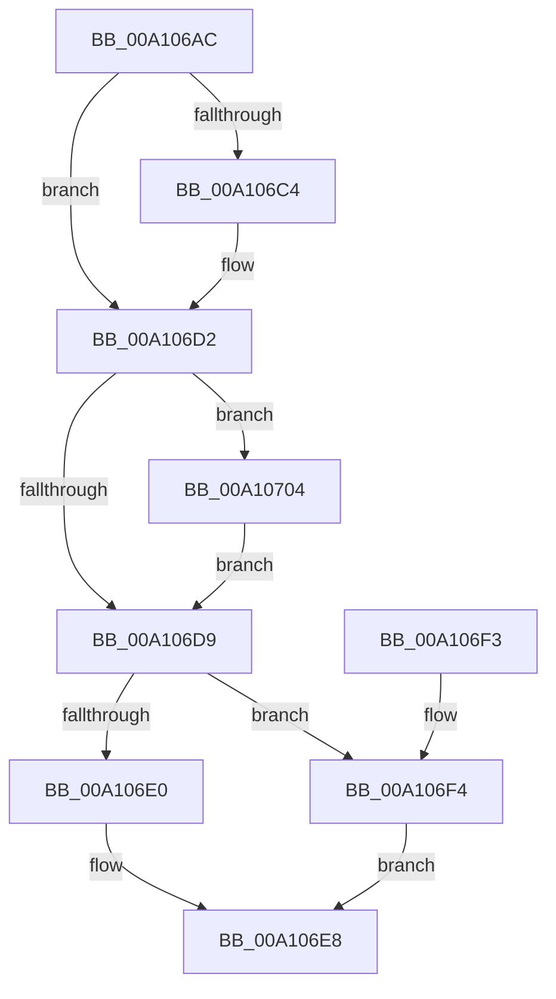

# DbgkpWakeTarget

- RVA: `0x00A106AC`–`0x00A10712` (길이 `102` bytes)
- VA: `0x0000000140A106AC`
- 실행 섹션: `PAGE`
- PDB 이름 있음: `예`; PDB Function 태그: `아니요`
- unwind 정보 RVA: `0x00065944`
- 디코드: `33`개 명령, `102/102` bytes 표시
- 미해석 바이트: `0` (있으면 어셈블리에 `.byte`로 보존)

> 이 문서는 커널 이미지의 기계어와 PDB 기호를 분석해 생성했습니다. 4번과 5번은 함수 원형과 자료형을 바이너리 사용 방식에서 추정한 C 해석이며 원본 소스 복구 결과는 아닙니다.

## 1. Dependencies

- 직접 호출 지점: **4**; 고유 호출 대상: **4**
- 직접 호출자로 확인된 함수: **4**
- RIP 상대 이미지 참조: **0**

### Outgoing calls
- `0x00A106CD` → [PsMultiResumeThread](../../text/20/PsMultiResumeThread_function_002027C4.md) (function, `0x002027C4`)
- `0x00A106E3` → [DbgkpFreeDebugEvent](DbgkpFreeDebugEvent_function_00A10718.md) (function, `0x00A10718`)
- `0x00A106FD` → [KeSetEvent](../../text/33/KeSetEvent_function_0033F310.md) (function, `0x0033F310`)
- `0x00A1070B` → [ExReleaseRundownProtection](../../text/34/ExReleaseRundownProtection_function_00349E80.md) (function, `0x00349E80`)

### Direct callers
- [DbgkpCloseObject](../91/DbgkpCloseObject_function_0091D5F0.md) at `0x0091D6D6`
- [DbgkClearProcessDebugObject](DbgkClearProcessDebugObject_function_00A10110.md) at `0x00A1022D`
- [NtDebugContinue](NtDebugContinue_function_00A10280.md) at `0x00A103C8`
- [DbgkpSetProcessDebugObject](DbgkpSetProcessDebugObject_function_00A10468.md) at `0x00A105BE`

### Static image references
- 디코드된 RIP-relative 메모리 참조가 없습니다.

## 2. Other-region calls and transfers

- 다른 실행 섹션으로 향하는 call: **3**
  - `0x00A106CD` → [PsMultiResumeThread](../../text/20/PsMultiResumeThread_function_002027C4.md) (`PAGE` → `.text`)
  - `0x00A106FD` → [KeSetEvent](../../text/33/KeSetEvent_function_0033F310.md) (`PAGE` → `.text`)
  - `0x00A1070B` → [ExReleaseRundownProtection](../../text/34/ExReleaseRundownProtection_function_00349E80.md) (`PAGE` → `.text`)
- 별도 외부 분기/꼬리 이동을 확인하지 못했습니다.

## 3. Assembly (complete function range)

```asm
00A106AC  48 89 5C 24 08                  mov qword ptr [rsp + 8], rbx
00A106B1  57                              push rdi
00A106B2  48 83 EC 20                     sub rsp, 0x20
00A106B6  8B 41 4C                        mov eax, dword ptr [rcx + 0x4c]
00A106B9  48 8B D9                        mov rbx, rcx
00A106BC  48 8B 79 40                     mov rdi, qword ptr [rcx + 0x40]
00A106C0  A8 20                           test al, 0x20
00A106C2  74 0E                           je 0x140a106d2
00A106C4  33 D2                           xor edx, edx
00A106C6  48 8B CF                        mov rcx, rdi
00A106C9  44 8D 42 01                     lea r8d, [rdx + 1]
00A106CD  E8 F2 20 7F FF                  call 0x1402027c4
00A106D2  8B 43 4C                        mov eax, dword ptr [rbx + 0x4c]
00A106D5  A8 08                           test al, 8
00A106D7  75 2B                           jne 0x140a10704
00A106D9  8B 43 4C                        mov eax, dword ptr [rbx + 0x4c]
00A106DC  A8 02                           test al, 2
00A106DE  74 14                           je 0x140a106f4
00A106E0  48 8B CB                        mov rcx, rbx
00A106E3  E8 30 00 00 00                  call 0x140a10718
00A106E8  48 8B 5C 24 30                  mov rbx, qword ptr [rsp + 0x30]
00A106ED  48 83 C4 20                     add rsp, 0x20
00A106F1  5F                              pop rdi
00A106F2  C3                              ret
00A106F3  CC                              int3
00A106F4  48 8D 4B 10                     lea rcx, [rbx + 0x10]
00A106F8  45 33 C0                        xor r8d, r8d
00A106FB  33 D2                           xor edx, edx
00A106FD  E8 0E EC 92 FF                  call 0x14033f310
00A10702  EB E4                           jmp 0x140a106e8
00A10704  48 8D 8F 88 05 00 00            lea rcx, [rdi + 0x588]
00A1070B  E8 70 97 93 FF                  call 0x140349e80
00A10710  EB C7                           jmp 0x140a106d9
```

## 4. C-style interpretation (structured pseudocode)

```c
__int64 __fastcall DbgkpWakeTarget(__int64 a1, int a2)
{
    __int64 result;
    __int64 v_rsp;
    unsigned __int64 v_stack_p8;

    v_stack_p8 = v_rbx;
    v_rsp = (v_rsp) - (32);
    result = (unsigned int)(*(unsigned int *)(a1 + 76));
    if ((((unsigned __int8)((unsigned int)(*(unsigned int *)(a1 + 76)))) & (32)) != 0) {
        a2 = 0;
        a1 = *(unsigned __int64 *)(a1 + 64);
        a3 = a2 + 1;
        result = PsMultiResumeThread(a1, a2, a3, a4);
    }
    if ((((unsigned __int8)((unsigned int)(*(unsigned int *)(a1 + 76)))) & (8)) != 0) goto loc_00A10704;
loc_00A106D9:
    if ((((unsigned __int8)((unsigned int)(*(unsigned int *)(a1 + 76)))) & (2)) == 0) goto loc_00A106F4;
    result = DbgkpFreeDebugEvent(a1, a2, a3, a4);
loc_00A106E8:
    v_rsp = (v_rsp) + (32);
    return result;
loc_00A106F4:
    a3 = 0;
    a2 = 0;
    result = KeSetEvent(v_stack_p8 + 16, a2, a3, a4);
    goto loc_00A106E8;
loc_00A10704:
    result = ExReleaseRundownProtection(*(unsigned __int64 *)(a1 + 64) + 1416, a2, a3, a4);
    goto loc_00A106D9;
}
```

## 5. (Beta) C Style

```c
int64_t DbgkpWakeTarget(void *Arg1, int32_t Arg2)
{
    uint8_t *arg1 = (uint8_t *)Arg1;

    int64_t result;
    int64_t local_rsp;
    uint64_t v_stack_p8;

    v_stack_p8 = local_rbx;
    local_rsp = (local_rsp) - (32);
    result = (uint32_t)(*(uint32_t *)(arg1 + 0x4C));
    if ((((uint8_t)((uint32_t)(*(uint32_t *)(arg1 + 0x4C)))) & (32)) != 0) {
        Arg2 = 0;
        Arg1 = *(uint64_t *)(arg1 + 0x40);
        a3 = Arg2 + 1;
        result = PsMultiResumeThread(Arg1, Arg2, a3, a4);
    }
    if ((((uint8_t)((uint32_t)(*(uint32_t *)(arg1 + 0x4C)))) & (8)) != 0) goto loc_00A10704;
loc_00A106D9:
    if ((((uint8_t)((uint32_t)(*(uint32_t *)(arg1 + 0x4C)))) & (2)) == 0) goto loc_00A106F4;
    result = DbgkpFreeDebugEvent(Arg1, Arg2, a3, a4);
loc_00A106E8:
    local_rsp = (local_rsp) + (32);
    return result;
loc_00A106F4:
    a3 = 0;
    Arg2 = 0;
    result = KeSetEvent(v_stack_p8 + 16, Arg2, a3, a4);
    goto loc_00A106E8;
loc_00A10704:
    result = ExReleaseRundownProtection(*(uint64_t *)(arg1 + 0x40) + 1416, Arg2, a3, a4);
    goto loc_00A106D9;
}
```

### 관측된 메모리 오프셋

구조체 형식이 확인되지 않은 접근은 인자 기준의 오프셋으로만 기록했습니다.

| 기준 인자 | 오프셋 표현 | 폭 (bit) | 접근 |
|---|---:|---:|---|
| `Arg1` | `+ 0x10` | `64` | `R` |
| `Arg1` | `+ 0x40` | `64` | `R` |
| `Arg1` | `+ 0x4C` | `32` | `R` |

## 6. Execution-region graph

[열기: 2D/3D 그래프와 함수 탐색 컨트롤 패널](../../../control-panel.html?section=page&rva=0x00A106AC&view=graph)

- 2D 그래프는 위에서 아래로 흐르고, 3D 그래프는 빈 공간을 드래그해 회전합니다. Shift+드래그는 이동, 휠은 확대·축소, 함수 노드 선택은 대상 보고서 이동입니다.

### Static fallback


