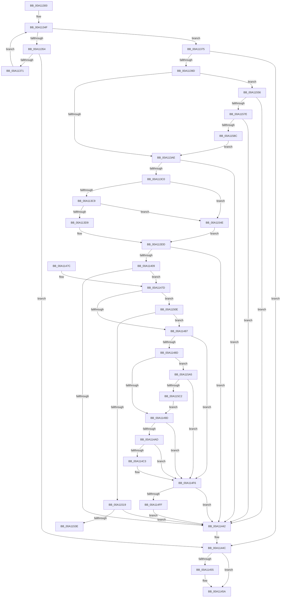

# DrvDbGetObjectSubKeyCallback

- RVA: `0x00A11300`–`0x00A115C7` (길이 `711` bytes)
- VA: `0x0000000140A11300`
- 실행 섹션: `PAGE`
- PDB 이름 있음: `예`; PDB Function 태그: `예`
- unwind 정보 RVA: `0x000A94F8`
- 디코드: `188`개 명령, `711/711` bytes 표시
- 미해석 바이트: `0` (있으면 어셈블리에 `.byte`로 보존)

> 이 문서는 커널 이미지의 기계어와 PDB 기호를 분석해 생성했습니다. 4번과 5번은 함수 원형과 자료형을 바이너리 사용 방식에서 추정한 C 해석이며 원본 소스 복구 결과는 아닙니다.

## 1. Dependencies

- 직접 호출 지점: **14**; 고유 호출 대상: **11**
- 직접 호출자로 확인된 함수: **1**
- RIP 상대 이미지 참조: **2**

### Outgoing calls
- `0x00A11364` → [wcsicmp](../../text/50/wcsicmp_function_00500080.md) (function, `0x00500080`)
- `0x00A11389` → [ExAllocatePool2](../../poolcode/B8/ExAllocatePool2_function_00B820F0.md) (function, `0x00B820F0`)
- `0x00A113B3` → [RtlStringCchCopyW](../../text/26/RtlStringCchCopyW_function_0026E9A4.md) (function, `0x0026E9A4`)
- `0x00A113FD` → [_RegRtlOpenKeyTransacted](../8E/_RegRtlOpenKeyTransacted_function_008EF810.md) (function, `0x008EF810`)
- `0x00A11439` → [ZwQueryKey](../../text/6A/ZwQueryKey_function_006AD390.md) (function, `0x006AD390`)
- `0x00A11447` → [ExFreePoolWithTag](../../poolcode/B8/ExFreePoolWithTag_function_00B82870.md) (function, `0x00B82870`)
- `0x00A11455` → [ZwClose](../../text/6A/ZwClose_function_006AD2B0.md) (function, `0x006AD2B0`)
- `0x00A11463` → [_security_check_cookie](../../text/6A/_security_check_cookie_function_006AC640.md) (function, `0x006AC640`)
- `0x00A114A4` → [RtlInitUnicodeStringEx](../../text/46/RtlInitUnicodeStringEx_function_00463960.md) (function, `0x00463960`)
- `0x00A114DF` → [RtlStringCchCopyExW](../../text/41/RtlStringCchCopyExW_function_0041E1C0.md) (function, `0x0041E1C0`)
- `0x00A11504` → [ExFreePoolWithTag](../../poolcode/B8/ExFreePoolWithTag_function_00B82870.md) (function, `0x00B82870`)
- `0x00A1152D` → [ExAllocatePool2](../../poolcode/B8/ExAllocatePool2_function_00B820F0.md) (function, `0x00B820F0`)
- `0x00A1156E` → [RtlStringCchCopyExW](../../text/41/RtlStringCchCopyExW_function_0041E1C0.md) (function, `0x0041E1C0`)
- `0x00A115B5` → [guard_dispatch_icall](../../text/6B/guard_dispatch_icall_function_006BAAD0.md) (function, `0x006BAAD0`)

### Direct callers
- [PnpCtxInternalEnumKeyCallback](../../text/47/PnpCtxInternalEnumKeyCallback_function_004719E0.md) at `0x004719FE`

### Static image references
- `0x00A11319` → RVA `0x00E0A740` (`.data`; read)
- `0x00A11354` → RVA `0x00002F00` (`.rdata`; read)

## 2. Other-region calls and transfers

- 다른 실행 섹션으로 향하는 call: **13**
  - `0x00A11364` → [wcsicmp](../../text/50/wcsicmp_function_00500080.md) (`PAGE` → `.text`)
  - `0x00A11389` → [ExAllocatePool2](../../poolcode/B8/ExAllocatePool2_function_00B820F0.md) (`PAGE` → `POOLCODE`)
  - `0x00A113B3` → [RtlStringCchCopyW](../../text/26/RtlStringCchCopyW_function_0026E9A4.md) (`PAGE` → `.text`)
  - `0x00A11439` → [ZwQueryKey](../../text/6A/ZwQueryKey_function_006AD390.md) (`PAGE` → `.text`)
  - `0x00A11447` → [ExFreePoolWithTag](../../poolcode/B8/ExFreePoolWithTag_function_00B82870.md) (`PAGE` → `POOLCODE`)
  - `0x00A11455` → [ZwClose](../../text/6A/ZwClose_function_006AD2B0.md) (`PAGE` → `.text`)
  - `0x00A11463` → [_security_check_cookie](../../text/6A/_security_check_cookie_function_006AC640.md) (`PAGE` → `.text`)
  - `0x00A114A4` → [RtlInitUnicodeStringEx](../../text/46/RtlInitUnicodeStringEx_function_00463960.md) (`PAGE` → `.text`)
  - `0x00A114DF` → [RtlStringCchCopyExW](../../text/41/RtlStringCchCopyExW_function_0041E1C0.md) (`PAGE` → `.text`)
  - `0x00A11504` → [ExFreePoolWithTag](../../poolcode/B8/ExFreePoolWithTag_function_00B82870.md) (`PAGE` → `POOLCODE`)
  - `0x00A1152D` → [ExAllocatePool2](../../poolcode/B8/ExAllocatePool2_function_00B820F0.md) (`PAGE` → `POOLCODE`)
  - `0x00A1156E` → [RtlStringCchCopyExW](../../text/41/RtlStringCchCopyExW_function_0041E1C0.md) (`PAGE` → `.text`)
  - `0x00A115B5` → [guard_dispatch_icall](../../text/6B/guard_dispatch_icall_function_006BAAD0.md) (`PAGE` → `.text`)
- call이 아닌 외부 분기/꼬리 이동: **1**
  - `0x00A11549` → [sub_00B36C8C](../B3/Unknown_function_00B36C8C.md) (`tail-transfer`)

## 3. Assembly (complete function range)

```asm
00A11300  40 55                           push rbp
00A11302  53                              push rbx
00A11303  56                              push rsi
00A11304  57                              push rdi
00A11305  41 54                           push r12
00A11307  41 55                           push r13
00A11309  41 56                           push r14
00A1130B  41 57                           push r15
00A1130D  48 8D 6C 24 E1                  lea rbp, [rsp - 0x1f]
00A11312  48 81 EC 98 00 00 00            sub rsp, 0x98
00A11319  48 8B 05 20 94 3F 00            mov rax, qword ptr [rip + 0x3f9420]
00A11320  48 33 C4                        xor rax, rsp
00A11323  48 89 45 07                     mov qword ptr [rbp + 7], rax
00A11327  45 33 DB                        xor r11d, r11d
00A1132A  0F 57 C0                        xorps xmm0, xmm0
00A1132D  4C 89 5D C7                     mov qword ptr [rbp - 0x39], r11
00A11331  45 8B F3                        mov r14d, r11d
00A11334  4C 89 5D B7                     mov qword ptr [rbp - 0x49], r11
00A11338  41 8B FB                        mov edi, r11d
00A1133B  4C 89 5D BF                     mov qword ptr [rbp - 0x41], r11
00A1133F  49 8B D9                        mov rbx, r9
00A11342  0F 11 45 CF                     movups xmmword ptr [rbp - 0x31], xmm0
00A11346  4D 8B F8                        mov r15, r8
00A11349  4C 8B E2                        mov r12, rdx
00A1134C  4C 8B E9                        mov r13, rcx
00A1134F  83 FF 01                        cmp edi, 1
00A11352  73 21                           jae 0x140a11375
00A11354  48 8D 05 A5 1B 5F FF            lea rax, [rip - 0xa0e45b]
00A1135B  8B D7                           mov edx, edi
00A1135D  49 8B CF                        mov rcx, r15
00A11360  48 8B 14 D0                     mov rdx, qword ptr [rax + rdx*8]
00A11364  E8 17 ED AE FF                  call 0x140500080
00A11369  85 C0                           test eax, eax
00A1136B  0F 84 DB 00 00 00               je 0x140a1144c
00A11371  FF C7                           inc edi
00A11373  EB DA                           jmp 0x140a1134f
00A11375  B8 00 01 00 00                  mov eax, 0x100
00A1137A  BA 00 02 00 00                  mov edx, 0x200
00A1137F  8B C8                           mov ecx, eax
00A11381  41 B8 50 44 44 42               mov r8d, 0x42444450
00A11387  8B F8                           mov edi, eax
00A11389  E8 62 0D 17 00                  call 0x140b820f0
00A1138E  45 33 DB                        xor r11d, r11d
00A11391  48 8B F0                        mov rsi, rax
00A11394  48 85 C0                        test rax, rax
00A11397  0F 84 AF 00 00 00               je 0x140a1144c
00A1139D  4C 8D 43 08                     lea r8, [rbx + 8]
00A113A1  48 8B C8                        mov rcx, rax
00A113A4  66 45 39 18                     cmp word ptr [r8], r11w
00A113A8  0F 85 A8 01 00 00               jne 0x140a11556
00A113AE  8B D7                           mov edx, edi
00A113B0  4D 8B C7                        mov r8, r15
00A113B3  E8 EC D5 85 FF                  call 0x14026e9a4
00A113B8  85 C0                           test eax, eax
00A113BA  0F 88 82 00 00 00               js 0x140a11442
00A113C0  4D 85 ED                        test r13, r13
00A113C3  0F 84 85 01 00 00               je 0x140a1154e
00A113C9  49 8B 85 E0 00 00 00            mov rax, qword ptr [r13 + 0xe0]
00A113D0  48 85 C0                        test rax, rax
00A113D3  0F 84 75 01 00 00               je 0x140a1154e
00A113D9  48 8B 48 08                     mov rcx, qword ptr [rax + 8]
00A113DD  48 89 4C 24 28                  mov qword ptr [rsp + 0x28], rcx
00A113E2  48 8D 45 BF                     lea rax, [rbp - 0x41]
00A113E6  49 8B CC                        mov rcx, r12
00A113E9  48 89 44 24 20                  mov qword ptr [rsp + 0x20], rax
00A113EE  41 B9 19 00 02 00               mov r9d, 0x20019
00A113F4  41 B8 08 00 00 00               mov r8d, 8
00A113FA  49 8B D7                        mov rdx, r15
00A113FD  E8 0E E4 ED FF                  call 0x1408ef810
00A11402  45 33 FF                        xor r15d, r15d
00A11405  85 C0                           test eax, eax
00A11407  78 39                           js 0x140a11442
00A11409  48 8B 4D BF                     mov rcx, qword ptr [rbp - 0x41]
00A1140D  41 8D 7F 04                     lea edi, [r15 + 4]
00A11411  33 C0                           xor eax, eax
00A11413  44 89 7D B7                     mov dword ptr [rbp - 0x49], r15d
00A11417  0F 57 C0                        xorps xmm0, xmm0
00A1141A  48 89 45 FF                     mov qword ptr [rbp - 1], rax
00A1141E  48 8D 45 B7                     lea rax, [rbp - 0x49]
00A11422  8B D7                           mov edx, edi
00A11424  45 8D 4F 28                     lea r9d, [r15 + 0x28]
00A11428  48 89 44 24 20                  mov qword ptr [rsp + 0x20], rax
00A1142D  4C 8D 45 DF                     lea r8, [rbp - 0x21]
00A11431  0F 11 45 DF                     movups xmmword ptr [rbp - 0x21], xmm0
00A11435  0F 11 45 EF                     movups xmmword ptr [rbp - 0x11], xmm0
00A11439  E8 52 BF C9 FF                  call 0x1406ad390
00A1143E  85 C0                           test eax, eax
00A11440  79 3B                           jns 0x140a1147d
00A11442  33 D2                           xor edx, edx
00A11444  48 8B CE                        mov rcx, rsi
00A11447  E8 24 14 17 00                  call 0x140b82870
00A1144C  48 8B 4D BF                     mov rcx, qword ptr [rbp - 0x41]
00A11450  48 85 C9                        test rcx, rcx
00A11453  74 05                           je 0x140a1145a
00A11455  E8 56 BE C9 FF                  call 0x1406ad2b0
00A1145A  33 C0                           xor eax, eax
00A1145C  48 8B 4D 07                     mov rcx, qword ptr [rbp + 7]
00A11460  48 33 CC                        xor rcx, rsp
00A11463  E8 D8 B1 C9 FF                  call 0x1406ac640
00A11468  48 81 C4 98 00 00 00            add rsp, 0x98
00A1146F  41 5F                           pop r15
00A11471  41 5E                           pop r14
00A11473  41 5D                           pop r13
00A11475  41 5C                           pop r12
00A11477  5F                              pop rdi
00A11478  5E                              pop rsi
00A11479  5B                              pop rbx
00A1147A  5D                              pop rbp
00A1147B  C3                              ret
00A1147C  CC                              int3
00A1147D  44 39 7D EB                     cmp dword ptr [rbp - 0x15], r15d
00A11481  0F 87 87 00 00 00               ja 0x140a1150e
00A11487  44 39 7D F3                     cmp dword ptr [rbp - 0xd], r15d
00A1148B  76 69                           jbe 0x140a114f6
00A1148D  48 8B 83 08 02 00 00            mov rax, qword ptr [rbx + 0x208]
00A11494  48 85 C0                        test rax, rax
00A11497  0F 85 08 01 00 00               jne 0x140a115a5
00A1149D  48 8B D6                        mov rdx, rsi
00A114A0  48 8D 4D CF                     lea rcx, [rbp - 0x31]
00A114A4  E8 B7 24 A5 FF                  call 0x140463960
00A114A9  85 C0                           test eax, eax
00A114AB  78 49                           js 0x140a114f6
00A114AD  0F B7 7D D1                     movzx edi, word ptr [rbp - 0x2f]
00A114B1  8B 83 20 02 00 00               mov eax, dword ptr [rbx + 0x220]
00A114B7  D1 EF                           shr edi, 1
00A114B9  01 BB 24 02 00 00               add dword ptr [rbx + 0x224], edi
00A114BF  3B C7                           cmp eax, edi
00A114C1  76 33                           jbe 0x140a114f6
00A114C3  48 8B 8B 18 02 00 00            mov rcx, qword ptr [rbx + 0x218]
00A114CA  8B D0                           mov edx, eax
00A114CC  C7 44 24 28 00 09 00 00         mov dword ptr [rsp + 0x28], 0x900
00A114D4  45 33 C9                        xor r9d, r9d
00A114D7  4C 8B C6                        mov r8, rsi
00A114DA  4C 89 7C 24 20                  mov qword ptr [rsp + 0x20], r15
00A114DF  E8 DC CC A0 FF                  call 0x14041e1c0
00A114E4  8B C7                           mov eax, edi
00A114E6  48 03 C0                        add rax, rax
00A114E9  48 01 83 18 02 00 00            add qword ptr [rbx + 0x218], rax
00A114F0  29 BB 20 02 00 00               sub dword ptr [rbx + 0x220], edi
00A114F6  4D 85 F6                        test r14, r14
00A114F9  0F 84 43 FF FF FF               je 0x140a11442
00A114FF  33 D2                           xor edx, edx
00A11501  49 8B CE                        mov rcx, r14
00A11504  E8 67 13 17 00                  call 0x140b82870
00A11509  E9 34 FF FF FF                  jmp 0x140a11442
00A1150E  8B 03                           mov eax, dword ptr [rbx]
00A11510  39 43 04                        cmp dword ptr [rbx + 4], eax
00A11513  0F 83 6E FF FF FF               jae 0x140a11487
00A11519  41 BC 00 01 00 00               mov r12d, 0x100
00A1151F  BA 28 02 00 00                  mov edx, 0x228
00A11524  41 8B CC                        mov ecx, r12d
00A11527  41 B8 50 44 44 42               mov r8d, 0x42444450
00A1152D  E8 BE 0B 17 00                  call 0x140b820f0
00A11532  4C 8B F0                        mov r14, rax
00A11535  48 85 C0                        test rax, rax
00A11538  0F 84 04 FF FF FF               je 0x140a11442
00A1153E  48 8B C8                        mov rcx, rax
00A11541  41 8D 54 24 80                  lea edx, [r12 - 0x80]
00A11546  48 8B C3                        mov rax, rbx
00A11549  E9 3E 57 12 00                  jmp 0x140b36c8c
00A1154E  49 8B CB                        mov rcx, r11
00A11551  E9 87 FE FF FF                  jmp 0x140a113dd
00A11556  48 8D 45 B7                     lea rax, [rbp - 0x49]
00A1155A  C7 44 24 28 00 09 00 00         mov dword ptr [rsp + 0x28], 0x900
00A11562  4C 8D 4D C7                     lea r9, [rbp - 0x39]
00A11566  48 89 44 24 20                  mov qword ptr [rsp + 0x20], rax
00A1156B  48 8B D7                        mov rdx, rdi
00A1156E  E8 4D CC A0 FF                  call 0x14041e1c0
00A11573  45 33 DB                        xor r11d, r11d
00A11576  85 C0                           test eax, eax
00A11578  0F 88 C4 FE FF FF               js 0x140a11442
00A1157E  48 8B 45 B7                     mov rax, qword ptr [rbp - 0x49]
00A11582  48 83 F8 02                     cmp rax, 2
00A11586  0F 82 B6 FE FF FF               jb 0x140a11442
00A1158C  48 8B 4D C7                     mov rcx, qword ptr [rbp - 0x39]
00A11590  8D 78 FE                        lea edi, [rax - 2]
00A11593  66 C7 01 5C 00                  mov word ptr [rcx], 0x5c
00A11598  48 83 C1 02                     add rcx, 2
00A1159C  66 44 89 19                     mov word ptr [rcx], r11w
00A115A0  E9 09 FE FF FF                  jmp 0x140a113ae
00A115A5  4C 8B 8B 10 02 00 00            mov r9, qword ptr [rbx + 0x210]
00A115AC  45 33 C0                        xor r8d, r8d
00A115AF  48 8B D6                        mov rdx, rsi
00A115B2  49 8B CD                        mov rcx, r13
00A115B5  E8 16 95 CA FF                  call 0x1406baad0
00A115BA  84 C0                           test al, al
00A115BC  0F 84 34 FF FF FF               je 0x140a114f6
00A115C2  E9 D6 FE FF FF                  jmp 0x140a1149d
```

## 4. C-style interpretation (structured pseudocode)

```c
__int64 __fastcall DrvDbGetObjectSubKeyCallback(__int64 a1, __int64 a2, __int64 a3, __int64 a4)
{
    __int64 result;
    __int64 v_r11;
    __int64 v_r15;
    __int64 v_rdi;
    __int64 v_rsp;
    unsigned __int64 v_stack_m58;
    unsigned __int64 v_stack_m5F;
    unsigned __int64 v_stack_m60;
    unsigned int v_stack_m6C;
    unsigned __int64 v_stack_m70;
    unsigned int v_stack_m74;
    unsigned __int64 v_stack_m80;
    unsigned __int16 v_stack_m8E;
    unsigned __int64 v_stack_m90;
    unsigned __int64 v_stack_m98;
    unsigned __int64 v_stack_mA0;
    unsigned __int64 v_stack_mA8;
    unsigned __int64 v_stack_mB0;
    unsigned __int64 v_stack_mB8;
    unsigned __int64 v_stack_p20;
    unsigned int v_stack_p28;

    v_rsp = (v_rsp) - (152);
    result = (*(unsigned __int64 *)(v_rip + 4166688)) ^ (v_rsp);
    v_stack_m58 = result;
    v_r11 = 0;
    v_stack_m98 = 0;
    v_stack_mA8 = 0;
    v_stack_mA0 = 0;
    v_stack_m90 = v_xmm0;
loc_00A1134F:
    if (0 >= 1) goto loc_00A11375;
    result = wcsicmp(a3, *(unsigned __int64 *)(v_rip - 10544219 + 0 * 8), a3, a4);
    if ((unsigned int)(result) == 0) goto loc_00A1144C;
    v_rdi = (unsigned int)((0) + 1);
    goto loc_00A1134F;
loc_00A11375:
    result = ExAllocatePool2(256, 512, (unsigned int)(0x42444450ULL), a4);
    v_r11 = 0;
    if (result == 0) goto loc_00A1144C;
    if ((*(unsigned __int16 *)(a4 + 8)) != 0) goto loc_00A11556;
loc_00A113AE:
    result = RtlStringCchCopyW(result, 256, a3, a4);
    if (sign_flag) goto loc_00A11442;
    if (a1 == 0) goto loc_00A1154E;
    if (*(unsigned __int64 *)(a1 + 224) == 0) goto loc_00A1154E;
loc_00A113DD:
    v_stack_mB0 = *(unsigned __int64 *)(*(unsigned __int64 *)(a1 + 224) + 8);
    v_stack_mB8 = v_stack_mA0;
    result = _RegRtlOpenKeyTransacted(a2, a3, 8, (unsigned int)(0x20019ULL));
    v_r15 = 0;
    if (sign_flag) goto loc_00A11442;
    result = 0;
    v_stack_mA8 = 0;
    v_stack_m60 = 0;
    v_stack_mB8 = v_stack_mA8;
    v_stack_m80 = v_xmm0;
    v_stack_m70 = v_xmm0;
    result = ZwQueryKey(v_stack_mA0, (unsigned int)((unsigned int)(v_r15 + 4)), v_stack_m80, v_r15 + 40);
    if (!sign_flag) goto loc_00A1147D;
loc_00A11442:
    a2 = 0;
    result = ExFreePoolWithTag(result, a2, v_stack_m80, v_r15 + 40);
loc_00A1144C:
    if (v_stack_mA0 != 0) {
        result = ZwClose(v_stack_mA0, a2, v_stack_m80, v_r15 + 40);
    }
    result = 0;
    a1 = (v_stack_m58) ^ (v_rsp);
    result = _security_check_cookie(a1, a2, v_stack_m80, v_r15 + 40);
    v_rsp = (v_rsp) + (152);
    return result;
loc_00A1147D:
    if (v_stack_m74 > 0) goto loc_00A1150E;
loc_00A11487:
    if (v_stack_m6C <= 0) goto loc_00A114F6;
    if (*(unsigned __int64 *)(a4 + 520) != 0) goto loc_00A115A5;
loc_00A1149D:
    result = RtlInitUnicodeStringEx(v_stack_m90, result, v_stack_m80, v_r15 + 40);
    if (sign_flag) goto loc_00A114F6;
    v_rdi = (unsigned int)((v_stack_m8E) >> (1));
    result = (unsigned int)(*(unsigned int *)(a4 + 544));
    if (((unsigned int)((unsigned int)(*(unsigned int *)(a4 + 544)))) >= = ((unsigned int)(v_rdi))) {
        a1 = *(unsigned __int64 *)(a4 + 536);
        a2 = (unsigned int)((unsigned int)(*(unsigned int *)(a4 + 544)));
        v_stack_p28 = 0x900ULL;
        a4 = 0;
        a3 = result;
        v_stack_p20 = 0;
        result = RtlStringCchCopyExW(a1, a2, a3, a4);
        result = (unsigned int)(v_rdi);
        result = (result) + (result);
    }
    if (0 == 0) goto loc_00A11442;
    a2 = 0;
    result = ExFreePoolWithTag(0, a2, a3, a4);
    goto loc_00A11442;
loc_00A1150E:
    if ((*(unsigned int *)(a4 + 4)) >= ((unsigned int)((unsigned int)(*(unsigned int *)(a4))))) goto loc_00A11487;
    result = ExAllocatePool2(256, 552, (unsigned int)(0x42444450ULL), a4);
    if (result == 0) goto loc_00A11442;
loc_00A1154E:
    goto loc_00A113DD;
loc_00A11556:
    v_stack_p28 = 0x900ULL;
    v_stack_p20 = v_stack_mA8;
    result = RtlStringCchCopyExW(0, v_rdi, (unsigned int)(0x42444450ULL), v_stack_m98);
    v_r11 = 0;
    if (sign_flag) goto loc_00A11442;
    if (v_stack_mA8 < 2) goto loc_00A11442;
    *(unsigned __int16 *)(v_stack_m98) = 92;
    a1 = (v_stack_m98) + (2);
    *(unsigned __int16 *)(a1) = 0;
    goto loc_00A113AE;
loc_00A115A5:
    a3 = 0;
    result = guard_dispatch_icall(a1, result, a3, *(unsigned __int64 *)(a4 + 528));
    if ((unsigned __int8)(result) == 0) goto loc_00A114F6;
    goto loc_00A1149D;
}
```

## 5. (Beta) C Style

```c
int64_t DrvDbGetObjectSubKeyCallback(int64_t Arg1, int64_t Arg2, int64_t Arg3, void *Arg4)
{
    uint8_t *arg4 = (uint8_t *)Arg4;

    int64_t result;
    int64_t local_r11;
    int64_t local_r15;
    int64_t local_rdi;
    int64_t local_rsp;
    uint64_t v_stack_m58;
    uint64_t v_stack_m5F;
    uint64_t v_stack_m60;
    uint32_t v_stack_m6C;
    uint64_t v_stack_m70;
    uint32_t v_stack_m74;
    uint64_t v_stack_m80;
    uint16_t v_stack_m8E;
    uint64_t v_stack_m90;
    uint64_t v_stack_m98;
    uint64_t v_stack_mA0;
    uint64_t v_stack_mA8;
    uint64_t v_stack_mB0;
    uint64_t v_stack_mB8;
    uint64_t v_stack_p20;
    uint32_t v_stack_p28;

    local_rsp = (local_rsp) - (152);
    result = (*(uint64_t *)(v_rip + 0x3F9420)) ^ (local_rsp);
    v_stack_m58 = result;
    local_r11 = 0;
    v_stack_m98 = 0;
    v_stack_mA8 = 0;
    v_stack_mA0 = 0;
    v_stack_m90 = v_xmm0;
loc_00A1134F:
    if (0 >= 1) goto loc_00A11375;
    result = wcsicmp(Arg3, *(uint64_t *)(v_rip - 0xA0E45B + 0x0 * 8), Arg3, Arg4);
    if ((uint32_t)(result) == 0) goto loc_00A1144C;
    local_rdi = (uint32_t)((0) + 1);
    goto loc_00A1134F;
loc_00A11375:
    result = ExAllocatePool2(256, 512, (uint32_t)(0x42444450ULL), Arg4);
    local_r11 = 0;
    if (result == 0) goto loc_00A1144C;
    if ((*(uint16_t *)(arg4 + 0x8)) != 0) goto loc_00A11556;
loc_00A113AE:
    result = RtlStringCchCopyW(result, 256, Arg3, Arg4);
    if (sign_flag) goto loc_00A11442;
    if (Arg1 == 0) goto loc_00A1154E;
    if (*(uint64_t *)(Arg1 + 0xE0) == 0) goto loc_00A1154E;
loc_00A113DD:
    v_stack_mB0 = *(uint64_t *)(*(uint64_t *)(Arg1 + 0xE0) + 0x8);
    v_stack_mB8 = v_stack_mA0;
    result = _RegRtlOpenKeyTransacted(Arg2, Arg3, 8, (uint32_t)(0x20019ULL));
    local_r15 = 0;
    if (sign_flag) goto loc_00A11442;
    result = 0;
    v_stack_mA8 = 0;
    v_stack_m60 = 0;
    v_stack_mB8 = v_stack_mA8;
    v_stack_m80 = v_xmm0;
    v_stack_m70 = v_xmm0;
    result = ZwQueryKey(v_stack_mA0, (uint32_t)((uint32_t)(local_r15 + 4)), v_stack_m80, local_r15 + 40);
    if (!sign_flag) goto loc_00A1147D;
loc_00A11442:
    Arg2 = 0;
    result = ExFreePoolWithTag(result, Arg2, v_stack_m80, local_r15 + 40);
loc_00A1144C:
    if (v_stack_mA0 != 0) {
        result = ZwClose(v_stack_mA0, Arg2, v_stack_m80, local_r15 + 40);
    }
    result = 0;
    Arg1 = (v_stack_m58) ^ (local_rsp);
    result = _security_check_cookie(Arg1, Arg2, v_stack_m80, local_r15 + 40);
    local_rsp = (local_rsp) + (152);
    return result;
loc_00A1147D:
    if (v_stack_m74 > 0) goto loc_00A1150E;
loc_00A11487:
    if (v_stack_m6C <= 0) goto loc_00A114F6;
    if (*(uint64_t *)(arg4 + 0x208) != 0) goto loc_00A115A5;
loc_00A1149D:
    result = RtlInitUnicodeStringEx(v_stack_m90, result, v_stack_m80, local_r15 + 40);
    if (sign_flag) goto loc_00A114F6;
    local_rdi = (uint32_t)((v_stack_m8E) >> (1));
    result = (uint32_t)(*(uint32_t *)(arg4 + 0x220));
    if (((uint32_t)((uint32_t)(*(uint32_t *)(arg4 + 0x220)))) >= = ((uint32_t)(local_rdi))) {
        Arg1 = *(uint64_t *)(arg4 + 0x218);
        Arg2 = (uint32_t)((uint32_t)(*(uint32_t *)(arg4 + 0x220)));
        v_stack_p28 = 0x900ULL;
        Arg4 = 0;
        Arg3 = result;
        v_stack_p20 = 0;
        result = RtlStringCchCopyExW(Arg1, Arg2, Arg3, Arg4);
        result = (uint32_t)(local_rdi);
        result = (result) + (result);
    }
    if (0 == 0) goto loc_00A11442;
    Arg2 = 0;
    result = ExFreePoolWithTag(0, Arg2, Arg3, Arg4);
    goto loc_00A11442;
loc_00A1150E:
    if ((*(uint32_t *)(arg4 + 0x4)) >= ((uint32_t)((uint32_t)(*(uint32_t *)(arg4))))) goto loc_00A11487;
    result = ExAllocatePool2(256, 552, (uint32_t)(0x42444450ULL), Arg4);
    if (result == 0) goto loc_00A11442;
loc_00A1154E:
    goto loc_00A113DD;
loc_00A11556:
    v_stack_p28 = 0x900ULL;
    v_stack_p20 = v_stack_mA8;
    result = RtlStringCchCopyExW(0, local_rdi, (uint32_t)(0x42444450ULL), v_stack_m98);
    local_r11 = 0;
    if (sign_flag) goto loc_00A11442;
    if (v_stack_mA8 < 2) goto loc_00A11442;
    *(uint16_t *)(v_stack_m98) = 92;
    Arg1 = (v_stack_m98) + (2);
    *(uint16_t *)(Arg1) = 0;
    goto loc_00A113AE;
loc_00A115A5:
    Arg3 = 0;
    result = guard_dispatch_icall(Arg1, result, Arg3, *(uint64_t *)(arg4 + 0x210));
    if ((uint8_t)(result) == 0) goto loc_00A114F6;
    goto loc_00A1149D;
}
```

### 관측된 메모리 오프셋

구조체 형식이 확인되지 않은 접근은 인자 기준의 오프셋으로만 기록했습니다.

| 기준 인자 | 오프셋 표현 | 폭 (bit) | 접근 |
|---|---:|---:|---|
| `Arg4` | `+ 0x0` | `16` | `R` |
| `Arg4` | `+ 0x0` | `32` | `R` |
| `Arg4` | `+ 0x4` | `32` | `R` |
| `Arg4` | `+ 0x8` | `64` | `R` |
| `Arg4` | `+ 0x208` | `64` | `R` |
| `Arg4` | `+ 0x210` | `64` | `R` |
| `Arg4` | `+ 0x218` | `64` | `R` |
| `Arg4` | `+ 0x218` | `64` | `R/W` |
| `Arg4` | `+ 0x220` | `32` | `R` |
| `Arg4` | `+ 0x220` | `32` | `R/W` |
| `Arg4` | `+ 0x224` | `32` | `R/W` |

## 6. Execution-region graph

[열기: 2D/3D 그래프와 함수 탐색 컨트롤 패널](../../../control-panel.html?section=page&rva=0x00A11300&view=graph)

- 2D 그래프는 위에서 아래로 흐르고, 3D 그래프는 빈 공간을 드래그해 회전합니다. Shift+드래그는 이동, 휠은 확대·축소, 함수 노드 선택은 대상 보고서 이동입니다.

### Static fallback


