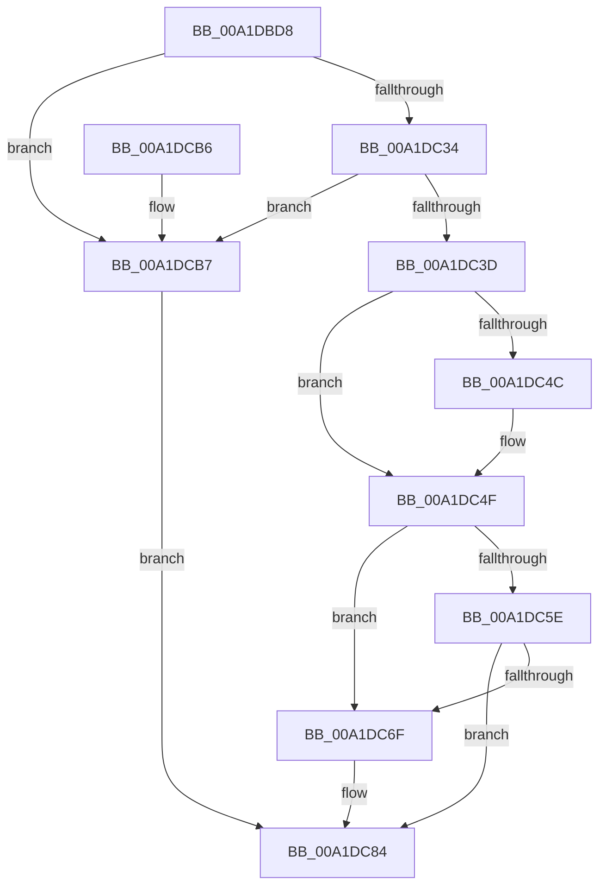

# EtwTraceThreadSetName

- RVA: `0x00A1DBD8`–`0x00A1DCC8` (길이 `240` bytes)
- VA: `0x0000000140A1DBD8`
- 실행 섹션: `PAGE`
- PDB 이름 있음: `예`; PDB Function 태그: `아니요`
- unwind 정보 RVA: `0x000AA76C`
- 디코드: `59`개 명령, `240/240` bytes 표시
- 미해석 바이트: `0` (있으면 어셈블리에 `.byte`로 보존)

> 이 문서는 커널 이미지의 기계어와 PDB 기호를 분석해 생성했습니다. 4번과 5번은 함수 원형과 자료형을 바이너리 사용 방식에서 추정한 C 해석이며 원본 소스 복구 결과는 아닙니다.

## 1. Dependencies

- 직접 호출 지점: **2**; 고유 호출 대상: **2**
- 직접 호출자로 확인된 함수: **1**
- RIP 상대 이미지 참조: **2**

### Outgoing calls
- `0x00A1DC9C` → [EtwTraceKernelEvent](../../text/23/EtwTraceKernelEvent_function_00235350.md) (function, `0x00235350`)
- `0x00A1DCA8` → [_security_check_cookie](../../text/6A/_security_check_cookie_function_006AC640.md) (function, `0x006AC640`)

### Direct callers
- [NtSetInformationThread](../8C/NtSetInformationThread_function_008C9F60.md) at `0x008CA954`

### Static image references
- `0x00A1DBE4` → RVA `0x00E0A740` (`.data`; read)
- `0x00A1DC6F` → RVA `0x000105E0` (`.rdata`; read)

## 2. Other-region calls and transfers

- 다른 실행 섹션으로 향하는 call: **2**
  - `0x00A1DC9C` → [EtwTraceKernelEvent](../../text/23/EtwTraceKernelEvent_function_00235350.md) (`PAGE` → `.text`)
  - `0x00A1DCA8` → [_security_check_cookie](../../text/6A/_security_check_cookie_function_006AC640.md) (`PAGE` → `.text`)
- 별도 외부 분기/꼬리 이동을 확인하지 못했습니다.

## 3. Assembly (complete function range)

```asm
00A1DBD8  40 55                           push rbp
00A1DBDA  48 8B EC                        mov rbp, rsp
00A1DBDD  48 81 EC 80 00 00 00            sub rsp, 0x80
00A1DBE4  48 8B 05 55 CB 3E 00            mov rax, qword ptr [rip + 0x3ecb55]
00A1DBEB  48 33 C4                        xor rax, rsp
00A1DBEE  48 89 45 F0                     mov qword ptr [rbp - 0x10], rax
00A1DBF2  8B 81 08 05 00 00               mov eax, dword ptr [rcx + 0x508]
00A1DBF8  45 33 C9                        xor r9d, r9d
00A1DBFB  48 8B 91 A0 06 00 00            mov rdx, qword ptr [rcx + 0x6a0]
00A1DC02  41 BB 02 00 00 00               mov r11d, 2
00A1DC08  89 45 B0                        mov dword ptr [rbp - 0x50], eax
00A1DC0B  45 8B D3                        mov r10d, r11d
00A1DC0E  8B 81 10 05 00 00               mov eax, dword ptr [rcx + 0x510]
00A1DC14  89 45 B4                        mov dword ptr [rbp - 0x4c], eax
00A1DC17  48 8D 45 B0                     lea rax, [rbp - 0x50]
00A1DC1B  48 89 45 C0                     mov qword ptr [rbp - 0x40], rax
00A1DC1F  44 89 4D B8                     mov dword ptr [rbp - 0x48], r9d
00A1DC23  48 C7 45 C8 08 00 00 00         mov qword ptr [rbp - 0x38], 8
00A1DC2B  48 85 D2                        test rdx, rdx
00A1DC2E  0F 84 83 00 00 00               je 0x140a1dcb7
00A1DC34  48 8B 4A 08                     mov rcx, qword ptr [rdx + 8]
00A1DC38  48 85 C9                        test rcx, rcx
00A1DC3B  74 7A                           je 0x140a1dcb7
00A1DC3D  44 0F B7 02                     movzx r8d, word ptr [rdx]
00A1DC41  B8 00 08 00 00                  mov eax, 0x800
00A1DC46  66 44 3B C0                     cmp r8w, ax
00A1DC4A  73 03                           jae 0x140a1dc4f
00A1DC4C  41 8B C0                        mov eax, r8d
00A1DC4F  48 89 4D D0                     mov qword ptr [rbp - 0x30], rcx
00A1DC53  89 45 D8                        mov dword ptr [rbp - 0x28], eax
00A1DC56  44 89 4D DC                     mov dword ptr [rbp - 0x24], r9d
00A1DC5A  85 C0                           test eax, eax
00A1DC5C  74 11                           je 0x140a1dc6f
00A1DC5E  8B C8                           mov ecx, eax
00A1DC60  48 8B 42 08                     mov rax, qword ptr [rdx + 8]
00A1DC64  48 D1 E9                        shr rcx, 1
00A1DC67  66 44 39 4C 48 FE               cmp word ptr [rax + rcx*2 - 2], r9w
00A1DC6D  74 15                           je 0x140a1dc84
00A1DC6F  48 8D 05 6A 29 5F FF            lea rax, [rip - 0xa0d696]
00A1DC76  4C 89 55 E8                     mov qword ptr [rbp - 0x18], r10
00A1DC7A  48 89 45 E0                     mov qword ptr [rbp - 0x20], rax
00A1DC7E  41 BA 03 00 00 00               mov r10d, 3
00A1DC84  41 B9 48 05 00 00               mov r9d, 0x548
00A1DC8A  C7 44 24 20 02 18 60 00         mov dword ptr [rsp + 0x20], 0x601802
00A1DC92  45 8B C3                        mov r8d, r11d
00A1DC95  48 8D 4D C0                     lea rcx, [rbp - 0x40]
00A1DC99  41 8B D2                        mov edx, r10d
00A1DC9C  E8 AF 76 81 FF                  call 0x140235350
00A1DCA1  48 8B 4D F0                     mov rcx, qword ptr [rbp - 0x10]
00A1DCA5  48 33 CC                        xor rcx, rsp
00A1DCA8  E8 93 E9 C8 FF                  call 0x1406ac640
00A1DCAD  48 81 C4 80 00 00 00            add rsp, 0x80
00A1DCB4  5D                              pop rbp
00A1DCB5  C3                              ret
00A1DCB6  CC                              int3
00A1DCB7  48 8D 05 22 29 5F FF            lea rax, [rip - 0xa0d6de]
00A1DCBE  4C 89 55 D8                     mov qword ptr [rbp - 0x28], r10
00A1DCC2  48 89 45 D0                     mov qword ptr [rbp - 0x30], rax
00A1DCC6  EB BC                           jmp 0x140a1dc84
```

## 4. C-style interpretation (structured pseudocode)

```c
__int64 __fastcall EtwTraceThreadSetName(__int64 a1, __int64 a2, __int64 a3, int a4)
{
    __int64 result;
    __int64 v_r10;
    __int64 v_rsp;
    unsigned __int64 v_stack_m18;
    unsigned __int64 v_stack_m20;
    unsigned __int64 v_stack_m28;
    unsigned int v_stack_m2C;
    unsigned int v_stack_m30;
    unsigned __int64 v_stack_m38;
    unsigned __int64 v_stack_m40;
    unsigned __int64 v_stack_m48;
    unsigned int v_stack_m50;
    unsigned int v_stack_m54;
    unsigned int v_stack_m58;
    unsigned int v_stack_m68;

    v_rsp = (v_rsp) - (128);
    result = (*(unsigned __int64 *)(v_rip + 4115285)) ^ (v_rsp);
    v_stack_m18 = result;
    a4 = 0;
    v_stack_m58 = (unsigned int)((unsigned int)(*(unsigned int *)(a1 + 1288)));
    v_stack_m54 = (unsigned int)((unsigned int)(*(unsigned int *)(a1 + 1296)));
    v_stack_m48 = v_stack_m58;
    v_stack_m50 = 0;
    v_stack_m40 = 8;
    if (*(unsigned __int64 *)(a1 + 1696) == 0) goto loc_00A1DCB7;
    if (*(unsigned __int64 *)(*(unsigned __int64 *)(a1 + 1696) + 8) == 0) goto loc_00A1DCB7;
    result = (unsigned int)(0x800ULL);
    if (((unsigned __int16)(*(unsigned __int16 *)(*(unsigned __int64 *)(a1 + 1696)))) < ((unsigned __int16)((unsigned int)(0x800ULL)))) {
        result = (unsigned int)(*(unsigned __int16 *)(*(unsigned __int64 *)(a1 + 1696)));
    }
    v_stack_m38 = *(unsigned __int64 *)(*(unsigned __int64 *)(a1 + 1696) + 8);
    v_stack_m30 = (unsigned int)(result);
    v_stack_m2C = 0;
    if ((unsigned int)(result) == 0) goto loc_00A1DC6F;
    a1 = ((unsigned int)((unsigned int)(result))) >> (1);
    result = *(unsigned __int64 *)(*(unsigned __int64 *)(a1 + 1696) + 8);
    v_r10 = 2;
    if ((*(unsigned __int16 *)(*(unsigned __int64 *)(*(unsigned __int64 *)(a1 + 1696) + 8) + a1 * 2 - 2)) != 0) {
        result = v_rip - 10540694;
        v_stack_m20 = 2;
        v_stack_m28 = result;
        v_r10 = 3;
    }
    v_stack_m68 = 0x601802ULL;
    result = EtwTraceKernelEvent(v_stack_m48, (unsigned int)((unsigned int)(v_r10)), 2, (unsigned int)(0x548ULL));
    a1 = (v_stack_m18) ^ (v_rsp);
    result = _security_check_cookie(a1, (unsigned int)((unsigned int)(v_r10)), 2, (unsigned int)(0x548ULL));
    v_rsp = (v_rsp) + (128);
    return result;
loc_00A1DCB7:
    v_stack_m30 = v_r10;
    v_stack_m38 = v_rip - 10540766;
    goto loc_00A1DC84;
}
```

## 5. (Beta) C Style

```c
int64_t EtwTraceThreadSetName(void *Arg1, int64_t Arg2, int64_t Arg3, int32_t Arg4)
{
    uint8_t *arg1 = (uint8_t *)Arg1;

    int64_t result;
    int64_t local_r10;
    int64_t local_rsp;
    uint64_t v_stack_m18;
    uint64_t v_stack_m20;
    uint64_t v_stack_m28;
    uint32_t v_stack_m2C;
    uint32_t v_stack_m30;
    uint64_t v_stack_m38;
    uint64_t v_stack_m40;
    uint64_t v_stack_m48;
    uint32_t v_stack_m50;
    uint32_t v_stack_m54;
    uint32_t v_stack_m58;
    uint32_t v_stack_m68;

    local_rsp = (local_rsp) - (128);
    result = (*(uint64_t *)(v_rip + 0x3ECB55)) ^ (local_rsp);
    v_stack_m18 = result;
    Arg4 = 0;
    v_stack_m58 = (uint32_t)((uint32_t)(*(uint32_t *)(arg1 + 0x508)));
    v_stack_m54 = (uint32_t)((uint32_t)(*(uint32_t *)(arg1 + 0x510)));
    v_stack_m48 = v_stack_m58;
    v_stack_m50 = 0;
    v_stack_m40 = 8;
    if (*(uint64_t *)(arg1 + 0x6A0) == 0) goto loc_00A1DCB7;
    if (*(uint64_t *)(*(uint64_t *)(arg1 + 0x6A0) + 0x8) == 0) goto loc_00A1DCB7;
    result = (uint32_t)(0x800ULL);
    if (((uint16_t)(*(uint16_t *)(*(uint64_t *)(arg1 + 0x6A0)))) < ((uint16_t)((uint32_t)(0x800ULL)))) {
        result = (uint32_t)(*(uint16_t *)(*(uint64_t *)(arg1 + 0x6A0)));
    }
    v_stack_m38 = *(uint64_t *)(*(uint64_t *)(arg1 + 0x6A0) + 0x8);
    v_stack_m30 = (uint32_t)(result);
    v_stack_m2C = 0;
    if ((uint32_t)(result) == 0) goto loc_00A1DC6F;
    Arg1 = ((uint32_t)((uint32_t)(result))) >> (1);
    result = *(uint64_t *)(*(uint64_t *)(arg1 + 0x6A0) + 0x8);
    local_r10 = 2;
    if ((*(uint16_t *)(*(uint64_t *)(*(uint64_t *)(arg1 + 0x6A0) + 0x8) + arg1 * 2 - 0x2)) != 0) {
        result = v_rip - 10540694;
        v_stack_m20 = 2;
        v_stack_m28 = result;
        local_r10 = 3;
    }
    v_stack_m68 = 0x601802ULL;
    result = EtwTraceKernelEvent(v_stack_m48, (uint32_t)((uint32_t)(local_r10)), 2, (uint32_t)(0x548ULL));
    Arg1 = (v_stack_m18) ^ (local_rsp);
    result = _security_check_cookie(Arg1, (uint32_t)((uint32_t)(local_r10)), 2, (uint32_t)(0x548ULL));
    local_rsp = (local_rsp) + (128);
    return result;
loc_00A1DCB7:
    v_stack_m30 = local_r10;
    v_stack_m38 = v_rip - 10540766;
    goto loc_00A1DC84;
}
```

### 관측된 메모리 오프셋

구조체 형식이 확인되지 않은 접근은 인자 기준의 오프셋으로만 기록했습니다.

| 기준 인자 | 오프셋 표현 | 폭 (bit) | 접근 |
|---|---:|---:|---|
| `Arg1` | `+ 0x508` | `32` | `R` |
| `Arg1` | `+ 0x510` | `32` | `R` |
| `Arg1` | `+ 0x6A0` | `64` | `R` |

## 6. Execution-region graph

[열기: 2D/3D 그래프와 함수 탐색 컨트롤 패널](../../../control-panel.html?section=page&rva=0x00A1DBD8&view=graph)

- 2D 그래프는 위에서 아래로 흐르고, 3D 그래프는 빈 공간을 드래그해 회전합니다. Shift+드래그는 이동, 휠은 확대·축소, 함수 노드 선택은 대상 보고서 이동입니다.

### Static fallback


