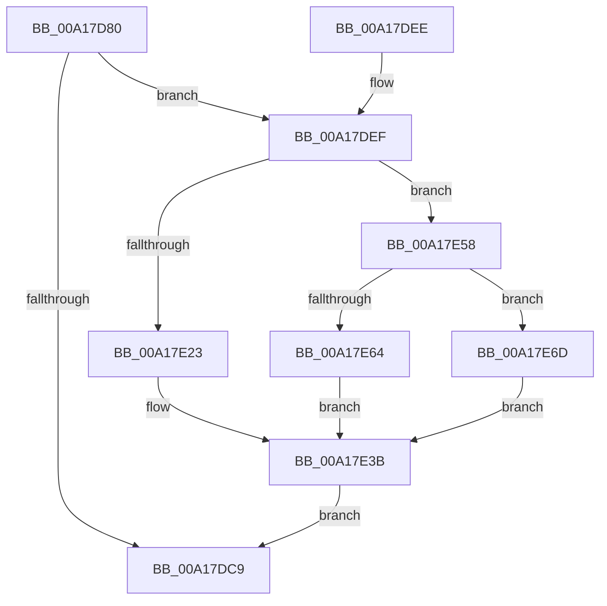

# EtwTraceWorkingSetSwap

- RVA: `0x00A17D80`–`0x00A17EB7` (길이 `311` bytes)
- VA: `0x0000000140A17D80`
- 실행 섹션: `PAGE`
- PDB 이름 있음: `예`; PDB Function 태그: `아니요`
- unwind 정보 RVA: `0x000AA0D0`
- 디코드: `81`개 명령, `311/311` bytes 표시
- 미해석 바이트: `0` (있으면 어셈블리에 `.byte`로 보존)

> 이 문서는 커널 이미지의 기계어와 PDB 기호를 분석해 생성했습니다. 4번과 5번은 함수 원형과 자료형을 바이너리 사용 방식에서 추정한 C 해석이며 원본 소스 복구 결과는 아닙니다.

## 1. Dependencies

- 직접 호출 지점: **4**; 고유 호출 대상: **4**
- 직접 호출자로 확인된 함수: **5**
- RIP 상대 이미지 참조: **6**

### Outgoing calls
- `0x00A17DC0` → [EtwProviderEnabled](../../text/3B/EtwProviderEnabled_function_003BA250.md) (function, `0x003BA250`)
- `0x00A17DD0` → [_security_check_cookie](../../text/6A/_security_check_cookie_function_006AC640.md) (function, `0x006AC640`)
- `0x00A17DF2` → [PsGetProcessId](../../text/43/PsGetProcessId_function_0043D910.md) (function, `0x0043D910`)
- `0x00A17E4E` → [EtwWrite](../../text/41/EtwWrite_function_0041C720.md) (function, `0x0041C720`)

### Direct callers
- [MmOutSwapWorkingSet](../../text/2A/MmOutSwapWorkingSet_function_002A6BC8.md) at `0x002A6C8B`
- [MmOutSwapWorkingSet](../../text/2A/MmOutSwapWorkingSet_function_002A6BC8.md) at `0x002A6D09`
- [MmOutSwapVirtualAddresses](../../text/2A/MmOutSwapVirtualAddresses_function_002A8C30.md) at `0x002A8CD0`
- [MmOutSwapVirtualAddresses](../../text/2A/MmOutSwapVirtualAddresses_function_002A8C30.md) at `0x002A8D96`
- [MmInSwapWorkingSet](../../text/45/MmInSwapWorkingSet_function_0045B6C4.md) at `0x0045B715`
- [MmInSwapWorkingSet](../../text/45/MmInSwapWorkingSet_function_0045B6C4.md) at `0x0045B831`
- [MiInSwapSharedWorkingSetWorker](../80/MiInSwapSharedWorkingSetWorker_function_0080C510.md) at `0x0080C579`
- [MiInSwapSharedWorkingSetWorker](../80/MiInSwapSharedWorkingSetWorker_function_0080C510.md) at `0x0080C5AF`
- [MmInSwapVirtualAddresses](MmInSwapVirtualAddresses_function_00A17CCC.md) at `0x00A17D13`
- [MmInSwapVirtualAddresses](MmInSwapVirtualAddresses_function_00A17CCC.md) at `0x00A17D54`

### Static image references
- `0x00A17D9B` → RVA `0x00E0A740` (`.data`; read)
- `0x00A17DB3` → RVA `0x00EFF848` (`.data`; read)
- `0x00A17E29` → RVA `0x000199D0` (`.rdata`; read)
- `0x00A17E30` → RVA `0x000199C0` (`.rdata`; read)
- `0x00A17E64` → RVA `0x000199E0` (`.rdata`; read)
- `0x00A17E79` → RVA `0x000199F0` (`.rdata`; read)

## 2. Other-region calls and transfers

- 다른 실행 섹션으로 향하는 call: **4**
  - `0x00A17DC0` → [EtwProviderEnabled](../../text/3B/EtwProviderEnabled_function_003BA250.md) (`PAGE` → `.text`)
  - `0x00A17DD0` → [_security_check_cookie](../../text/6A/_security_check_cookie_function_006AC640.md) (`PAGE` → `.text`)
  - `0x00A17DF2` → [PsGetProcessId](../../text/43/PsGetProcessId_function_0043D910.md) (`PAGE` → `.text`)
  - `0x00A17E4E` → [EtwWrite](../../text/41/EtwWrite_function_0041C720.md) (`PAGE` → `.text`)
- 별도 외부 분기/꼬리 이동을 확인하지 못했습니다.

## 3. Assembly (complete function range)

```asm
00A17D80  48 8B C4                        mov rax, rsp
00A17D83  48 89 58 08                     mov qword ptr [rax + 8], rbx
00A17D87  48 89 70 10                     mov qword ptr [rax + 0x10], rsi
00A17D8B  48 89 78 18                     mov qword ptr [rax + 0x18], rdi
00A17D8F  55                              push rbp
00A17D90  48 8D 68 A1                     lea rbp, [rax - 0x5f]
00A17D94  48 81 EC B0 00 00 00            sub rsp, 0xb0
00A17D9B  48 8B 05 9E 29 3F 00            mov rax, qword ptr [rip + 0x3f299e]
00A17DA2  48 33 C4                        xor rax, rsp
00A17DA5  48 89 45 47                     mov qword ptr [rbp + 0x47], rax
00A17DA9  49 8B D8                        mov rbx, r8
00A17DAC  8B FA                           mov edi, edx
00A17DAE  48 8B F1                        mov rsi, rcx
00A17DB1  33 D2                           xor edx, edx
00A17DB3  48 8B 0D 8E 7A 4E 00            mov rcx, qword ptr [rip + 0x4e7a8e]
00A17DBA  41 B8 80 00 00 00               mov r8d, 0x80
00A17DC0  E8 8B 24 9A FF                  call 0x1403ba250
00A17DC5  84 C0                           test al, al
00A17DC7  75 26                           jne 0x140a17def
00A17DC9  48 8B 4D 47                     mov rcx, qword ptr [rbp + 0x47]
00A17DCD  48 33 CC                        xor rcx, rsp
00A17DD0  E8 6B 48 C9 FF                  call 0x1406ac640
00A17DD5  4C 8D 9C 24 B0 00 00 00         lea r11, [rsp + 0xb0]
00A17DDD  49 8B 5B 10                     mov rbx, qword ptr [r11 + 0x10]
00A17DE1  49 8B 73 18                     mov rsi, qword ptr [r11 + 0x18]
00A17DE5  49 8B 7B 20                     mov rdi, qword ptr [r11 + 0x20]
00A17DE9  49 8B E3                        mov rsp, r11
00A17DEC  5D                              pop rbp
00A17DED  C3                              ret
00A17DEE  CC                              int3
00A17DEF  48 8B CE                        mov rcx, rsi
00A17DF2  E8 19 5B A2 FF                  call 0x14043d910
00A17DF7  83 65 F3 00                     and dword ptr [rbp - 0xd], 0
00A17DFB  BA 04 00 00 00                  mov edx, 4
00A17E00  83 65 03 00                     and dword ptr [rbp + 3], 0
00A17E04  8B CF                           mov ecx, edi
00A17E06  89 45 D7                        mov dword ptr [rbp - 0x29], eax
00A17E09  83 E1 01                        and ecx, 1
00A17E0C  48 8D 45 D7                     lea rax, [rbp - 0x29]
00A17E10  89 55 EF                        mov dword ptr [rbp - 0x11], edx
00A17E13  44 8D 4A FE                     lea r9d, [rdx - 2]
00A17E17  48 89 45 E7                     mov qword ptr [rbp - 0x19], rax
00A17E1B  89 55 FF                        mov dword ptr [rbp - 1], edx
00A17E1E  41 84 F9                        test r9b, dil
00A17E21  74 35                           je 0x140a17e58
00A17E23  85 C9                           test ecx, ecx
00A17E25  48 89 5D F7                     mov qword ptr [rbp - 9], rbx
00A17E29  48 8D 05 A0 1B 60 FF            lea rax, [rip - 0x9fe460]
00A17E30  48 8D 15 89 1B 60 FF            lea rdx, [rip - 0x9fe477]
00A17E37  48 0F 44 D0                     cmove rdx, rax
00A17E3B  48 8B 0D 06 7A 4E 00            mov rcx, qword ptr [rip + 0x4e7a06]
00A17E42  48 8D 45 E7                     lea rax, [rbp - 0x19]
00A17E46  45 33 C0                        xor r8d, r8d
00A17E49  48 89 44 24 20                  mov qword ptr [rsp + 0x20], rax
00A17E4E  E8 CD 48 A0 FF                  call 0x14041c720
00A17E53  E9 71 FF FF FF                  jmp 0x140a17dc9
00A17E58  48 8D 43 20                     lea rax, [rbx + 0x20]
00A17E5C  48 89 45 F7                     mov qword ptr [rbp - 9], rax
00A17E60  85 C9                           test ecx, ecx
00A17E62  74 09                           je 0x140a17e6d
00A17E64  48 8D 15 75 1B 60 FF            lea rdx, [rip - 0x9fe48b]
00A17E6B  EB CE                           jmp 0x140a17e3b
00A17E6D  83 65 13 00                     and dword ptr [rbp + 0x13], 0
00A17E71  48 8D 43 08                     lea rax, [rbx + 8]
00A17E75  83 65 23 00                     and dword ptr [rbp + 0x23], 0
00A17E79  48 8D 15 70 1B 60 FF            lea rdx, [rip - 0x9fe490]
00A17E80  83 65 33 00                     and dword ptr [rbp + 0x33], 0
00A17E84  B9 08 00 00 00                  mov ecx, 8
00A17E89  83 65 43 00                     and dword ptr [rbp + 0x43], 0
00A17E8D  48 89 45 17                     mov qword ptr [rbp + 0x17], rax
00A17E91  48 8D 43 10                     lea rax, [rbx + 0x10]
00A17E95  48 89 45 27                     mov qword ptr [rbp + 0x27], rax
00A17E99  48 8D 43 18                     lea rax, [rbx + 0x18]
00A17E9D  48 89 45 37                     mov qword ptr [rbp + 0x37], rax
00A17EA1  44 8D 49 FE                     lea r9d, [rcx - 2]
00A17EA5  48 89 5D 07                     mov qword ptr [rbp + 7], rbx
00A17EA9  89 4D 0F                        mov dword ptr [rbp + 0xf], ecx
00A17EAC  89 4D 1F                        mov dword ptr [rbp + 0x1f], ecx
00A17EAF  89 4D 2F                        mov dword ptr [rbp + 0x2f], ecx
00A17EB2  89 4D 3F                        mov dword ptr [rbp + 0x3f], ecx
00A17EB5  EB 84                           jmp 0x140a17e3b
```

## 4. C-style interpretation (structured pseudocode)

```c
__int64 __fastcall EtwTraceWorkingSetSwap(__int64 a1, int a2, __int64 a3)
{
    __int64 result;
    __int64 v_rsp;
    unsigned __int64 v_stack_m8;
    unsigned __int64 v_stack_m90;

    *(unsigned __int64 *)(v_rsp + 8) = v_rbx;
    *(unsigned __int64 *)(v_rsp + 16) = v_rsi;
    *(unsigned __int64 *)(v_rsp + 24) = v_rdi;
    v_rsp = (v_rsp) - (176);
    result = (*(unsigned __int64 *)(v_rip + 4139422)) ^ (v_rsp);
    *(unsigned __int64 *)(v_rsp - 95 + 71) = result;
    a2 = 0;
    result = EtwProviderEnabled(*(unsigned __int64 *)(v_rip + 5143182), a2, 128, a4);
    if ((unsigned __int8)(result) != 0) goto loc_00A17DEF;
loc_00A17DC9:
    a1 = (*(unsigned __int64 *)(v_rsp - 95 + 71)) ^ (v_rsp);
    result = _security_check_cookie(a1, a2, 128, a4);
    return result;
loc_00A17DEF:
    result = PsGetProcessId(*(unsigned __int64 *)(v_stack_m8 + 24), a2, 128, a4);
    *(unsigned int *)(v_rsp - 95 - 41) = (unsigned int)(result);
    a1 = (unsigned int)(((unsigned int)((unsigned int)(*(unsigned __int64 *)(v_stack_m8 + 32)))) & (1));
    *(unsigned int *)(v_rsp - 95 - 17) = 4;
    *(unsigned __int64 *)(v_rsp - 95 - 25) = v_rsp - 95 - 41;
    *(unsigned int *)(v_rsp - 95 - 1) = 4;
    if ((((unsigned __int8)(4 - 2)) & ((unsigned __int8)(*(unsigned __int64 *)(v_stack_m8 + 32)))) == 0) goto loc_00A17E58;
    *(unsigned __int64 *)(v_rsp - 95 - 9) = *(unsigned __int64 *)(v_stack_m8 + 16);
    a2 = v_rip - 10478711;
    if ((unsigned int)(a1) == 0) { a2 = v_rip - 10478688; }
loc_00A17E3B:
    a3 = 0;
    v_stack_m90 = v_rsp - 95 - 25;
    result = EtwWrite(*(unsigned __int64 *)(v_rip + 5143046), a2, a3, 4 - 2);
    goto loc_00A17DC9;
loc_00A17E58:
    *(unsigned __int64 *)(v_rsp - 95 - 9) = *(unsigned __int64 *)(v_stack_m8 + 16) + 32;
    if ((unsigned int)(*(unsigned __int64 *)(v_rip + 5143046)) == 0) goto loc_00A17E6D;
    goto loc_00A17E3B;
loc_00A17E6D:
    *(unsigned __int64 *)(v_rsp - 95 + 23) = *(unsigned __int64 *)(v_stack_m8 + 16) + 8;
    *(unsigned __int64 *)(v_rsp - 95 + 39) = *(unsigned __int64 *)(v_stack_m8 + 16) + 16;
    *(unsigned __int64 *)(v_rsp - 95 + 55) = *(unsigned __int64 *)(v_stack_m8 + 16) + 24;
    *(unsigned __int64 *)(v_rsp - 95 + 7) = *(unsigned __int64 *)(v_stack_m8 + 16);
    *(unsigned int *)(v_rsp - 95 + 15) = 8;
    *(unsigned int *)(v_rsp - 95 + 31) = 8;
    *(unsigned int *)(v_rsp - 95 + 47) = 8;
    *(unsigned int *)(v_rsp - 95 + 63) = 8;
    goto loc_00A17E3B;
}
```

## 5. (Beta) C Style

```c
int64_t EtwTraceWorkingSetSwap(int64_t Arg1, int32_t Arg2, void *Arg3)
{
    uint8_t *arg3 = (uint8_t *)Arg3;

    int64_t result;
    int64_t local_rsp;
    uint64_t v_stack_m8;
    uint64_t v_stack_m90;

    *(uint64_t *)(local_rsp + 0x8) = local_rbx;
    *(uint64_t *)(local_rsp + 0x10) = local_rsi;
    *(uint64_t *)(local_rsp + 0x18) = local_rdi;
    local_rsp = (local_rsp) - (176);
    result = (*(uint64_t *)(v_rip + 0x3F299E)) ^ (local_rsp);
    *(uint64_t *)(local_rsp - 0x5F + 0x47) = result;
    Arg2 = 0;
    result = EtwProviderEnabled(*(uint64_t *)(v_rip + 0x4E7A8E), Arg2, 128, a4);
    if ((uint8_t)(result) != 0) goto loc_00A17DEF;
loc_00A17DC9:
    Arg1 = (*(uint64_t *)(local_rsp - 0x5F + 0x47)) ^ (local_rsp);
    result = _security_check_cookie(Arg1, Arg2, 128, a4);
    return result;
loc_00A17DEF:
    result = PsGetProcessId(*(uint64_t *)(v_stack_m8 + 0x18), Arg2, 128, a4);
    *(uint32_t *)(local_rsp - 0x5F - 0x29) = (uint32_t)(result);
    Arg1 = (uint32_t)(((uint32_t)((uint32_t)(*(uint64_t *)(v_stack_m8 + 0x20)))) & (1));
    *(uint32_t *)(local_rsp - 0x5F - 0x11) = 4;
    *(uint64_t *)(local_rsp - 0x5F - 0x19) = local_rsp - 95 - 41;
    *(uint32_t *)(local_rsp - 0x5F - 0x1) = 4;
    if ((((uint8_t)(4 - 2)) & ((uint8_t)(*(uint64_t *)(v_stack_m8 + 0x20)))) == 0) goto loc_00A17E58;
    *(uint64_t *)(local_rsp - 0x5F - 0x9) = *(uint64_t *)(v_stack_m8 + 0x10);
    Arg2 = v_rip - 10478711;
    if ((uint32_t)(Arg1) == 0) { Arg2 = v_rip - 10478688; }
loc_00A17E3B:
    Arg3 = 0;
    v_stack_m90 = local_rsp - 95 - 25;
    result = EtwWrite(*(uint64_t *)(v_rip + 0x4E7A06), Arg2, Arg3, 4 - 2);
    goto loc_00A17DC9;
loc_00A17E58:
    *(uint64_t *)(local_rsp - 0x5F - 0x9) = *(uint64_t *)(v_stack_m8 + 0x10) + 32;
    if ((uint32_t)(*(uint64_t *)(v_rip + 0x4E7A06)) == 0) goto loc_00A17E6D;
    goto loc_00A17E3B;
loc_00A17E6D:
    *(uint64_t *)(local_rsp - 0x5F + 0x17) = *(uint64_t *)(v_stack_m8 + 0x10) + 8;
    *(uint64_t *)(local_rsp - 0x5F + 0x27) = *(uint64_t *)(v_stack_m8 + 0x10) + 16;
    *(uint64_t *)(local_rsp - 0x5F + 0x37) = *(uint64_t *)(v_stack_m8 + 0x10) + 24;
    *(uint64_t *)(local_rsp - 0x5F + 0x7) = *(uint64_t *)(v_stack_m8 + 0x10);
    *(uint32_t *)(local_rsp - 0x5F + 0xF) = 8;
    *(uint32_t *)(local_rsp - 0x5F + 0x1F) = 8;
    *(uint32_t *)(local_rsp - 0x5F + 0x2F) = 8;
    *(uint32_t *)(local_rsp - 0x5F + 0x3F) = 8;
    goto loc_00A17E3B;
}
```

### 관측된 메모리 오프셋

구조체 형식이 확인되지 않은 접근은 인자 기준의 오프셋으로만 기록했습니다.

| 기준 인자 | 오프셋 표현 | 폭 (bit) | 접근 |
|---|---:|---:|---|
| `Arg3` | `+ 0x8` | `64` | `R` |
| `Arg3` | `+ 0x10` | `64` | `R` |
| `Arg3` | `+ 0x18` | `64` | `R` |
| `Arg3` | `+ 0x20` | `64` | `R` |

## 6. Execution-region graph

[열기: 2D/3D 그래프와 함수 탐색 컨트롤 패널](../../../control-panel.html?section=page&rva=0x00A17D80&view=graph)

- 2D 그래프는 위에서 아래로 흐르고, 3D 그래프는 빈 공간을 드래그해 회전합니다. Shift+드래그는 이동, 휠은 확대·축소, 함수 노드 선택은 대상 보고서 이동입니다.

### Static fallback


