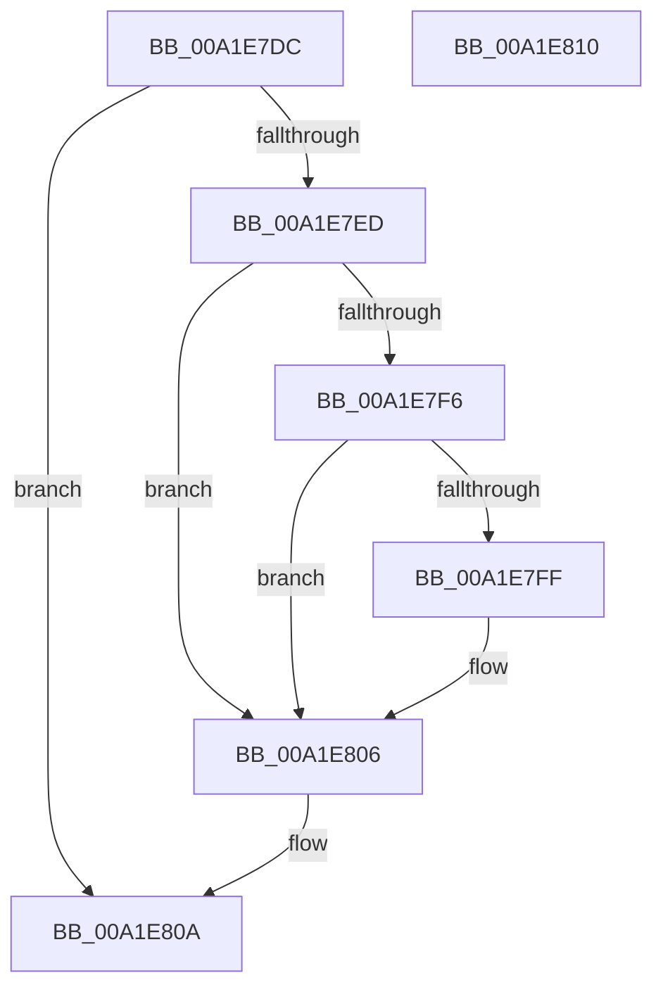

# EtwpFreeSecurityDescriptor

- RVA: `0x00A1E7DC`–`0x00A1E811` (길이 `53` bytes)
- VA: `0x0000000140A1E7DC`
- 실행 섹션: `PAGE`
- PDB 이름 있음: `예`; PDB Function 태그: `아니요`
- unwind 정보 RVA: `0x0005CF00`
- 디코드: `17`개 명령, `53/53` bytes 표시
- 미해석 바이트: `0` (있으면 어셈블리에 `.byte`로 보존)

> 이 문서는 커널 이미지의 기계어와 PDB 기호를 분석해 생성했습니다. 4번과 5번은 함수 원형과 자료형을 바이너리 사용 방식에서 추정한 C 해석이며 원본 소스 복구 결과는 아닙니다.

## 1. Dependencies

- 직접 호출 지점: **1**; 고유 호출 대상: **1**
- 직접 호출자로 확인된 함수: **3**
- RIP 상대 이미지 참조: **2**

### Outgoing calls
- `0x00A1E801` → [ExFreePoolWithTag](../../poolcode/B8/ExFreePoolWithTag_function_00B82870.md) (function, `0x00B82870`)

### Direct callers
- [EtwpStartLogger](../A9/EtwpStartLogger_function_00A99D80.md) at `0x00A9A08E`
- [EtwpStartLogger](../A9/EtwpStartLogger_function_00A99D80.md) at `0x00A9AC7B`
- [EtwpUpdateTrace](../AB/EtwpUpdateTrace_function_00ABCC7C.md) at `0x00ABD090`
- [EtwpFixBootLoggers](../../init/C4/EtwpFixBootLoggers_function_00C4F09C.md) at `0x00C4F137`

### Static image references
- `0x00A1E7ED` → RVA `0x00FC6D68` (`ALMOSTRO`; read)
- `0x00A1E7F6` → RVA `0x00E68510` (`.data`; read)

## 2. Other-region calls and transfers

- 다른 실행 섹션으로 향하는 call: **1**
  - `0x00A1E801` → [ExFreePoolWithTag](../../poolcode/B8/ExFreePoolWithTag_function_00B82870.md) (`PAGE` → `POOLCODE`)
- 별도 외부 분기/꼬리 이동을 확인하지 못했습니다.

## 3. Assembly (complete function range)

```asm
00A1E7DC  40 53                           push rbx
00A1E7DE  48 83 EC 20                     sub rsp, 0x20
00A1E7E2  48 8B D9                        mov rbx, rcx
00A1E7E5  48 8B 09                        mov rcx, qword ptr [rcx]
00A1E7E8  48 85 C9                        test rcx, rcx
00A1E7EB  74 1D                           je 0x140a1e80a
00A1E7ED  48 3B 0D 74 85 5A 00            cmp rcx, qword ptr [rip + 0x5a8574]
00A1E7F4  74 10                           je 0x140a1e806
00A1E7F6  48 3B 0D 13 9D 44 00            cmp rcx, qword ptr [rip + 0x449d13]
00A1E7FD  74 07                           je 0x140a1e806
00A1E7FF  33 D2                           xor edx, edx
00A1E801  E8 6A 40 16 00                  call 0x140b82870
00A1E806  48 83 23 00                     and qword ptr [rbx], 0
00A1E80A  48 83 C4 20                     add rsp, 0x20
00A1E80E  5B                              pop rbx
00A1E80F  C3                              ret
00A1E810  CC                              int3
```

## 4. C-style interpretation (structured pseudocode)

```c
__int64 __fastcall EtwpFreeSecurityDescriptor(__int64 a1, int a2)
{
    __int64 result;
    __int64 v_rsp;

    v_rsp = (v_rsp) - (32);
    if (*(unsigned __int64 *)(a1) == 0) goto loc_00A1E80A;
    if ((*(unsigned __int64 *)(a1)) == (*(unsigned __int64 *)(v_rip + 5932404))) goto loc_00A1E806;
    if ((*(unsigned __int64 *)(a1)) != (*(unsigned __int64 *)(v_rip + 4496659))) {
        a2 = 0;
        result = ExFreePoolWithTag(*(unsigned __int64 *)(a1), a2, a3, a4);
    }
loc_00A1E80A:
    v_rsp = (v_rsp) + (32);
    return result;
}
```

## 5. (Beta) C Style

```c
int64_t EtwpFreeSecurityDescriptor(void *Arg1, int32_t Arg2)
{
    uint8_t *arg1 = (uint8_t *)Arg1;

    int64_t result;
    int64_t local_rsp;

    local_rsp = (local_rsp) - (32);
    if (*(uint64_t *)(arg1) == 0) goto loc_00A1E80A;
    if ((*(uint64_t *)(arg1)) == (*(uint64_t *)(v_rip + 0x5A8574))) goto loc_00A1E806;
    if ((*(uint64_t *)(arg1)) != (*(uint64_t *)(v_rip + 0x449D13))) {
        Arg2 = 0;
        result = ExFreePoolWithTag(*(uint64_t *)(arg1), Arg2, a3, a4);
    }
loc_00A1E80A:
    local_rsp = (local_rsp) + (32);
    return result;
}
```

### 관측된 메모리 오프셋

구조체 형식이 확인되지 않은 접근은 인자 기준의 오프셋으로만 기록했습니다.

| 기준 인자 | 오프셋 표현 | 폭 (bit) | 접근 |
|---|---:|---:|---|
| `Arg1` | `+ 0x0` | `64` | `R` |
| `Arg1` | `+ 0x0` | `64` | `R/W` |

## 6. Execution-region graph

[열기: 2D/3D 그래프와 함수 탐색 컨트롤 패널](../../../control-panel.html?section=page&rva=0x00A1E7DC&view=graph)

- 2D 그래프는 위에서 아래로 흐르고, 3D 그래프는 빈 공간을 드래그해 회전합니다. Shift+드래그는 이동, 휠은 확대·축소, 함수 노드 선택은 대상 보고서 이동입니다.

### Static fallback


