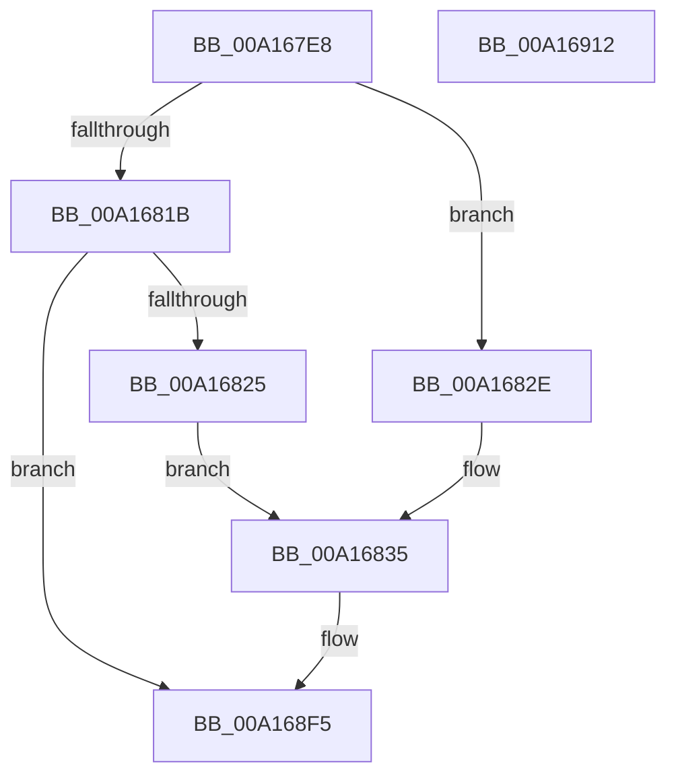

# EtwpPsProvTraceImage

- RVA: `0x00A167E8`–`0x00A16913` (길이 `299` bytes)
- VA: `0x0000000140A167E8`
- 실행 섹션: `PAGE`
- PDB 이름 있음: `예`; PDB Function 태그: `아니요`
- unwind 정보 RVA: `0x0006FCAC`
- 디코드: `70`개 명령, `299/299` bytes 표시
- 미해석 바이트: `0` (있으면 어셈블리에 `.byte`로 보존)

> 이 문서는 커널 이미지의 기계어와 PDB 기호를 분석해 생성했습니다. 4번과 5번은 함수 원형과 자료형을 바이너리 사용 방식에서 추정한 C 해석이며 원본 소스 복구 결과는 아닙니다.

## 1. Dependencies

- 직접 호출 지점: **2**; 고유 호출 대상: **2**
- 직접 호출자로 확인된 함수: **1**
- RIP 상대 이미지 참조: **5**

### Outgoing calls
- `0x00A168F0` → [EtwWriteEx](../../text/25/EtwWriteEx_function_0025F0D0.md) (function, `0x0025F0D0`)
- `0x00A168FC` → [_security_check_cookie](../../text/6A/_security_check_cookie_function_006AC640.md) (function, `0x006AC640`)

### Direct callers
- [EtwpTraceImageUnload](../../text/44/EtwpTraceImageUnload_function_0044C048.md) at `0x0044C110`

### Static image references
- `0x00A167FA` → RVA `0x00E0A740` (`.data`; read)
- `0x00A16825` → RVA `0x000199B0` (`.rdata`; read)
- `0x00A1682E` → RVA `0x00011410` (`.rdata`; read)
- `0x00A168A3` → RVA `0x00EFF9E8` (`.data`; read)
- `0x00A168AD` → RVA `0x000105E0` (`.rdata`; read)

## 2. Other-region calls and transfers

- 다른 실행 섹션으로 향하는 call: **2**
  - `0x00A168F0` → [EtwWriteEx](../../text/25/EtwWriteEx_function_0025F0D0.md) (`PAGE` → `.text`)
  - `0x00A168FC` → [_security_check_cookie](../../text/6A/_security_check_cookie_function_006AC640.md) (`PAGE` → `.text`)
- 별도 외부 분기/꼬리 이동을 확인하지 못했습니다.

## 3. Assembly (complete function range)

```asm
00A167E8  48 89 5C 24 08                  mov qword ptr [rsp + 8], rbx
00A167ED  55                              push rbp
00A167EE  48 8D 6C 24 A9                  lea rbp, [rsp - 0x57]
00A167F3  48 81 EC D0 00 00 00            sub rsp, 0xd0
00A167FA  48 8B 05 3F 3F 3F 00            mov rax, qword ptr [rip + 0x3f3f3f]
00A16801  48 33 C4                        xor rax, rsp
00A16804  48 89 45 47                     mov qword ptr [rbp + 0x47], rax
00A16808  45 0F B7 D0                     movzx r10d, r8w
00A1680C  41 8B D9                        mov ebx, r9d
00A1680F  4C 8B DA                        mov r11, rdx
00A16812  41 81 EA 01 14 00 00            sub r10d, 0x1401
00A16819  74 13                           je 0x140a1682e
00A1681B  41 83 FA 01                     cmp r10d, 1
00A1681F  0F 85 D0 00 00 00               jne 0x140a168f5
00A16825  48 8D 15 84 31 60 FF            lea rdx, [rip - 0x9fce7c]
00A1682C  EB 07                           jmp 0x140a16835
00A1682E  48 8D 15 DB AB 5F FF            lea rdx, [rip - 0xa05425]
00A16835  83 65 D3 00                     and dword ptr [rbp - 0x2d], 0
00A16839  49 8D 43 08                     lea rax, [r11 + 8]
00A1683D  83 65 E3 00                     and dword ptr [rbp - 0x1d], 0
00A16841  41 BA 08 00 00 00               mov r10d, 8
00A16847  83 65 F3 00                     and dword ptr [rbp - 0xd], 0
00A1684B  45 33 C9                        xor r9d, r9d
00A1684E  83 65 03 00                     and dword ptr [rbp + 3], 0
00A16852  83 65 13 00                     and dword ptr [rbp + 0x13], 0
00A16856  83 65 23 00                     and dword ptr [rbp + 0x23], 0
00A1685A  45 8D 42 FC                     lea r8d, [r10 - 4]
00A1685E  83 65 33 00                     and dword ptr [rbp + 0x33], 0
00A16862  83 65 43 00                     and dword ptr [rbp + 0x43], 0
00A16866  48 89 45 D7                     mov qword ptr [rbp - 0x29], rax
00A1686A  85 DB                           test ebx, ebx
00A1686C  49 8D 43 10                     lea rax, [r11 + 0x10]
00A16870  44 89 45 EF                     mov dword ptr [rbp - 0x11], r8d
00A16874  48 89 45 E7                     mov qword ptr [rbp - 0x19], rax
00A16878  41 0F 95 C1                     setne r9b
00A1687C  49 8D 43 14                     lea rax, [r11 + 0x14]
00A16880  44 89 45 FF                     mov dword ptr [rbp - 1], r8d
00A16884  48 89 45 F7                     mov qword ptr [rbp - 9], rax
00A16888  49 8D 43 18                     lea rax, [r11 + 0x18]
00A1688C  48 89 45 07                     mov qword ptr [rbp + 7], rax
00A16890  49 8D 43 20                     lea rax, [r11 + 0x20]
00A16894  48 89 45 17                     mov qword ptr [rbp + 0x17], rax
00A16898  48 8B 41 08                     mov rax, qword ptr [rcx + 8]
00A1689C  48 89 45 27                     mov qword ptr [rbp + 0x27], rax
00A168A0  0F B7 01                        movzx eax, word ptr [rcx]
00A168A3  48 8B 0D 3E 91 4E 00            mov rcx, qword ptr [rip + 0x4e913e]
00A168AA  89 45 2F                        mov dword ptr [rbp + 0x2f], eax
00A168AD  48 8D 05 2C 9D 5F FF            lea rax, [rip - 0xa062d4]
00A168B4  48 89 45 37                     mov qword ptr [rbp + 0x37], rax
00A168B8  48 8D 45 C7                     lea rax, [rbp - 0x39]
00A168BC  48 89 44 24 38                  mov qword ptr [rsp + 0x38], rax
00A168C1  44 89 54 24 30                  mov dword ptr [rsp + 0x30], r10d
00A168C6  48 83 64 24 28 00               and qword ptr [rsp + 0x28], 0
00A168CC  48 83 64 24 20 00               and qword ptr [rsp + 0x20], 0
00A168D2  44 89 45 0F                     mov dword ptr [rbp + 0xf], r8d
00A168D6  45 33 C0                        xor r8d, r8d
00A168D9  4C 89 5D C7                     mov qword ptr [rbp - 0x39], r11
00A168DD  44 89 55 CF                     mov dword ptr [rbp - 0x31], r10d
00A168E1  44 89 55 DF                     mov dword ptr [rbp - 0x21], r10d
00A168E5  44 89 55 1F                     mov dword ptr [rbp + 0x1f], r10d
00A168E9  C7 45 3F 02 00 00 00            mov dword ptr [rbp + 0x3f], 2
00A168F0  E8 DB 87 84 FF                  call 0x14025f0d0
00A168F5  48 8B 4D 47                     mov rcx, qword ptr [rbp + 0x47]
00A168F9  48 33 CC                        xor rcx, rsp
00A168FC  E8 3F 5D C9 FF                  call 0x1406ac640
00A16901  48 8B 9C 24 E0 00 00 00         mov rbx, qword ptr [rsp + 0xe0]
00A16909  48 81 C4 D0 00 00 00            add rsp, 0xd0
00A16910  5D                              pop rbp
00A16911  C3                              ret
00A16912  CC                              int3
```

## 4. C-style interpretation (structured pseudocode)

```c
__int64 __fastcall EtwpPsProvTraceImage(__int64 a1, __int64 a2, unsigned __int16 a3, int a4)
{
    __int64 result;
    __int64 v_r10;
    __int64 v_rsp;
    unsigned __int64 v_stack_m18;
    unsigned int v_stack_m1C;
    unsigned int v_stack_m20;
    unsigned __int64 v_stack_m28;
    unsigned int v_stack_m2C;
    unsigned int v_stack_m30;
    unsigned __int64 v_stack_m38;
    unsigned int v_stack_m3C;
    unsigned int v_stack_m40;
    unsigned __int64 v_stack_m48;
    unsigned int v_stack_m4C;
    unsigned int v_stack_m50;
    unsigned __int64 v_stack_m58;
    unsigned int v_stack_m5C;
    unsigned __int64 v_stack_m5F;
    unsigned int v_stack_m60;
    unsigned __int64 v_stack_m68;
    unsigned int v_stack_m6C;
    unsigned int v_stack_m70;
    unsigned __int64 v_stack_m78;
    unsigned int v_stack_m7C;
    unsigned int v_stack_m80;
    unsigned __int64 v_stack_m88;
    unsigned int v_stack_m8C;
    unsigned int v_stack_m90;
    unsigned __int64 v_stack_m98;
    unsigned __int64 v_stack_mA0;
    unsigned int v_stack_mA8;
    unsigned __int64 v_stack_mB0;
    unsigned __int64 v_stack_mB8;
    unsigned __int64 v_stack_p8;

    v_stack_p8 = v_rbx;
    v_rsp = (v_rsp) - (208);
    result = (*(unsigned __int64 *)(v_rip + 4144959)) ^ (v_rsp);
    v_stack_m18 = result;
    v_r10 = (unsigned int)((a3) - (0x1401ULL));
    if (condition_is_equal) goto loc_00A1682E;
    if (((unsigned int)(v_r10)) != 1) goto loc_00A168F5;
    goto loc_00A16835;
loc_00A1682E:
loc_00A16835:
    a4 = 0;
    v_stack_m88 = a2 + 8;
    v_stack_m70 = (unsigned int)(8 - 4);
    v_stack_m78 = a2 + 16;
    a4 = ((unsigned int)((unsigned int)(a4)) != 0) ? 1 : 0;
    v_stack_m60 = (unsigned int)(8 - 4);
    v_stack_m68 = a2 + 20;
    v_stack_m58 = a2 + 24;
    v_stack_m48 = a2 + 32;
    v_stack_m38 = *(unsigned __int64 *)(a1 + 8);
    v_stack_m30 = (unsigned int)(*(unsigned __int16 *)(a1));
    v_stack_m28 = v_rip - 10511060;
    v_stack_mA0 = v_stack_m98;
    v_stack_mA8 = 8;
    v_stack_m50 = (unsigned int)(8 - 4);
    a3 = 0;
    v_stack_m98 = a2;
    v_stack_m90 = 8;
    v_stack_m80 = 8;
    v_stack_m40 = 8;
    v_stack_m20 = 2;
    result = EtwWriteEx(*(unsigned __int64 *)(v_rip + 5148990), v_rip - 10507301, a3, a4);
loc_00A168F5:
    a1 = (v_stack_m18) ^ (v_rsp);
    result = _security_check_cookie(a1, v_rip - 10507301, a3, a4);
    v_rsp = (v_rsp) + (208);
    return result;
}
```

## 5. (Beta) C Style

```c
int64_t EtwpPsProvTraceImage(void *Arg1, void *Arg2, uint16_t Arg3, int32_t Arg4)
{
    uint8_t *arg1 = (uint8_t *)Arg1;
    uint8_t *arg2 = (uint8_t *)Arg2;

    int64_t result;
    int64_t local_r10;
    int64_t local_rsp;
    uint64_t v_stack_m18;
    uint32_t v_stack_m1C;
    uint32_t v_stack_m20;
    uint64_t v_stack_m28;
    uint32_t v_stack_m2C;
    uint32_t v_stack_m30;
    uint64_t v_stack_m38;
    uint32_t v_stack_m3C;
    uint32_t v_stack_m40;
    uint64_t v_stack_m48;
    uint32_t v_stack_m4C;
    uint32_t v_stack_m50;
    uint64_t v_stack_m58;
    uint32_t v_stack_m5C;
    uint64_t v_stack_m5F;
    uint32_t v_stack_m60;
    uint64_t v_stack_m68;
    uint32_t v_stack_m6C;
    uint32_t v_stack_m70;
    uint64_t v_stack_m78;
    uint32_t v_stack_m7C;
    uint32_t v_stack_m80;
    uint64_t v_stack_m88;
    uint32_t v_stack_m8C;
    uint32_t v_stack_m90;
    uint64_t v_stack_m98;
    uint64_t v_stack_mA0;
    uint32_t v_stack_mA8;
    uint64_t v_stack_mB0;
    uint64_t v_stack_mB8;
    uint64_t v_stack_p8;

    v_stack_p8 = local_rbx;
    local_rsp = (local_rsp) - (208);
    result = (*(uint64_t *)(v_rip + 0x3F3F3F)) ^ (local_rsp);
    v_stack_m18 = result;
    local_r10 = (uint32_t)((Arg3) - (0x1401ULL));
    if (condition_is_equal) goto loc_00A1682E;
    if (((uint32_t)(local_r10)) != 1) goto loc_00A168F5;
    goto loc_00A16835;
loc_00A1682E:
loc_00A16835:
    Arg4 = 0;
    v_stack_m88 = Arg2 + 8;
    v_stack_m70 = (uint32_t)(8 - 4);
    v_stack_m78 = Arg2 + 16;
    Arg4 = ((uint32_t)((uint32_t)(Arg4)) != 0) ? 1 : 0;
    v_stack_m60 = (uint32_t)(8 - 4);
    v_stack_m68 = Arg2 + 20;
    v_stack_m58 = Arg2 + 24;
    v_stack_m48 = Arg2 + 32;
    v_stack_m38 = *(uint64_t *)(arg1 + 0x8);
    v_stack_m30 = (uint32_t)(*(uint16_t *)(arg1));
    v_stack_m28 = v_rip - 10511060;
    v_stack_mA0 = v_stack_m98;
    v_stack_mA8 = 8;
    v_stack_m50 = (uint32_t)(8 - 4);
    Arg3 = 0;
    v_stack_m98 = Arg2;
    v_stack_m90 = 8;
    v_stack_m80 = 8;
    v_stack_m40 = 8;
    v_stack_m20 = 2;
    result = EtwWriteEx(*(uint64_t *)(v_rip + 0x4E913E), v_rip - 10507301, Arg3, Arg4);
loc_00A168F5:
    Arg1 = (v_stack_m18) ^ (local_rsp);
    result = _security_check_cookie(Arg1, v_rip - 10507301, Arg3, Arg4);
    local_rsp = (local_rsp) + (208);
    return result;
}
```

### 관측된 메모리 오프셋

구조체 형식이 확인되지 않은 접근은 인자 기준의 오프셋으로만 기록했습니다.

| 기준 인자 | 오프셋 표현 | 폭 (bit) | 접근 |
|---|---:|---:|---|
| `Arg1` | `+ 0x0` | `16` | `R` |
| `Arg1` | `+ 0x8` | `64` | `R` |
| `Arg2` | `+ 0x8` | `64` | `R` |
| `Arg2` | `+ 0x10` | `64` | `R` |
| `Arg2` | `+ 0x14` | `64` | `R` |
| `Arg2` | `+ 0x18` | `64` | `R` |
| `Arg2` | `+ 0x20` | `64` | `R` |

## 6. Execution-region graph

[열기: 2D/3D 그래프와 함수 탐색 컨트롤 패널](../../../control-panel.html?section=page&rva=0x00A167E8&view=graph)

- 2D 그래프는 위에서 아래로 흐르고, 3D 그래프는 빈 공간을 드래그해 회전합니다. Shift+드래그는 이동, 휠은 확대·축소, 함수 노드 선택은 대상 보고서 이동입니다.

### Static fallback


