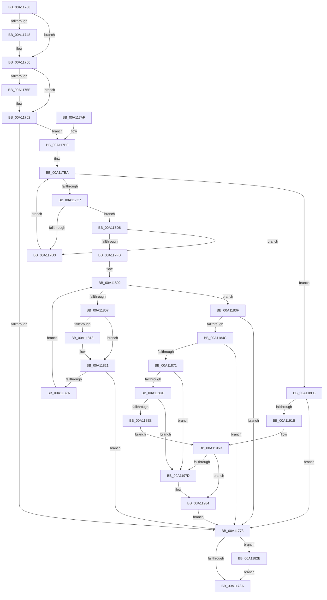

# EtwpTrackBinaryForSession

- RVA: `0x00A11708`–`0x00A119A2` (길이 `666` bytes)
- VA: `0x0000000140A11708`
- 실행 섹션: `PAGE`
- PDB 이름 있음: `예`; PDB Function 태그: `아니요`
- unwind 정보 RVA: `0x000A956C`
- 디코드: `173`개 명령, `666/666` bytes 표시
- 미해석 바이트: `0` (있으면 어셈블리에 `.byte`로 보존)

> 이 문서는 커널 이미지의 기계어와 PDB 기호를 분석해 생성했습니다. 4번과 5번은 함수 원형과 자료형을 바이너리 사용 방식에서 추정한 C 해석이며 원본 소스 복구 결과는 아닙니다.

## 1. Dependencies

- 직접 호출 지점: **11**; 고유 호출 대상: **8**
- 직접 호출자로 확인된 함수: **1**
- RIP 상대 이미지 참조: **0**

### Outgoing calls
- `0x00A11738` → [KeAbPreAcquire](../../text/21/KeAbPreAcquire_function_00210230.md) (function, `0x00210230`)
- `0x00A11751` → [ExfAcquirePushLockExclusiveEx](../../text/20/ExfAcquirePushLockExclusiveEx_function_0020FC90.md) (function, `0x0020FC90`)
- `0x00A11791` → [KeAbPostRelease](../../text/2E/KeAbPostRelease_function_002E1600.md) (function, `0x002E1600`)
- `0x00A117EA` → [RtlCompareMemory](../../text/6B/RtlCompareMemory_function_006BA670.md) (function, `0x006BA670`)
- `0x00A11835` → [ExfTryToWakePushLock](../../text/26/ExfTryToWakePushLock_function_00265DD0.md) (function, `0x00265DD0`)
- `0x00A11860` → [ExAllocatePool2](../../poolcode/B8/ExAllocatePool2_function_00B820F0.md) (function, `0x00B820F0`)
- `0x00A11881` → [memcpy](../../text/6C/memcpy_function_006C6840.md) (function, `0x006C6840`)
- `0x00A118C9` → [memcpy](../../text/6C/memcpy_function_006C6840.md) (function, `0x006C6840`)
- `0x00A118F4` → [ExFreePoolWithTag](../../poolcode/B8/ExFreePoolWithTag_function_00B82870.md) (function, `0x00B82870`)
- `0x00A1190A` → [ExAllocatePool2](../../poolcode/B8/ExAllocatePool2_function_00B820F0.md) (function, `0x00B820F0`)
- `0x00A11949` → [memcpy](../../text/6C/memcpy_function_006C6840.md) (function, `0x006C6840`)

### Direct callers
- [EtwpProviderArrivalCallback](../A0/EtwpProviderArrivalCallback_function_00A03F94.md) at `0x00A04044`

### Static image references
- 디코드된 RIP-relative 메모리 참조가 없습니다.

## 2. Other-region calls and transfers

- 다른 실행 섹션으로 향하는 call: **11**
  - `0x00A11738` → [KeAbPreAcquire](../../text/21/KeAbPreAcquire_function_00210230.md) (`PAGE` → `.text`)
  - `0x00A11751` → [ExfAcquirePushLockExclusiveEx](../../text/20/ExfAcquirePushLockExclusiveEx_function_0020FC90.md) (`PAGE` → `.text`)
  - `0x00A11791` → [KeAbPostRelease](../../text/2E/KeAbPostRelease_function_002E1600.md) (`PAGE` → `.text`)
  - `0x00A117EA` → [RtlCompareMemory](../../text/6B/RtlCompareMemory_function_006BA670.md) (`PAGE` → `.text`)
  - `0x00A11835` → [ExfTryToWakePushLock](../../text/26/ExfTryToWakePushLock_function_00265DD0.md) (`PAGE` → `.text`)
  - `0x00A11860` → [ExAllocatePool2](../../poolcode/B8/ExAllocatePool2_function_00B820F0.md) (`PAGE` → `POOLCODE`)
  - `0x00A11881` → [memcpy](../../text/6C/memcpy_function_006C6840.md) (`PAGE` → `.text`)
  - `0x00A118C9` → [memcpy](../../text/6C/memcpy_function_006C6840.md) (`PAGE` → `.text`)
  - `0x00A118F4` → [ExFreePoolWithTag](../../poolcode/B8/ExFreePoolWithTag_function_00B82870.md) (`PAGE` → `POOLCODE`)
  - `0x00A1190A` → [ExAllocatePool2](../../poolcode/B8/ExAllocatePool2_function_00B820F0.md) (`PAGE` → `POOLCODE`)
  - `0x00A11949` → [memcpy](../../text/6C/memcpy_function_006C6840.md) (`PAGE` → `.text`)
- 별도 외부 분기/꼬리 이동을 확인하지 못했습니다.

## 3. Assembly (complete function range)

```asm
00A11708  48 89 5C 24 08                  mov qword ptr [rsp + 8], rbx
00A1170D  48 89 6C 24 10                  mov qword ptr [rsp + 0x10], rbp
00A11712  48 89 74 24 18                  mov qword ptr [rsp + 0x18], rsi
00A11717  57                              push rdi
00A11718  41 56                           push r14
00A1171A  41 57                           push r15
00A1171C  48 83 EC 20                     sub rsp, 0x20
00A11720  48 8D 99 B0 02 00 00            lea rbx, [rcx + 0x2b0]
00A11727  4D 8B F0                        mov r14, r8
00A1172A  48 8B EA                        mov rbp, rdx
00A1172D  48 8B F1                        mov rsi, rcx
00A11730  48 8B CB                        mov rcx, rbx
00A11733  45 33 C0                        xor r8d, r8d
00A11736  33 D2                           xor edx, edx
00A11738  E8 F3 EA 7F FF                  call 0x140210230
00A1173D  F0 48 0F BA 2B 00               lock bts qword ptr [rbx], 0
00A11743  48 8B F8                        mov rdi, rax
00A11746  73 0E                           jae 0x140a11756
00A11748  4C 8B C3                        mov r8, rbx
00A1174B  48 8B D0                        mov rdx, rax
00A1174E  48 8B CB                        mov rcx, rbx
00A11751  E8 3A E5 7F FF                  call 0x14020fc90
00A11756  45 33 FF                        xor r15d, r15d
00A11759  48 85 FF                        test rdi, rdi
00A1175C  74 04                           je 0x140a11762
00A1175E  C6 47 0A 01                     mov byte ptr [rdi + 0xa], 1
00A11762  0F B7 55 00                     movzx edx, word ptr [rbp]
00A11766  8B C2                           mov eax, edx
00A11768  03 86 44 01 00 00               add eax, dword ptr [rsi + 0x144]
00A1176E  3B 46 04                        cmp eax, dword ptr [rsi + 4]
00A11771  76 3D                           jbe 0x140a117b0
00A11773  48 83 C8 FF                     or rax, 0xffffffffffffffff
00A11777  F0 48 0F C1 86 B0 02 00 00      lock xadd qword ptr [rsi + 0x2b0], rax
00A11780  24 06                           and al, 6
00A11782  3C 02                           cmp al, 2
00A11784  0F 84 A4 00 00 00               je 0x140a1182e
00A1178A  48 8D 8E B0 02 00 00            lea rcx, [rsi + 0x2b0]
00A11791  E8 6A FE 8C FF                  call 0x1402e1600
00A11796  48 8B 5C 24 40                  mov rbx, qword ptr [rsp + 0x40]
00A1179B  48 8B 6C 24 48                  mov rbp, qword ptr [rsp + 0x48]
00A117A0  48 8B 74 24 50                  mov rsi, qword ptr [rsp + 0x50]
00A117A5  48 83 C4 20                     add rsp, 0x20
00A117A9  41 5F                           pop r15
00A117AB  41 5E                           pop r14
00A117AD  5F                              pop rdi
00A117AE  C3                              ret
00A117AF  CC                              int3
00A117B0  48 8D BE 18 05 00 00            lea rdi, [rsi + 0x518]
00A117B7  48 8B 1F                        mov rbx, qword ptr [rdi]
00A117BA  44 0F B7 C2                     movzx r8d, dx
00A117BE  48 3B DF                        cmp rbx, rdi
00A117C1  0F 84 34 01 00 00               je 0x140a118fb
00A117C7  8B 4B 10                        mov ecx, dword ptr [rbx + 0x10]
00A117CA  49 8D 40 02                     lea rax, [r8 + 2]
00A117CE  48 3B C8                        cmp rcx, rax
00A117D1  74 05                           je 0x140a117d8
00A117D3  48 8B 1B                        mov rbx, qword ptr [rbx]
00A117D6  EB E2                           jmp 0x140a117ba
00A117D8  8B 4B 14                        mov ecx, dword ptr [rbx + 0x14]
00A117DB  48 8B 55 08                     mov rdx, qword ptr [rbp + 8]
00A117DF  48 C1 E1 04                     shl rcx, 4
00A117E3  48 83 C1 1C                     add rcx, 0x1c
00A117E7  48 03 CB                        add rcx, rbx
00A117EA  E8 81 8E CA FF                  call 0x1406ba670
00A117EF  0F B7 4D 00                     movzx ecx, word ptr [rbp]
00A117F3  0F B7 D1                        movzx edx, cx
00A117F6  48 3B C1                        cmp rax, rcx
00A117F9  75 D8                           jne 0x140a117d3
00A117FB  44 8B 4B 14                     mov r9d, dword ptr [rbx + 0x14]
00A117FF  41 8B D7                        mov edx, r15d
00A11802  41 3B D1                        cmp edx, r9d
00A11805  73 38                           jae 0x140a1183f
00A11807  49 8B 0E                        mov rcx, qword ptr [r14]
00A1180A  44 8B C2                        mov r8d, edx
00A1180D  49 C1 E0 04                     shl r8, 4
00A11811  49 2B 4C 18 1C                  sub rcx, qword ptr [r8 + rbx + 0x1c]
00A11816  75 09                           jne 0x140a11821
00A11818  49 8B 4E 08                     mov rcx, qword ptr [r14 + 8]
00A1181C  49 2B 4C 18 24                  sub rcx, qword ptr [r8 + rbx + 0x24]
00A11821  48 85 C9                        test rcx, rcx
00A11824  0F 84 49 FF FF FF               je 0x140a11773
00A1182A  FF C2                           inc edx
00A1182C  EB D4                           jmp 0x140a11802
00A1182E  48 8D 8E B0 02 00 00            lea rcx, [rsi + 0x2b0]
00A11835  E8 96 45 85 FF                  call 0x140265dd0
00A1183A  E9 4B FF FF FF                  jmp 0x140a1178a
00A1183F  41 8B C1                        mov eax, r9d
00A11842  41 83 F9 10                     cmp r9d, 0x10
00A11846  0F 83 27 FF FF FF               jae 0x140a11773
00A1184C  8D 50 03                        lea edx, [rax + 3]
00A1184F  B9 00 01 00 00                  mov ecx, 0x100
00A11854  C1 E2 04                        shl edx, 4
00A11857  41 B8 45 74 77 62               mov r8d, 0x62777445
00A1185D  03 53 10                        add edx, dword ptr [rbx + 0x10]
00A11860  E8 8B 08 17 00                  call 0x140b820f0
00A11865  48 8B F8                        mov rdi, rax
00A11868  48 85 C0                        test rax, rax
00A1186B  0F 84 02 FF FF FF               je 0x140a11773
00A11871  44 8B 43 14                     mov r8d, dword ptr [rbx + 0x14]
00A11875  48 8D 53 1C                     lea rdx, [rbx + 0x1c]
00A11879  49 C1 E0 04                     shl r8, 4
00A1187D  48 8D 48 1C                     lea rcx, [rax + 0x1c]
00A11881  E8 BA 4F CB FF                  call 0x1406c6840
00A11886  8B 43 14                        mov eax, dword ptr [rbx + 0x14]
00A11889  41 0F 10 06                     movups xmm0, xmmword ptr [r14]
00A1188D  48 03 C0                        add rax, rax
00A11890  F3 0F 7F 44 C7 1C               movdqu xmmword ptr [rdi + rax*8 + 0x1c], xmm0
00A11896  8B 4B 14                        mov ecx, dword ptr [rbx + 0x14]
00A11899  FF C1                           inc ecx
00A1189B  89 4F 14                        mov dword ptr [rdi + 0x14], ecx
00A1189E  8B 43 18                        mov eax, dword ptr [rbx + 0x18]
00A118A1  FF C0                           inc eax
00A118A3  48 C1 E1 04                     shl rcx, 4
00A118A7  89 47 18                        mov dword ptr [rdi + 0x18], eax
00A118AA  48 83 C1 1C                     add rcx, 0x1c
00A118AE  8B 43 10                        mov eax, dword ptr [rbx + 0x10]
00A118B1  48 03 CF                        add rcx, rdi
00A118B4  89 47 10                        mov dword ptr [rdi + 0x10], eax
00A118B7  8B 53 14                        mov edx, dword ptr [rbx + 0x14]
00A118BA  44 8B 43 10                     mov r8d, dword ptr [rbx + 0x10]
00A118BE  48 C1 E2 04                     shl rdx, 4
00A118C2  48 83 C2 1C                     add rdx, 0x1c
00A118C6  48 03 D3                        add rdx, rbx
00A118C9  E8 72 4F CB FF                  call 0x1406c6840
00A118CE  48 8B 0B                        mov rcx, qword ptr [rbx]
00A118D1  48 39 59 08                     cmp qword ptr [rcx + 8], rbx
00A118D5  0F 85 A2 00 00 00               jne 0x140a1197d
00A118DB  48 8B 43 08                     mov rax, qword ptr [rbx + 8]
00A118DF  48 39 18                        cmp qword ptr [rax], rbx
00A118E2  0F 85 95 00 00 00               jne 0x140a1197d
00A118E8  48 89 08                        mov qword ptr [rax], rcx
00A118EB  33 D2                           xor edx, edx
00A118ED  48 89 41 08                     mov qword ptr [rcx + 8], rax
00A118F1  48 8B CB                        mov rcx, rbx
00A118F4  E8 77 0F 17 00                  call 0x140b82870
00A118F9  EB 72                           jmp 0x140a1196d
00A118FB  49 8D 50 32                     lea rdx, [r8 + 0x32]
00A118FF  B9 00 01 00 00                  mov ecx, 0x100
00A11904  41 B8 45 74 77 62               mov r8d, 0x62777445
00A1190A  E8 E1 07 17 00                  call 0x140b820f0
00A1190F  48 8B F8                        mov rdi, rax
00A11912  48 85 C0                        test rax, rax
00A11915  0F 84 58 FE FF FF               je 0x140a11773
00A1191B  C7 40 14 01 00 00 00            mov dword ptr [rax + 0x14], 1
00A11922  C7 40 18 01 00 00 00            mov dword ptr [rax + 0x18], 1
00A11929  41 0F 10 06                     movups xmm0, xmmword ptr [r14]
00A1192D  F3 0F 7F 40 1C                  movdqu xmmword ptr [rax + 0x1c], xmm0
00A11932  0F B7 4D 00                     movzx ecx, word ptr [rbp]
00A11936  83 C1 02                        add ecx, 2
00A11939  89 48 10                        mov dword ptr [rax + 0x10], ecx
00A1193C  48 8D 48 2C                     lea rcx, [rax + 0x2c]
00A11940  44 0F B7 45 00                  movzx r8d, word ptr [rbp]
00A11945  48 8B 55 08                     mov rdx, qword ptr [rbp + 8]
00A11949  E8 F2 4E CB FF                  call 0x1406c6840
00A1194E  0F B7 45 00                     movzx eax, word ptr [rbp]
00A11952  48 D1 E8                        shr rax, 1
00A11955  66 44 89 7C 47 2C               mov word ptr [rdi + rax*2 + 0x2c], r15w
00A1195B  8B 8E 44 01 00 00               mov ecx, dword ptr [rsi + 0x144]
00A11961  83 C1 10                        add ecx, 0x10
00A11964  03 4F 10                        add ecx, dword ptr [rdi + 0x10]
00A11967  89 8E 44 01 00 00               mov dword ptr [rsi + 0x144], ecx
00A1196D  48 8D 86 18 05 00 00            lea rax, [rsi + 0x518]
00A11974  48 8B 08                        mov rcx, qword ptr [rax]
00A11977  48 39 41 08                     cmp qword ptr [rcx + 8], rax
00A1197B  74 07                           je 0x140a11984
00A1197D  B9 03 00 00 00                  mov ecx, 3
00A11982  CD 29                           int 0x29
00A11984  48 89 0F                        mov qword ptr [rdi], rcx
00A11987  48 89 47 08                     mov qword ptr [rdi + 8], rax
00A1198B  48 89 79 08                     mov qword ptr [rcx + 8], rdi
00A1198F  48 89 38                        mov qword ptr [rax], rdi
00A11992  F0 81 8E 38 03 00 00 C0 00 00 00  lock or dword ptr [rsi + 0x338], 0xc0
00A1199D  E9 D1 FD FF FF                  jmp 0x140a11773
```

## 4. C-style interpretation (structured pseudocode)

```c
__int64 __fastcall EtwpTrackBinaryForSession(__int64 a1, __int64 a2, __int64 a3)
{
    __int64 result;
    __int64 v_r15;
    __int64 v_rsp;
    unsigned __int64 v_stack_p10;
    unsigned __int64 v_stack_p18;
    unsigned __int64 v_stack_p8;

    v_stack_p8 = v_rbx;
    v_stack_p10 = v_rbp;
    v_stack_p18 = v_rsi;
    v_rsp = (v_rsp) - (32);
    a3 = 0;
    a2 = 0;
    result = KeAbPreAcquire(a1 + 688, a2, a3, a4);
    if (!(condition_is_above_or_equal)) {
        a3 = a1 + 688;
        a2 = result;
        a1 = a1 + 688;
        result = ExfAcquirePushLockExclusiveEx(a1, a2, a3, a4);
    }
    v_r15 = 0;
    if (result != 0) {
        *(unsigned __int8 *)(result + 10) = 1;
    }
    result = (unsigned int)(((unsigned int)((unsigned int)(*(unsigned __int16 *)(a2)))) + (*(unsigned int *)(a1 + 324)));
    if (((unsigned int)(result)) <= (*(unsigned int *)(a1 + 4))) goto loc_00A117B0;
loc_00A11773:
    result = (result) | (-1);
    result = (unsigned __int8)((result) & (6));
    if (((unsigned __int8)(result)) == 2) goto loc_00A1182E;
loc_00A1178A:
    result = KeAbPostRelease(a1 + 688, *(unsigned __int16 *)(a2), a3, a4);
    v_rsp = (v_rsp) + (32);
    return result;
loc_00A117B0:
loc_00A117BA:
    if ((*(unsigned __int64 *)(v_stack_p18 + 1304)) == (v_stack_p18 + 1304)) goto loc_00A118FB;
    if (((unsigned int)(*(unsigned int *)(*(unsigned __int64 *)(v_stack_p18 + 1304) + 16))) == ((unsigned __int16)(*(unsigned __int16 *)(a2)) + 2)) goto loc_00A117D8;
loc_00A117D3:
    goto loc_00A117BA;
loc_00A117D8:
    a1 = ((unsigned int)(*(unsigned int *)(*(unsigned __int64 *)(*(unsigned __int64 *)(v_stack_p18 + 1304)) + 20))) << (4);
    a1 = (a1) + (28);
    a1 = (a1) + (*(unsigned __int64 *)(*(unsigned __int64 *)(v_stack_p18 + 1304)));
    result = RtlCompareMemory(a1, *(unsigned __int64 *)(v_stack_p10 + 8), (unsigned __int16)(*(unsigned __int16 *)(a2)), a4);
    if (result != (*(unsigned __int16 *)(v_stack_p10))) goto loc_00A117D3;
loc_00A11802:
    if (0 >= ((unsigned int)((unsigned int)(*(unsigned int *)(*(unsigned __int64 *)(*(unsigned __int64 *)(v_stack_p18 + 1304)) + 20))))) goto loc_00A1183F;
    a3 = (0) << (4);
    a1 = (*(unsigned __int64 *)(a3)) - (*(unsigned __int64 *)(a3 + *(unsigned __int64 *)(*(unsigned __int64 *)(v_stack_p18 + 1304)) * 1 + 28));
    if (!(condition_is_not_equal)) {
        a1 = *(unsigned __int64 *)(a3 + 8);
        a1 = (a1) - (*(unsigned __int64 *)(a3 + *(unsigned __int64 *)(*(unsigned __int64 *)(v_stack_p18 + 1304)) * 1 + 36));
    }
    if (a1 == 0) goto loc_00A11773;
    a2 = (unsigned int)((0) + 1);
    goto loc_00A11802;
loc_00A1182E:
    result = ExfTryToWakePushLock(v_stack_p18 + 688, a2, a3, (unsigned int)(*(unsigned int *)(*(unsigned __int64 *)(*(unsigned __int64 *)(v_stack_p18 + 1304)) + 20)));
    goto loc_00A1178A;
loc_00A1183F:
    if (((unsigned int)((unsigned int)(*(unsigned int *)(*(unsigned __int64 *)(*(unsigned __int64 *)(v_stack_p18 + 1304)) + 20)))) >= 16) goto loc_00A11773;
    a2 = (unsigned int)(((unsigned int)((unsigned int)((unsigned int)(*(unsigned int *)(*(unsigned __int64 *)(*(unsigned __int64 *)(v_stack_p18 + 1304)) + 20)))) + 3) << (4));
    a2 = (unsigned int)((a2) + (*(unsigned int *)(*(unsigned __int64 *)(*(unsigned __int64 *)(v_stack_p18 + 1304)) + 16)));
    result = ExAllocatePool2(256, a2, (unsigned int)(0x62777445ULL), (unsigned int)(*(unsigned int *)(*(unsigned __int64 *)(*(unsigned __int64 *)(v_stack_p18 + 1304)) + 20)));
    if (result == 0) goto loc_00A11773;
    a3 = ((unsigned int)(*(unsigned int *)(*(unsigned __int64 *)(*(unsigned __int64 *)(v_stack_p18 + 1304)) + 20))) << (4);
    result = memcpy(result + 28, *(unsigned __int64 *)(*(unsigned __int64 *)(v_stack_p18 + 1304)) + 28, a3, (unsigned int)(*(unsigned int *)(*(unsigned __int64 *)(*(unsigned __int64 *)(v_stack_p18 + 1304)) + 20)));
    result = ((unsigned int)(*(unsigned int *)(*(unsigned __int64 *)(*(unsigned __int64 *)(v_stack_p18 + 1304)) + 20))) + ((unsigned int)(*(unsigned int *)(*(unsigned __int64 *)(*(unsigned __int64 *)(v_stack_p18 + 1304)) + 20)));
    *(unsigned __int64 *)(result + result * 8 + 28) = v_xmm0;
    a1 = (unsigned int)(((unsigned int)(*(unsigned int *)(*(unsigned __int64 *)(*(unsigned __int64 *)(v_stack_p18 + 1304)) + 20))) + 1);
    *(unsigned int *)(result + 20) = (unsigned int)(a1);
    result = (unsigned int)(((unsigned int)(*(unsigned int *)(*(unsigned __int64 *)(*(unsigned __int64 *)(v_stack_p18 + 1304)) + 24))) + 1);
    a1 = (a1) << (4);
    *(unsigned int *)(result + 24) = (unsigned int)(result);
    a1 = (a1) + (28);
    a1 = (a1) + (result);
    *(unsigned int *)(result + 16) = (unsigned int)((unsigned int)(*(unsigned int *)(*(unsigned __int64 *)(*(unsigned __int64 *)(v_stack_p18 + 1304)) + 16)));
    a2 = ((unsigned int)(*(unsigned int *)(*(unsigned __int64 *)(*(unsigned __int64 *)(v_stack_p18 + 1304)) + 20))) << (4);
    a2 = (a2) + (28);
    a2 = (a2) + (*(unsigned __int64 *)(*(unsigned __int64 *)(v_stack_p18 + 1304)));
    result = memcpy(a1, a2, (unsigned int)(*(unsigned int *)(*(unsigned __int64 *)(*(unsigned __int64 *)(v_stack_p18 + 1304)) + 16)), (unsigned int)(*(unsigned int *)(*(unsigned __int64 *)(*(unsigned __int64 *)(v_stack_p18 + 1304)) + 20)));
    if ((*(unsigned __int64 *)(*(unsigned __int64 *)(*(unsigned __int64 *)(*(unsigned __int64 *)(v_stack_p18 + 1304))) + 8)) != (*(unsigned __int64 *)(*(unsigned __int64 *)(v_stack_p18 + 1304)))) goto loc_00A1197D;
    if ((*(unsigned __int64 *)(*(unsigned __int64 *)(*(unsigned __int64 *)(*(unsigned __int64 *)(v_stack_p18 + 1304)) + 8))) != (*(unsigned __int64 *)(*(unsigned __int64 *)(v_stack_p18 + 1304)))) goto loc_00A1197D;
    *(unsigned __int64 *)(*(unsigned __int64 *)(*(unsigned __int64 *)(*(unsigned __int64 *)(v_stack_p18 + 1304)) + 8)) = *(unsigned __int64 *)(*(unsigned __int64 *)(*(unsigned __int64 *)(v_stack_p18 + 1304)));
    a2 = 0;
    *(unsigned __int64 *)(*(unsigned __int64 *)(*(unsigned __int64 *)(*(unsigned __int64 *)(v_stack_p18 + 1304))) + 8) = *(unsigned __int64 *)(*(unsigned __int64 *)(*(unsigned __int64 *)(v_stack_p18 + 1304)) + 8);
    result = ExFreePoolWithTag(*(unsigned __int64 *)(*(unsigned __int64 *)(v_stack_p18 + 1304)), a2, (unsigned int)(*(unsigned int *)(*(unsigned __int64 *)(*(unsigned __int64 *)(v_stack_p18 + 1304)) + 16)), (unsigned int)(*(unsigned int *)(*(unsigned __int64 *)(*(unsigned __int64 *)(v_stack_p18 + 1304)) + 20)));
    goto loc_00A1196D;
loc_00A118FB:
    result = ExAllocatePool2(256, (unsigned int)(*(unsigned int *)(*(unsigned __int64 *)(*(unsigned __int64 *)(v_stack_p18 + 1304)) + 16)) + 50, (unsigned int)(0x62777445ULL), (unsigned int)(*(unsigned int *)(*(unsigned __int64 *)(*(unsigned __int64 *)(v_stack_p18 + 1304)) + 20)));
    if (result == 0) goto loc_00A11773;
    *(unsigned int *)(result + 20) = 1;
    *(unsigned int *)(result + 24) = 1;
    *(unsigned __int64 *)(result + 28) = v_xmm0;
    a1 = (unsigned int)((*(unsigned __int16 *)(v_stack_p10)) + (2));
    *(unsigned int *)(result + 16) = (unsigned int)(a1);
    result = memcpy(result + 44, *(unsigned __int64 *)(v_stack_p10 + 8), *(unsigned __int16 *)(v_stack_p10), (unsigned int)(*(unsigned int *)(*(unsigned __int64 *)(*(unsigned __int64 *)(v_stack_p18 + 1304)) + 20)));
    result = (*(unsigned __int16 *)(v_stack_p10)) >> (1);
    *(unsigned __int16 *)(result + result * 2 + 44) = 0;
    a1 = (unsigned int)(((unsigned int)(*(unsigned int *)(v_stack_p18 + 324))) + (16));
    a1 = (unsigned int)((a1) + (*(unsigned int *)(result + 16)));
    *(unsigned int *)(v_stack_p18 + 324) = (unsigned int)(a1);
loc_00A1196D:
    if ((*(unsigned __int64 *)(*(unsigned __int64 *)(v_stack_p18 + 1304) + 8)) != (v_stack_p18 + 1304)) {
        a1 = 3;
    }
    *(unsigned __int64 *)(result) = a1;
    *(unsigned __int64 *)(result + 8) = v_stack_p18 + 1304;
    *(unsigned __int64 *)(a1 + 8) = result;
    *(unsigned __int64 *)(v_stack_p18 + 1304) = result;
    goto loc_00A11773;
}
```

## 5. (Beta) C Style

```c
int64_t EtwpTrackBinaryForSession(void *Arg1, void *Arg2, void *Arg3)
{
    uint8_t *arg1 = (uint8_t *)Arg1;
    uint8_t *arg2 = (uint8_t *)Arg2;
    uint8_t *arg3 = (uint8_t *)Arg3;

    int64_t result;
    int64_t local_r15;
    int64_t local_rsp;
    uint64_t v_stack_p10;
    uint64_t v_stack_p18;
    uint64_t v_stack_p8;

    v_stack_p8 = local_rbx;
    v_stack_p10 = local_rbp;
    v_stack_p18 = local_rsi;
    local_rsp = (local_rsp) - (32);
    Arg3 = 0;
    Arg2 = 0;
    result = KeAbPreAcquire(Arg1 + 688, Arg2, Arg3, a4);
    if (!(condition_is_above_or_equal)) {
        Arg3 = Arg1 + 688;
        Arg2 = result;
        Arg1 = Arg1 + 688;
        result = ExfAcquirePushLockExclusiveEx(Arg1, Arg2, Arg3, a4);
    }
    local_r15 = 0;
    if (result != 0) {
        *(uint8_t *)(result + 0xA) = 1;
    }
    result = (uint32_t)(((uint32_t)((uint32_t)(*(uint16_t *)(arg2)))) + (*(uint32_t *)(arg1 + 0x144)));
    if (((uint32_t)(result)) <= (*(uint32_t *)(arg1 + 0x4))) goto loc_00A117B0;
loc_00A11773:
    result = (result) | (-1);
    result = (uint8_t)((result) & (6));
    if (((uint8_t)(result)) == 2) goto loc_00A1182E;
loc_00A1178A:
    result = KeAbPostRelease(Arg1 + 688, *(uint16_t *)(arg2), Arg3, a4);
    local_rsp = (local_rsp) + (32);
    return result;
loc_00A117B0:
loc_00A117BA:
    if ((*(uint64_t *)(v_stack_p18 + 0x518)) == (v_stack_p18 + 1304)) goto loc_00A118FB;
    if (((uint32_t)(*(uint32_t *)(*(uint64_t *)(v_stack_p18 + 0x518) + 0x10))) == ((uint16_t)(*(uint16_t *)(arg2)) + 2)) goto loc_00A117D8;
loc_00A117D3:
    goto loc_00A117BA;
loc_00A117D8:
    Arg1 = ((uint32_t)(*(uint32_t *)(*(uint64_t *)(*(uint64_t *)(v_stack_p18 + 0x518)) + 0x14))) << (4);
    Arg1 = (Arg1) + (28);
    Arg1 = (Arg1) + (*(uint64_t *)(*(uint64_t *)(v_stack_p18 + 0x518)));
    result = RtlCompareMemory(Arg1, *(uint64_t *)(v_stack_p10 + 0x8), (uint16_t)(*(uint16_t *)(arg2)), a4);
    if (result != (*(uint16_t *)(v_stack_p10))) goto loc_00A117D3;
loc_00A11802:
    if (0 >= ((uint32_t)((uint32_t)(*(uint32_t *)(*(uint64_t *)(*(uint64_t *)(v_stack_p18 + 0x518)) + 0x14))))) goto loc_00A1183F;
    Arg3 = (0) << (4);
    Arg1 = (*(uint64_t *)(arg3)) - (*(uint64_t *)(arg3 + *(uint64_t *)(*(uint64_t *)(v_stack_p18 + 0x518)) * 1 + 0x1C));
    if (!(condition_is_not_equal)) {
        Arg1 = *(uint64_t *)(arg3 + 0x8);
        Arg1 = (Arg1) - (*(uint64_t *)(arg3 + *(uint64_t *)(*(uint64_t *)(v_stack_p18 + 0x518)) * 1 + 0x24));
    }
    if (Arg1 == NULL) goto loc_00A11773;
    Arg2 = (uint32_t)((0) + 1);
    goto loc_00A11802;
loc_00A1182E:
    result = ExfTryToWakePushLock(v_stack_p18 + 688, Arg2, Arg3, (uint32_t)(*(uint32_t *)(*(uint64_t *)(*(uint64_t *)(v_stack_p18 + 0x518)) + 0x14)));
    goto loc_00A1178A;
loc_00A1183F:
    if (((uint32_t)((uint32_t)(*(uint32_t *)(*(uint64_t *)(*(uint64_t *)(v_stack_p18 + 0x518)) + 0x14)))) >= 16) goto loc_00A11773;
    Arg2 = (uint32_t)(((uint32_t)((uint32_t)((uint32_t)(*(uint32_t *)(*(uint64_t *)(*(uint64_t *)(v_stack_p18 + 0x518)) + 0x14)))) + 3) << (4));
    Arg2 = (uint32_t)((Arg2) + (*(uint32_t *)(*(uint64_t *)(*(uint64_t *)(v_stack_p18 + 0x518)) + 0x10)));
    result = ExAllocatePool2(256, Arg2, (uint32_t)(0x62777445ULL), (uint32_t)(*(uint32_t *)(*(uint64_t *)(*(uint64_t *)(v_stack_p18 + 0x518)) + 0x14)));
    if (result == 0) goto loc_00A11773;
    Arg3 = ((uint32_t)(*(uint32_t *)(*(uint64_t *)(*(uint64_t *)(v_stack_p18 + 0x518)) + 0x14))) << (4);
    result = memcpy(result + 28, *(uint64_t *)(*(uint64_t *)(v_stack_p18 + 0x518)) + 28, Arg3, (uint32_t)(*(uint32_t *)(*(uint64_t *)(*(uint64_t *)(v_stack_p18 + 0x518)) + 0x14)));
    result = ((uint32_t)(*(uint32_t *)(*(uint64_t *)(*(uint64_t *)(v_stack_p18 + 0x518)) + 0x14))) + ((uint32_t)(*(uint32_t *)(*(uint64_t *)(*(uint64_t *)(v_stack_p18 + 0x518)) + 0x14)));
    *(uint64_t *)(result + result * 8 + 0x1C) = v_xmm0;
    Arg1 = (uint32_t)(((uint32_t)(*(uint32_t *)(*(uint64_t *)(*(uint64_t *)(v_stack_p18 + 0x518)) + 0x14))) + 1);
    *(uint32_t *)(result + 0x14) = (uint32_t)(Arg1);
    result = (uint32_t)(((uint32_t)(*(uint32_t *)(*(uint64_t *)(*(uint64_t *)(v_stack_p18 + 0x518)) + 0x18))) + 1);
    Arg1 = (Arg1) << (4);
    *(uint32_t *)(result + 0x18) = (uint32_t)(result);
    Arg1 = (Arg1) + (28);
    Arg1 = (Arg1) + (result);
    *(uint32_t *)(result + 0x10) = (uint32_t)((uint32_t)(*(uint32_t *)(*(uint64_t *)(*(uint64_t *)(v_stack_p18 + 0x518)) + 0x10)));
    Arg2 = ((uint32_t)(*(uint32_t *)(*(uint64_t *)(*(uint64_t *)(v_stack_p18 + 0x518)) + 0x14))) << (4);
    Arg2 = (Arg2) + (28);
    Arg2 = (Arg2) + (*(uint64_t *)(*(uint64_t *)(v_stack_p18 + 0x518)));
    result = memcpy(Arg1, Arg2, (uint32_t)(*(uint32_t *)(*(uint64_t *)(*(uint64_t *)(v_stack_p18 + 0x518)) + 0x10)), (uint32_t)(*(uint32_t *)(*(uint64_t *)(*(uint64_t *)(v_stack_p18 + 0x518)) + 0x14)));
    if ((*(uint64_t *)(*(uint64_t *)(*(uint64_t *)(*(uint64_t *)(v_stack_p18 + 0x518))) + 0x8)) != (*(uint64_t *)(*(uint64_t *)(v_stack_p18 + 0x518)))) goto loc_00A1197D;
    if ((*(uint64_t *)(*(uint64_t *)(*(uint64_t *)(*(uint64_t *)(v_stack_p18 + 0x518)) + 0x8))) != (*(uint64_t *)(*(uint64_t *)(v_stack_p18 + 0x518)))) goto loc_00A1197D;
    *(uint64_t *)(*(uint64_t *)(*(uint64_t *)(*(uint64_t *)(v_stack_p18 + 0x518)) + 0x8)) = *(uint64_t *)(*(uint64_t *)(*(uint64_t *)(v_stack_p18 + 0x518)));
    Arg2 = 0;
    *(uint64_t *)(*(uint64_t *)(*(uint64_t *)(*(uint64_t *)(v_stack_p18 + 0x518))) + 0x8) = *(uint64_t *)(*(uint64_t *)(*(uint64_t *)(v_stack_p18 + 0x518)) + 0x8);
    result = ExFreePoolWithTag(*(uint64_t *)(*(uint64_t *)(v_stack_p18 + 0x518)), Arg2, (uint32_t)(*(uint32_t *)(*(uint64_t *)(*(uint64_t *)(v_stack_p18 + 0x518)) + 0x10)), (uint32_t)(*(uint32_t *)(*(uint64_t *)(*(uint64_t *)(v_stack_p18 + 0x518)) + 0x14)));
    goto loc_00A1196D;
loc_00A118FB:
    result = ExAllocatePool2(256, (uint32_t)(*(uint32_t *)(*(uint64_t *)(*(uint64_t *)(v_stack_p18 + 0x518)) + 0x10)) + 50, (uint32_t)(0x62777445ULL), (uint32_t)(*(uint32_t *)(*(uint64_t *)(*(uint64_t *)(v_stack_p18 + 0x518)) + 0x14)));
    if (result == 0) goto loc_00A11773;
    *(uint32_t *)(result + 0x14) = 1;
    *(uint32_t *)(result + 0x18) = 1;
    *(uint64_t *)(result + 0x1C) = v_xmm0;
    Arg1 = (uint32_t)((*(uint16_t *)(v_stack_p10)) + (2));
    *(uint32_t *)(result + 0x10) = (uint32_t)(Arg1);
    result = memcpy(result + 44, *(uint64_t *)(v_stack_p10 + 0x8), *(uint16_t *)(v_stack_p10), (uint32_t)(*(uint32_t *)(*(uint64_t *)(*(uint64_t *)(v_stack_p18 + 0x518)) + 0x14)));
    result = (*(uint16_t *)(v_stack_p10)) >> (1);
    *(uint16_t *)(result + result * 2 + 0x2C) = 0;
    Arg1 = (uint32_t)(((uint32_t)(*(uint32_t *)(v_stack_p18 + 0x144))) + (16));
    Arg1 = (uint32_t)((Arg1) + (*(uint32_t *)(result + 0x10)));
    *(uint32_t *)(v_stack_p18 + 0x144) = (uint32_t)(Arg1);
loc_00A1196D:
    if ((*(uint64_t *)(*(uint64_t *)(v_stack_p18 + 0x518) + 0x8)) != (v_stack_p18 + 1304)) {
        Arg1 = 3;
    }
    *(void **)(result) = Arg1;
    *(uint64_t *)(result + 0x8) = v_stack_p18 + 1304;
    *(uint64_t *)(arg1 + 0x8) = result;
    *(uint64_t *)(v_stack_p18 + 0x518) = result;
    goto loc_00A11773;
}
```

### 관측된 메모리 오프셋

구조체 형식이 확인되지 않은 접근은 인자 기준의 오프셋으로만 기록했습니다.

| 기준 인자 | 오프셋 표현 | 폭 (bit) | 접근 |
|---|---:|---:|---|
| `Arg1` | `+ 0x0` | `64` | `R` |
| `Arg1` | `+ 0x0` | `64` | `R/W` |
| `Arg1` | `+ 0x4` | `32` | `R` |
| `Arg1` | `+ 0x144` | `32` | `R` |
| `Arg1` | `+ 0x144` | `32` | `W` |
| `Arg1` | `+ 0x2B0` | `64` | `R` |
| `Arg1` | `+ 0x2B0` | `64` | `R/W` |
| `Arg1` | `+ 0x338` | `32` | `R/W` |
| `Arg1` | `+ 0x518` | `64` | `R` |
| `Arg2` | `+ 0x0` | `16` | `R` |
| `Arg2` | `+ 0x8` | `64` | `R` |
| `Arg3` | `+ 0x0` | `64` | `R` |
| `Arg3` | `+ 0x0` | `128` | `R` |
| `Arg3` | `+ 0x8` | `64` | `R` |

## 6. Execution-region graph

[열기: 2D/3D 그래프와 함수 탐색 컨트롤 패널](../../../control-panel.html?section=page&rva=0x00A11708&view=graph)

- 2D 그래프는 위에서 아래로 흐르고, 3D 그래프는 빈 공간을 드래그해 회전합니다. Shift+드래그는 이동, 휠은 확대·축소, 함수 노드 선택은 대상 보고서 이동입니다.

### Static fallback


