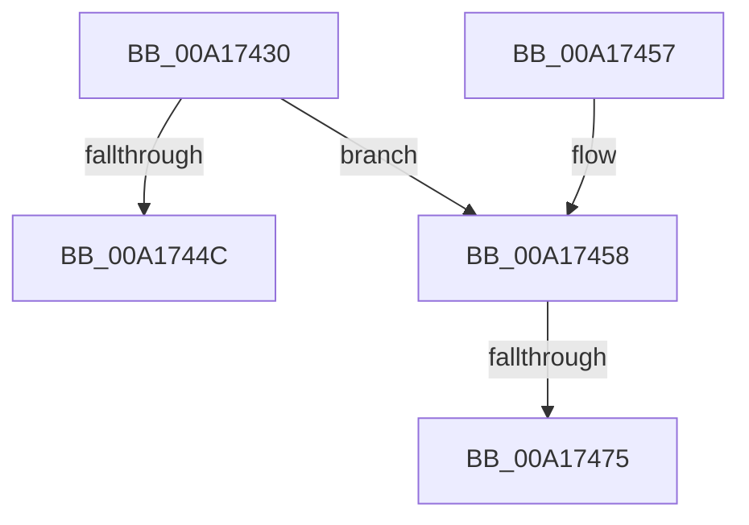

# ExDereferenceHandleDebugInfo

- RVA: `0x00A17430`–`0x00A17489` (길이 `89` bytes)
- VA: `0x0000000140A17430`
- 실행 섹션: `PAGE`
- PDB 이름 있음: `예`; PDB Function 태그: `예`
- unwind 정보 RVA: `0x00070B28`
- 디코드: `27`개 명령, `89/89` bytes 표시
- 미해석 바이트: `0` (있으면 어셈블리에 `.byte`로 보존)

> 이 문서는 커널 이미지의 기계어와 PDB 기호를 분석해 생성했습니다. 4번과 5번은 함수 원형과 자료형을 바이너리 사용 방식에서 추정한 C 해석이며 원본 소스 복구 결과는 아닙니다.

## 1. Dependencies

- 직접 호출 지점: **2**; 고유 호출 대상: **2**
- 직접 호출자로 확인된 함수: **5**
- RIP 상대 이미지 참조: **0**

### Outgoing calls
- `0x00A17463` → [ExFreePoolWithTag](../../poolcode/B8/ExFreePoolWithTag_function_00B82870.md) (function, `0x00B82870`)
- `0x00A1747E` → [PsReturnProcessNonPagedPoolQuota](../../text/41/PsReturnProcessNonPagedPoolQuota_function_0041C200.md) (function, `0x0041C200`)

### Direct callers
- [ExDisableHandleTracing](../../text/65/ExDisableHandleTracing_function_00655CBC.md) at `0x00655D0E`
- [ExpUpdateDebugInfo](../86/ExpUpdateDebugInfo_function_0086B174.md) at `0x0086B3F1`
- [ExpFreeHandleTable](../90/ExpFreeHandleTable_function_00903B70.md) at `0x00903C92`
- [NtQueryInformationProcess](../9A/NtQueryInformationProcess_function_009AA250.md) at `0x009AD784`
- [ExEnableHandleTracing](../AD/ExEnableHandleTracing_function_00AD2C8C.md) at `0x00AD2E2D`

### Static image references
- 디코드된 RIP-relative 메모리 참조가 없습니다.

## 2. Other-region calls and transfers

- 다른 실행 섹션으로 향하는 call: **2**
  - `0x00A17463` → [ExFreePoolWithTag](../../poolcode/B8/ExFreePoolWithTag_function_00B82870.md) (`PAGE` → `POOLCODE`)
  - `0x00A1747E` → [PsReturnProcessNonPagedPoolQuota](../../text/41/PsReturnProcessNonPagedPoolQuota_function_0041C200.md) (`PAGE` → `.text`)
- call이 아닌 외부 분기/꼬리 이동: **2**
  - `0x00A1746F` → [sub_00B370CC](../B3/Unknown_function_00B370CC.md) (`tail-transfer`)
  - `0x00A17484` → [sub_00B370CC](../B3/Unknown_function_00B370CC.md) (`tail-transfer`)

## 3. Assembly (complete function range)

```asm
00A17430  48 89 5C 24 08                  mov qword ptr [rsp + 8], rbx
00A17435  57                              push rdi
00A17436  48 83 EC 20                     sub rsp, 0x20
00A1743A  4C 8B C2                        mov r8, rdx
00A1743D  48 8B F9                        mov rdi, rcx
00A17440  83 C8 FF                        or eax, 0xffffffff
00A17443  F0 0F C1 02                     lock xadd dword ptr [rdx], eax
00A17447  83 F8 01                        cmp eax, 1
00A1744A  74 0C                           je 0x140a17458
00A1744C  48 8B 5C 24 30                  mov rbx, qword ptr [rsp + 0x30]
00A17451  48 83 C4 20                     add rsp, 0x20
00A17455  5F                              pop rdi
00A17456  C3                              ret
00A17457  CC                              int3
00A17458  8B 5A 04                        mov ebx, dword ptr [rdx + 4]
00A1745B  49 8B C8                        mov rcx, r8
00A1745E  BA 4F 62 74 64                  mov edx, 0x6474624f
00A17463  E8 08 B4 16 00                  call 0x140b82870
00A17468  48 8B 4F 10                     mov rcx, qword ptr [rdi + 0x10]
00A1746C  48 85 C9                        test rcx, rcx
00A1746F  0F 84 57 FC 11 00               je 0x140b370cc
00A17475  8D 14 9B                        lea edx, [rbx + rbx*4]
00A17478  C1 E2 05                        shl edx, 5
00A1747B  83 C2 50                        add edx, 0x50
00A1747E  E8 7D 4D A0 FF                  call 0x14041c200
00A17483  90                              nop
00A17484  E9 43 FC 11 00                  jmp 0x140b370cc
```

## 4. C-style interpretation (structured pseudocode)

```c
__int64 __fastcall ExDereferenceHandleDebugInfo(__int64 a1, __int64 a2)
{
    __int64 result;
    __int64 v_rsp;
    unsigned __int64 v_stack_p8;

    v_stack_p8 = v_rbx;
    v_rsp = (v_rsp) - (32);
    result = (unsigned int)((result) | (0xFFFFFFFFULL));
    if (((unsigned int)(result)) == 1) goto loc_00A17458;
    v_rsp = (v_rsp) + (32);
    return result;
loc_00A17458:
    result = ExFreePoolWithTag(a2, (unsigned int)(0x6474624FULL), a2, a4);
    a2 = (unsigned int)(((unsigned int)(*(unsigned int *)(a2 + 4)) + (unsigned int)(*(unsigned int *)(a2 + 4)) * 4) << (5));
    a2 = (unsigned int)((a2) + (80));
    result = PsReturnProcessNonPagedPoolQuota(*(unsigned __int64 *)(a1 + 16), a2, a2, a4);
}
```

## 5. (Beta) C Style

```c
int64_t ExDereferenceHandleDebugInfo(void *Arg1, void *Arg2)
{
    uint8_t *arg1 = (uint8_t *)Arg1;
    uint8_t *arg2 = (uint8_t *)Arg2;

    int64_t result;
    int64_t local_rsp;
    uint64_t v_stack_p8;

    v_stack_p8 = local_rbx;
    local_rsp = (local_rsp) - (32);
    result = (uint32_t)((result) | (0xFFFFFFFFULL));
    if (((uint32_t)(result)) == 1) goto loc_00A17458;
    local_rsp = (local_rsp) + (32);
    return result;
loc_00A17458:
    result = ExFreePoolWithTag(Arg2, (uint32_t)(0x6474624FULL), Arg2, a4);
    Arg2 = (uint32_t)(((uint32_t)(*(uint32_t *)(arg2 + 0x4)) + (uint32_t)(*(uint32_t *)(arg2 + 0x4)) * 4) << (5));
    Arg2 = (uint32_t)((Arg2) + (80));
    result = PsReturnProcessNonPagedPoolQuota(*(uint64_t *)(arg1 + 0x10), Arg2, Arg2, a4);
}
```

### 관측된 메모리 오프셋

구조체 형식이 확인되지 않은 접근은 인자 기준의 오프셋으로만 기록했습니다.

| 기준 인자 | 오프셋 표현 | 폭 (bit) | 접근 |
|---|---:|---:|---|
| `Arg1` | `+ 0x10` | `64` | `R` |
| `Arg2` | `+ 0x0` | `32` | `R/W` |
| `Arg2` | `+ 0x4` | `32` | `R` |

## 6. Execution-region graph

[열기: 2D/3D 그래프와 함수 탐색 컨트롤 패널](../../../control-panel.html?section=page&rva=0x00A17430&view=graph)

- 2D 그래프는 위에서 아래로 흐르고, 3D 그래프는 빈 공간을 드래그해 회전합니다. Shift+드래그는 이동, 휠은 확대·축소, 함수 노드 선택은 대상 보고서 이동입니다.

### Static fallback


