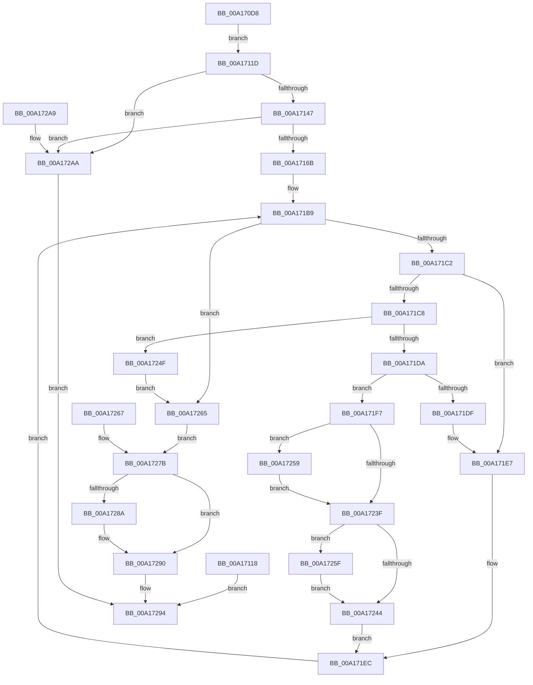

# ExGetPoolTagInfo

- RVA: `0x00A170D8`–`0x00A172B1` (길이 `473` bytes)
- VA: `0x0000000140A170D8`
- 실행 섹션: `PAGE`
- PDB 이름 있음: `예`; PDB Function 태그: `아니요`
- unwind 정보 RVA: `0x000A9DF8`
- 디코드: `122`개 명령, `473/473` bytes 표시
- 미해석 바이트: `0` (있으면 어셈블리에 `.byte`로 보존)

> 이 문서는 커널 이미지의 기계어와 PDB 기호를 분석해 생성했습니다. 4번과 5번은 함수 원형과 자료형을 바이너리 사용 방식에서 추정한 C 해석이며 원본 소스 복구 결과는 아닙니다.

## 1. Dependencies

- 직접 호출 지점: **3**; 고유 호출 대상: **3**
- 직접 호출자로 확인된 함수: **2**
- RIP 상대 이미지 참조: **3**

### Outgoing calls
- `0x00A17152` → [ExAllocatePool2](../../poolcode/B8/ExAllocatePool2_function_00B820F0.md) (function, `0x00B820F0`)
- `0x00A1719D` → [KeGenericCallDpcEx](../../text/2C/KeGenericCallDpcEx_function_002C99F4.md) (function, `0x002C99F4`)
- `0x00A17280` → [ExFreePoolWithTag](../../poolcode/B8/ExFreePoolWithTag_function_00B82870.md) (function, `0x00B82870`)

### Direct callers
- [EtwpPoolRunDown](../7C/EtwpPoolRunDown_function_007C0650.md) at `0x007C06EB`
- [ExpQuerySystemInformation](../A5/ExpQuerySystemInformation_function_00A57858.md) at `0x00A582F6`

### Static image references
- `0x00A1711D` → RVA `0x00EFED50` (`.data`; read)
- `0x00A17124` → RVA `0x00EFED48` (`.data`; read)
- `0x00A17196` → RVA `0x004407D0` (`ExpGetPoolTagInfoTarget`; read)

## 2. Other-region calls and transfers

- 다른 실행 섹션으로 향하는 call: **3**
  - `0x00A17152` → [ExAllocatePool2](../../poolcode/B8/ExAllocatePool2_function_00B820F0.md) (`PAGE` → `POOLCODE`)
  - `0x00A1719D` → [KeGenericCallDpcEx](../../text/2C/KeGenericCallDpcEx_function_002C99F4.md) (`PAGE` → `.text`)
  - `0x00A17280` → [ExFreePoolWithTag](../../poolcode/B8/ExFreePoolWithTag_function_00B82870.md) (`PAGE` → `POOLCODE`)
- 별도 외부 분기/꼬리 이동을 확인하지 못했습니다.

## 3. Assembly (complete function range)

```asm
00A170D8  48 89 5C 24 10                  mov qword ptr [rsp + 0x10], rbx
00A170DD  4C 89 44 24 18                  mov qword ptr [rsp + 0x18], r8
00A170E2  56                              push rsi
00A170E3  57                              push rdi
00A170E4  41 54                           push r12
00A170E6  41 56                           push r14
00A170E8  41 57                           push r15
00A170EA  48 83 EC 60                     sub rsp, 0x60
00A170EE  49 8B F8                        mov rdi, r8
00A170F1  44 8B E2                        mov r12d, edx
00A170F4  48 8B F1                        mov rsi, rcx
00A170F7  C7 44 24 24 00 00 00 00         mov dword ptr [rsp + 0x24], 0
00A170FF  48 8D 41 08                     lea rax, [rcx + 8]
00A17103  48 89 44 24 30                  mov qword ptr [rsp + 0x30], rax
00A17108  C7 44 24 20 08 00 00 00         mov dword ptr [rsp + 0x20], 8
00A17110  C7 01 00 00 00 00               mov dword ptr [rcx], 0
00A17116  EB 05                           jmp 0x140a1711d
00A17118  E9 77 01 00 00                  jmp 0x140a17294
00A1711D  4C 8B 3D 2C 7C 4E 00            mov r15, qword ptr [rip + 0x4e7c2c]
00A17124  4C 8B 35 1D 7C 4E 00            mov r14, qword ptr [rip + 0x4e7c1d]
00A1712B  4B 8D 0C BF                     lea rcx, [r15 + r15*4]
00A1712F  48 C1 E1 04                     shl rcx, 4
00A17133  4B 8D 14 B6                     lea rdx, [r14 + r14*4]
00A17137  48 C1 E2 04                     shl rdx, 4
00A1713B  48 03 D1                        add rdx, rcx
00A1713E  48 3B D1                        cmp rdx, rcx
00A17141  0F 82 63 01 00 00               jb 0x140a172aa
00A17147  B9 40 00 00 00                  mov ecx, 0x40
00A1714C  41 B8 49 6E 66 6F               mov r8d, 0x6f666e49
00A17152  E8 99 AF 16 00                  call 0x140b820f0
00A17157  48 8B D8                        mov rbx, rax
00A1715A  48 89 84 24 90 00 00 00         mov qword ptr [rsp + 0x90], rax
00A17162  48 85 C0                        test rax, rax
00A17165  0F 84 3F 01 00 00               je 0x140a172aa
00A1716B  48 89 44 24 38                  mov qword ptr [rsp + 0x38], rax
00A17170  48 8B 0D D9 7B 4E 00            mov rcx, qword ptr [rip + 0x4e7bd9]
00A17177  48 89 4C 24 40                  mov qword ptr [rsp + 0x40], rcx
00A1717C  48 8D 14 89                     lea rdx, [rcx + rcx*4]
00A17180  48 C1 E2 04                     shl rdx, 4
00A17184  48 03 D0                        add rdx, rax
00A17187  48 89 54 24 48                  mov qword ptr [rsp + 0x48], rdx
00A1718C  4C 89 74 24 50                  mov qword ptr [rsp + 0x50], r14
00A17191  48 8D 54 24 38                  lea rdx, [rsp + 0x38]
00A17196  48 8D 0D 33 96 A2 FF            lea rcx, [rip - 0x5d69cd]
00A1719D  E8 52 28 8B FF                  call 0x1402c99f4
00A171A2  48 8B D3                        mov rdx, rbx
00A171A5  48 89 5C 24 28                  mov qword ptr [rsp + 0x28], rbx
00A171AA  4B 8D 04 3E                     lea rax, [r14 + r15]
00A171AE  4C 8D 0C 80                     lea r9, [rax + rax*4]
00A171B2  49 C1 E1 04                     shl r9, 4
00A171B6  4C 03 CB                        add r9, rbx
00A171B9  49 3B D1                        cmp rdx, r9
00A171BC  0F 83 A3 00 00 00               jae 0x140a17265
00A171C2  8B 02                           mov eax, dword ptr [rdx]
00A171C4  85 C0                           test eax, eax
00A171C6  74 1F                           je 0x140a171e7
00A171C8  FF 06                           inc dword ptr [rsi]
00A171CA  8B 44 24 20                     mov eax, dword ptr [rsp + 0x20]
00A171CE  83 C0 28                        add eax, 0x28
00A171D1  89 44 24 20                     mov dword ptr [rsp + 0x20], eax
00A171D5  83 F8 28                        cmp eax, 0x28
00A171D8  72 75                           jb 0x140a1724f
00A171DA  44 3B E0                        cmp r12d, eax
00A171DD  73 18                           jae 0x140a171f7
00A171DF  C7 44 24 24 04 00 00 C0         mov dword ptr [rsp + 0x24], 0xc0000004
00A171E7  48 8B 54 24 28                  mov rdx, qword ptr [rsp + 0x28]
00A171EC  48 83 C2 50                     add rdx, 0x50
00A171F0  48 89 54 24 28                  mov qword ptr [rsp + 0x28], rdx
00A171F5  EB C2                           jmp 0x140a171b9
00A171F7  48 8B 44 24 28                  mov rax, qword ptr [rsp + 0x28]
00A171FC  8B 08                           mov ecx, dword ptr [rax]
00A171FE  4C 8B 44 24 30                  mov r8, qword ptr [rsp + 0x30]
00A17203  41 89 08                        mov dword ptr [r8], ecx
00A17206  48 8B 54 24 28                  mov rdx, qword ptr [rsp + 0x28]
00A1720B  8B 4A 28                        mov ecx, dword ptr [rdx + 0x28]
00A1720E  41 89 48 04                     mov dword ptr [r8 + 4], ecx
00A17212  44 8B 5A 30                     mov r11d, dword ptr [rdx + 0x30]
00A17216  45 89 58 08                     mov dword ptr [r8 + 8], r11d
00A1721A  48 8B 42 20                     mov rax, qword ptr [rdx + 0x20]
00A1721E  49 89 40 10                     mov qword ptr [r8 + 0x10], rax
00A17222  44 8B 72 10                     mov r14d, dword ptr [rdx + 0x10]
00A17226  45 89 70 18                     mov dword ptr [r8 + 0x18], r14d
00A1722A  44 8B 52 18                     mov r10d, dword ptr [rdx + 0x18]
00A1722E  45 89 50 1C                     mov dword ptr [r8 + 0x1c], r10d
00A17232  48 8B 42 08                     mov rax, qword ptr [rdx + 8]
00A17236  49 89 40 20                     mov qword ptr [r8 + 0x20], rax
00A1723A  41 3B CB                        cmp ecx, r11d
00A1723D  72 1A                           jb 0x140a17259
00A1723F  45 3B F2                        cmp r14d, r10d
00A17242  72 1B                           jb 0x140a1725f
00A17244  49 83 C0 28                     add r8, 0x28
00A17248  4C 89 44 24 30                  mov qword ptr [rsp + 0x30], r8
00A1724D  EB 9D                           jmp 0x140a171ec
00A1724F  C7 44 24 24 95 00 00 C0         mov dword ptr [rsp + 0x24], 0xc0000095
00A17257  EB 0C                           jmp 0x140a17265
00A17259  45 89 58 04                     mov dword ptr [r8 + 4], r11d
00A1725D  EB E0                           jmp 0x140a1723f
00A1725F  45 89 50 18                     mov dword ptr [r8 + 0x18], r10d
00A17263  EB DF                           jmp 0x140a17244
00A17265  EB 14                           jmp 0x140a1727b
00A17267  89 44 24 24                     mov dword ptr [rsp + 0x24], eax
00A1726B  48 8B BC 24 A0 00 00 00         mov rdi, qword ptr [rsp + 0xa0]
00A17273  48 8B 9C 24 90 00 00 00         mov rbx, qword ptr [rsp + 0x90]
00A1727B  33 D2                           xor edx, edx
00A1727D  48 8B CB                        mov rcx, rbx
00A17280  E8 EB B5 16 00                  call 0x140b82870
00A17285  48 85 FF                        test rdi, rdi
00A17288  74 06                           je 0x140a17290
00A1728A  8B 44 24 20                     mov eax, dword ptr [rsp + 0x20]
00A1728E  89 07                           mov dword ptr [rdi], eax
00A17290  8B 44 24 24                     mov eax, dword ptr [rsp + 0x24]
00A17294  48 8B 9C 24 98 00 00 00         mov rbx, qword ptr [rsp + 0x98]
00A1729C  48 83 C4 60                     add rsp, 0x60
00A172A0  41 5F                           pop r15
00A172A2  41 5E                           pop r14
00A172A4  41 5C                           pop r12
00A172A6  5F                              pop rdi
00A172A7  5E                              pop rsi
00A172A8  C3                              ret
00A172A9  CC                              int3
00A172AA  B8 9A 00 00 C0                  mov eax, 0xc000009a
00A172AF  EB E3                           jmp 0x140a17294
```

## 4. C-style interpretation (structured pseudocode)

```c
__int64 __fastcall ExGetPoolTagInfo(__int64 a1, int a2, __int64 a3)
{
    __int64 result;
    __int64 v_rsp;
    unsigned __int64 v_stack_m38;
    unsigned __int64 v_stack_m40;
    unsigned __int64 v_stack_m48;
    unsigned __int64 v_stack_m50;
    unsigned __int64 v_stack_m58;
    unsigned __int64 v_stack_m60;
    unsigned int v_stack_m64;
    unsigned int v_stack_m68;
    unsigned __int64 v_stack_p10;
    unsigned __int64 v_stack_p18;
    unsigned __int64 v_stack_p8;

    v_stack_p10 = v_rbx;
    v_stack_p18 = a3;
    v_rsp = (v_rsp) - (96);
    v_stack_m64 = 0;
    v_stack_m58 = a1 + 8;
    v_stack_m68 = 8;
    *(unsigned int *)(a1) = 0;
    goto loc_00A1711D;
loc_00A1711D:
    a1 = (*(unsigned __int64 *)(v_rip + 5143596) + *(unsigned __int64 *)(v_rip + 5143596) * 4) << (4);
    a2 = (*(unsigned __int64 *)(v_rip + 5143581) + *(unsigned __int64 *)(v_rip + 5143581) * 4) << (4);
    a2 = (a2) + (a1);
    if (a2 < a1) goto loc_00A172AA;
    result = ExAllocatePool2(64, a2, (unsigned int)(0x6F666E49ULL), a4);
    v_stack_p8 = result;
    if (result == 0) goto loc_00A172AA;
    v_stack_m50 = result;
    v_stack_m48 = *(unsigned __int64 *)(v_rip + 5143513);
    a2 = (*(unsigned __int64 *)(v_rip + 5143513) + *(unsigned __int64 *)(v_rip + 5143513) * 4) << (4);
    a2 = (a2) + (result);
    v_stack_m40 = a2;
    v_stack_m38 = *(unsigned __int64 *)(v_rip + 5143581);
    result = KeGenericCallDpcEx(v_rip - 6121933, v_stack_m50, (unsigned int)(0x6F666E49ULL), a4);
    v_stack_m60 = result;
    a4 = (*(unsigned __int64 *)(v_rip + 5143581) + *(unsigned __int64 *)(v_rip + 5143596) * 1 + *(unsigned __int64 *)(v_rip + 5143581) + *(unsigned __int64 *)(v_rip + 5143596) * 1 * 4) << (4);
    a4 = (a4) + (result);
loc_00A171B9:
    if (result >= a4) goto loc_00A17265;
    if ((unsigned int)((unsigned int)(*(unsigned int *)(result))) == 0) goto loc_00A171E7;
    result = (unsigned int)(((unsigned int)(v_stack_m68)) + (40));
    v_stack_m68 = (unsigned int)(result);
    if (((unsigned int)(result)) < 40) goto loc_00A1724F;
    if (((unsigned int)((unsigned int)(a2))) >= ((unsigned int)(result))) goto loc_00A171F7;
    v_stack_m64 = 0xC0000004ULL;
loc_00A171E7:
loc_00A171EC:
    a2 = (v_stack_m60) + (80);
    v_stack_m60 = a2;
    goto loc_00A171B9;
loc_00A171F7:
    *(unsigned int *)(v_stack_m58) = (unsigned int)((unsigned int)(*(unsigned int *)(v_stack_m60)));
    *(unsigned int *)(v_stack_m58 + 4) = (unsigned int)((unsigned int)(*(unsigned int *)(v_stack_m60 + 40)));
    *(unsigned int *)(v_stack_m58 + 8) = (unsigned int)((unsigned int)(*(unsigned int *)(v_stack_m60 + 48)));
    *(unsigned __int64 *)(v_stack_m58 + 16) = *(unsigned __int64 *)(v_stack_m60 + 32);
    *(unsigned int *)(v_stack_m58 + 24) = (unsigned int)((unsigned int)(*(unsigned int *)(v_stack_m60 + 16)));
    *(unsigned int *)(v_stack_m58 + 28) = (unsigned int)((unsigned int)(*(unsigned int *)(v_stack_m60 + 24)));
    *(unsigned __int64 *)(v_stack_m58 + 32) = *(unsigned __int64 *)(v_stack_m60 + 8);
    if (((unsigned int)((unsigned int)(*(unsigned int *)(v_stack_m60 + 40)))) < ((unsigned int)((unsigned int)(*(unsigned int *)(v_stack_m60 + 48))))) goto loc_00A17259;
loc_00A1723F:
    if (((unsigned int)((unsigned int)(*(unsigned int *)(v_stack_m60 + 16)))) < ((unsigned int)((unsigned int)(*(unsigned int *)(v_stack_m60 + 24))))) goto loc_00A1725F;
loc_00A17244:
    a3 = (v_stack_m58) + (40);
    v_stack_m58 = a3;
    goto loc_00A171EC;
loc_00A1724F:
    v_stack_m64 = 0xC0000095ULL;
    goto loc_00A17265;
loc_00A17259:
    *(unsigned int *)(a3 + 4) = (unsigned int)((unsigned int)(*(unsigned int *)(v_stack_m60 + 48)));
    goto loc_00A1723F;
loc_00A1725F:
    *(unsigned int *)(a3 + 24) = (unsigned int)((unsigned int)(*(unsigned int *)(v_stack_m60 + 24)));
    goto loc_00A17244;
loc_00A17265:
    goto loc_00A1727B;
loc_00A1727B:
    a2 = 0;
    result = ExFreePoolWithTag(result, a2, a3, a4);
    if (a3 != 0) {
        result = v_stack_m68;
        *(unsigned int *)(a3) = (unsigned int)(result);
    }
loc_00A17294:
    v_rsp = (v_rsp) + (96);
    return (unsigned int)(v_stack_m64);
loc_00A172AA:
    goto loc_00A17294;
}
```

## 5. (Beta) C Style

```c
int64_t ExGetPoolTagInfo(void *Arg1, int32_t Arg2, int64_t Arg3)
{
    uint8_t *arg1 = (uint8_t *)Arg1;

    int64_t result;
    int64_t local_rsp;
    uint64_t v_stack_m38;
    uint64_t v_stack_m40;
    uint64_t v_stack_m48;
    uint64_t v_stack_m50;
    uint64_t v_stack_m58;
    uint64_t v_stack_m60;
    uint32_t v_stack_m64;
    uint32_t v_stack_m68;
    uint64_t v_stack_p10;
    uint64_t v_stack_p18;
    uint64_t v_stack_p8;

    v_stack_p10 = local_rbx;
    v_stack_p18 = Arg3;
    local_rsp = (local_rsp) - (96);
    v_stack_m64 = 0;
    v_stack_m58 = Arg1 + 8;
    v_stack_m68 = 8;
    *(uint32_t *)(arg1) = 0;
    goto loc_00A1711D;
loc_00A1711D:
    Arg1 = (*(uint64_t *)(v_rip + 0x4E7C2C) + *(uint64_t *)(v_rip + 0x4E7C2C) * 4) << (4);
    Arg2 = (*(uint64_t *)(v_rip + 0x4E7C1D) + *(uint64_t *)(v_rip + 0x4E7C1D) * 4) << (4);
    Arg2 = (Arg2) + (Arg1);
    if (Arg2 < Arg1) goto loc_00A172AA;
    result = ExAllocatePool2(64, Arg2, (uint32_t)(0x6F666E49ULL), a4);
    v_stack_p8 = result;
    if (result == 0) goto loc_00A172AA;
    v_stack_m50 = result;
    v_stack_m48 = *(uint64_t *)(v_rip + 0x4E7BD9);
    Arg2 = (*(uint64_t *)(v_rip + 0x4E7BD9) + *(uint64_t *)(v_rip + 0x4E7BD9) * 4) << (4);
    Arg2 = (Arg2) + (result);
    v_stack_m40 = Arg2;
    v_stack_m38 = *(uint64_t *)(v_rip + 0x4E7C1D);
    result = KeGenericCallDpcEx(v_rip - 6121933, v_stack_m50, (uint32_t)(0x6F666E49ULL), a4);
    v_stack_m60 = result;
    a4 = (*(uint64_t *)(v_rip + 0x4E7C1D) + *(uint64_t *)(v_rip + 0x4E7C2C) * 1 + *(uint64_t *)(v_rip + 0x4E7C1D) + *(uint64_t *)(v_rip + 0x4E7C2C) * 1 * 4) << (4);
    a4 = (a4) + (result);
loc_00A171B9:
    if (result >= a4) goto loc_00A17265;
    if ((uint32_t)((uint32_t)(*(uint32_t *)(result))) == 0) goto loc_00A171E7;
    result = (uint32_t)(((uint32_t)(v_stack_m68)) + (40));
    v_stack_m68 = (uint32_t)(result);
    if (((uint32_t)(result)) < 40) goto loc_00A1724F;
    if (((uint32_t)((uint32_t)(Arg2))) >= ((uint32_t)(result))) goto loc_00A171F7;
    v_stack_m64 = 0xC0000004ULL;
loc_00A171E7:
loc_00A171EC:
    Arg2 = (v_stack_m60) + (80);
    v_stack_m60 = Arg2;
    goto loc_00A171B9;
loc_00A171F7:
    *(uint32_t *)(v_stack_m58) = (uint32_t)((uint32_t)(*(uint32_t *)(v_stack_m60)));
    *(uint32_t *)(v_stack_m58 + 0x4) = (uint32_t)((uint32_t)(*(uint32_t *)(v_stack_m60 + 0x28)));
    *(uint32_t *)(v_stack_m58 + 0x8) = (uint32_t)((uint32_t)(*(uint32_t *)(v_stack_m60 + 0x30)));
    *(uint64_t *)(v_stack_m58 + 0x10) = *(uint64_t *)(v_stack_m60 + 0x20);
    *(uint32_t *)(v_stack_m58 + 0x18) = (uint32_t)((uint32_t)(*(uint32_t *)(v_stack_m60 + 0x10)));
    *(uint32_t *)(v_stack_m58 + 0x1C) = (uint32_t)((uint32_t)(*(uint32_t *)(v_stack_m60 + 0x18)));
    *(uint64_t *)(v_stack_m58 + 0x20) = *(uint64_t *)(v_stack_m60 + 0x8);
    if (((uint32_t)((uint32_t)(*(uint32_t *)(v_stack_m60 + 0x28)))) < ((uint32_t)((uint32_t)(*(uint32_t *)(v_stack_m60 + 0x30))))) goto loc_00A17259;
loc_00A1723F:
    if (((uint32_t)((uint32_t)(*(uint32_t *)(v_stack_m60 + 0x10)))) < ((uint32_t)((uint32_t)(*(uint32_t *)(v_stack_m60 + 0x18))))) goto loc_00A1725F;
loc_00A17244:
    Arg3 = (v_stack_m58) + (40);
    v_stack_m58 = Arg3;
    goto loc_00A171EC;
loc_00A1724F:
    v_stack_m64 = 0xC0000095ULL;
    goto loc_00A17265;
loc_00A17259:
    *(uint32_t *)(Arg3 + 0x4) = (uint32_t)((uint32_t)(*(uint32_t *)(v_stack_m60 + 0x30)));
    goto loc_00A1723F;
loc_00A1725F:
    *(uint32_t *)(Arg3 + 0x18) = (uint32_t)((uint32_t)(*(uint32_t *)(v_stack_m60 + 0x18)));
    goto loc_00A17244;
loc_00A17265:
    goto loc_00A1727B;
loc_00A1727B:
    Arg2 = 0;
    result = ExFreePoolWithTag(result, Arg2, Arg3, a4);
    if (Arg3 != 0) {
        result = v_stack_m68;
        *(uint32_t *)(Arg3) = (uint32_t)(result);
    }
loc_00A17294:
    local_rsp = (local_rsp) + (96);
    return (uint32_t)(v_stack_m64);
loc_00A172AA:
    goto loc_00A17294;
}
```

### 관측된 메모리 오프셋

구조체 형식이 확인되지 않은 접근은 인자 기준의 오프셋으로만 기록했습니다.

| 기준 인자 | 오프셋 표현 | 폭 (bit) | 접근 |
|---|---:|---:|---|
| `Arg1` | `+ 0x0` | `32` | `R/W` |
| `Arg1` | `+ 0x0` | `32` | `W` |
| `Arg1` | `+ 0x8` | `64` | `R` |

## 6. Execution-region graph

[열기: 2D/3D 그래프와 함수 탐색 컨트롤 패널](../../../control-panel.html?section=page&rva=0x00A170D8&view=graph)

- 2D 그래프는 위에서 아래로 흐르고, 3D 그래프는 빈 공간을 드래그해 회전합니다. Shift+드래그는 이동, 휠은 확대·축소, 함수 노드 선택은 대상 보고서 이동입니다.

### Static fallback


