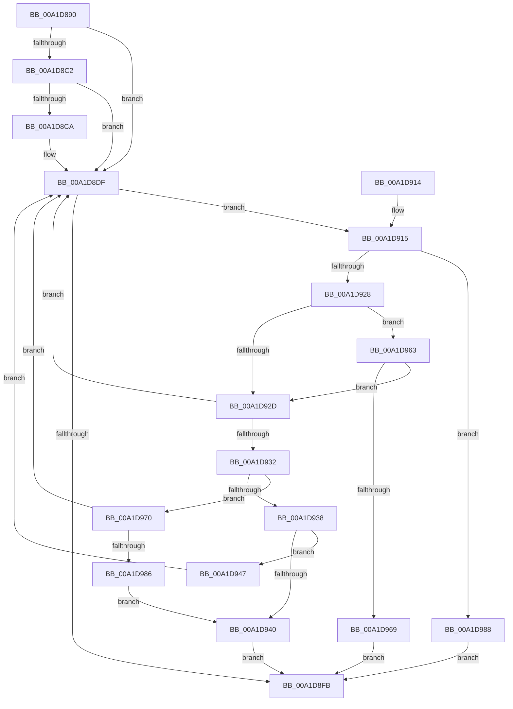

# FsRtlCancellableWaitForSingleObject

- RVA: `0x00A1D890`–`0x00A1D992` (길이 `258` bytes)
- VA: `0x0000000140A1D890`
- 실행 섹션: `PAGE`
- PDB 이름 있음: `예`; PDB Function 태그: `아니요`
- unwind 정보 RVA: `0x000AA6DC`
- 디코드: `75`개 명령, `258/258` bytes 표시
- 미해석 바이트: `0` (있으면 어셈블리에 `.byte`로 보존)

> 이 문서는 커널 이미지의 기계어와 PDB 기호를 분석해 생성했습니다. 4번과 5번은 함수 원형과 자료형을 바이너리 사용 방식에서 추정한 C 해석이며 원본 소스 복구 결과는 아닙니다.

## 1. Dependencies

- 직접 호출 지점: **3**; 고유 호출 대상: **2**
- 직접 호출자로 확인된 함수: **1**
- RIP 상대 이미지 참조: **0**

### Outgoing calls
- `0x00A1D8CD` → [KeQueryTimeIncrement](../../text/44/KeQueryTimeIncrement_function_0044B4C0.md) (function, `0x0044B4C0`)
- `0x00A1D8EF` → [KeWaitForSingleObject](../../text/20/KeWaitForSingleObject_function_0020E6B0.md) (function, `0x0020E6B0`)
- `0x00A1D947` → [KeQueryTimeIncrement](../../text/44/KeQueryTimeIncrement_function_0044B4C0.md) (function, `0x0044B4C0`)

### Direct callers
- [FsRtlpWaitOnIrp](../../text/4E/FsRtlpWaitOnIrp_function_004E7998.md) at `0x004E7CAA`

### Static image references
- 디코드된 RIP-relative 메모리 참조가 없습니다.

## 2. Other-region calls and transfers

- 다른 실행 섹션으로 향하는 call: **3**
  - `0x00A1D8CD` → [KeQueryTimeIncrement](../../text/44/KeQueryTimeIncrement_function_0044B4C0.md) (`PAGE` → `.text`)
  - `0x00A1D8EF` → [KeWaitForSingleObject](../../text/20/KeWaitForSingleObject_function_0020E6B0.md) (`PAGE` → `.text`)
  - `0x00A1D947` → [KeQueryTimeIncrement](../../text/44/KeQueryTimeIncrement_function_0044B4C0.md) (`PAGE` → `.text`)
- 별도 외부 분기/꼬리 이동을 확인하지 못했습니다.

## 3. Assembly (complete function range)

```asm
00A1D890  48 89 5C 24 08                  mov qword ptr [rsp + 8], rbx
00A1D895  48 89 6C 24 10                  mov qword ptr [rsp + 0x10], rbp
00A1D89A  48 89 74 24 18                  mov qword ptr [rsp + 0x18], rsi
00A1D89F  57                              push rdi
00A1D8A0  41 56                           push r14
00A1D8A2  41 57                           push r15
00A1D8A4  48 83 EC 30                     sub rsp, 0x30
00A1D8A8  33 DB                           xor ebx, ebx
00A1D8AA  49 8B E8                        mov rbp, r8
00A1D8AD  48 8B F2                        mov rsi, rdx
00A1D8B0  4C 8B F1                        mov r14, rcx
00A1D8B3  49 BF 20 03 00 00 80 F7 FF FF   movabs r15, 0xfffff78000000320
00A1D8BD  48 85 D2                        test rdx, rdx
00A1D8C0  74 1D                           je 0x140a1d8df
00A1D8C2  48 8B 1A                        mov rbx, qword ptr [rdx]
00A1D8C5  48 85 DB                        test rbx, rbx
00A1D8C8  79 15                           jns 0x140a1d8df
00A1D8CA  49 8B 1F                        mov rbx, qword ptr [r15]
00A1D8CD  E8 EE DB A2 FF                  call 0x14044b4c0
00A1D8D2  8B C8                           mov ecx, eax
00A1D8D4  48 8B 06                        mov rax, qword ptr [rsi]
00A1D8D7  48 99                           cqo
00A1D8D9  48 F7 F9                        idiv rcx
00A1D8DC  48 2B D8                        sub rbx, rax
00A1D8DF  41 B1 01                        mov r9b, 1
00A1D8E2  48 89 74 24 20                  mov qword ptr [rsp + 0x20], rsi
00A1D8E7  45 33 C0                        xor r8d, r8d
00A1D8EA  33 D2                           xor edx, edx
00A1D8EC  49 8B CE                        mov rcx, r14
00A1D8EF  E8 BC 0D 7F FF                  call 0x14020e6b0
00A1D8F4  3D 01 01 00 00                  cmp eax, 0x101
00A1D8F9  74 1A                           je 0x140a1d915
00A1D8FB  48 8B 5C 24 50                  mov rbx, qword ptr [rsp + 0x50]
00A1D900  48 8B 6C 24 58                  mov rbp, qword ptr [rsp + 0x58]
00A1D905  48 8B 74 24 60                  mov rsi, qword ptr [rsp + 0x60]
00A1D90A  48 83 C4 30                     add rsp, 0x30
00A1D90E  41 5F                           pop r15
00A1D910  41 5E                           pop r14
00A1D912  5F                              pop rdi
00A1D913  C3                              ret
00A1D914  CC                              int3
00A1D915  65 48 8B 04 25 88 01 00 00      mov rax, qword ptr gs:[0x188]
00A1D91E  8B 80 A0 05 00 00               mov eax, dword ptr [rax + 0x5a0]
00A1D924  A8 01                           test al, 1
00A1D926  75 60                           jne 0x140a1d988
00A1D928  48 85 ED                        test rbp, rbp
00A1D92B  75 36                           jne 0x140a1d963
00A1D92D  48 85 F6                        test rsi, rsi
00A1D930  74 AD                           je 0x140a1d8df
00A1D932  48 83 3E 00                     cmp qword ptr [rsi], 0
00A1D936  7D 38                           jge 0x140a1d970
00A1D938  49 8B 3F                        mov rdi, qword ptr [r15]
00A1D93B  48 3B FB                        cmp rdi, rbx
00A1D93E  7C 07                           jl 0x140a1d947
00A1D940  B8 02 01 00 00                  mov eax, 0x102
00A1D945  EB B4                           jmp 0x140a1d8fb
00A1D947  E8 74 DB A2 FF                  call 0x14044b4c0
00A1D94C  8B C8                           mov ecx, eax
00A1D94E  48 8B C3                        mov rax, rbx
00A1D951  48 2B C7                        sub rax, rdi
00A1D954  48 0F AF C8                     imul rcx, rax
00A1D958  48 F7 D9                        neg rcx
00A1D95B  48 89 0E                        mov qword ptr [rsi], rcx
00A1D95E  E9 7C FF FF FF                  jmp 0x140a1d8df
00A1D963  80 7D 44 00                     cmp byte ptr [rbp + 0x44], 0
00A1D967  74 C4                           je 0x140a1d92d
00A1D969  B8 20 01 00 C0                  mov eax, 0xc0000120
00A1D96E  EB 8B                           jmp 0x140a1d8fb
00A1D970  48 B8 14 00 00 00 80 F7 FF FF   movabs rax, 0xfffff78000000014
00A1D97A  48 8B 00                        mov rax, qword ptr [rax]
00A1D97D  48 3B C3                        cmp rax, rbx
00A1D980  0F 8C 59 FF FF FF               jl 0x140a1d8df
00A1D986  EB B8                           jmp 0x140a1d940
00A1D988  B8 4B 00 00 C0                  mov eax, 0xc000004b
00A1D98D  E9 69 FF FF FF                  jmp 0x140a1d8fb
```

## 4. C-style interpretation (structured pseudocode)

```c
__int64 __fastcall FsRtlCancellableWaitForSingleObject(__int64 a1, __int64 a2, __int64 a3)
{
    __int64 result;
    __int64 v_rbx;
    __int64 v_rsp;
    unsigned __int64 v_stack_m28;
    unsigned __int64 v_stack_p10;
    unsigned __int64 v_stack_p18;
    unsigned __int64 v_stack_p8;

    v_stack_p8 = v_rbx;
    v_stack_p10 = v_rbp;
    v_stack_p18 = v_rsi;
    v_rsp = (v_rsp) - (48);
    v_rbx = 0;
    if (a2 == 0) goto loc_00A1D8DF;
    v_rbx = *(unsigned __int64 *)(a2);
    if (sign_flag) {
        v_rbx = *(unsigned __int64 *)(v_r15);
        result = KeQueryTimeIncrement(a1, a2, a3, a4);
        a1 = (unsigned int)(result);
        result = *(unsigned __int64 *)(a2);
        v_rbx = (v_rbx) - (result);
    }
    v_stack_m28 = a2;
    a3 = 0;
    a2 = 0;
    result = KeWaitForSingleObject(a1, a2, a3, 1);
    if (((unsigned int)(result)) == 257) goto loc_00A1D915;
loc_00A1D8FB:
    v_rsp = (v_rsp) + (48);
    return result;
loc_00A1D915:
    if ((((unsigned __int8)((unsigned int)(*(unsigned int *)(*(unsigned __int64 *)(gs_base + (0 + 392)) + 1440)))) & (1)) != 0) goto loc_00A1D988;
    if (v_stack_p10 != 0) goto loc_00A1D963;
loc_00A1D92D:
    if (v_stack_p18 == 0) goto loc_00A1D8DF;
    if ((*(unsigned __int64 *)(v_stack_p18)) >= 0) goto loc_00A1D970;
    if ((*(unsigned __int64 *)(v_r15)) < v_stack_p8) goto loc_00A1D947;
loc_00A1D940:
    goto loc_00A1D8FB;
loc_00A1D947:
    result = KeQueryTimeIncrement(a1, a2, a3, 1);
    result = (v_stack_p8) - (*(unsigned __int64 *)(v_r15));
    a1 = ((unsigned int)((unsigned int)(result))) * (result);
    a1 = -(a1);
    *(unsigned __int64 *)(v_stack_p18) = a1;
    goto loc_00A1D8DF;
loc_00A1D963:
    if ((*(unsigned __int8 *)(v_stack_p10 + 68)) == 0) goto loc_00A1D92D;
    goto loc_00A1D8FB;
loc_00A1D970:
    if ((*(unsigned __int64 *)((unsigned int)(0xC0000120ULL))) < v_stack_p8) goto loc_00A1D8DF;
    goto loc_00A1D940;
loc_00A1D988:
    goto loc_00A1D8FB;
}
```

## 5. (Beta) C Style

```c
int64_t FsRtlCancellableWaitForSingleObject(int64_t Arg1, void *Arg2, int64_t Arg3)
{
    uint8_t *arg2 = (uint8_t *)Arg2;

    int64_t result;
    int64_t local_rbx;
    int64_t local_rsp;
    uint64_t v_stack_m28;
    uint64_t v_stack_p10;
    uint64_t v_stack_p18;
    uint64_t v_stack_p8;

    v_stack_p8 = local_rbx;
    v_stack_p10 = local_rbp;
    v_stack_p18 = local_rsi;
    local_rsp = (local_rsp) - (48);
    local_rbx = 0;
    if (Arg2 == NULL) goto loc_00A1D8DF;
    local_rbx = *(uint64_t *)(arg2);
    if (sign_flag) {
        local_rbx = *(uint64_t *)(local_r15);
        result = KeQueryTimeIncrement(Arg1, Arg2, Arg3, a4);
        Arg1 = (uint32_t)(result);
        result = *(uint64_t *)(arg2);
        local_rbx = (local_rbx) - (result);
    }
    v_stack_m28 = Arg2;
    Arg3 = 0;
    Arg2 = 0;
    result = KeWaitForSingleObject(Arg1, Arg2, Arg3, 1);
    if (((uint32_t)(result)) == 257) goto loc_00A1D915;
loc_00A1D8FB:
    local_rsp = (local_rsp) + (48);
    return result;
loc_00A1D915:
    if ((((uint8_t)((uint32_t)(*(uint32_t *)(*(uint64_t *)(gs_base + (0 + 0x188)) + 0x5A0)))) & (1)) != 0) goto loc_00A1D988;
    if (v_stack_p10 != 0) goto loc_00A1D963;
loc_00A1D92D:
    if (v_stack_p18 == 0) goto loc_00A1D8DF;
    if ((*(uint64_t *)(v_stack_p18)) >= 0) goto loc_00A1D970;
    if ((*(uint64_t *)(local_r15)) < v_stack_p8) goto loc_00A1D947;
loc_00A1D940:
    goto loc_00A1D8FB;
loc_00A1D947:
    result = KeQueryTimeIncrement(Arg1, Arg2, Arg3, 1);
    result = (v_stack_p8) - (*(uint64_t *)(local_r15));
    Arg1 = ((uint32_t)((uint32_t)(result))) * (result);
    Arg1 = -(Arg1);
    *(uint64_t *)(v_stack_p18) = Arg1;
    goto loc_00A1D8DF;
loc_00A1D963:
    if ((*(uint8_t *)(v_stack_p10 + 0x44)) == 0) goto loc_00A1D92D;
    goto loc_00A1D8FB;
loc_00A1D970:
    if ((*(uint64_t *)((uint32_t)(0xC0000120ULL))) < v_stack_p8) goto loc_00A1D8DF;
    goto loc_00A1D940;
loc_00A1D988:
    goto loc_00A1D8FB;
}
```

### 관측된 메모리 오프셋

구조체 형식이 확인되지 않은 접근은 인자 기준의 오프셋으로만 기록했습니다.

| 기준 인자 | 오프셋 표현 | 폭 (bit) | 접근 |
|---|---:|---:|---|
| `Arg2` | `+ 0x0` | `64` | `R` |

## 6. Execution-region graph

[열기: 2D/3D 그래프와 함수 탐색 컨트롤 패널](../../../control-panel.html?section=page&rva=0x00A1D890&view=graph)

- 2D 그래프는 위에서 아래로 흐르고, 3D 그래프는 빈 공간을 드래그해 회전합니다. Shift+드래그는 이동, 휠은 확대·축소, 함수 노드 선택은 대상 보고서 이동입니다.

### Static fallback


