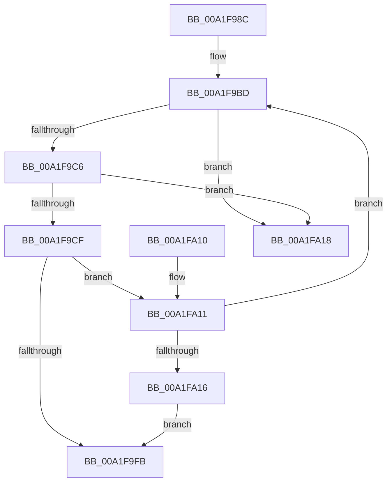

# FsRtlNotifyCompleteIrpList

- RVA: `0x00A1F98C`–`0x00A1FA1F` (길이 `147` bytes)
- VA: `0x0000000140A1F98C`
- 실행 섹션: `PAGE`
- PDB 이름 있음: `예`; PDB Function 태그: `아니요`
- unwind 정보 RVA: `0x00091EE8`
- 디코드: `42`개 명령, `147/147` bytes 표시
- 미해석 바이트: `0` (있으면 어셈블리에 `.byte`로 보존)

> 이 문서는 커널 이미지의 기계어와 PDB 기호를 분석해 생성했습니다. 4번과 5번은 함수 원형과 자료형을 바이너리 사용 방식에서 추정한 C 해석이며 원본 소스 복구 결과는 아닙니다.

## 1. Dependencies

- 직접 호출 지점: **1**; 고유 호출 대상: **1**
- 직접 호출자로 확인된 함수: **4**
- RIP 상대 이미지 참조: **0**

### Outgoing calls
- `0x00A1F9F2` → [FsRtlNotifyCompleteIrp](FsRtlNotifyCompleteIrp_function_00A1FA28.md) (function, `0x00A1FA28`)

### Direct callers
- [FsRtlCheckNotifyForDeleteLite](../71/FsRtlCheckNotifyForDeleteLite_function_00716CDC.md) at `0x00716D08`
- [FsRtlNotifyFilterReportChange](FsRtlNotifyFilterReportChange_function_00A1E880.md) at `0x00A1EC6A`
- [FsRtlNotifyCleanupOneEntry](../A3/FsRtlNotifyCleanupOneEntry_function_00A32908.md) at `0x00A3292B`
- [FsRtlCheckNotifyForDelete](../AD/FsRtlCheckNotifyForDelete_function_00AD2ACC.md) at `0x00AD2B09`

### Static image references
- 디코드된 RIP-relative 메모리 참조가 없습니다.

## 2. Other-region calls and transfers

- 다른 실행 섹션으로 향하는 call: **0**
- 별도 외부 분기/꼬리 이동을 확인하지 못했습니다.

## 3. Assembly (complete function range)

```asm
00A1F98C  48 89 5C 24 08                  mov qword ptr [rsp + 8], rbx
00A1F991  48 89 6C 24 10                  mov qword ptr [rsp + 0x10], rbp
00A1F996  48 89 74 24 18                  mov qword ptr [rsp + 0x18], rsi
00A1F99B  57                              push rdi
00A1F99C  48 83 EC 30                     sub rsp, 0x30
00A1F9A0  8B 69 68                        mov ebp, dword ptr [rcx + 0x68]
00A1F9A3  48 8D 59 30                     lea rbx, [rcx + 0x30]
00A1F9A7  83 61 68 00                     and dword ptr [rcx + 0x68], 0
00A1F9AB  B8 FD FF 00 00                  mov eax, 0xfffd
00A1F9B0  66 21 41 48                     and word ptr [rcx + 0x48], ax
00A1F9B4  8B F2                           mov esi, edx
00A1F9B6  83 61 6C 00                     and dword ptr [rcx + 0x6c], 0
00A1F9BA  48 8B F9                        mov rdi, rcx
00A1F9BD  48 8B 0B                        mov rcx, qword ptr [rbx]
00A1F9C0  48 39 59 08                     cmp qword ptr [rcx + 8], rbx
00A1F9C4  75 52                           jne 0x140a1fa18
00A1F9C6  48 8B 01                        mov rax, qword ptr [rcx]
00A1F9C9  48 39 48 08                     cmp qword ptr [rax + 8], rcx
00A1F9CD  75 49                           jne 0x140a1fa18
00A1F9CF  48 89 03                        mov qword ptr [rbx], rax
00A1F9D2  44 8B CE                        mov r9d, esi
00A1F9D5  48 89 58 08                     mov qword ptr [rax + 8], rbx
00A1F9D9  44 8B C5                        mov r8d, ebp
00A1F9DC  48 83 21 00                     and qword ptr [rcx], 0
00A1F9E0  48 8B D7                        mov rdx, rdi
00A1F9E3  48 81 C1 58 FF FF FF            add rcx, -0xa8
00A1F9EA  C7 44 24 20 01 00 00 00         mov dword ptr [rsp + 0x20], 1
00A1F9F2  E8 31 00 00 00                  call 0x140a1fa28
00A1F9F7  85 F6                           test esi, esi
00A1F9F9  75 16                           jne 0x140a1fa11
00A1F9FB  48 8B 5C 24 40                  mov rbx, qword ptr [rsp + 0x40]
00A1FA00  48 8B 6C 24 48                  mov rbp, qword ptr [rsp + 0x48]
00A1FA05  48 8B 74 24 50                  mov rsi, qword ptr [rsp + 0x50]
00A1FA0A  48 83 C4 30                     add rsp, 0x30
00A1FA0E  5F                              pop rdi
00A1FA0F  C3                              ret
00A1FA10  CC                              int3
00A1FA11  48 39 1B                        cmp qword ptr [rbx], rbx
00A1FA14  75 A7                           jne 0x140a1f9bd
00A1FA16  EB E3                           jmp 0x140a1f9fb
00A1FA18  B9 03 00 00 00                  mov ecx, 3
00A1FA1D  CD 29                           int 0x29
```

## 4. C-style interpretation (structured pseudocode)

```c
__int64 __fastcall FsRtlNotifyCompleteIrpList(__int64 a1, int a2)
{
    __int64 result;
    __int64 v_rsp;
    unsigned int v_stack_m18;
    unsigned __int64 v_stack_p10;
    unsigned __int64 v_stack_p18;
    unsigned __int64 v_stack_p8;

    v_stack_p8 = v_rbx;
    v_stack_p10 = v_rbp;
    v_stack_p18 = v_rsi;
    v_rsp = (v_rsp) - (48);
loc_00A1F9BD:
    if ((*(unsigned __int64 *)(*(unsigned __int64 *)(a1 + 48) + 8)) != (a1 + 48)) goto loc_00A1FA18;
    if ((*(unsigned __int64 *)(*(unsigned __int64 *)(*(unsigned __int64 *)(a1 + 48)) + 8)) != (*(unsigned __int64 *)(a1 + 48))) goto loc_00A1FA18;
    *(unsigned __int64 *)(a1 + 48) = *(unsigned __int64 *)(*(unsigned __int64 *)(a1 + 48));
    *(unsigned __int64 *)(*(unsigned __int64 *)(*(unsigned __int64 *)(a1 + 48)) + 8) = a1 + 48;
    a1 = (*(unsigned __int64 *)(a1 + 48)) + (-168);
    v_stack_m18 = 1;
    result = FsRtlNotifyCompleteIrp(a1, a1, (unsigned int)((unsigned int)((unsigned int)(*(unsigned int *)(a1 + 104)))), (unsigned int)((unsigned int)((unsigned int)(a2))));
    if ((unsigned int)((unsigned int)(a2)) != 0) goto loc_00A1FA11;
loc_00A1F9FB:
    v_rsp = (v_rsp) + (48);
    return result;
loc_00A1FA11:
    if ((*(unsigned __int64 *)(v_stack_p8)) != v_stack_p8) goto loc_00A1F9BD;
    goto loc_00A1F9FB;
loc_00A1FA18:
    return result;
}
```

## 5. (Beta) C Style

```c
int64_t FsRtlNotifyCompleteIrpList(void *Arg1, int32_t Arg2)
{
    uint8_t *arg1 = (uint8_t *)Arg1;

    int64_t result;
    int64_t local_rsp;
    uint32_t v_stack_m18;
    uint64_t v_stack_p10;
    uint64_t v_stack_p18;
    uint64_t v_stack_p8;

    v_stack_p8 = local_rbx;
    v_stack_p10 = local_rbp;
    v_stack_p18 = local_rsi;
    local_rsp = (local_rsp) - (48);
loc_00A1F9BD:
    if ((*(uint64_t *)(*(uint64_t *)(arg1 + 0x30) + 0x8)) != (Arg1 + 48)) goto loc_00A1FA18;
    if ((*(uint64_t *)(*(uint64_t *)(*(uint64_t *)(arg1 + 0x30)) + 0x8)) != (*(uint64_t *)(arg1 + 0x30))) goto loc_00A1FA18;
    *(uint64_t *)(arg1 + 0x30) = *(uint64_t *)(*(uint64_t *)(arg1 + 0x30));
    *(void **)(*(uint64_t *)(*(uint64_t *)(arg1 + 0x30)) + 0x8) = Arg1 + 48;
    Arg1 = (*(uint64_t *)(arg1 + 0x30)) + (-168);
    v_stack_m18 = 1;
    result = FsRtlNotifyCompleteIrp(Arg1, Arg1, (uint32_t)((uint32_t)((uint32_t)(*(uint32_t *)(arg1 + 0x68)))), (uint32_t)((uint32_t)((uint32_t)(Arg2))));
    if ((uint32_t)((uint32_t)(Arg2)) != 0) goto loc_00A1FA11;
loc_00A1F9FB:
    local_rsp = (local_rsp) + (48);
    return result;
loc_00A1FA11:
    if ((*(uint64_t *)(v_stack_p8)) != v_stack_p8) goto loc_00A1F9BD;
    goto loc_00A1F9FB;
loc_00A1FA18:
    return result;
}
```

### 관측된 메모리 오프셋

구조체 형식이 확인되지 않은 접근은 인자 기준의 오프셋으로만 기록했습니다.

| 기준 인자 | 오프셋 표현 | 폭 (bit) | 접근 |
|---|---:|---:|---|
| `Arg1` | `+ 0x0` | `64` | `R` |
| `Arg1` | `+ 0x0` | `64` | `W` |
| `Arg1` | `+ 0x30` | `64` | `R` |
| `Arg1` | `+ 0x48` | `16` | `R/W` |
| `Arg1` | `+ 0x68` | `32` | `R` |
| `Arg1` | `+ 0x68` | `32` | `R/W` |
| `Arg1` | `+ 0x6C` | `32` | `R/W` |

## 6. Execution-region graph

[열기: 2D/3D 그래프와 함수 탐색 컨트롤 패널](../../../control-panel.html?section=page&rva=0x00A1F98C&view=graph)

- 2D 그래프는 위에서 아래로 흐르고, 3D 그래프는 빈 공간을 드래그해 회전합니다. Shift+드래그는 이동, 휠은 확대·축소, 함수 노드 선택은 대상 보고서 이동입니다.

### Static fallback


