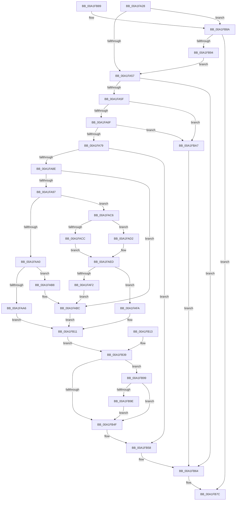

# FsRtlNotifyCompleteIrp

- RVA: `0x00A1FA28`–`0x00A1FBAE` (길이 `390` bytes)
- VA: `0x0000000140A1FA28`
- 실행 섹션: `PAGE`
- PDB 이름 있음: `예`; PDB Function 태그: `아니요`
- unwind 정보 RVA: `0x000AAB7C`
- 디코드: `107`개 명령, `390/390` bytes 표시
- 미해석 바이트: `0` (있으면 어셈블리에 `.byte`로 보존)

> 이 문서는 커널 이미지의 기계어와 PDB 기호를 분석해 생성했습니다. 4번과 5번은 함수 원형과 자료형을 바이너리 사용 방식에서 추정한 C 해석이며 원본 소스 복구 결과는 아닙니다.

## 1. Dependencies

- 직접 호출 지점: **6**; 고유 호출 대상: **6**
- 직접 호출자로 확인된 함수: **4**
- RIP 상대 이미지 참조: **0**

### Outgoing calls
- `0x00A1FA4A` → [FsRtlNotifySetCancelRoutine](../../text/27/FsRtlNotifySetCancelRoutine_function_0027239C.md) (function, `0x0027239C`)
- `0x00A1FABF` → [memcpy](../../text/6C/memcpy_function_006C6840.md) (function, `0x006C6840`)
- `0x00A1FAE8` → [MmMapLockedPagesSpecifyCache](../../text/31/MmMapLockedPagesSpecifyCache_function_00318800.md) (function, `0x00318800`)
- `0x00A1FB41` → [PsReturnProcessPagedPoolQuota](../../text/2A/PsReturnProcessPagedPoolQuota_function_002A6860.md) (function, `0x002A6860`)
- `0x00A1FB77` → [IofCompleteRequest](../../text/29/IofCompleteRequest_function_0029B5C0.md) (function, `0x0029B5C0`)
- `0x00A1FBA0` → [ExFreePoolWithTag](../../poolcode/B8/ExFreePoolWithTag_function_00B82870.md) (function, `0x00B82870`)

### Direct callers
- [FsRtlNotifyFilterReportChangeLiteEx](FsRtlNotifyFilterReportChangeLiteEx_function_00A1F2B0.md) at `0x00A1F785`
- [FsRtlNotifyCompleteIrpList](FsRtlNotifyCompleteIrpList_function_00A1F98C.md) at `0x00A1F9F2`
- [FsRtlNotifyFilterChangeDirectory](../AA/FsRtlNotifyFilterChangeDirectory_function_00AAB9E0.md) at `0x00AABCB2`
- [FsRtlNotifyFilterChangeDirectoryLite](../AD/FsRtlNotifyFilterChangeDirectoryLite_function_00ADC950.md) at `0x00ADCBEE`

### Static image references
- 디코드된 RIP-relative 메모리 참조가 없습니다.

## 2. Other-region calls and transfers

- 다른 실행 섹션으로 향하는 call: **6**
  - `0x00A1FA4A` → [FsRtlNotifySetCancelRoutine](../../text/27/FsRtlNotifySetCancelRoutine_function_0027239C.md) (`PAGE` → `.text`)
  - `0x00A1FABF` → [memcpy](../../text/6C/memcpy_function_006C6840.md) (`PAGE` → `.text`)
  - `0x00A1FAE8` → [MmMapLockedPagesSpecifyCache](../../text/31/MmMapLockedPagesSpecifyCache_function_00318800.md) (`PAGE` → `.text`)
  - `0x00A1FB41` → [PsReturnProcessPagedPoolQuota](../../text/2A/PsReturnProcessPagedPoolQuota_function_002A6860.md) (`PAGE` → `.text`)
  - `0x00A1FB77` → [IofCompleteRequest](../../text/29/IofCompleteRequest_function_0029B5C0.md) (`PAGE` → `.text`)
  - `0x00A1FBA0` → [ExFreePoolWithTag](../../poolcode/B8/ExFreePoolWithTag_function_00B82870.md) (`PAGE` → `POOLCODE`)
- 별도 외부 분기/꼬리 이동을 확인하지 못했습니다.

## 3. Assembly (complete function range)

```asm
00A1FA28  48 89 54 24 10                  mov qword ptr [rsp + 0x10], rdx
00A1FA2D  48 89 4C 24 08                  mov qword ptr [rsp + 8], rcx
00A1FA32  56                              push rsi
00A1FA33  57                              push rdi
00A1FA34  41 55                           push r13
00A1FA36  41 56                           push r14
00A1FA38  41 57                           push r15
00A1FA3A  48 83 EC 40                     sub rsp, 0x40
00A1FA3E  41 8B F1                        mov esi, r9d
00A1FA41  45 8B F0                        mov r14d, r8d
00A1FA44  4C 8B EA                        mov r13, rdx
00A1FA47  48 8B F9                        mov rdi, rcx
00A1FA4A  E8 4D 29 85 FF                  call 0x14027239c
00A1FA4F  84 C0                           test al, al
00A1FA51  0F 84 33 01 00 00               je 0x140a1fb8a
00A1FA57  85 F6                           test esi, esi
00A1FA59  0F 85 05 01 00 00               jne 0x140a1fb64
00A1FA5F  48 8B 87 B8 00 00 00            mov rax, qword ptr [rdi + 0xb8]
00A1FA66  45 85 F6                        test r14d, r14d
00A1FA69  0F 84 38 01 00 00               je 0x140a1fba7
00A1FA6F  44 39 70 08                     cmp dword ptr [rax + 8], r14d
00A1FA73  0F 82 2E 01 00 00               jb 0x140a1fba7
00A1FA79  4D 8D 7D 50                     lea r15, [r13 + 0x50]
00A1FA7D  4C 89 7C 24 30                  mov qword ptr [rsp + 0x30], r15
00A1FA82  49 8B 17                        mov rdx, qword ptr [r15]
00A1FA85  48 85 D2                        test rdx, rdx
00A1FA88  0F 84 CA 00 00 00               je 0x140a1fb58
00A1FA8E  48 8B 4F 18                     mov rcx, qword ptr [rdi + 0x18]
00A1FA92  48 85 C9                        test rcx, rcx
00A1FA95  75 25                           jne 0x140a1fabc
00A1FA97  48 8B 4F 08                     mov rcx, qword ptr [rdi + 8]
00A1FA9B  48 85 C9                        test rcx, rcx
00A1FA9E  75 26                           jne 0x140a1fac6
00A1FAA0  F6 40 03 01                     test byte ptr [rax + 3], 1
00A1FAA4  74 12                           je 0x140a1fab8
00A1FAA6  8B 47 10                        mov eax, dword ptr [rdi + 0x10]
00A1FAA9  83 C8 70                        or eax, 0x70
00A1FAAC  89 47 10                        mov dword ptr [rdi + 0x10], eax
00A1FAAF  49 8B 07                        mov rax, qword ptr [r15]
00A1FAB2  48 89 47 18                     mov qword ptr [rdi + 0x18], rax
00A1FAB6  EB 59                           jmp 0x140a1fb11
00A1FAB8  48 8B 4F 70                     mov rcx, qword ptr [rdi + 0x70]
00A1FABC  4D 8B C6                        mov r8, r14
00A1FABF  E8 7C 6D CA FF                  call 0x1406c6840
00A1FAC4  EB 4B                           jmp 0x140a1fb11
00A1FAC6  F6 41 0A 05                     test byte ptr [rcx + 0xa], 5
00A1FACA  74 06                           je 0x140a1fad2
00A1FACC  48 8B 41 18                     mov rax, qword ptr [rcx + 0x18]
00A1FAD0  EB 1B                           jmp 0x140a1faed
00A1FAD2  C7 44 24 28 10 00 00 40         mov dword ptr [rsp + 0x28], 0x40000010
00A1FADA  83 64 24 20 00                  and dword ptr [rsp + 0x20], 0
00A1FADF  45 33 C9                        xor r9d, r9d
00A1FAE2  33 D2                           xor edx, edx
00A1FAE4  45 8D 41 01                     lea r8d, [r9 + 1]
00A1FAE8  E8 13 8D 8F FF                  call 0x140318800
00A1FAED  48 85 C0                        test rax, rax
00A1FAF0  74 08                           je 0x140a1fafa
00A1FAF2  49 8B 17                        mov rdx, qword ptr [r15]
00A1FAF5  48 8B C8                        mov rcx, rax
00A1FAF8  EB C2                           jmp 0x140a1fabc
00A1FAFA  BE 0C 01 00 00                  mov esi, 0x10c
00A1FAFF  89 B4 24 88 00 00 00            mov dword ptr [rsp + 0x88], esi
00A1FB06  45 33 F6                        xor r14d, r14d
00A1FB09  44 89 B4 24 80 00 00 00         mov dword ptr [rsp + 0x80], r14d
00A1FB11  EB 26                           jmp 0x140a1fb39
00A1FB13  BE 0C 01 00 00                  mov esi, 0x10c
00A1FB18  89 B4 24 88 00 00 00            mov dword ptr [rsp + 0x88], esi
00A1FB1F  45 33 F6                        xor r14d, r14d
00A1FB22  44 89 B4 24 80 00 00 00         mov dword ptr [rsp + 0x80], r14d
00A1FB2A  4C 8B 6C 24 78                  mov r13, qword ptr [rsp + 0x78]
00A1FB2F  48 8B 7C 24 70                  mov rdi, qword ptr [rsp + 0x70]
00A1FB34  4C 8B 7C 24 30                  mov r15, qword ptr [rsp + 0x30]
00A1FB39  41 8B 55 64                     mov edx, dword ptr [r13 + 0x64]
00A1FB3D  49 8B 4D 78                     mov rcx, qword ptr [r13 + 0x78]
00A1FB41  E8 1A 6D 88 FF                  call 0x1402a6860
00A1FB46  49 8B 0F                        mov rcx, qword ptr [r15]
00A1FB49  48 3B 4F 18                     cmp rcx, qword ptr [rdi + 0x18]
00A1FB4D  75 4A                           jne 0x140a1fb99
00A1FB4F  49 83 27 00                     and qword ptr [r15], 0
00A1FB53  41 83 65 64 00                  and dword ptr [r13 + 0x64], 0
00A1FB58  41 8B C6                        mov eax, r14d
00A1FB5B  48 89 47 38                     mov qword ptr [rdi + 0x38], rax
00A1FB5F  49 83 65 58 00                  and qword ptr [r13 + 0x58], 0
00A1FB64  48 8B 87 B8 00 00 00            mov rax, qword ptr [rdi + 0xb8]
00A1FB6B  80 48 03 01                     or byte ptr [rax + 3], 1
00A1FB6F  89 77 30                        mov dword ptr [rdi + 0x30], esi
00A1FB72  B2 01                           mov dl, 1
00A1FB74  48 8B CF                        mov rcx, rdi
00A1FB77  E8 44 BA 87 FF                  call 0x14029b5c0
00A1FB7C  48 83 C4 40                     add rsp, 0x40
00A1FB80  41 5F                           pop r15
00A1FB82  41 5E                           pop r14
00A1FB84  41 5D                           pop r13
00A1FB86  5F                              pop rdi
00A1FB87  5E                              pop rsi
00A1FB88  C3                              ret
00A1FB89  CC                              int3
00A1FB8A  83 BC 24 90 00 00 00 00         cmp dword ptr [rsp + 0x90], 0
00A1FB92  75 E8                           jne 0x140a1fb7c
00A1FB94  E9 BE FE FF FF                  jmp 0x140a1fa57
00A1FB99  48 85 C9                        test rcx, rcx
00A1FB9C  74 B1                           je 0x140a1fb4f
00A1FB9E  33 D2                           xor edx, edx
00A1FBA0  E8 CB 2C 16 00                  call 0x140b82870
00A1FBA5  EB A8                           jmp 0x140a1fb4f
00A1FBA7  BE 0C 01 00 00                  mov esi, 0x10c
00A1FBAC  EB B6                           jmp 0x140a1fb64
```

## 4. C-style interpretation (structured pseudocode)

```c
__int64 __fastcall FsRtlNotifyCompleteIrp(__int64 a1, __int64 a2, int a3, int a4, unsigned int a5)
{
    __int64 result;
    __int64 v_r14;
    __int64 v_rsp;
    unsigned __int64 v_stack_m38;
    unsigned int v_stack_m40;
    unsigned int v_stack_m48;
    unsigned __int64 v_stack_p10;
    unsigned int v_stack_p18;
    unsigned int v_stack_p20;
    unsigned __int64 v_stack_p8;

    v_stack_p10 = a2;
    v_stack_p8 = a1;
    v_rsp = (v_rsp) - (64);
    result = FsRtlNotifySetCancelRoutine(a1, a2, a3, a4);
    if ((unsigned __int8)(result) == 0) goto loc_00A1FB8A;
loc_00A1FA57:
    if ((unsigned int)((unsigned int)(a4)) != 0) goto loc_00A1FB64;
    if ((unsigned int)((unsigned int)(a3)) == 0) goto loc_00A1FBA7;
    if ((*(unsigned int *)(*(unsigned __int64 *)(a1 + 184) + 8)) < ((unsigned int)((unsigned int)(a3)))) goto loc_00A1FBA7;
    v_stack_m38 = a2 + 80;
    if (*(unsigned __int64 *)(a2 + 80) == 0) goto loc_00A1FB58;
    if (*(unsigned __int64 *)(a1 + 24) != 0) goto loc_00A1FABC;
    if (*(unsigned __int64 *)(a1 + 8) != 0) goto loc_00A1FAC6;
    if (((*(unsigned __int8 *)(*(unsigned __int64 *)(a1 + 184) + 3)) & (1)) == 0) goto loc_00A1FAB8;
    result = (unsigned int)(((unsigned int)(*(unsigned int *)(a1 + 16))) | (112));
    *(unsigned int *)(a1 + 16) = (unsigned int)(result);
    *(unsigned __int64 *)(a1 + 24) = *(unsigned __int64 *)(a2 + 80);
    goto loc_00A1FB11;
loc_00A1FAB8:
loc_00A1FABC:
    result = memcpy(*(unsigned __int64 *)(a1 + 112), *(unsigned __int64 *)(a2 + 80), (unsigned int)(a3), a4);
    goto loc_00A1FB11;
loc_00A1FAC6:
    if (((*(unsigned __int8 *)(*(unsigned __int64 *)(a1 + 112) + 10)) & (5)) == 0) goto loc_00A1FAD2;
    goto loc_00A1FAED;
loc_00A1FAD2:
    v_stack_m40 = 0x40000010ULL;
    a4 = 0;
    a2 = 0;
    result = MmMapLockedPagesSpecifyCache(*(unsigned __int64 *)(a1 + 112), a2, a4 + 1, a4);
loc_00A1FAED:
    if (result == 0) goto loc_00A1FAFA;
    goto loc_00A1FABC;
loc_00A1FAFA:
    v_stack_p20 = 268;
    v_r14 = 0;
    v_stack_p18 = 0;
loc_00A1FB11:
    goto loc_00A1FB39;
loc_00A1FB39:
    result = PsReturnProcessPagedPoolQuota(*(unsigned __int64 *)(a2 + 120), (unsigned int)(*(unsigned int *)(a2 + 100)), a4 + 1, a4);
    if ((*(unsigned __int64 *)(a2 + 80)) != (*(unsigned __int64 *)(a1 + 24))) goto loc_00A1FB99;
loc_00A1FB4F:
loc_00A1FB58:
    *(unsigned __int64 *)(a1 + 56) = 0;
loc_00A1FB64:
    *(unsigned int *)(a1 + 48) = 268;
    result = IofCompleteRequest(a1, 1, a4 + 1, a4);
loc_00A1FB7C:
    v_rsp = (v_rsp) + (64);
    return result;
loc_00A1FB8A:
    if (a5 != 0) goto loc_00A1FB7C;
    goto loc_00A1FA57;
loc_00A1FB99:
    if (a1 == 0) goto loc_00A1FB4F;
    a2 = 0;
    result = ExFreePoolWithTag(a1, a2, a4 + 1, a4);
    goto loc_00A1FB4F;
loc_00A1FBA7:
    goto loc_00A1FB64;
}
```

## 5. (Beta) C Style

```c
int64_t FsRtlNotifyCompleteIrp(void *Arg1, void *Arg2, int32_t Arg3, int32_t Arg4, uint32_t Arg5)
{
    uint8_t *arg1 = (uint8_t *)Arg1;
    uint8_t *arg2 = (uint8_t *)Arg2;

    int64_t result;
    int64_t local_r14;
    int64_t local_rsp;
    uint64_t v_stack_m38;
    uint32_t v_stack_m40;
    uint32_t v_stack_m48;
    uint64_t v_stack_p10;
    uint32_t v_stack_p18;
    uint32_t v_stack_p20;
    uint64_t v_stack_p8;

    v_stack_p10 = Arg2;
    v_stack_p8 = Arg1;
    local_rsp = (local_rsp) - (64);
    result = FsRtlNotifySetCancelRoutine(Arg1, Arg2, Arg3, Arg4);
    if ((uint8_t)(result) == 0) goto loc_00A1FB8A;
loc_00A1FA57:
    if ((uint32_t)((uint32_t)(Arg4)) != 0) goto loc_00A1FB64;
    if ((uint32_t)((uint32_t)(Arg3)) == 0) goto loc_00A1FBA7;
    if ((*(uint32_t *)(*(uint64_t *)(arg1 + 0xB8) + 0x8)) < ((uint32_t)((uint32_t)(Arg3)))) goto loc_00A1FBA7;
    v_stack_m38 = Arg2 + 80;
    if (*(uint64_t *)(arg2 + 0x50) == 0) goto loc_00A1FB58;
    if (*(uint64_t *)(arg1 + 0x18) != 0) goto loc_00A1FABC;
    if (*(uint64_t *)(arg1 + 0x8) != 0) goto loc_00A1FAC6;
    if (((*(uint8_t *)(*(uint64_t *)(arg1 + 0xB8) + 0x3)) & (1)) == 0) goto loc_00A1FAB8;
    result = (uint32_t)(((uint32_t)(*(uint32_t *)(arg1 + 0x10))) | (112));
    *(uint32_t *)(arg1 + 0x10) = (uint32_t)(result);
    *(uint64_t *)(arg1 + 0x18) = *(uint64_t *)(arg2 + 0x50);
    goto loc_00A1FB11;
loc_00A1FAB8:
loc_00A1FABC:
    result = memcpy(*(uint64_t *)(arg1 + 0x70), *(uint64_t *)(arg2 + 0x50), (uint32_t)(Arg3), Arg4);
    goto loc_00A1FB11;
loc_00A1FAC6:
    if (((*(uint8_t *)(*(uint64_t *)(arg1 + 0x70) + 0xA)) & (5)) == 0) goto loc_00A1FAD2;
    goto loc_00A1FAED;
loc_00A1FAD2:
    v_stack_m40 = 0x40000010ULL;
    Arg4 = 0;
    Arg2 = 0;
    result = MmMapLockedPagesSpecifyCache(*(uint64_t *)(arg1 + 0x70), Arg2, Arg4 + 1, Arg4);
loc_00A1FAED:
    if (result == 0) goto loc_00A1FAFA;
    goto loc_00A1FABC;
loc_00A1FAFA:
    v_stack_p20 = 268;
    local_r14 = 0;
    v_stack_p18 = 0;
loc_00A1FB11:
    goto loc_00A1FB39;
loc_00A1FB39:
    result = PsReturnProcessPagedPoolQuota(*(uint64_t *)(arg2 + 0x78), (uint32_t)(*(uint32_t *)(arg2 + 0x64)), Arg4 + 1, Arg4);
    if ((*(uint64_t *)(arg2 + 0x50)) != (*(uint64_t *)(arg1 + 0x18))) goto loc_00A1FB99;
loc_00A1FB4F:
loc_00A1FB58:
    *(uint64_t *)(arg1 + 0x38) = 0;
loc_00A1FB64:
    *(uint32_t *)(arg1 + 0x30) = 268;
    result = IofCompleteRequest(Arg1, 1, Arg4 + 1, Arg4);
loc_00A1FB7C:
    local_rsp = (local_rsp) + (64);
    return result;
loc_00A1FB8A:
    if (Arg5 != 0) goto loc_00A1FB7C;
    goto loc_00A1FA57;
loc_00A1FB99:
    if (Arg1 == NULL) goto loc_00A1FB4F;
    Arg2 = 0;
    result = ExFreePoolWithTag(Arg1, Arg2, Arg4 + 1, Arg4);
    goto loc_00A1FB4F;
loc_00A1FBA7:
    goto loc_00A1FB64;
}
```

### 관측된 메모리 오프셋

구조체 형식이 확인되지 않은 접근은 인자 기준의 오프셋으로만 기록했습니다.

| 기준 인자 | 오프셋 표현 | 폭 (bit) | 접근 |
|---|---:|---:|---|
| `Arg1` | `+ 0x8` | `64` | `R` |
| `Arg1` | `+ 0x10` | `32` | `R` |
| `Arg1` | `+ 0x10` | `32` | `W` |
| `Arg1` | `+ 0x18` | `64` | `R` |
| `Arg1` | `+ 0x18` | `64` | `W` |
| `Arg1` | `+ 0x30` | `32` | `W` |
| `Arg1` | `+ 0x38` | `64` | `W` |
| `Arg1` | `+ 0x70` | `64` | `R` |
| `Arg1` | `+ 0xB8` | `64` | `R` |
| `Arg2` | `+ 0x0` | `64` | `R` |
| `Arg2` | `+ 0x0` | `64` | `R/W` |
| `Arg2` | `+ 0x50` | `64` | `R` |
| `Arg2` | `+ 0x58` | `64` | `R/W` |
| `Arg2` | `+ 0x64` | `32` | `R` |
| `Arg2` | `+ 0x64` | `32` | `R/W` |
| `Arg2` | `+ 0x78` | `64` | `R` |

## 6. Execution-region graph

[열기: 2D/3D 그래프와 함수 탐색 컨트롤 패널](../../../control-panel.html?section=page&rva=0x00A1FA28&view=graph)

- 2D 그래프는 위에서 아래로 흐르고, 3D 그래프는 빈 공간을 드래그해 회전합니다. Shift+드래그는 이동, 휠은 확대·축소, 함수 노드 선택은 대상 보고서 이동입니다.

### Static fallback


