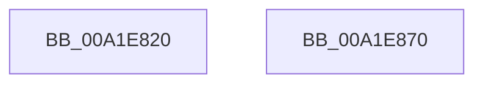

# FsRtlNotifyFullReportChange

- RVA: `0x00A1E820`–`0x00A1E871` (길이 `81` bytes)
- VA: `0x0000000140A1E820`
- 실행 섹션: `PAGE`
- PDB 이름 있음: `예`; PDB Function 태그: `아니요`
- unwind 정보 RVA: `0x0005CC98`
- 디코드: `17`개 명령, `81/81` bytes 표시
- 미해석 바이트: `0` (있으면 어셈블리에 `.byte`로 보존)

> 이 문서는 커널 이미지의 기계어와 PDB 기호를 분석해 생성했습니다. 4번과 5번은 함수 원형과 자료형을 바이너리 사용 방식에서 추정한 C 해석이며 원본 소스 복구 결과는 아닙니다.

## 1. Dependencies

- 직접 호출 지점: **1**; 고유 호출 대상: **1**
- 직접 호출자로 확인된 함수: **0**
- RIP 상대 이미지 참조: **0**

### Outgoing calls
- `0x00A1E866` → [FsRtlNotifyFilterReportChange](FsRtlNotifyFilterReportChange_function_00A1E880.md) (function, `0x00A1E880`)

### Direct callers
- 이 함수 시작 RVA로 연결되는 직접 call은 확인되지 않았습니다. 간접 호출은 완전히 역산할 수 없습니다.

### Static image references
- 디코드된 RIP-relative 메모리 참조가 없습니다.

## 2. Other-region calls and transfers

- 다른 실행 섹션으로 향하는 call: **0**
- 별도 외부 분기/꼬리 이동을 확인하지 못했습니다.

## 3. Assembly (complete function range)

```asm
00A1E820  4C 8B DC                        mov r11, rsp
00A1E823  48 83 EC 58                     sub rsp, 0x58
00A1E827  49 83 63 F0 00                  and qword ptr [r11 - 0x10], 0
00A1E82C  48 8B 84 24 A0 00 00 00         mov rax, qword ptr [rsp + 0xa0]
00A1E834  49 89 43 E8                     mov qword ptr [r11 - 0x18], rax
00A1E838  8B 84 24 98 00 00 00            mov eax, dword ptr [rsp + 0x98]
00A1E83F  89 44 24 38                     mov dword ptr [rsp + 0x38], eax
00A1E843  8B 84 24 90 00 00 00            mov eax, dword ptr [rsp + 0x90]
00A1E84A  89 44 24 30                     mov dword ptr [rsp + 0x30], eax
00A1E84E  48 8B 84 24 88 00 00 00         mov rax, qword ptr [rsp + 0x88]
00A1E856  49 89 43 D0                     mov qword ptr [r11 - 0x30], rax
00A1E85A  48 8B 84 24 80 00 00 00         mov rax, qword ptr [rsp + 0x80]
00A1E862  49 89 43 C8                     mov qword ptr [r11 - 0x38], rax
00A1E866  E8 15 00 00 00                  call 0x140a1e880
00A1E86B  48 83 C4 58                     add rsp, 0x58
00A1E86F  C3                              ret
00A1E870  CC                              int3
```

## 4. C-style interpretation (structured pseudocode)

```c
__int64 __fastcall FsRtlNotifyFullReportChange(__int64 a1, __int64 a2, __int64 a3, __int64 a4, __int64 a5, __int64 a6, unsigned int a7, unsigned int a8, __int64 a9)
{
    __int64 result;
    __int64 v_rsp;
    unsigned int v_stack_m20;
    unsigned int v_stack_m28;

    v_rsp = (v_rsp) - (88);
    *(unsigned __int64 *)(v_rsp - 24) = a9;
    v_stack_m20 = (unsigned int)((unsigned int)(a8));
    v_stack_m28 = (unsigned int)((unsigned int)(a7));
    *(unsigned __int64 *)(v_rsp - 48) = a6;
    *(unsigned __int64 *)(v_rsp - 56) = a5;
    result = FsRtlNotifyFilterReportChange(a1, a2, a3, a4);
    v_rsp = (v_rsp) + (88);
    return result;
}
```

## 5. (Beta) C Style

```c
int64_t FsRtlNotifyFullReportChange(int64_t Arg1, int64_t Arg2, int64_t Arg3, int64_t Arg4, int64_t Arg5, int64_t Arg6, uint32_t Arg7, uint32_t Arg8, int64_t Arg9)
{
    int64_t result;
    int64_t local_rsp;
    uint32_t v_stack_m20;
    uint32_t v_stack_m28;

    local_rsp = (local_rsp) - (88);
    *(uint64_t *)(local_rsp - 0x18) = Arg9;
    v_stack_m20 = (uint32_t)((uint32_t)(Arg8));
    v_stack_m28 = (uint32_t)((uint32_t)(Arg7));
    *(uint64_t *)(local_rsp - 0x30) = Arg6;
    *(uint64_t *)(local_rsp - 0x38) = Arg5;
    result = FsRtlNotifyFilterReportChange(Arg1, Arg2, Arg3, Arg4);
    local_rsp = (local_rsp) + (88);
    return result;
}
```

## 6. Execution-region graph

[열기: 2D/3D 그래프와 함수 탐색 컨트롤 패널](../../../control-panel.html?section=page&rva=0x00A1E820&view=graph)

- 2D 그래프는 위에서 아래로 흐르고, 3D 그래프는 빈 공간을 드래그해 회전합니다. Shift+드래그는 이동, 휠은 확대·축소, 함수 노드 선택은 대상 보고서 이동입니다.

### Static fallback


