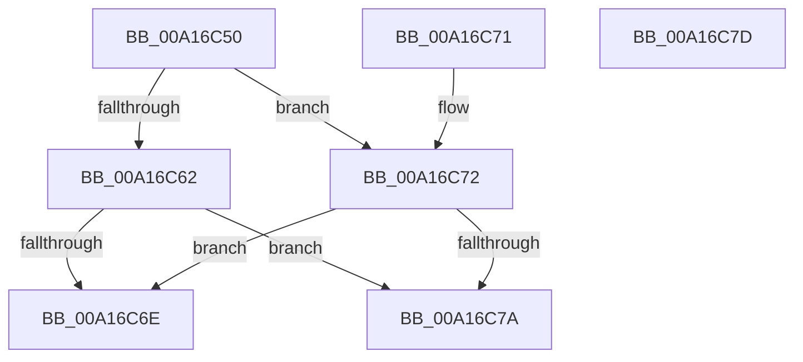

# FsRtlOplockIsSharedRequest

- RVA: `0x00A16C50`–`0x00A16C7E` (길이 `46` bytes)
- VA: `0x0000000140A16C50`
- 실행 섹션: `PAGE`
- PDB 이름 있음: `예`; PDB Function 태그: `아니요`
- unwind 정보 RVA: `0x000DB714`
- 디코드: `16`개 명령, `46/46` bytes 표시
- 미해석 바이트: `0` (있으면 어셈블리에 `.byte`로 보존)

> 이 문서는 커널 이미지의 기계어와 PDB 기호를 분석해 생성했습니다. 4번과 5번은 함수 원형과 자료형을 바이너리 사용 방식에서 추정한 C 해석이며 원본 소스 복구 결과는 아닙니다.

## 1. Dependencies

- 직접 호출 지점: **0**; 고유 호출 대상: **0**
- 직접 호출자로 확인된 함수: **0**
- RIP 상대 이미지 참조: **0**

### Outgoing calls
- 직접 디코드된 call 명령이 없습니다.

### Direct callers
- 이 함수 시작 RVA로 연결되는 직접 call은 확인되지 않았습니다. 간접 호출은 완전히 역산할 수 없습니다.

### Static image references
- 디코드된 RIP-relative 메모리 참조가 없습니다.

## 2. Other-region calls and transfers

- 다른 실행 섹션으로 향하는 call: **0**
- 별도 외부 분기/꼬리 이동을 확인하지 못했습니다.

## 3. Assembly (complete function range)

```asm
00A16C50  48 8B 81 B8 00 00 00            mov rax, qword ptr [rcx + 0xb8]
00A16C57  8B 50 18                        mov edx, dword ptr [rax + 0x18]
00A16C5A  81 FA 40 02 09 00               cmp edx, 0x90240
00A16C60  75 10                           jne 0x140a16c72
00A16C62  48 8B 41 18                     mov rax, qword ptr [rcx + 0x18]
00A16C66  8B 48 04                        mov ecx, dword ptr [rax + 4]
00A16C69  F6 C1 04                        test cl, 4
00A16C6C  75 0C                           jne 0x140a16c7a
00A16C6E  B0 01                           mov al, 1
00A16C70  C3                              ret
00A16C71  CC                              int3
00A16C72  81 FA 04 00 09 00               cmp edx, 0x90004
00A16C78  74 F4                           je 0x140a16c6e
00A16C7A  32 C0                           xor al, al
00A16C7C  C3                              ret
00A16C7D  CC                              int3
```

## 4. C-style interpretation (structured pseudocode)

```c
__int64 __fastcall FsRtlOplockIsSharedRequest(__int64 a1)
{
    __int64 result;

    if (((unsigned int)((unsigned int)(*(unsigned int *)(*(unsigned __int64 *)(a1 + 184) + 24)))) != 0x90240ULL) goto loc_00A16C72;
    if ((((unsigned __int8)((unsigned int)(*(unsigned int *)(*(unsigned __int64 *)(a1 + 24) + 4)))) & (4)) != 0) goto loc_00A16C7A;
loc_00A16C6E:
    return 1;
loc_00A16C72:
    if (((unsigned int)((unsigned int)(*(unsigned int *)(*(unsigned __int64 *)(a1 + 184) + 24)))) == 0x90004ULL) goto loc_00A16C6E;
loc_00A16C7A:
    result = 0;
    return result;
}
```

## 5. (Beta) C Style

```c
int64_t FsRtlOplockIsSharedRequest(void *Arg1)
{
    uint8_t *arg1 = (uint8_t *)Arg1;

    int64_t result;

    if (((uint32_t)((uint32_t)(*(uint32_t *)(*(uint64_t *)(arg1 + 0xB8) + 0x18)))) != 0x90240ULL) goto loc_00A16C72;
    if ((((uint8_t)((uint32_t)(*(uint32_t *)(*(uint64_t *)(arg1 + 0x18) + 0x4)))) & (4)) != 0) goto loc_00A16C7A;
loc_00A16C6E:
    return 1;
loc_00A16C72:
    if (((uint32_t)((uint32_t)(*(uint32_t *)(*(uint64_t *)(arg1 + 0xB8) + 0x18)))) == 0x90004ULL) goto loc_00A16C6E;
loc_00A16C7A:
    result = 0;
    return result;
}
```

### 관측된 메모리 오프셋

구조체 형식이 확인되지 않은 접근은 인자 기준의 오프셋으로만 기록했습니다.

| 기준 인자 | 오프셋 표현 | 폭 (bit) | 접근 |
|---|---:|---:|---|
| `Arg1` | `+ 0x18` | `64` | `R` |
| `Arg1` | `+ 0xB8` | `64` | `R` |

## 6. Execution-region graph

[열기: 2D/3D 그래프와 함수 탐색 컨트롤 패널](../../../control-panel.html?section=page&rva=0x00A16C50&view=graph)

- 2D 그래프는 위에서 아래로 흐르고, 3D 그래프는 빈 공간을 드래그해 회전합니다. Shift+드래그는 이동, 휠은 확대·축소, 함수 노드 선택은 대상 보고서 이동입니다.

### Static fallback


