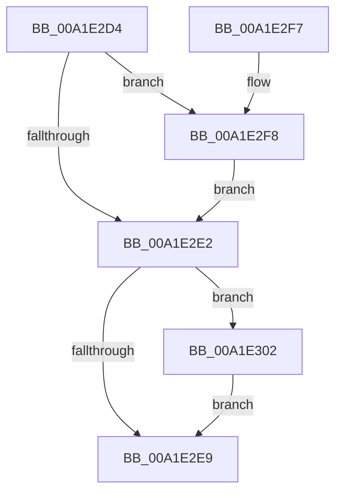

# IopAllocateIrpCleanup

- RVA: `0x00A1E2D4`–`0x00A1E30C` (길이 `56` bytes)
- VA: `0x0000000140A1E2D4`
- 실행 섹션: `PAGE`
- PDB 이름 있음: `예`; PDB Function 태그: `아니요`
- unwind 정보 RVA: `0x00060A68`
- 디코드: `20`개 명령, `56/56` bytes 표시
- 미해석 바이트: `0` (있으면 어셈블리에 `.byte`로 보존)

> 이 문서는 커널 이미지의 기계어와 PDB 기호를 분석해 생성했습니다. 4번과 5번은 함수 원형과 자료형을 바이너리 사용 방식에서 추정한 C 해석이며 원본 소스 복구 결과는 아닙니다.

## 1. Dependencies

- 직접 호출 지점: **3**; 고유 호출 대상: **2**
- 직접 호출자로 확인된 함수: **8**
- RIP 상대 이미지 참조: **0**

### Outgoing calls
- `0x00A1E2EC` → [ObfDereferenceObject](../../text/2F/ObfDereferenceObject_function_002F9350.md) (function, `0x002F9350`)
- `0x00A1E2FB` → [ObfDereferenceObject](../../text/2F/ObfDereferenceObject_function_002F9350.md) (function, `0x002F9350`)
- `0x00A1E305` → [IopReleaseFileObjectLock](../../text/25/IopReleaseFileObjectLock_function_00250A90.md) (function, `0x00250A90`)

### Direct callers
- [NtSetInformationFile](../../text/29/NtSetInformationFile_function_0029C5E0.md) at `0x0029D0BF`
- [IopSetEaOrQuotaInformationFile](../71/IopSetEaOrQuotaInformationFile_function_0071BD70.md) at `0x0071BF83`
- [IoSetInformation](../71/IoSetInformation_function_0071DBF0.md) at `0x0071DD4D`
- [NtQueryQuotaInformationFile](../72/NtQueryQuotaInformationFile_function_00720FE0.md) at `0x0072149D`
- [NtSetVolumeInformationFile](../72/NtSetVolumeInformationFile_function_00721750.md) at `0x00721A5A`
- [BuildQueryDirectoryIrp](../8E/BuildQueryDirectoryIrp_function_008EC770.md) at `0x008ECD66`
- [BuildQueryDirectoryIrp](../8E/BuildQueryDirectoryIrp_function_008EC770.md) at `0x008ECEA8`
- [NtNotifyChangeDirectoryFileEx](NtNotifyChangeDirectoryFileEx_function_00A1DEA0.md) at `0x00A1E026`
- [NtNotifyChangeDirectoryFileEx](NtNotifyChangeDirectoryFileEx_function_00A1DEA0.md) at `0x00A1E18A`
- [sub_00B41AB2](../B4/Unknown_function_00B41AB2.md) at `0x00B41AB7`

### Static image references
- 디코드된 RIP-relative 메모리 참조가 없습니다.

## 2. Other-region calls and transfers

- 다른 실행 섹션으로 향하는 call: **3**
  - `0x00A1E2EC` → [ObfDereferenceObject](../../text/2F/ObfDereferenceObject_function_002F9350.md) (`PAGE` → `.text`)
  - `0x00A1E2FB` → [ObfDereferenceObject](../../text/2F/ObfDereferenceObject_function_002F9350.md) (`PAGE` → `.text`)
  - `0x00A1E305` → [IopReleaseFileObjectLock](../../text/25/IopReleaseFileObjectLock_function_00250A90.md) (`PAGE` → `.text`)
- 별도 외부 분기/꼬리 이동을 확인하지 못했습니다.

## 3. Assembly (complete function range)

```asm
00A1E2D4  40 53                           push rbx
00A1E2D6  48 83 EC 20                     sub rsp, 0x20
00A1E2DA  48 8B D9                        mov rbx, rcx
00A1E2DD  48 85 D2                        test rdx, rdx
00A1E2E0  75 16                           jne 0x140a1e2f8
00A1E2E2  8B 43 50                        mov eax, dword ptr [rbx + 0x50]
00A1E2E5  A8 02                           test al, 2
00A1E2E7  75 19                           jne 0x140a1e302
00A1E2E9  48 8B CB                        mov rcx, rbx
00A1E2EC  E8 5F B0 8D FF                  call 0x1402f9350
00A1E2F1  48 83 C4 20                     add rsp, 0x20
00A1E2F5  5B                              pop rbx
00A1E2F6  C3                              ret
00A1E2F7  CC                              int3
00A1E2F8  48 8B CA                        mov rcx, rdx
00A1E2FB  E8 50 B0 8D FF                  call 0x1402f9350
00A1E300  EB E0                           jmp 0x140a1e2e2
00A1E302  48 8B CB                        mov rcx, rbx
00A1E305  E8 86 27 83 FF                  call 0x140250a90
00A1E30A  EB DD                           jmp 0x140a1e2e9
```

## 4. C-style interpretation (structured pseudocode)

```c
__int64 __fastcall IopAllocateIrpCleanup(__int64 a1, __int64 a2)
{
    __int64 result;
    __int64 v_rsp;

    v_rsp = (v_rsp) - (32);
    if (a2 != 0) goto loc_00A1E2F8;
loc_00A1E2E2:
    if ((((unsigned __int8)((unsigned int)(*(unsigned int *)(a1 + 80)))) & (2)) != 0) goto loc_00A1E302;
loc_00A1E2E9:
    result = ObfDereferenceObject(a1, a2, a3, a4);
    v_rsp = (v_rsp) + (32);
    return result;
loc_00A1E2F8:
    result = ObfDereferenceObject(a2, a2, a3, a4);
    goto loc_00A1E2E2;
loc_00A1E302:
    result = IopReleaseFileObjectLock(a1, a2, a3, a4);
    goto loc_00A1E2E9;
}
```

## 5. (Beta) C Style

```c
int64_t IopAllocateIrpCleanup(void *Arg1, int64_t Arg2)
{
    uint8_t *arg1 = (uint8_t *)Arg1;

    int64_t result;
    int64_t local_rsp;

    local_rsp = (local_rsp) - (32);
    if (Arg2 != 0) goto loc_00A1E2F8;
loc_00A1E2E2:
    if ((((uint8_t)((uint32_t)(*(uint32_t *)(arg1 + 0x50)))) & (2)) != 0) goto loc_00A1E302;
loc_00A1E2E9:
    result = ObfDereferenceObject(Arg1, Arg2, a3, a4);
    local_rsp = (local_rsp) + (32);
    return result;
loc_00A1E2F8:
    result = ObfDereferenceObject(Arg2, Arg2, a3, a4);
    goto loc_00A1E2E2;
loc_00A1E302:
    result = IopReleaseFileObjectLock(Arg1, Arg2, a3, a4);
    goto loc_00A1E2E9;
}
```

### 관측된 메모리 오프셋

구조체 형식이 확인되지 않은 접근은 인자 기준의 오프셋으로만 기록했습니다.

| 기준 인자 | 오프셋 표현 | 폭 (bit) | 접근 |
|---|---:|---:|---|
| `Arg1` | `+ 0x50` | `32` | `R` |

## 6. Execution-region graph

[열기: 2D/3D 그래프와 함수 탐색 컨트롤 패널](../../../control-panel.html?section=page&rva=0x00A1E2D4&view=graph)

- 2D 그래프는 위에서 아래로 흐르고, 3D 그래프는 빈 공간을 드래그해 회전합니다. Shift+드래그는 이동, 휠은 확대·축소, 함수 노드 선택은 대상 보고서 이동입니다.

### Static fallback


