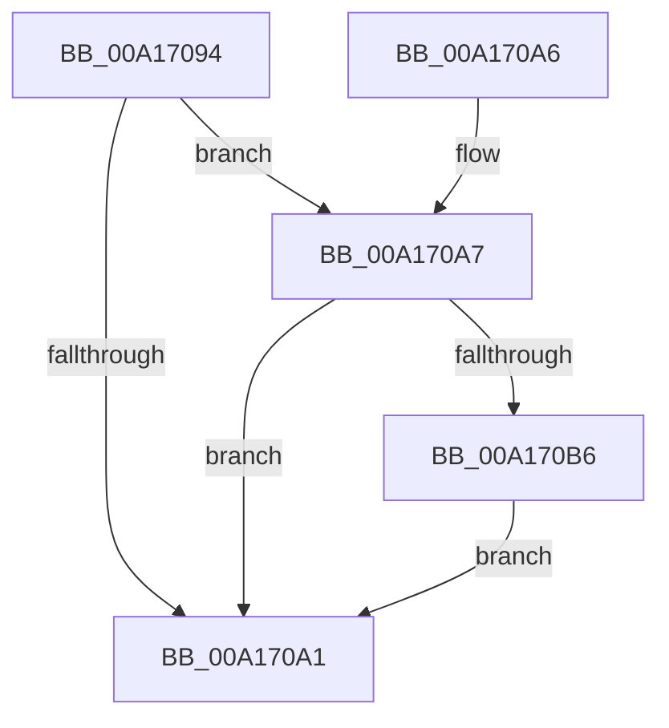

# KeSynchronizeWithDynamicProcessors

- RVA: `0x00A17094`–`0x00A170D0` (길이 `60` bytes)
- VA: `0x0000000140A17094`
- 실행 섹션: `PAGE`
- PDB 이름 있음: `예`; PDB Function 태그: `아니요`
- unwind 정보 RVA: `0x0007C048`
- 디코드: `15`개 명령, `60/60` bytes 표시
- 미해석 바이트: `0` (있으면 어셈블리에 `.byte`로 보존)

> 이 문서는 커널 이미지의 기계어와 PDB 기호를 분석해 생성했습니다. 4번과 5번은 함수 원형과 자료형을 바이너리 사용 방식에서 추정한 C 해석이며 원본 소스 복구 결과는 아닙니다.

## 1. Dependencies

- 직접 호출 지점: **2**; 고유 호출 대상: **2**
- 직접 호출자로 확인된 함수: **3**
- RIP 상대 이미지 참조: **2**

### Outgoing calls
- `0x00A170BD` → [ExAcquireFastMutex](../../text/20/ExAcquireFastMutex_function_0020E5A0.md) (function, `0x0020E5A0`)
- `0x00A170C9` → [ExReleaseFastMutex](../../text/25/ExReleaseFastMutex_function_002519C0.md) (function, `0x002519C0`)

### Direct callers
- [PspInitializeQuotaBlock](../78/PspInitializeQuotaBlock_function_00780EB0.md) at `0x00781001`
- [ExpNodeHotAddProcessorWorker](../7C/ExpNodeHotAddProcessorWorker_function_007CF820.md) at `0x007CF82D`
- [NtSetSystemInformation](../AF/NtSetSystemInformation_function_00AF4A60.md) at `0x00AF4C7A`

### Static image references
- `0x00A17098` → RVA `0x00FC6AA4` (`ALMOSTRO`; read)
- `0x00A170AC` → RVA `0x00F22B80` (`.data`; read)

## 2. Other-region calls and transfers

- 다른 실행 섹션으로 향하는 call: **2**
  - `0x00A170BD` → [ExAcquireFastMutex](../../text/20/ExAcquireFastMutex_function_0020E5A0.md) (`PAGE` → `.text`)
  - `0x00A170C9` → [ExReleaseFastMutex](../../text/25/ExReleaseFastMutex_function_002519C0.md) (`PAGE` → `.text`)
- 별도 외부 분기/꼬리 이동을 확인하지 못했습니다.

## 3. Assembly (complete function range)

```asm
00A17094  48 83 EC 28                     sub rsp, 0x28
00A17098  80 3D 05 FA 5A 00 00            cmp byte ptr [rip + 0x5afa05], 0
00A1709F  75 06                           jne 0x140a170a7
00A170A1  48 83 C4 28                     add rsp, 0x28
00A170A5  C3                              ret
00A170A6  CC                              int3
00A170A7  F0 83 0C 24 00                  lock or dword ptr [rsp], 0
00A170AC  8B 05 CE BA 50 00               mov eax, dword ptr [rip + 0x50bace]
00A170B2  A8 01                           test al, 1
00A170B4  75 EB                           jne 0x140a170a1
00A170B6  48 8D 0D C3 BA 50 00            lea rcx, [rip + 0x50bac3]
00A170BD  E8 DE 74 7F FF                  call 0x14020e5a0
00A170C2  48 8D 0D B7 BA 50 00            lea rcx, [rip + 0x50bab7]
00A170C9  E8 F2 A8 83 FF                  call 0x1402519c0
00A170CE  EB D1                           jmp 0x140a170a1
```

## 4. C-style interpretation (structured pseudocode)

```c
__int64 __fastcall KeSynchronizeWithDynamicProcessors(void)
{
    __int64 result;
    __int64 v_rsp;
    unsigned int v_stack_p0;

    v_rsp = (v_rsp) - (40);
    if ((*(unsigned __int8 *)(v_rip + 5962245)) != 0) goto loc_00A170A7;
loc_00A170A1:
    v_rsp = (v_rsp) + (40);
    return result;
loc_00A170A7:
    if ((((unsigned __int8)((unsigned int)(*(unsigned int *)(v_rip + 5290702)))) & (1)) != 0) goto loc_00A170A1;
    result = ExAcquireFastMutex(v_rip + 5290691, a2, a3, a4);
    result = ExReleaseFastMutex(v_rip + 5290679, a2, a3, a4);
    goto loc_00A170A1;
}
```

## 5. (Beta) C Style

```c
void KeSynchronizeWithDynamicProcessors(void)
{
    int64_t result;
    int64_t local_rsp;
    uint32_t v_stack_p0;

    local_rsp = (local_rsp) - (40);
    if ((*(uint8_t *)(v_rip + 0x5AFA05)) != 0) goto loc_00A170A7;
loc_00A170A1:
    local_rsp = (local_rsp) + (40);
    return result;
loc_00A170A7:
    if ((((uint8_t)((uint32_t)(*(uint32_t *)(v_rip + 0x50BACE)))) & (1)) != 0) goto loc_00A170A1;
    result = ExAcquireFastMutex(v_rip + 5290691, a2, a3, a4);
    result = ExReleaseFastMutex(v_rip + 5290679, a2, a3, a4);
    goto loc_00A170A1;
}
```

## 6. Execution-region graph

[열기: 2D/3D 그래프와 함수 탐색 컨트롤 패널](../../../control-panel.html?section=page&rva=0x00A17094&view=graph)

- 2D 그래프는 위에서 아래로 흐르고, 3D 그래프는 빈 공간을 드래그해 회전합니다. Shift+드래그는 이동, 휠은 확대·축소, 함수 노드 선택은 대상 보고서 이동입니다.

### Static fallback


