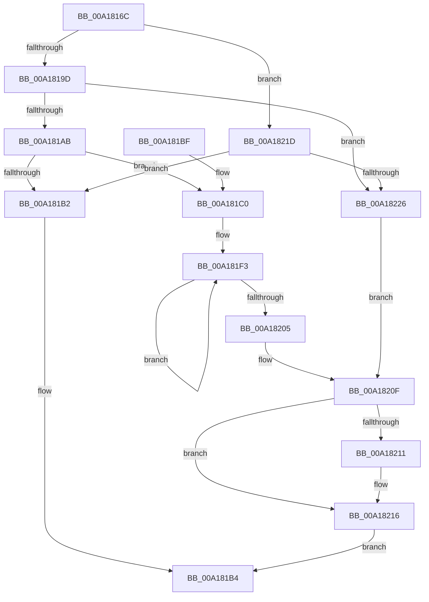

# MiCleanEmbryonicProcess

- RVA: `0x00A1816C`–`0x00A1822E` (길이 `194` bytes)
- VA: `0x0000000140A1816C`
- 실행 섹션: `PAGE`
- PDB 이름 있음: `예`; PDB Function 태그: `아니요`
- unwind 정보 RVA: `0x000A6520`
- 디코드: `51`개 명령, `194/194` bytes 표시
- 미해석 바이트: `0` (있으면 어셈블리에 `.byte`로 보존)

> 이 문서는 커널 이미지의 기계어와 PDB 기호를 분석해 생성했습니다. 4번과 5번은 함수 원형과 자료형을 바이너리 사용 방식에서 추정한 C 해석이며 원본 소스 복구 결과는 아닙니다.

## 1. Dependencies

- 직접 호출 지점: **5**; 고유 호출 대상: **5**
- 직접 호출자로 확인된 함수: **1**
- RIP 상대 이미지 참조: **0**

### Outgoing calls
- `0x00A18183` → [MiGetSharedVm](../../text/41/MiGetSharedVm_function_00414A20.md) (function, `0x00414A20`)
- `0x00A181CB` → [PsReturnProcessQuota](../../text/47/PsReturnProcessQuota_function_0047DE8C.md) (function, `0x0047DE8C`)
- `0x00A181D3` → [MiGetProcessPartition](../../text/44/MiGetProcessPartition_function_00443B10.md) (function, `0x00443B10`)
- `0x00A181E3` → [MiReturnResident](../../text/28/MiReturnResident_function_00286890.md) (function, `0x00286890`)
- `0x00A18211` → [PsDereferenceSession](PsDereferenceSession_function_00A1827C.md) (function, `0x00A1827C`)

### Direct callers
- [MmCleanProcessAddressSpace](MmCleanProcessAddressSpace_function_00A17EC0.md) at `0x00A17F00`

### Static image references
- 디코드된 RIP-relative 메모리 참조가 없습니다.

## 2. Other-region calls and transfers

- 다른 실행 섹션으로 향하는 call: **4**
  - `0x00A18183` → [MiGetSharedVm](../../text/41/MiGetSharedVm_function_00414A20.md) (`PAGE` → `.text`)
  - `0x00A181CB` → [PsReturnProcessQuota](../../text/47/PsReturnProcessQuota_function_0047DE8C.md) (`PAGE` → `.text`)
  - `0x00A181D3` → [MiGetProcessPartition](../../text/44/MiGetProcessPartition_function_00443B10.md) (`PAGE` → `.text`)
  - `0x00A181E3` → [MiReturnResident](../../text/28/MiReturnResident_function_00286890.md) (`PAGE` → `.text`)
- 별도 외부 분기/꼬리 이동을 확인하지 못했습니다.

## 3. Assembly (complete function range)

```asm
00A1816C  48 89 5C 24 08                  mov qword ptr [rsp + 8], rbx
00A18171  57                              push rdi
00A18172  48 83 EC 20                     sub rsp, 0x20
00A18176  48 8D B9 00 04 00 00            lea rdi, [rcx + 0x400]
00A1817D  48 8B D9                        mov rbx, rcx
00A18180  48 8B CF                        mov rcx, rdi
00A18183  E8 98 C8 9F FF                  call 0x140414a20
00A18188  8B 87 B8 00 00 00               mov eax, dword ptr [rdi + 0xb8]
00A1818E  8B 8B F4 01 00 00               mov ecx, dword ptr [rbx + 0x1f4]
00A18194  F6 C1 20                        test cl, 0x20
00A18197  0F 85 80 00 00 00               jne 0x140a1821d
00A1819D  8B C1                           mov eax, ecx
00A1819F  25 00 0C 00 00                  and eax, 0xc00
00A181A4  3D 00 04 00 00                  cmp eax, 0x400
00A181A9  76 7B                           jbe 0x140a18226
00A181AB  3D 00 08 00 00                  cmp eax, 0x800
00A181B0  74 0E                           je 0x140a181c0
00A181B2  33 C0                           xor eax, eax
00A181B4  48 8B 5C 24 30                  mov rbx, qword ptr [rsp + 0x30]
00A181B9  48 83 C4 20                     add rsp, 0x20
00A181BD  5F                              pop rdi
00A181BE  C3                              ret
00A181BF  CC                              int3
00A181C0  4C 8B 47 70                     mov r8, qword ptr [rdi + 0x70]
00A181C4  48 8B CB                        mov rcx, rbx
00A181C7  49 83 E8 04                     sub r8, 4
00A181CB  E8 BC 5C A6 FF                  call 0x14047de8c
00A181D0  48 8B CB                        mov rcx, rbx
00A181D3  E8 38 B9 A2 FF                  call 0x140443b10
00A181D8  48 8B 57 70                     mov rdx, qword ptr [rdi + 0x70]
00A181DC  48 8B C8                        mov rcx, rax
00A181DF  48 83 EA 04                     sub rdx, 4
00A181E3  E8 A8 E6 86 FF                  call 0x140286890
00A181E8  8B 83 F4 01 00 00               mov eax, dword ptr [rbx + 0x1f4]
00A181EE  BA FF F7 FF FF                  mov edx, 0xfffff7ff
00A181F3  8B C8                           mov ecx, eax
00A181F5  23 CA                           and ecx, edx
00A181F7  0F BA E9 0A                     bts ecx, 0xa
00A181FB  F0 0F B1 8B F4 01 00 00         lock cmpxchg dword ptr [rbx + 0x1f4], ecx
00A18203  75 EE                           jne 0x140a181f3
00A18205  F7 83 F4 01 00 00 00 00 01 00   test dword ptr [rbx + 0x1f4], 0x10000
00A1820F  74 05                           je 0x140a18216
00A18211  E8 66 00 00 00                  call 0x140a1827c
00A18216  B8 01 00 00 00                  mov eax, 1
00A1821B  EB 97                           jmp 0x140a181b4
00A1821D  C1 E8 18                        shr eax, 0x18
00A18220  24 30                           and al, 0x30
00A18222  3C 30                           cmp al, 0x30
00A18224  74 8C                           je 0x140a181b2
00A18226  F7 C1 00 00 01 00               test ecx, 0x10000
00A1822C  EB E1                           jmp 0x140a1820f
```

## 4. C-style interpretation (structured pseudocode)

```c
__int64 __fastcall MiCleanEmbryonicProcess(__int64 a1)
{
    __int64 result;
    __int64 v_rsp;
    unsigned __int64 v_stack_p8;

    v_stack_p8 = v_rbx;
    v_rsp = (v_rsp) - (32);
    result = MiGetSharedVm(a1 + 1024, a2, a3, a4);
    if ((((unsigned __int8)((unsigned int)(*(unsigned int *)(a1 + 500)))) & (32)) != 0) goto loc_00A1821D;
    result = (unsigned int)(((unsigned int)((unsigned int)((unsigned int)(*(unsigned int *)(a1 + 500))))) & (0xC00ULL));
    if (((unsigned int)(result)) <= 0x400ULL) goto loc_00A18226;
    if (((unsigned int)(result)) == 0x800ULL) goto loc_00A181C0;
loc_00A181B2:
    result = 0;
loc_00A181B4:
    v_rsp = (v_rsp) + (32);
    return result;
loc_00A181C0:
    a3 = (*(unsigned __int64 *)(a1 + 1024 + 112)) - (4);
    result = PsReturnProcessQuota(v_stack_p8, a2, a3, a4);
    result = MiGetProcessPartition(v_stack_p8, a2, a3, a4);
    a2 = (*(unsigned __int64 *)(a1 + 1024 + 112)) - (4);
    result = MiReturnResident(result, a2, a3, a4);
loc_00A181F3:
    a1 = (unsigned int)(((unsigned int)((unsigned int)((unsigned int)(*(unsigned int *)(v_stack_p8 + 500))))) & ((unsigned int)((unsigned int)(0xFFFFF7FFULL))));
    if (condition_is_not_equal) goto loc_00A181F3;
loc_00A1820F:
    result = (unsigned int)(*(unsigned int *)(v_stack_p8 + 500));
    if (((*(unsigned int *)(v_stack_p8 + 500)) & (0x10000ULL)) != 0) {
        result = PsDereferenceSession(a1, (unsigned int)(0xFFFFF7FFULL), a3, a4);
    }
    goto loc_00A181B4;
loc_00A1821D:
    result = (unsigned int)((1) >> (24));
    result = (unsigned __int8)((result) & (48));
    if (((unsigned __int8)(result)) == 48) goto loc_00A181B2;
loc_00A18226:
    goto loc_00A1820F;
}
```

## 5. (Beta) C Style

```c
int64_t MiCleanEmbryonicProcess(void *Arg1)
{
    uint8_t *arg1 = (uint8_t *)Arg1;

    int64_t result;
    int64_t local_rsp;
    uint64_t v_stack_p8;

    v_stack_p8 = local_rbx;
    local_rsp = (local_rsp) - (32);
    result = MiGetSharedVm(Arg1 + 1024, a2, a3, a4);
    if ((((uint8_t)((uint32_t)(*(uint32_t *)(arg1 + 0x1F4)))) & (32)) != 0) goto loc_00A1821D;
    result = (uint32_t)(((uint32_t)((uint32_t)((uint32_t)(*(uint32_t *)(arg1 + 0x1F4))))) & (0xC00ULL));
    if (((uint32_t)(result)) <= 0x400ULL) goto loc_00A18226;
    if (((uint32_t)(result)) == 0x800ULL) goto loc_00A181C0;
loc_00A181B2:
    result = 0;
loc_00A181B4:
    local_rsp = (local_rsp) + (32);
    return result;
loc_00A181C0:
    a3 = (*(uint64_t *)(arg1 + 0x400 + 0x70)) - (4);
    result = PsReturnProcessQuota(v_stack_p8, a2, a3, a4);
    result = MiGetProcessPartition(v_stack_p8, a2, a3, a4);
    a2 = (*(uint64_t *)(arg1 + 0x400 + 0x70)) - (4);
    result = MiReturnResident(result, a2, a3, a4);
loc_00A181F3:
    Arg1 = (uint32_t)(((uint32_t)((uint32_t)((uint32_t)(*(uint32_t *)(v_stack_p8 + 0x1F4))))) & ((uint32_t)((uint32_t)(0xFFFFF7FFULL))));
    if (condition_is_not_equal) goto loc_00A181F3;
loc_00A1820F:
    result = (uint32_t)(*(uint32_t *)(v_stack_p8 + 0x1F4));
    if (((*(uint32_t *)(v_stack_p8 + 0x1F4)) & (0x10000ULL)) != 0) {
        result = PsDereferenceSession(Arg1, (uint32_t)(0xFFFFF7FFULL), a3, a4);
    }
    goto loc_00A181B4;
loc_00A1821D:
    result = (uint32_t)((1) >> (24));
    result = (uint8_t)((result) & (48));
    if (((uint8_t)(result)) == 48) goto loc_00A181B2;
loc_00A18226:
    goto loc_00A1820F;
}
```

### 관측된 메모리 오프셋

구조체 형식이 확인되지 않은 접근은 인자 기준의 오프셋으로만 기록했습니다.

| 기준 인자 | 오프셋 표현 | 폭 (bit) | 접근 |
|---|---:|---:|---|
| `Arg1` | `+ 0x70` | `64` | `R` |
| `Arg1` | `+ 0xB8` | `32` | `R` |
| `Arg1` | `+ 0x1F4` | `32` | `R` |
| `Arg1` | `+ 0x400` | `64` | `R` |

## 6. Execution-region graph

[열기: 2D/3D 그래프와 함수 탐색 컨트롤 패널](../../../control-panel.html?section=page&rva=0x00A1816C&view=graph)

- 2D 그래프는 위에서 아래로 흐르고, 3D 그래프는 빈 공간을 드래그해 회전합니다. Shift+드래그는 이동, 휠은 확대·축소, 함수 노드 선택은 대상 보고서 이동입니다.

### Static fallback


