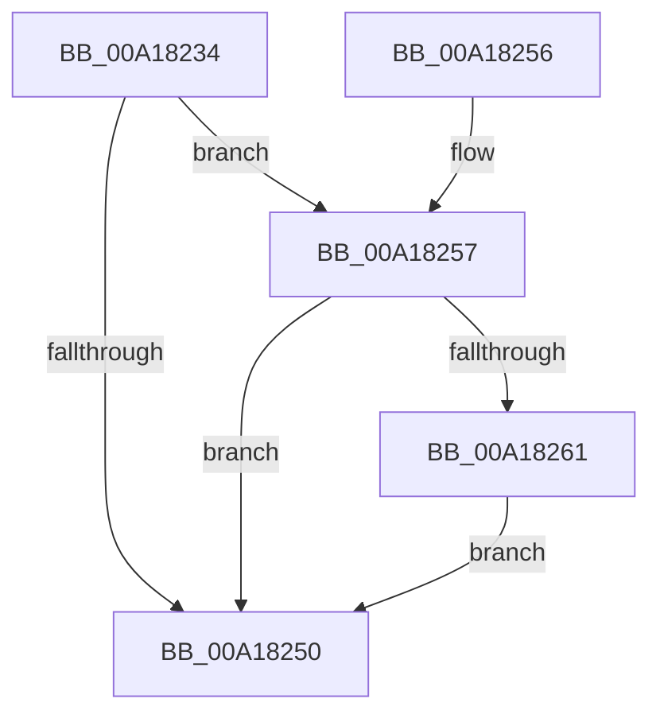

# MiCleanProcessPhysicalPages

- RVA: `0x00A18234`–`0x00A18276` (길이 `66` bytes)
- VA: `0x0000000140A18234`
- 실행 섹션: `PAGE`
- PDB 이름 있음: `예`; PDB Function 태그: `아니요`
- unwind 정보 RVA: `0x00065B84`
- 디코드: `19`개 명령, `66/66` bytes 표시
- 미해석 바이트: `0` (있으면 어셈블리에 `.byte`로 보존)

> 이 문서는 커널 이미지의 기계어와 PDB 기호를 분석해 생성했습니다. 4번과 5번은 함수 원형과 자료형을 바이너리 사용 방식에서 추정한 C 해석이며 원본 소스 복구 결과는 아닙니다.

## 1. Dependencies

- 직접 호출 지점: **2**; 고유 호출 대상: **2**
- 직접 호출자로 확인된 함수: **1**
- RIP 상대 이미지 참조: **0**

### Outgoing calls
- `0x00A18257` → [MiDeleteAweInfoPages](../80/MiDeleteAweInfoPages_function_0080AA40.md) (function, `0x0080AA40`)
- `0x00A1826F` → [MiReturnProcessCommitment](../../text/45/MiReturnProcessCommitment_function_0045CED4.md) (function, `0x0045CED4`)

### Direct callers
- [MmCleanProcessAddressSpace](MmCleanProcessAddressSpace_function_00A17EC0.md) at `0x00A18069`

### Static image references
- 디코드된 RIP-relative 메모리 참조가 없습니다.

## 2. Other-region calls and transfers

- 다른 실행 섹션으로 향하는 call: **1**
  - `0x00A1826F` → [MiReturnProcessCommitment](../../text/45/MiReturnProcessCommitment_function_0045CED4.md) (`PAGE` → `.text`)
- 별도 외부 분기/꼬리 이동을 확인하지 못했습니다.

## 3. Assembly (complete function range)

```asm
00A18234  40 53                           push rbx
00A18236  48 83 EC 20                     sub rsp, 0x20
00A1823A  48 8B 81 10 04 00 00            mov rax, qword ptr [rcx + 0x410]
00A18241  48 8B D9                        mov rbx, rcx
00A18244  48 8B 88 48 04 00 00            mov rcx, qword ptr [rax + 0x448]
00A1824B  48 85 C9                        test rcx, rcx
00A1824E  75 07                           jne 0x140a18257
00A18250  48 83 C4 20                     add rsp, 0x20
00A18254  5B                              pop rbx
00A18255  C3                              ret
00A18256  CC                              int3
00A18257  E8 E4 27 DF FF                  call 0x14080aa40
00A1825C  48 85 C0                        test rax, rax
00A1825F  74 EF                           je 0x140a18250
00A18261  48 83 A3 70 05 00 00 00         and qword ptr [rbx + 0x570], 0
00A18269  48 8B D0                        mov rdx, rax
00A1826C  48 8B CB                        mov rcx, rbx
00A1826F  E8 60 4C A4 FF                  call 0x14045ced4
00A18274  EB DA                           jmp 0x140a18250
```

## 4. C-style interpretation (structured pseudocode)

```c
__int64 __fastcall MiCleanProcessPhysicalPages(__int64 a1)
{
    __int64 result;
    __int64 v_rsp;

    v_rsp = (v_rsp) - (32);
    if (*(unsigned __int64 *)(*(unsigned __int64 *)(a1 + 1040) + 1096) != 0) goto loc_00A18257;
loc_00A18250:
    v_rsp = (v_rsp) + (32);
    return *(unsigned __int64 *)(a1 + 1040);
loc_00A18257:
    result = MiDeleteAweInfoPages(*(unsigned __int64 *)(*(unsigned __int64 *)(a1 + 1040) + 1096), a2, a3, a4);
    if (result == 0) goto loc_00A18250;
    result = MiReturnProcessCommitment(a1, result, a3, a4);
    goto loc_00A18250;
}
```

## 5. (Beta) C Style

```c
int64_t MiCleanProcessPhysicalPages(void *Arg1)
{
    uint8_t *arg1 = (uint8_t *)Arg1;

    int64_t result;
    int64_t local_rsp;

    local_rsp = (local_rsp) - (32);
    if (*(uint64_t *)(*(uint64_t *)(arg1 + 0x410) + 0x448) != 0) goto loc_00A18257;
loc_00A18250:
    local_rsp = (local_rsp) + (32);
    return *(uint64_t *)(arg1 + 0x410);
loc_00A18257:
    result = MiDeleteAweInfoPages(*(uint64_t *)(*(uint64_t *)(arg1 + 0x410) + 0x448), a2, a3, a4);
    if (result == 0) goto loc_00A18250;
    result = MiReturnProcessCommitment(Arg1, result, a3, a4);
    goto loc_00A18250;
}
```

### 관측된 메모리 오프셋

구조체 형식이 확인되지 않은 접근은 인자 기준의 오프셋으로만 기록했습니다.

| 기준 인자 | 오프셋 표현 | 폭 (bit) | 접근 |
|---|---:|---:|---|
| `Arg1` | `+ 0x410` | `64` | `R` |
| `Arg1` | `+ 0x570` | `64` | `R/W` |

## 6. Execution-region graph

[열기: 2D/3D 그래프와 함수 탐색 컨트롤 패널](../../../control-panel.html?section=page&rva=0x00A18234&view=graph)

- 2D 그래프는 위에서 아래로 흐르고, 3D 그래프는 빈 공간을 드래그해 회전합니다. Shift+드래그는 이동, 휠은 확대·축소, 함수 노드 선택은 대상 보고서 이동입니다.

### Static fallback


