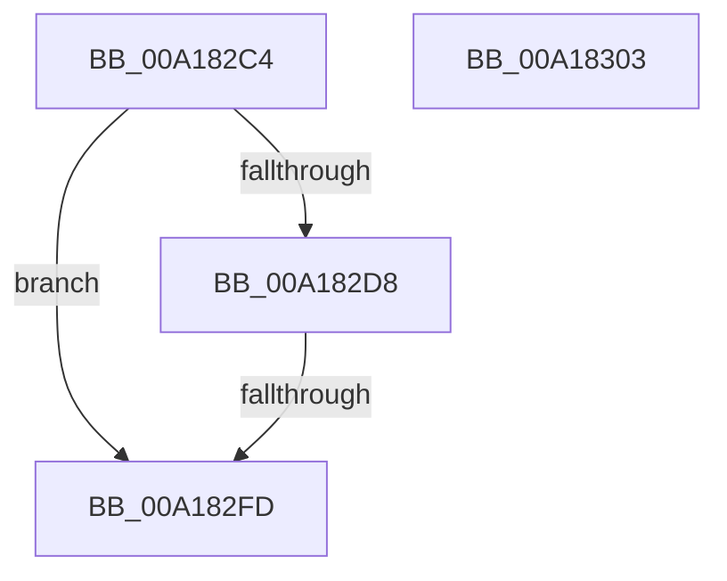

# MiContractWsSwapPageFile

- RVA: `0x00A182C4`–`0x00A18304` (길이 `64` bytes)
- VA: `0x0000000140A182C4`
- 실행 섹션: `PAGE`
- PDB 이름 있음: `예`; PDB Function 태그: `예`
- unwind 정보 RVA: `0x0005CF00`
- 디코드: `19`개 명령, `64/64` bytes 표시
- 미해석 바이트: `0` (있으면 어셈블리에 `.byte`로 보존)

> 이 문서는 커널 이미지의 기계어와 PDB 기호를 분석해 생성했습니다. 4번과 5번은 함수 원형과 자료형을 바이너리 사용 방식에서 추정한 C 해석이며 원본 소스 복구 결과는 아닙니다.

## 1. Dependencies

- 직접 호출 지점: **2**; 고유 호출 대상: **2**
- 직접 호출자로 확인된 함수: **4**
- RIP 상대 이미지 참조: **0**

### Outgoing calls
- `0x00A182CD` → [MiNumberWsSwapPagefiles](../../text/2D/MiNumberWsSwapPagefiles_function_002DCFA4.md) (function, `0x002DCFA4`)
- `0x00A182DB` → [MiWsSwapPageFileNumber](../../text/2A/MiWsSwapPageFileNumber_function_002A7470.md) (function, `0x002A7470`)

### Direct callers
- [MiTrimUnusedPageFileRegionsWorker](../../text/2A/MiTrimUnusedPageFileRegionsWorker_function_002AA320.md) at `0x002AA441`
- [MmInSwapWorkingSet](../../text/45/MmInSwapWorkingSet_function_0045B6C4.md) at `0x0045B81E`
- [MmInSwapVirtualAddresses](MmInSwapVirtualAddresses_function_00A17CCC.md) at `0x00A17D3D`
- [MmCleanProcessAddressSpace](MmCleanProcessAddressSpace_function_00A17EC0.md) at `0x00A180D7`

### Static image references
- 디코드된 RIP-relative 메모리 참조가 없습니다.

## 2. Other-region calls and transfers

- 다른 실행 섹션으로 향하는 call: **2**
  - `0x00A182CD` → [MiNumberWsSwapPagefiles](../../text/2D/MiNumberWsSwapPagefiles_function_002DCFA4.md) (`PAGE` → `.text`)
  - `0x00A182DB` → [MiWsSwapPageFileNumber](../../text/2A/MiWsSwapPageFileNumber_function_002A7470.md) (`PAGE` → `.text`)
- call이 아닌 외부 분기/꼬리 이동: **1**
  - `0x00A182F7` → [sub_00B37110](../B3/Unknown_function_00B37110.md) (`tail-transfer`)

## 3. Assembly (complete function range)

```asm
00A182C4  40 53                           push rbx
00A182C6  48 83 EC 20                     sub rsp, 0x20
00A182CA  4C 8B D9                        mov r11, rcx
00A182CD  E8 D2 4C 8C FF                  call 0x1402dcfa4
00A182D2  33 DB                           xor ebx, ebx
00A182D4  85 C0                           test eax, eax
00A182D6  74 25                           je 0x140a182fd
00A182D8  49 8B CB                        mov rcx, r11
00A182DB  E8 90 F1 88 FF                  call 0x1402a7470
00A182E0  44 8B D0                        mov r10d, eax
00A182E3  41 B8 00 00 01 00               mov r8d, 0x10000
00A182E9  4B 8B 8C D3 60 48 00 00         mov rcx, qword ptr [r11 + r10*8 + 0x4860]
00A182F1  8B 41 0C                        mov eax, dword ptr [rcx + 0xc]
00A182F4  41 3B C0                        cmp eax, r8d
00A182F7  0F 83 13 EE 11 00               jae 0x140b37110
00A182FD  48 83 C4 20                     add rsp, 0x20
00A18301  5B                              pop rbx
00A18302  C3                              ret
00A18303  CC                              int3
```

## 4. C-style interpretation (structured pseudocode)

```c
__int64 __fastcall MiContractWsSwapPageFile(__int64 a1)
{
    __int64 result;
    __int64 v_rbx;
    __int64 v_rsp;

    v_rsp = (v_rsp) - (32);
    result = MiNumberWsSwapPagefiles(a1, a2, a3, a4);
    v_rbx = 0;
    if ((unsigned int)(result) == 0) goto loc_00A182FD;
    result = MiWsSwapPageFileNumber(a1, a2, a3, a4);
loc_00A182FD:
    v_rsp = (v_rsp) + (32);
    return (unsigned int)(*(unsigned int *)(*(unsigned __int64 *)(a1 + (unsigned int)((unsigned int)(result)) * 8 + 18528) + 12));
}
```

## 5. (Beta) C Style

```c
int64_t MiContractWsSwapPageFile(int64_t Arg1)
{
    int64_t result;
    int64_t local_rbx;
    int64_t local_rsp;

    local_rsp = (local_rsp) - (32);
    result = MiNumberWsSwapPagefiles(Arg1, a2, a3, a4);
    local_rbx = 0;
    if ((uint32_t)(result) == 0) goto loc_00A182FD;
    result = MiWsSwapPageFileNumber(Arg1, a2, a3, a4);
loc_00A182FD:
    local_rsp = (local_rsp) + (32);
    return (uint32_t)(*(uint32_t *)(*(uint64_t *)(Arg1 + (uint32_t)((uint32_t)(result)) * 8 + 0x4860) + 0xC));
}
```

## 6. Execution-region graph

[열기: 2D/3D 그래프와 함수 탐색 컨트롤 패널](../../../control-panel.html?section=page&rva=0x00A182C4&view=graph)

- 2D 그래프는 위에서 아래로 흐르고, 3D 그래프는 빈 공간을 드래그해 회전합니다. Shift+드래그는 이동, 휠은 확대·축소, 함수 노드 선택은 대상 보고서 이동입니다.

### Static fallback


