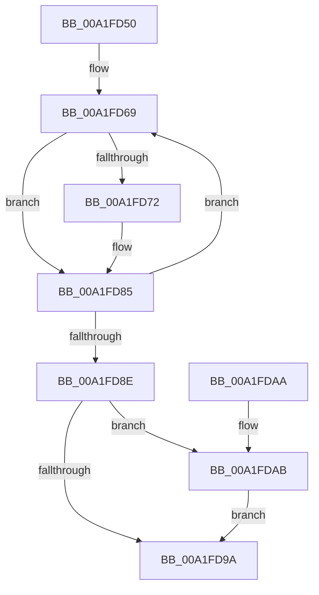

# MiDeletePageFileSectionNodes

- RVA: `0x00A1FD50`–`0x00A1FDB2` (길이 `98` bytes)
- VA: `0x0000000140A1FD50`
- 실행 섹션: `PAGE`
- PDB 이름 있음: `예`; PDB Function 태그: `아니요`
- unwind 정보 RVA: `0x0006383C`
- 디코드: `29`개 명령, `98/98` bytes 표시
- 미해석 바이트: `0` (있으면 어셈블리에 `.byte`로 보존)

> 이 문서는 커널 이미지의 기계어와 PDB 기호를 분석해 생성했습니다. 4번과 5번은 함수 원형과 자료형을 바이너리 사용 방식에서 추정한 C 해석이며 원본 소스 복구 결과는 아닙니다.

## 1. Dependencies

- 직접 호출 지점: **4**; 고유 호출 대상: **4**
- 직접 호출자로 확인된 함수: **1**
- RIP 상대 이미지 참조: **0**

### Outgoing calls
- `0x00A1FD78` → [MiUpdateSystemProtoPtesTree](../../text/29/MiUpdateSystemProtoPtesTree_function_00295F0C.md) (function, `0x00295F0C`)
- `0x00A1FD80` → [MiFreeProtoPool](../../text/47/MiFreeProtoPool_function_0047D140.md) (function, `0x0047D140`)
- `0x00A1FD91` → [MiAweControlArea](../../text/44/MiAweControlArea_function_00447720.md) (function, `0x00447720`)
- `0x00A1FDAB` → [MiDeleteSectionAwe](../../text/68/MiDeleteSectionAwe_function_006887A8.md) (function, `0x006887A8`)

### Direct callers
- [MiSegmentDelete](MiSegmentDelete_function_00A1FBB4.md) at `0x00A1FCE1`

### Static image references
- 디코드된 RIP-relative 메모리 참조가 없습니다.

## 2. Other-region calls and transfers

- 다른 실행 섹션으로 향하는 call: **4**
  - `0x00A1FD78` → [MiUpdateSystemProtoPtesTree](../../text/29/MiUpdateSystemProtoPtesTree_function_00295F0C.md) (`PAGE` → `.text`)
  - `0x00A1FD80` → [MiFreeProtoPool](../../text/47/MiFreeProtoPool_function_0047D140.md) (`PAGE` → `.text`)
  - `0x00A1FD91` → [MiAweControlArea](../../text/44/MiAweControlArea_function_00447720.md) (`PAGE` → `.text`)
  - `0x00A1FDAB` → [MiDeleteSectionAwe](../../text/68/MiDeleteSectionAwe_function_006887A8.md) (`PAGE` → `.text`)
- 별도 외부 분기/꼬리 이동을 확인하지 못했습니다.

## 3. Assembly (complete function range)

```asm
00A1FD50  48 89 5C 24 08                  mov qword ptr [rsp + 8], rbx
00A1FD55  48 89 74 24 10                  mov qword ptr [rsp + 0x10], rsi
00A1FD5A  57                              push rdi
00A1FD5B  48 83 EC 20                     sub rsp, 0x20
00A1FD5F  48 8B F9                        mov rdi, rcx
00A1FD62  48 8D 99 80 00 00 00            lea rbx, [rcx + 0x80]
00A1FD69  48 8B 73 08                     mov rsi, qword ptr [rbx + 8]
00A1FD6D  48 85 F6                        test rsi, rsi
00A1FD70  74 13                           je 0x140a1fd85
00A1FD72  48 8D 4B 38                     lea rcx, [rbx + 0x38]
00A1FD76  33 D2                           xor edx, edx
00A1FD78  E8 8F 61 87 FF                  call 0x140295f0c
00A1FD7D  48 8B D6                        mov rdx, rsi
00A1FD80  E8 BB D3 A5 FF                  call 0x14047d140
00A1FD85  48 8B 5B 10                     mov rbx, qword ptr [rbx + 0x10]
00A1FD89  48 85 DB                        test rbx, rbx
00A1FD8C  75 DB                           jne 0x140a1fd69
00A1FD8E  48 8B CF                        mov rcx, rdi
00A1FD91  E8 8A 79 A2 FF                  call 0x140447720
00A1FD96  85 C0                           test eax, eax
00A1FD98  75 11                           jne 0x140a1fdab
00A1FD9A  48 8B 5C 24 30                  mov rbx, qword ptr [rsp + 0x30]
00A1FD9F  48 8B 74 24 38                  mov rsi, qword ptr [rsp + 0x38]
00A1FDA4  48 83 C4 20                     add rsp, 0x20
00A1FDA8  5F                              pop rdi
00A1FDA9  C3                              ret
00A1FDAA  CC                              int3
00A1FDAB  E8 F8 89 C6 FF                  call 0x1406887a8
00A1FDB0  EB E8                           jmp 0x140a1fd9a
```

## 4. C-style interpretation (structured pseudocode)

```c
__int64 __fastcall MiDeletePageFileSectionNodes(__int64 a1, int a2)
{
    __int64 result;
    __int64 v_rsp;
    unsigned __int64 v_stack_p10;
    unsigned __int64 v_stack_p8;

    v_stack_p8 = v_rbx;
    v_stack_p10 = v_rsi;
    v_rsp = (v_rsp) - (32);
loc_00A1FD69:
    if (*(unsigned __int64 *)(a1 + 128 + 8) != 0) {
        a1 = a1 + 128 + 56;
        a2 = 0;
        result = MiUpdateSystemProtoPtesTree(a1, a2, a3, a4);
        a2 = *(unsigned __int64 *)(a1 + 128 + 8);
        result = MiFreeProtoPool(a1, a2, a3, a4);
    }
    if (*(unsigned __int64 *)(a1 + 128 + 16) != 0) goto loc_00A1FD69;
    result = MiAweControlArea(a1, a2, a3, a4);
    if ((unsigned int)(result) != 0) goto loc_00A1FDAB;
loc_00A1FD9A:
    v_rsp = (v_rsp) + (32);
    return result;
loc_00A1FDAB:
    result = MiDeleteSectionAwe(a1, a2, a3, a4);
    goto loc_00A1FD9A;
}
```

## 5. (Beta) C Style

```c
int64_t MiDeletePageFileSectionNodes(void *Arg1, int32_t Arg2)
{
    uint8_t *arg1 = (uint8_t *)Arg1;

    int64_t result;
    int64_t local_rsp;
    uint64_t v_stack_p10;
    uint64_t v_stack_p8;

    v_stack_p8 = local_rbx;
    v_stack_p10 = local_rsi;
    local_rsp = (local_rsp) - (32);
loc_00A1FD69:
    if (*(uint64_t *)(arg1 + 0x80 + 0x8) != 0) {
        Arg1 = Arg1 + 128 + 56;
        Arg2 = 0;
        result = MiUpdateSystemProtoPtesTree(Arg1, Arg2, a3, a4);
        Arg2 = *(uint64_t *)(arg1 + 0x80 + 0x8);
        result = MiFreeProtoPool(Arg1, Arg2, a3, a4);
    }
    if (*(uint64_t *)(arg1 + 0x80 + 0x10) != 0) goto loc_00A1FD69;
    result = MiAweControlArea(Arg1, Arg2, a3, a4);
    if ((uint32_t)(result) != 0) goto loc_00A1FDAB;
loc_00A1FD9A:
    local_rsp = (local_rsp) + (32);
    return result;
loc_00A1FDAB:
    result = MiDeleteSectionAwe(Arg1, Arg2, a3, a4);
    goto loc_00A1FD9A;
}
```

### 관측된 메모리 오프셋

구조체 형식이 확인되지 않은 접근은 인자 기준의 오프셋으로만 기록했습니다.

| 기준 인자 | 오프셋 표현 | 폭 (bit) | 접근 |
|---|---:|---:|---|
| `Arg1` | `+ 0x80` | `64` | `R` |

## 6. Execution-region graph

[열기: 2D/3D 그래프와 함수 탐색 컨트롤 패널](../../../control-panel.html?section=page&rva=0x00A1FD50&view=graph)

- 2D 그래프는 위에서 아래로 흐르고, 3D 그래프는 빈 공간을 드래그해 회전합니다. Shift+드래그는 이동, 휠은 확대·축소, 함수 노드 선택은 대상 보고서 이동입니다.

### Static fallback


