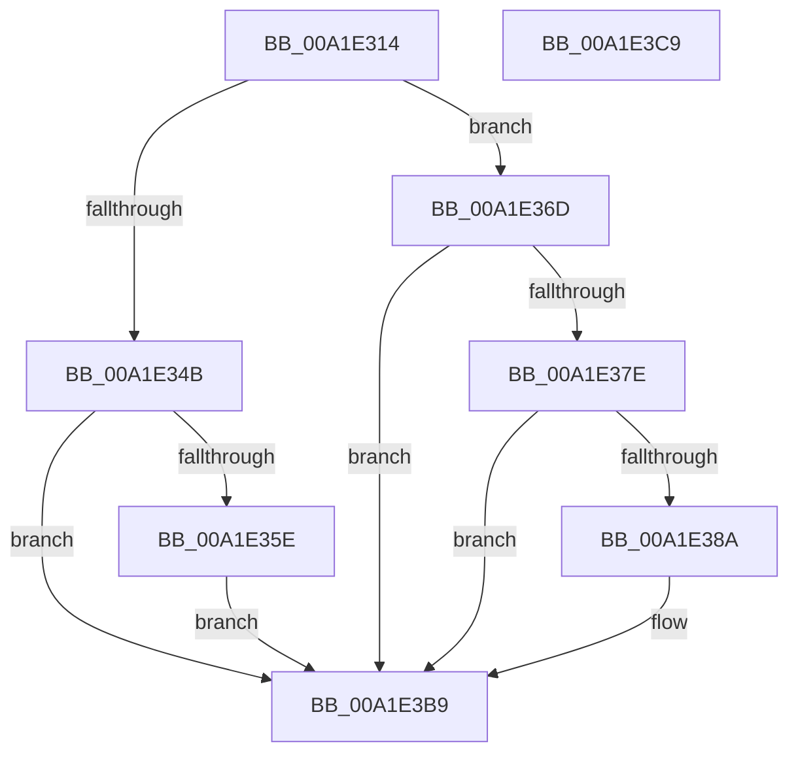

# MiReturnVadQuota

- RVA: `0x00A1E314`–`0x00A1E3CA` (길이 `182` bytes)
- VA: `0x0000000140A1E314`
- 실행 섹션: `PAGE`
- PDB 이름 있음: `예`; PDB Function 태그: `아니요`
- unwind 정보 RVA: `0x00060BC4`
- 디코드: `51`개 명령, `182/182` bytes 표시
- 미해석 바이트: `0` (있으면 어셈블리에 `.byte`로 보존)

> 이 문서는 커널 이미지의 기계어와 PDB 기호를 분석해 생성했습니다. 4번과 5번은 함수 원형과 자료형을 바이너리 사용 방식에서 추정한 C 해석이며 원본 소스 복구 결과는 아닙니다.

## 1. Dependencies

- 직접 호출 지점: **4**; 고유 호출 대상: **3**
- 직접 호출자로 확인된 함수: **1**
- RIP 상대 이미지 참조: **0**

### Outgoing calls
- `0x00A1E366` → [PsReturnProcessNonPagedPoolQuota](../../text/41/PsReturnProcessNonPagedPoolQuota_function_0041C200.md) (function, `0x0041C200`)
- `0x00A1E375` → [PsReturnProcessNonPagedPoolQuota](../../text/41/PsReturnProcessNonPagedPoolQuota_function_0041C200.md) (function, `0x0041C200`)
- `0x00A1E381` → [MiVadPureReserve](../../text/2C/MiVadPureReserve_function_002C34C0.md) (function, `0x002C34C0`)
- `0x00A1E3B4` → [PsReturnProcessPagedPoolQuota](../../text/2A/PsReturnProcessPagedPoolQuota_function_002A6860.md) (function, `0x002A6860`)

### Direct callers
- [MiFinishVadDeletion](../../text/43/MiFinishVadDeletion_function_00430ED0.md) at `0x00430F91`

### Static image references
- 디코드된 RIP-relative 메모리 참조가 없습니다.

## 2. Other-region calls and transfers

- 다른 실행 섹션으로 향하는 call: **4**
  - `0x00A1E366` → [PsReturnProcessNonPagedPoolQuota](../../text/41/PsReturnProcessNonPagedPoolQuota_function_0041C200.md) (`PAGE` → `.text`)
  - `0x00A1E375` → [PsReturnProcessNonPagedPoolQuota](../../text/41/PsReturnProcessNonPagedPoolQuota_function_0041C200.md) (`PAGE` → `.text`)
  - `0x00A1E381` → [MiVadPureReserve](../../text/2C/MiVadPureReserve_function_002C34C0.md) (`PAGE` → `.text`)
  - `0x00A1E3B4` → [PsReturnProcessPagedPoolQuota](../../text/2A/PsReturnProcessPagedPoolQuota_function_002A6860.md) (`PAGE` → `.text`)
- 별도 외부 분기/꼬리 이동을 확인하지 못했습니다.

## 3. Assembly (complete function range)

```asm
00A1E314  48 89 5C 24 08                  mov qword ptr [rsp + 8], rbx
00A1E319  48 89 74 24 10                  mov qword ptr [rsp + 0x10], rsi
00A1E31E  57                              push rdi
00A1E31F  48 83 EC 20                     sub rsp, 0x20
00A1E323  44 8B 49 34                     mov r9d, dword ptr [rcx + 0x34]
00A1E327  41 8B F0                        mov esi, r8d
00A1E32A  44 0F B6 51 22                  movzx r10d, byte ptr [rcx + 0x22]
00A1E32F  49 B8 FD FF FF FF 07 00 00 00   movabs r8, 0x7fffffffd
00A1E339  49 C1 E2 20                     shl r10, 0x20
00A1E33D  48 8B FA                        mov rdi, rdx
00A1E340  4D 0B D1                        or r10, r9
00A1E343  48 8B D9                        mov rbx, rcx
00A1E346  4D 3B D0                        cmp r10, r8
00A1E349  72 22                           jb 0x140a1e36d
00A1E34B  8B 49 34                        mov ecx, dword ptr [rcx + 0x34]
00A1E34E  0F B6 53 22                     movzx edx, byte ptr [rbx + 0x22]
00A1E352  48 C1 E2 20                     shl rdx, 0x20
00A1E356  48 0B D1                        or rdx, rcx
00A1E359  49 3B D0                        cmp rdx, r8
00A1E35C  75 5B                           jne 0x140a1e3b9
00A1E35E  BA 40 00 00 00                  mov edx, 0x40
00A1E363  48 8B CF                        mov rcx, rdi
00A1E366  E8 95 DE 9F FF                  call 0x14041c200
00A1E36B  EB 4C                           jmp 0x140a1e3b9
00A1E36D  BA 88 00 00 00                  mov edx, 0x88
00A1E372  48 8B CF                        mov rcx, rdi
00A1E375  E8 86 DE 9F FF                  call 0x14041c200
00A1E37A  85 F6                           test esi, esi
00A1E37C  74 3B                           je 0x140a1e3b9
00A1E37E  48 8B CB                        mov rcx, rbx
00A1E381  E8 3A 51 8A FF                  call 0x1402c34c0
00A1E386  85 C0                           test eax, eax
00A1E388  75 2F                           jne 0x140a1e3b9
00A1E38A  8B 43 1C                        mov eax, dword ptr [rbx + 0x1c]
00A1E38D  0F B6 53 21                     movzx edx, byte ptr [rbx + 0x21]
00A1E391  0F B6 4B 20                     movzx ecx, byte ptr [rbx + 0x20]
00A1E395  48 C1 E2 20                     shl rdx, 0x20
00A1E399  48 0B D0                        or rdx, rax
00A1E39C  48 C1 E1 20                     shl rcx, 0x20
00A1E3A0  8B 43 18                        mov eax, dword ptr [rbx + 0x18]
00A1E3A3  48 0B C8                        or rcx, rax
00A1E3A6  48 2B D1                        sub rdx, rcx
00A1E3A9  48 8B CF                        mov rcx, rdi
00A1E3AC  48 8D 14 D5 08 00 00 00         lea rdx, [rdx*8 + 8]
00A1E3B4  E8 A7 84 88 FF                  call 0x1402a6860
00A1E3B9  48 8B 5C 24 30                  mov rbx, qword ptr [rsp + 0x30]
00A1E3BE  48 8B 74 24 38                  mov rsi, qword ptr [rsp + 0x38]
00A1E3C3  48 83 C4 20                     add rsp, 0x20
00A1E3C7  5F                              pop rdi
00A1E3C8  C3                              ret
00A1E3C9  CC                              int3
```

## 4. C-style interpretation (structured pseudocode)

```c
__int64 __fastcall MiReturnVadQuota(__int64 a1, __int64 a2, int a3)
{
    __int64 result;
    __int64 v_r10;
    __int64 v_rsp;
    unsigned __int64 v_stack_p10;
    unsigned __int64 v_stack_p8;

    v_stack_p8 = v_rbx;
    v_stack_p10 = v_rsi;
    v_rsp = (v_rsp) - (32);
    v_r10 = (*(unsigned __int8 *)(a1 + 34)) << (32);
    v_r10 = (v_r10) | ((unsigned int)(*(unsigned int *)(a1 + 52)));
    if (v_r10 < a3) goto loc_00A1E36D;
    a2 = (*(unsigned __int8 *)(a1 + 34)) << (32);
    a2 = (a2) | ((unsigned int)(*(unsigned int *)(a1 + 52)));
    if (a2 != a3) goto loc_00A1E3B9;
    result = PsReturnProcessNonPagedPoolQuota(a2, 64, a3, (unsigned int)(*(unsigned int *)(a1 + 52)));
    goto loc_00A1E3B9;
loc_00A1E36D:
    result = PsReturnProcessNonPagedPoolQuota(a2, 136, a3, (unsigned int)(*(unsigned int *)(a1 + 52)));
    if ((unsigned int)((unsigned int)(a3)) == 0) goto loc_00A1E3B9;
    result = MiVadPureReserve(a1, 136, a3, (unsigned int)(*(unsigned int *)(a1 + 52)));
    if ((unsigned int)(result) == 0) {
        result = *(unsigned int *)(a1 + 28);
        a2 = *(unsigned __int8 *)(a1 + 33);
        a1 = *(unsigned __int8 *)(a1 + 32);
        a2 = (a2) << (32);
        a2 = (a2) | (result);
        a1 = (a1) << (32);
        result = *(unsigned int *)(a1 + 24);
        a1 = (a1) | (result);
        a2 = (a2) - (a1);
        a1 = a2;
        a2 = a2 * 8 + 8;
        result = PsReturnProcessPagedPoolQuota(a1, a2, a3, (unsigned int)(*(unsigned int *)(a1 + 52)));
    }
    v_rsp = (v_rsp) + (32);
    return result;
}
```

## 5. (Beta) C Style

```c
int64_t MiReturnVadQuota(void *Arg1, int64_t Arg2, int32_t Arg3)
{
    uint8_t *arg1 = (uint8_t *)Arg1;

    int64_t result;
    int64_t local_r10;
    int64_t local_rsp;
    uint64_t v_stack_p10;
    uint64_t v_stack_p8;

    v_stack_p8 = local_rbx;
    v_stack_p10 = local_rsi;
    local_rsp = (local_rsp) - (32);
    local_r10 = (*(uint8_t *)(arg1 + 0x22)) << (32);
    local_r10 = (local_r10) | ((uint32_t)(*(uint32_t *)(arg1 + 0x34)));
    if (local_r10 < Arg3) goto loc_00A1E36D;
    Arg2 = (*(uint8_t *)(arg1 + 0x22)) << (32);
    Arg2 = (Arg2) | ((uint32_t)(*(uint32_t *)(arg1 + 0x34)));
    if (Arg2 != Arg3) goto loc_00A1E3B9;
    result = PsReturnProcessNonPagedPoolQuota(Arg2, 64, Arg3, (uint32_t)(*(uint32_t *)(arg1 + 0x34)));
    goto loc_00A1E3B9;
loc_00A1E36D:
    result = PsReturnProcessNonPagedPoolQuota(Arg2, 136, Arg3, (uint32_t)(*(uint32_t *)(arg1 + 0x34)));
    if ((uint32_t)((uint32_t)(Arg3)) == 0) goto loc_00A1E3B9;
    result = MiVadPureReserve(Arg1, 136, Arg3, (uint32_t)(*(uint32_t *)(arg1 + 0x34)));
    if ((uint32_t)(result) == 0) {
        result = *(uint32_t *)(arg1 + 0x1C);
        Arg2 = *(uint8_t *)(arg1 + 0x21);
        Arg1 = *(uint8_t *)(arg1 + 0x20);
        Arg2 = (Arg2) << (32);
        Arg2 = (Arg2) | (result);
        Arg1 = (Arg1) << (32);
        result = *(uint32_t *)(arg1 + 0x18);
        Arg1 = (Arg1) | (result);
        Arg2 = (Arg2) - (Arg1);
        Arg1 = Arg2;
        Arg2 = Arg2 * 8 + 8;
        result = PsReturnProcessPagedPoolQuota(Arg1, Arg2, Arg3, (uint32_t)(*(uint32_t *)(arg1 + 0x34)));
    }
    local_rsp = (local_rsp) + (32);
    return result;
}
```

### 관측된 메모리 오프셋

구조체 형식이 확인되지 않은 접근은 인자 기준의 오프셋으로만 기록했습니다.

| 기준 인자 | 오프셋 표현 | 폭 (bit) | 접근 |
|---|---:|---:|---|
| `Arg1` | `+ 0x18` | `32` | `R` |
| `Arg1` | `+ 0x1C` | `32` | `R` |
| `Arg1` | `+ 0x20` | `8` | `R` |
| `Arg1` | `+ 0x21` | `8` | `R` |
| `Arg1` | `+ 0x22` | `8` | `R` |
| `Arg1` | `+ 0x34` | `32` | `R` |

## 6. Execution-region graph

[열기: 2D/3D 그래프와 함수 탐색 컨트롤 패널](../../../control-panel.html?section=page&rva=0x00A1E314&view=graph)

- 2D 그래프는 위에서 아래로 흐르고, 3D 그래프는 빈 공간을 드래그해 회전합니다. Shift+드래그는 이동, 휠은 확대·축소, 함수 노드 선택은 대상 보고서 이동입니다.

### Static fallback


