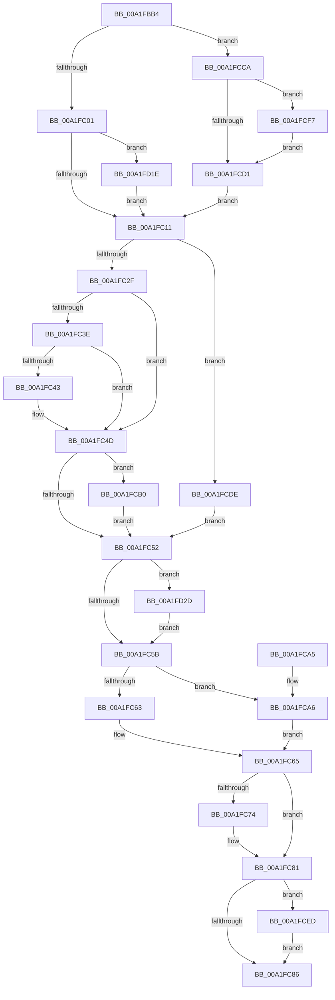

# MiSegmentDelete

- RVA: `0x00A1FBB4`–`0x00A1FD48` (길이 `404` bytes)
- VA: `0x0000000140A1FBB4`
- 실행 섹션: `PAGE`
- PDB 이름 있음: `예`; PDB Function 태그: `아니요`
- unwind 정보 RVA: `0x000AABA8`
- 디코드: `110`개 명령, `404/404` bytes 표시
- 미해석 바이트: `0` (있으면 어셈블리에 `.byte`로 보존)

> 이 문서는 커널 이미지의 기계어와 PDB 기호를 분석해 생성했습니다. 4번과 5번은 함수 원형과 자료형을 바이너리 사용 방식에서 추정한 C 해석이며 원본 소스 복구 결과는 아닙니다.

## 1. Dependencies

- 직접 호출 지점: **14**; 고유 호출 대상: **14**
- 직접 호출자로 확인된 함수: **3**
- RIP 상대 이미지 참조: **1**

### Outgoing calls
- `0x00A1FBE9` → [MiPrepareSegmentForDeletion](../../text/46/MiPrepareSegmentForDeletion_function_004630A8.md) (function, `0x004630A8`)
- `0x00A1FC14` → [MiDeleteSegmentPages](../../text/32/MiDeleteSegmentPages_function_003261D4.md) (function, `0x003261D4`)
- `0x00A1FC1E` → [MiReleaseControlAreaCharges](../../text/44/MiReleaseControlAreaCharges_function_004444BC.md) (function, `0x004444BC`)
- `0x00A1FC6A` → [MiDereferenceControlAreaProbe](../../text/36/MiDereferenceControlAreaProbe_function_003691C0.md) (function, `0x003691C0`)
- `0x00A1FC7C` → [ObfDereferenceObjectWithTag](../../text/2F/ObfDereferenceObjectWithTag_function_002F78E0.md) (function, `0x002F78E0`)
- `0x00A1FCBA` → [MiUpdateSystemProtoPtesTree](../../text/29/MiUpdateSystemProtoPtesTree_function_00295F0C.md) (function, `0x00295F0C`)
- `0x00A1FCC3` → [MiFreeProtoPool](../../text/47/MiFreeProtoPool_function_0047D140.md) (function, `0x0047D140`)
- `0x00A1FCD4` → [MiReleaseControlAreaWaiters](../../text/28/MiReleaseControlAreaWaiters_function_002865F0.md) (function, `0x002865F0`)
- `0x00A1FCE1` → [MiDeletePageFileSectionNodes](MiDeletePageFileSectionNodes_function_00A1FD50.md) (function, `0x00A1FD50`)
- `0x00A1FCF0` → [IoDiskIoAttributionDereference](../../text/34/IoDiskIoAttributionDereference_function_00349978.md) (function, `0x00349978`)
- `0x00A1FD17` → [DbgUnLoadImageSymbolsUnicode](../../text/4A/DbgUnLoadImageSymbolsUnicode_function_004AE114.md) (function, `0x004AE114`)
- `0x00A1FD23` → [MiLogSectionCreate](../7F/MiLogSectionCreate_function_007FCDEC.md) (function, `0x007FCDEC`)
- `0x00A1FD30` → [MiGetControlAreaPartition](../../text/43/MiGetControlAreaPartition_function_0043E560.md) (function, `0x0043E560`)
- `0x00A1FD3E` → [MiReturnCrossPartitionSectionCharges](../../text/4B/MiReturnCrossPartitionSectionCharges_function_004BA61C.md) (function, `0x004BA61C`)

### Direct callers
- [MiCheckControlArea](../../text/28/MiCheckControlArea_function_002861B0.md) at `0x00286420`
- [MiCheckControlArea](../../text/28/MiCheckControlArea_function_002861B0.md) at `0x00286442`
- [MiDestroySection](../../text/46/MiDestroySection_function_00462FDC.md) at `0x0046301D`
- [MiDeleteEmptyControlAreas](../../text/49/MiDeleteEmptyControlAreas_function_0049334C.md) at `0x004933D1`

### Static image references
- `0x00A1FC01` → RVA `0x00FC6B04` (`ALMOSTRO`; read)

## 2. Other-region calls and transfers

- 다른 실행 섹션으로 향하는 call: **12**
  - `0x00A1FBE9` → [MiPrepareSegmentForDeletion](../../text/46/MiPrepareSegmentForDeletion_function_004630A8.md) (`PAGE` → `.text`)
  - `0x00A1FC14` → [MiDeleteSegmentPages](../../text/32/MiDeleteSegmentPages_function_003261D4.md) (`PAGE` → `.text`)
  - `0x00A1FC1E` → [MiReleaseControlAreaCharges](../../text/44/MiReleaseControlAreaCharges_function_004444BC.md) (`PAGE` → `.text`)
  - `0x00A1FC6A` → [MiDereferenceControlAreaProbe](../../text/36/MiDereferenceControlAreaProbe_function_003691C0.md) (`PAGE` → `.text`)
  - `0x00A1FC7C` → [ObfDereferenceObjectWithTag](../../text/2F/ObfDereferenceObjectWithTag_function_002F78E0.md) (`PAGE` → `.text`)
  - `0x00A1FCBA` → [MiUpdateSystemProtoPtesTree](../../text/29/MiUpdateSystemProtoPtesTree_function_00295F0C.md) (`PAGE` → `.text`)
  - `0x00A1FCC3` → [MiFreeProtoPool](../../text/47/MiFreeProtoPool_function_0047D140.md) (`PAGE` → `.text`)
  - `0x00A1FCD4` → [MiReleaseControlAreaWaiters](../../text/28/MiReleaseControlAreaWaiters_function_002865F0.md) (`PAGE` → `.text`)
  - `0x00A1FCF0` → [IoDiskIoAttributionDereference](../../text/34/IoDiskIoAttributionDereference_function_00349978.md) (`PAGE` → `.text`)
  - `0x00A1FD17` → [DbgUnLoadImageSymbolsUnicode](../../text/4A/DbgUnLoadImageSymbolsUnicode_function_004AE114.md) (`PAGE` → `.text`)
  - `0x00A1FD30` → [MiGetControlAreaPartition](../../text/43/MiGetControlAreaPartition_function_0043E560.md) (`PAGE` → `.text`)
  - `0x00A1FD3E` → [MiReturnCrossPartitionSectionCharges](../../text/4B/MiReturnCrossPartitionSectionCharges_function_004BA61C.md) (`PAGE` → `.text`)
- 별도 외부 분기/꼬리 이동을 확인하지 못했습니다.

## 3. Assembly (complete function range)

```asm
00A1FBB4  48 8B C4                        mov rax, rsp
00A1FBB7  48 89 58 08                     mov qword ptr [rax + 8], rbx
00A1FBBB  48 89 68 10                     mov qword ptr [rax + 0x10], rbp
00A1FBBF  48 89 70 18                     mov qword ptr [rax + 0x18], rsi
00A1FBC3  48 89 78 20                     mov qword ptr [rax + 0x20], rdi
00A1FBC7  41 54                           push r12
00A1FBC9  41 56                           push r14
00A1FBCB  41 57                           push r15
00A1FBCD  48 83 EC 20                     sub rsp, 0x20
00A1FBD1  4C 8B 39                        mov r15, qword ptr [rcx]
00A1FBD4  45 33 E4                        xor r12d, r12d
00A1FBD7  8B 59 38                        mov ebx, dword ptr [rcx + 0x38]
00A1FBDA  48 8B F1                        mov rsi, rcx
00A1FBDD  4C 39 61 40                     cmp qword ptr [rcx + 0x40], r12
00A1FBE1  41 8B 7F 0C                     mov edi, dword ptr [r15 + 0xc]
00A1FBE5  41 0F 95 C4                     setne r12b
00A1FBE9  E8 BA 34 A4 FF                  call 0x1404630a8
00A1FBEE  44 8B F3                        mov r14d, ebx
00A1FBF1  48 8B E8                        mov rbp, rax
00A1FBF4  41 81 E6 80 00 00 00            and r14d, 0x80
00A1FBFB  0F 85 C9 00 00 00               jne 0x140a1fcca
00A1FC01  F7 05 F9 6E 5A 00 01 00 40 00   test dword ptr [rip + 0x5a6ef9], 0x400001
00A1FC0B  0F 85 0D 01 00 00               jne 0x140a1fd1e
00A1FC11  48 8B CE                        mov rcx, rsi
00A1FC14  E8 BB 65 90 FF                  call 0x1403261d4
00A1FC19  33 D2                           xor edx, edx
00A1FC1B  48 8B CE                        mov rcx, rsi
00A1FC1E  E8 99 48 A2 FF                  call 0x1404444bc
00A1FC23  48 8B E8                        mov rbp, rax
00A1FC26  45 85 F6                        test r14d, r14d
00A1FC29  0F 84 AF 00 00 00               je 0x140a1fcde
00A1FC2F  33 C9                           xor ecx, ecx
00A1FC31  48 87 4E 40                     xchg qword ptr [rsi + 0x40], rcx
00A1FC35  48 8B F9                        mov rdi, rcx
00A1FC38  48 83 E7 F0                     and rdi, 0xfffffffffffffff0
00A1FC3C  74 0F                           je 0x140a1fc4d
00A1FC3E  83 E1 0F                        and ecx, 0xf
00A1FC41  76 0A                           jbe 0x140a1fc4d
00A1FC43  F7 D9                           neg ecx
00A1FC45  48 63 C1                        movsxd rax, ecx
00A1FC48  F0 48 01 47 D0                  lock add qword ptr [rdi - 0x30], rax
00A1FC4D  F6 C3 20                        test bl, 0x20
00A1FC50  75 5E                           jne 0x140a1fcb0
00A1FC52  48 85 ED                        test rbp, rbp
00A1FC55  0F 85 D2 00 00 00               jne 0x140a1fd2d
00A1FC5B  80 E3 A0                        and bl, 0xa0
00A1FC5E  80 FB 80                        cmp bl, 0x80
00A1FC61  74 43                           je 0x140a1fca6
00A1FC63  33 DB                           xor ebx, ebx
00A1FC65  33 D2                           xor edx, edx
00A1FC67  48 8B CE                        mov rcx, rsi
00A1FC6A  E8 51 95 94 FF                  call 0x1403691c0
00A1FC6F  48 85 FF                        test rdi, rdi
00A1FC72  74 0D                           je 0x140a1fc81
00A1FC74  BA 4D 6D 53 43                  mov edx, 0x43536d4d
00A1FC79  48 8B CF                        mov rcx, rdi
00A1FC7C  E8 5F 7C 8D FF                  call 0x1402f78e0
00A1FC81  48 85 DB                        test rbx, rbx
00A1FC84  75 67                           jne 0x140a1fced
00A1FC86  48 8B 5C 24 40                  mov rbx, qword ptr [rsp + 0x40]
00A1FC8B  48 8B 6C 24 48                  mov rbp, qword ptr [rsp + 0x48]
00A1FC90  48 8B 74 24 50                  mov rsi, qword ptr [rsp + 0x50]
00A1FC95  48 8B 7C 24 58                  mov rdi, qword ptr [rsp + 0x58]
00A1FC9A  48 83 C4 20                     add rsp, 0x20
00A1FC9E  41 5F                           pop r15
00A1FCA0  41 5E                           pop r14
00A1FCA2  41 5C                           pop r12
00A1FCA4  C3                              ret
00A1FCA5  CC                              int3
00A1FCA6  48 8B 5E 78                     mov rbx, qword ptr [rsi + 0x78]
00A1FCAA  48 83 E3 F8                     and rbx, 0xfffffffffffffff8
00A1FCAE  EB B5                           jmp 0x140a1fc65
00A1FCB0  48 8B 4E 60                     mov rcx, qword ptr [rsi + 0x60]
00A1FCB4  33 D2                           xor edx, edx
00A1FCB6  48 83 E1 F8                     and rcx, 0xfffffffffffffff8
00A1FCBA  E8 4D 62 87 FF                  call 0x140295f0c
00A1FCBF  49 8B 57 40                     mov rdx, qword ptr [r15 + 0x40]
00A1FCC3  E8 78 D4 A5 FF                  call 0x14047d140
00A1FCC8  EB 88                           jmp 0x140a1fc52
00A1FCCA  66 0F BA E7 0B                  bt di, 0xb
00A1FCCF  72 26                           jb 0x140a1fcf7
00A1FCD1  48 8B CD                        mov rcx, rbp
00A1FCD4  E8 17 69 86 FF                  call 0x1402865f0
00A1FCD9  E9 33 FF FF FF                  jmp 0x140a1fc11
00A1FCDE  48 8B CE                        mov rcx, rsi
00A1FCE1  E8 6A 00 00 00                  call 0x140a1fd50
00A1FCE6  33 FF                           xor edi, edi
00A1FCE8  E9 65 FF FF FF                  jmp 0x140a1fc52
00A1FCED  48 8B CB                        mov rcx, rbx
00A1FCF0  E8 83 9C 92 FF                  call 0x140349978
00A1FCF5  EB 8F                           jmp 0x140a1fc86
00A1FCF7  65 4C 8B 04 25 88 01 00 00      mov r8, qword ptr gs:[0x188]
00A1FD00  48 8B 4E 40                     mov rcx, qword ptr [rsi + 0x40]
00A1FD04  49 8B 57 20                     mov rdx, qword ptr [r15 + 0x20]
00A1FD08  48 83 E1 F0                     and rcx, 0xfffffffffffffff0
00A1FD0C  48 83 C1 58                     add rcx, 0x58
00A1FD10  4D 8B 80 B8 00 00 00            mov r8, qword ptr [r8 + 0xb8]
00A1FD17  E8 F8 E3 A8 FF                  call 0x1404ae114
00A1FD1C  EB B3                           jmp 0x140a1fcd1
00A1FD1E  33 D2                           xor edx, edx
00A1FD20  48 8B CE                        mov rcx, rsi
00A1FD23  E8 C4 D0 DD FF                  call 0x1407fcdec
00A1FD28  E9 E4 FE FF FF                  jmp 0x140a1fc11
00A1FD2D  48 8B CE                        mov rcx, rsi
00A1FD30  E8 2B E8 A1 FF                  call 0x14043e560
00A1FD35  41 8B D4                        mov edx, r12d
00A1FD38  48 8B C8                        mov rcx, rax
00A1FD3B  4C 8B C5                        mov r8, rbp
00A1FD3E  E8 D9 A8 A9 FF                  call 0x1404ba61c
00A1FD43  E9 13 FF FF FF                  jmp 0x140a1fc5b
```

## 4. C-style interpretation (structured pseudocode)

```c
__int64 __fastcall MiSegmentDelete(__int64 a1, int a2)
{
    __int64 result;
    __int64 v_r12;
    __int64 v_r14;
    __int64 v_rbx;
    __int64 v_rdi;
    __int64 v_rsp;
    unsigned __int64 v_stack_p10;
    unsigned __int64 v_stack_p18;
    unsigned __int64 v_stack_p20;
    unsigned __int64 v_stack_p8;

    *(unsigned __int64 *)(v_rsp + 8) = v_rbx;
    *(unsigned __int64 *)(v_rsp + 16) = v_rbp;
    *(unsigned __int64 *)(v_rsp + 24) = v_rsi;
    *(unsigned __int64 *)(v_rsp + 32) = v_rdi;
    v_rsp = (v_rsp) - (32);
    v_r12 = 0;
    v_r12 = ((*(unsigned __int64 *)(a1 + 64)) != 0) ? 1 : 0;
    result = MiPrepareSegmentForDeletion(a1, a2, a3, a4);
    v_r14 = (unsigned int)(((unsigned int)((unsigned int)((unsigned int)(*(unsigned int *)(a1 + 56))))) & (128));
    if (condition_is_not_equal) goto loc_00A1FCCA;
    if (((*(unsigned int *)(v_rip + 5926649)) & (0x400001ULL)) != 0) goto loc_00A1FD1E;
loc_00A1FC11:
    result = MiDeleteSegmentPages(a1, a2, a3, a4);
    a2 = 0;
    result = MiReleaseControlAreaCharges(a1, a2, a3, a4);
    if ((unsigned int)(v_r14) == 0) goto loc_00A1FCDE;
    a1 = 0;
    v_rdi = (0) & (-16);
    if (condition_is_equal) goto loc_00A1FC4D;
    a1 = (unsigned int)((a1) & (15));
    if (!(condition_is_below_or_equal)) {
        a1 = (unsigned int)(-(a1));
        result = (int)((unsigned int)(a1));
    }
    if ((((unsigned __int8)((unsigned int)(*(unsigned int *)(a1 + 56)))) & (32)) != 0) goto loc_00A1FCB0;
loc_00A1FC52:
    if (result != 0) goto loc_00A1FD2D;
loc_00A1FC5B:
    v_rbx = (unsigned __int8)(((unsigned int)(*(unsigned int *)(a1 + 56))) & (160));
    if (((unsigned __int8)(v_rbx)) == 128) goto loc_00A1FCA6;
    v_rbx = 0;
loc_00A1FC65:
    a2 = 0;
    result = MiDereferenceControlAreaProbe(a1, a2, a3, a4);
    if (v_rdi != 0) {
        a2 = 0x43536D4DULL;
        a1 = v_rdi;
        result = ObfDereferenceObjectWithTag(a1, a2, a3, a4);
    }
    if (0 != 0) goto loc_00A1FCED;
loc_00A1FC86:
    v_rsp = (v_rsp) + (32);
    return result;
loc_00A1FCA6:
    v_rbx = (*(unsigned __int64 *)(v_stack_p18 + 120)) & (-8);
    goto loc_00A1FC65;
loc_00A1FCB0:
    a2 = 0;
    a1 = (*(unsigned __int64 *)(v_stack_p18 + 96)) & (-8);
    result = MiUpdateSystemProtoPtesTree(a1, a2, a3, a4);
    result = MiFreeProtoPool(a1, *(unsigned __int64 *)(*(unsigned __int64 *)(a1) + 64), a3, a4);
    goto loc_00A1FC52;
loc_00A1FCCA:
    if (condition_is_below) goto loc_00A1FCF7;
loc_00A1FCD1:
    result = MiReleaseControlAreaWaiters(v_stack_p10, *(unsigned __int64 *)(*(unsigned __int64 *)(a1) + 64), a3, a4);
    goto loc_00A1FC11;
loc_00A1FCDE:
    result = MiDeletePageFileSectionNodes(v_stack_p18, *(unsigned __int64 *)(*(unsigned __int64 *)(a1) + 64), a3, a4);
    v_rdi = 0;
    goto loc_00A1FC52;
loc_00A1FCED:
    result = IoDiskIoAttributionDereference(v_rbx, *(unsigned __int64 *)(*(unsigned __int64 *)(a1) + 64), a3, a4);
    goto loc_00A1FC86;
loc_00A1FCF7:
    a1 = (*(unsigned __int64 *)(v_stack_p18 + 64)) & (-16);
    a1 = (a1) + (88);
    result = DbgUnLoadImageSymbolsUnicode(a1, *(unsigned __int64 *)(*(unsigned __int64 *)(a1) + 32), *(unsigned __int64 *)(*(unsigned __int64 *)(gs_base + (0 + 392)) + 184), a4);
    goto loc_00A1FCD1;
loc_00A1FD1E:
    a2 = 0;
    result = MiLogSectionCreate(v_stack_p18, a2, *(unsigned __int64 *)(*(unsigned __int64 *)(gs_base + (0 + 392)) + 184), a4);
    goto loc_00A1FC11;
loc_00A1FD2D:
    result = MiGetControlAreaPartition(v_stack_p18, a2, *(unsigned __int64 *)(*(unsigned __int64 *)(gs_base + (0 + 392)) + 184), a4);
    result = MiReturnCrossPartitionSectionCharges(result, (unsigned int)((unsigned int)(v_r12)), v_stack_p10, a4);
    goto loc_00A1FC5B;
}
```

## 5. (Beta) C Style

```c
int64_t MiSegmentDelete(void *Arg1, int32_t Arg2)
{
    uint8_t *arg1 = (uint8_t *)Arg1;

    int64_t result;
    int64_t local_r12;
    int64_t local_r14;
    int64_t local_rbx;
    int64_t local_rdi;
    int64_t local_rsp;
    uint64_t v_stack_p10;
    uint64_t v_stack_p18;
    uint64_t v_stack_p20;
    uint64_t v_stack_p8;

    *(uint64_t *)(local_rsp + 0x8) = local_rbx;
    *(uint64_t *)(local_rsp + 0x10) = local_rbp;
    *(uint64_t *)(local_rsp + 0x18) = local_rsi;
    *(uint64_t *)(local_rsp + 0x20) = local_rdi;
    local_rsp = (local_rsp) - (32);
    local_r12 = 0;
    local_r12 = ((*(uint64_t *)(arg1 + 0x40)) != 0) ? 1 : 0;
    result = MiPrepareSegmentForDeletion(Arg1, Arg2, a3, a4);
    local_r14 = (uint32_t)(((uint32_t)((uint32_t)((uint32_t)(*(uint32_t *)(arg1 + 0x38))))) & (128));
    if (condition_is_not_equal) goto loc_00A1FCCA;
    if (((*(uint32_t *)(v_rip + 0x5A6EF9)) & (0x400001ULL)) != 0) goto loc_00A1FD1E;
loc_00A1FC11:
    result = MiDeleteSegmentPages(Arg1, Arg2, a3, a4);
    Arg2 = 0;
    result = MiReleaseControlAreaCharges(Arg1, Arg2, a3, a4);
    if ((uint32_t)(local_r14) == 0) goto loc_00A1FCDE;
    Arg1 = 0;
    local_rdi = (0) & (-16);
    if (condition_is_equal) goto loc_00A1FC4D;
    Arg1 = (uint32_t)((Arg1) & (15));
    if (!(condition_is_below_or_equal)) {
        Arg1 = (uint32_t)(-(Arg1));
        result = (int32_t)((uint32_t)(Arg1));
    }
    if ((((uint8_t)((uint32_t)(*(uint32_t *)(arg1 + 0x38)))) & (32)) != 0) goto loc_00A1FCB0;
loc_00A1FC52:
    if (result != 0) goto loc_00A1FD2D;
loc_00A1FC5B:
    local_rbx = (uint8_t)(((uint32_t)(*(uint32_t *)(arg1 + 0x38))) & (160));
    if (((uint8_t)(local_rbx)) == 128) goto loc_00A1FCA6;
    local_rbx = 0;
loc_00A1FC65:
    Arg2 = 0;
    result = MiDereferenceControlAreaProbe(Arg1, Arg2, a3, a4);
    if (local_rdi != 0) {
        Arg2 = 0x43536D4DULL;
        Arg1 = local_rdi;
        result = ObfDereferenceObjectWithTag(Arg1, Arg2, a3, a4);
    }
    if (0 != 0) goto loc_00A1FCED;
loc_00A1FC86:
    local_rsp = (local_rsp) + (32);
    return result;
loc_00A1FCA6:
    local_rbx = (*(uint64_t *)(v_stack_p18 + 0x78)) & (-8);
    goto loc_00A1FC65;
loc_00A1FCB0:
    Arg2 = 0;
    Arg1 = (*(uint64_t *)(v_stack_p18 + 0x60)) & (-8);
    result = MiUpdateSystemProtoPtesTree(Arg1, Arg2, a3, a4);
    result = MiFreeProtoPool(Arg1, *(uint64_t *)(*(uint64_t *)(arg1) + 0x40), a3, a4);
    goto loc_00A1FC52;
loc_00A1FCCA:
    if (condition_is_below) goto loc_00A1FCF7;
loc_00A1FCD1:
    result = MiReleaseControlAreaWaiters(v_stack_p10, *(uint64_t *)(*(uint64_t *)(arg1) + 0x40), a3, a4);
    goto loc_00A1FC11;
loc_00A1FCDE:
    result = MiDeletePageFileSectionNodes(v_stack_p18, *(uint64_t *)(*(uint64_t *)(arg1) + 0x40), a3, a4);
    local_rdi = 0;
    goto loc_00A1FC52;
loc_00A1FCED:
    result = IoDiskIoAttributionDereference(local_rbx, *(uint64_t *)(*(uint64_t *)(arg1) + 0x40), a3, a4);
    goto loc_00A1FC86;
loc_00A1FCF7:
    Arg1 = (*(uint64_t *)(v_stack_p18 + 0x40)) & (-16);
    Arg1 = (Arg1) + (88);
    result = DbgUnLoadImageSymbolsUnicode(Arg1, *(uint64_t *)(*(uint64_t *)(arg1) + 0x20), *(uint64_t *)(*(uint64_t *)(gs_base + (0 + 0x188)) + 0xB8), a4);
    goto loc_00A1FCD1;
loc_00A1FD1E:
    Arg2 = 0;
    result = MiLogSectionCreate(v_stack_p18, Arg2, *(uint64_t *)(*(uint64_t *)(gs_base + (0 + 0x188)) + 0xB8), a4);
    goto loc_00A1FC11;
loc_00A1FD2D:
    result = MiGetControlAreaPartition(v_stack_p18, Arg2, *(uint64_t *)(*(uint64_t *)(gs_base + (0 + 0x188)) + 0xB8), a4);
    result = MiReturnCrossPartitionSectionCharges(result, (uint32_t)((uint32_t)(local_r12)), v_stack_p10, a4);
    goto loc_00A1FC5B;
}
```

### 관측된 메모리 오프셋

구조체 형식이 확인되지 않은 접근은 인자 기준의 오프셋으로만 기록했습니다.

| 기준 인자 | 오프셋 표현 | 폭 (bit) | 접근 |
|---|---:|---:|---|
| `Arg1` | `+ 0x0` | `64` | `R` |
| `Arg1` | `+ 0x38` | `32` | `R` |
| `Arg1` | `+ 0x40` | `64` | `R` |
| `Arg1` | `+ 0x40` | `64` | `R/W` |
| `Arg1` | `+ 0x60` | `64` | `R` |
| `Arg1` | `+ 0x78` | `64` | `R` |

## 6. Execution-region graph

[열기: 2D/3D 그래프와 함수 탐색 컨트롤 패널](../../../control-panel.html?section=page&rva=0x00A1FBB4&view=graph)

- 2D 그래프는 위에서 아래로 흐르고, 3D 그래프는 빈 공간을 드래그해 회전합니다. Shift+드래그는 이동, 휠은 확대·축소, 함수 노드 선택은 대상 보고서 이동입니다.

### Static fallback


