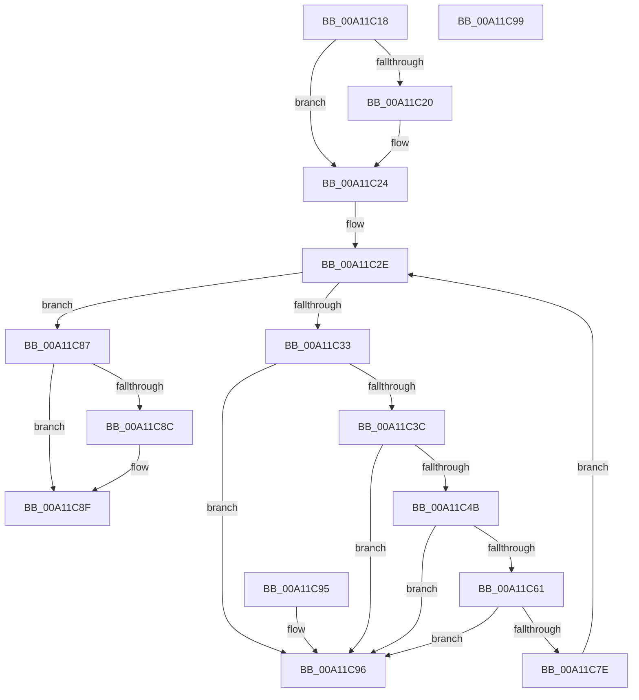

# MiValidateMemoryRangeEntries

- RVA: `0x00A11C18`–`0x00A11C9A` (길이 `130` bytes)
- VA: `0x0000000140A11C18`
- 실행 섹션: `PAGE`
- PDB 이름 있음: `예`; PDB Function 태그: `아니요`
- unwind 정보 RVA: `0x000DB714`
- 디코드: `42`개 명령, `130/130` bytes 표시
- 미해석 바이트: `0` (있으면 어셈블리에 `.byte`로 보존)

> 이 문서는 커널 이미지의 기계어와 PDB 기호를 분석해 생성했습니다. 4번과 5번은 함수 원형과 자료형을 바이너리 사용 방식에서 추정한 C 해석이며 원본 소스 복구 결과는 아닙니다.

## 1. Dependencies

- 직접 호출 지점: **0**; 고유 호출 대상: **0**
- 직접 호출자로 확인된 함수: **1**
- RIP 상대 이미지 참조: **0**

### Outgoing calls
- 직접 디코드된 call 명령이 없습니다.

### Direct callers
- [MmOutSwapVirtualAddresses](../../text/2A/MmOutSwapVirtualAddresses_function_002A8C30.md) at `0x002A8CE0`

### Static image references
- 디코드된 RIP-relative 메모리 참조가 없습니다.

## 2. Other-region calls and transfers

- 다른 실행 섹션으로 향하는 call: **0**
- 별도 외부 분기/꼬리 이동을 확인하지 못했습니다.

## 3. Assembly (complete function range)

```asm
00A11C18  4C 8B C9                        mov r9, rcx
00A11C1B  4D 85 C0                        test r8, r8
00A11C1E  74 04                           je 0x140a11c24
00A11C20  49 83 20 00                     and qword ptr [r8], 0
00A11C24  45 33 D2                        xor r10d, r10d
00A11C27  48 C1 E2 04                     shl rdx, 4
00A11C2B  48 03 D1                        add rdx, rcx
00A11C2E  4C 3B CA                        cmp r9, rdx
00A11C31  73 54                           jae 0x140a11c87
00A11C33  49 8B 49 08                     mov rcx, qword ptr [r9 + 8]
00A11C37  48 85 C9                        test rcx, rcx
00A11C3A  74 5A                           je 0x140a11c96
00A11C3C  4D 8B 19                        mov r11, qword ptr [r9]
00A11C3F  49 8D 43 FF                     lea rax, [r11 - 1]
00A11C43  48 03 C1                        add rax, rcx
00A11C46  49 3B C3                        cmp rax, r11
00A11C49  72 4B                           jb 0x140a11c96
00A11C4B  49 8D 43 FF                     lea rax, [r11 - 1]
00A11C4F  49 BB FF FF FE FF FF 7F 00 00   movabs r11, 0x7ffffffeffff
00A11C59  48 03 C1                        add rax, rcx
00A11C5C  49 3B C3                        cmp rax, r11
00A11C5F  77 35                           ja 0x140a11c96
00A11C61  41 8B 01                        mov eax, dword ptr [r9]
00A11C64  25 FF 0F 00 00                  and eax, 0xfff
00A11C69  48 05 FF 0F 00 00               add rax, 0xfff
00A11C6F  48 03 C1                        add rax, rcx
00A11C72  48 C1 E8 0C                     shr rax, 0xc
00A11C76  49 03 C2                        add rax, r10
00A11C79  49 3B C2                        cmp rax, r10
00A11C7C  72 18                           jb 0x140a11c96
00A11C7E  4C 8B D0                        mov r10, rax
00A11C81  49 83 C1 10                     add r9, 0x10
00A11C85  EB A7                           jmp 0x140a11c2e
00A11C87  4D 85 C0                        test r8, r8
00A11C8A  74 03                           je 0x140a11c8f
00A11C8C  4D 89 10                        mov qword ptr [r8], r10
00A11C8F  B8 01 00 00 00                  mov eax, 1
00A11C94  C3                              ret
00A11C95  CC                              int3
00A11C96  33 C0                           xor eax, eax
00A11C98  C3                              ret
00A11C99  CC                              int3
```

## 4. C-style interpretation (structured pseudocode)

```c
__int64 __fastcall MiValidateMemoryRangeEntries(__int64 a1, __int64 a2, __int64 a3)
{
    __int64 result;
    __int64 v_r10;

    if (a3 != 0) {
    }
    v_r10 = 0;
    a2 = (a2) << (4);
    a2 = (a2) + (a1);
loc_00A11C2E:
    if (a1 >= a2) goto loc_00A11C87;
    if (*(unsigned __int64 *)(a1 + 8) == 0) goto loc_00A11C96;
    result = (*(unsigned __int64 *)(a1) - 1) + (*(unsigned __int64 *)(a1 + 8));
    if (result < (*(unsigned __int64 *)(a1))) goto loc_00A11C96;
    result = (*(unsigned __int64 *)(a1) - 1) + (*(unsigned __int64 *)(a1 + 8));
    if (result > (*(unsigned __int64 *)(a1))) goto loc_00A11C96;
    result = (unsigned int)(((unsigned int)(*(unsigned int *)(a1))) & (0xFFFULL));
    result = (result) + (0xFFFULL);
    result = (result) + (*(unsigned __int64 *)(a1 + 8));
    result = (result) >> (12);
    result = (result) + (0);
    if (result < 0) goto loc_00A11C96;
    a4 = (a1) + (16);
    goto loc_00A11C2E;
loc_00A11C87:
    if (a3 != 0) {
        *(unsigned __int64 *)(a3) = result;
    }
    return 1;
loc_00A11C96:
    result = 0;
    return result;
}
```

## 5. (Beta) C Style

```c
int64_t MiValidateMemoryRangeEntries(int64_t Arg1, int64_t Arg2, int64_t Arg3)
{
    int64_t result;
    int64_t local_r10;

    if (Arg3 != 0) {
    }
    local_r10 = 0;
    Arg2 = (Arg2) << (4);
    Arg2 = (Arg2) + (Arg1);
loc_00A11C2E:
    if (Arg1 >= Arg2) goto loc_00A11C87;
    if (*(uint64_t *)(Arg1 + 0x8) == 0) goto loc_00A11C96;
    result = (*(uint64_t *)(Arg1) - 1) + (*(uint64_t *)(Arg1 + 0x8));
    if (result < (*(uint64_t *)(Arg1))) goto loc_00A11C96;
    result = (*(uint64_t *)(Arg1) - 1) + (*(uint64_t *)(Arg1 + 0x8));
    if (result > (*(uint64_t *)(Arg1))) goto loc_00A11C96;
    result = (uint32_t)(((uint32_t)(*(uint32_t *)(Arg1))) & (0xFFFULL));
    result = (result) + (0xFFFULL);
    result = (result) + (*(uint64_t *)(Arg1 + 0x8));
    result = (result) >> (12);
    result = (result) + (0);
    if (result < 0) goto loc_00A11C96;
    a4 = (Arg1) + (16);
    goto loc_00A11C2E;
loc_00A11C87:
    if (Arg3 != 0) {
        *(uint64_t *)(Arg3) = result;
    }
    return 1;
loc_00A11C96:
    result = 0;
    return result;
}
```

## 6. Execution-region graph

[열기: 2D/3D 그래프와 함수 탐색 컨트롤 패널](../../../control-panel.html?section=page&rva=0x00A11C18&view=graph)

- 2D 그래프는 위에서 아래로 흐르고, 3D 그래프는 빈 공간을 드래그해 회전합니다. Shift+드래그는 이동, 휠은 확대·축소, 함수 노드 선택은 대상 보고서 이동입니다.

### Static fallback


