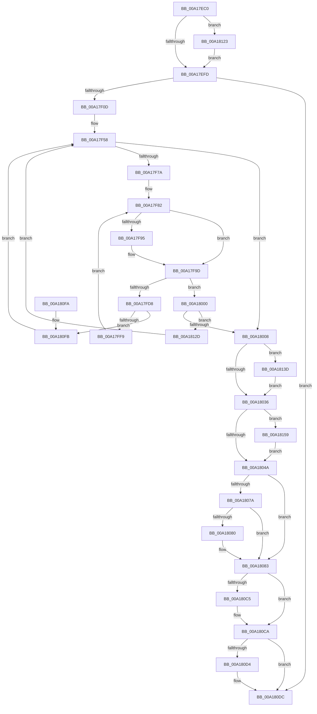

# MmCleanProcessAddressSpace

- RVA: `0x00A17EC0`–`0x00A18166` (길이 `678` bytes)
- VA: `0x0000000140A17EC0`
- 실행 섹션: `PAGE`
- PDB 이름 있음: `예`; PDB Function 태그: `아니요`
- unwind 정보 RVA: `0x000AA0F4`
- 디코드: `176`개 명령, `678/678` bytes 표시
- 미해석 바이트: `0` (있으면 어셈블리에 `.byte`로 보존)

> 이 문서는 커널 이미지의 기계어와 PDB 기호를 분석해 생성했습니다. 4번과 5번은 함수 원형과 자료형을 바이너리 사용 방식에서 추정한 C 해석이며 원본 소스 복구 결과는 아닙니다.

## 1. Dependencies

- 직접 호출 지점: **37**; 고유 호출 대상: **28**
- 직접 호출자로 확인된 함수: **1**
- RIP 상대 이미지 참조: **0**

### Outgoing calls
- `0x00A17F00` → [MiCleanEmbryonicProcess](MiCleanEmbryonicProcess_function_00A1816C.md) (function, `0x00A1816C`)
- `0x00A17F17` → [MiGetSharedVm](../../text/41/MiGetSharedVm_function_00414A20.md) (function, `0x00414A20`)
- `0x00A17F26` → [KeInitializeEvent](../../text/40/KeInitializeEvent_function_0040DD10.md) (function, `0x0040DD10`)
- `0x00A17F3A` → [MiBeginProcessClean](../../text/2A/MiBeginProcessClean_function_002A473C.md) (function, `0x002A473C`)
- `0x00A17F49` → [MiGetProcessPartition](../../text/44/MiGetProcessPartition_function_00443B10.md) (function, `0x00443B10`)
- `0x00A17F61` → [LOCK_ADDRESS_SPACE_SHARED](../../text/2A/LOCK_ADDRESS_SPACE_SHARED_function_002A8B3C.md) (function, `0x002A8B3C`)
- `0x00A17F69` → [MiGetFirstVad](../../text/2A/MiGetFirstVad_function_002A8BBC.md) (function, `0x002A8BBC`)
- `0x00A17F7D` → [MiReferenceVad](../../text/29/MiReferenceVad_function_00295890.md) (function, `0x00295890`)
- `0x00A17F88` → [MiGetNextVad](../../text/29/MiGetNextVad_function_00297224.md) (function, `0x00297224`)
- `0x00A17F98` → [MiReferenceVad](../../text/29/MiReferenceVad_function_00295890.md) (function, `0x00295890`)
- `0x00A17FA3` → [UNLOCK_ADDRESS_SPACE_SHARED](../../text/2A/UNLOCK_ADDRESS_SPACE_SHARED_function_002A8ACC.md) (function, `0x002A8ACC`)
- `0x00A17FAE` → [MiLockVad](../../text/29/MiLockVad_function_00295810.md) (function, `0x00295810`)
- `0x00A17FB6` → [MiCleanVad](../88/MiCleanVad_function_00889224.md) (function, `0x00889224`)
- `0x00A17FCE` → [LOCK_ADDRESS_SPACE_SHARED](../../text/2A/LOCK_ADDRESS_SPACE_SHARED_function_002A8B3C.md) (function, `0x002A8B3C`)
- `0x00A17FDE` → [MiLockVad](../../text/29/MiLockVad_function_00295810.md) (function, `0x00295810`)
- `0x00A17FE6` → [MiVadDeleted](../../text/43/MiVadDeleted_function_00431350.md) (function, `0x00431350`)
- `0x00A17FF9` → [MiUnlockVad](../../text/2A/MiUnlockVad_function_002A59C8.md) (function, `0x002A59C8`)
- `0x00A18029` → [UNLOCK_ADDRESS_SPACE_SHARED](../../text/2A/UNLOCK_ADDRESS_SPACE_SHARED_function_002A8ACC.md) (function, `0x002A8ACC`)
- `0x00A1804A` → [ExFreeSvmAsid](../../text/49/ExFreeSvmAsid_function_0049CCBC.md) (function, `0x0049CCBC`)
- `0x00A1804F` → [MiCleanCfg](../../text/49/MiCleanCfg_function_00492778.md) (function, `0x00492778`)
- `0x00A1805A` → [LOCK_ADDRESS_SPACE](../../text/2A/LOCK_ADDRESS_SPACE_function_002A4944.md) (function, `0x002A4944`)
- `0x00A18069` → [MiCleanProcessPhysicalPages](MiCleanProcessPhysicalPages_function_00A18234.md) (function, `0x00A18234`)
- `0x00A18088` → [MiDeleteCloneZombies](../../text/49/MiDeleteCloneZombies_function_0049A7B8.md) (function, `0x0049A7B8`)
- `0x00A18090` → [MiCleanWorkingSet](../../text/47/MiCleanWorkingSet_function_004740C4.md) (function, `0x004740C4`)
- `0x00A1809E` → [UNLOCK_ADDRESS_SPACE](../../text/2A/UNLOCK_ADDRESS_SPACE_function_002A4844.md) (function, `0x002A4844`)
- `0x00A180A9` → [PsReturnProcessQuota](../../text/47/PsReturnProcessQuota_function_0047DE8C.md) (function, `0x0047DE8C`)
- `0x00A180B4` → [MiReturnResident](../../text/28/MiReturnResident_function_00286890.md) (function, `0x00286890`)
- `0x00A180C5` → [PsDereferenceSession](PsDereferenceSession_function_00A1827C.md) (function, `0x00A1827C`)
- `0x00A180D7` → [MiContractWsSwapPageFile](MiContractWsSwapPageFile_function_00A182C4.md) (function, `0x00A182C4`)
- `0x00A180FB` → [MiUnlockVad](../../text/2A/MiUnlockVad_function_002A59C8.md) (function, `0x002A59C8`)
- `0x00A18106` → [UNLOCK_ADDRESS_SPACE_SHARED](../../text/2A/UNLOCK_ADDRESS_SPACE_SHARED_function_002A8ACC.md) (function, `0x002A8ACC`)
- `0x00A18111` → [MiLockVad](../../text/29/MiLockVad_function_00295810.md) (function, `0x00295810`)
- `0x00A18119` → [MiCleanVad](../88/MiCleanVad_function_00889224.md) (function, `0x00889224`)
- `0x00A18123` → [VmCleanProcessAddressSpace](../7A/VmCleanProcessAddressSpace_function_007ACD38.md) (function, `0x007ACD38`)
- `0x00A18133` → [UNLOCK_ADDRESS_SPACE_SHARED](../../text/2A/UNLOCK_ADDRESS_SPACE_SHARED_function_002A8ACC.md) (function, `0x002A8ACC`)
- `0x00A1814F` → [KeWaitForSingleObject](../../text/20/KeWaitForSingleObject_function_0020E6B0.md) (function, `0x0020E6B0`)
- `0x00A1815C` → [MiClearCommitReleaseState](../../text/66/MiClearCommitReleaseState_function_0066EF4C.md) (function, `0x0066EF4C`)

### Direct callers
- [PspRundownSingleProcess](../90/PspRundownSingleProcess_function_00906D50.md) at `0x00906E0D`

### Static image references
- 디코드된 RIP-relative 메모리 참조가 없습니다.

## 2. Other-region calls and transfers

- 다른 실행 섹션으로 향하는 call: **30**
  - `0x00A17F17` → [MiGetSharedVm](../../text/41/MiGetSharedVm_function_00414A20.md) (`PAGE` → `.text`)
  - `0x00A17F26` → [KeInitializeEvent](../../text/40/KeInitializeEvent_function_0040DD10.md) (`PAGE` → `.text`)
  - `0x00A17F3A` → [MiBeginProcessClean](../../text/2A/MiBeginProcessClean_function_002A473C.md) (`PAGE` → `.text`)
  - `0x00A17F49` → [MiGetProcessPartition](../../text/44/MiGetProcessPartition_function_00443B10.md) (`PAGE` → `.text`)
  - `0x00A17F61` → [LOCK_ADDRESS_SPACE_SHARED](../../text/2A/LOCK_ADDRESS_SPACE_SHARED_function_002A8B3C.md) (`PAGE` → `.text`)
  - `0x00A17F69` → [MiGetFirstVad](../../text/2A/MiGetFirstVad_function_002A8BBC.md) (`PAGE` → `.text`)
  - `0x00A17F7D` → [MiReferenceVad](../../text/29/MiReferenceVad_function_00295890.md) (`PAGE` → `.text`)
  - `0x00A17F88` → [MiGetNextVad](../../text/29/MiGetNextVad_function_00297224.md) (`PAGE` → `.text`)
  - `0x00A17F98` → [MiReferenceVad](../../text/29/MiReferenceVad_function_00295890.md) (`PAGE` → `.text`)
  - `0x00A17FA3` → [UNLOCK_ADDRESS_SPACE_SHARED](../../text/2A/UNLOCK_ADDRESS_SPACE_SHARED_function_002A8ACC.md) (`PAGE` → `.text`)
  - `0x00A17FAE` → [MiLockVad](../../text/29/MiLockVad_function_00295810.md) (`PAGE` → `.text`)
  - `0x00A17FCE` → [LOCK_ADDRESS_SPACE_SHARED](../../text/2A/LOCK_ADDRESS_SPACE_SHARED_function_002A8B3C.md) (`PAGE` → `.text`)
  - `0x00A17FDE` → [MiLockVad](../../text/29/MiLockVad_function_00295810.md) (`PAGE` → `.text`)
  - `0x00A17FE6` → [MiVadDeleted](../../text/43/MiVadDeleted_function_00431350.md) (`PAGE` → `.text`)
  - `0x00A17FF9` → [MiUnlockVad](../../text/2A/MiUnlockVad_function_002A59C8.md) (`PAGE` → `.text`)
  - `0x00A18029` → [UNLOCK_ADDRESS_SPACE_SHARED](../../text/2A/UNLOCK_ADDRESS_SPACE_SHARED_function_002A8ACC.md) (`PAGE` → `.text`)
  - `0x00A1804A` → [ExFreeSvmAsid](../../text/49/ExFreeSvmAsid_function_0049CCBC.md) (`PAGE` → `.text`)
  - `0x00A1804F` → [MiCleanCfg](../../text/49/MiCleanCfg_function_00492778.md) (`PAGE` → `.text`)
  - `0x00A1805A` → [LOCK_ADDRESS_SPACE](../../text/2A/LOCK_ADDRESS_SPACE_function_002A4944.md) (`PAGE` → `.text`)
  - `0x00A18088` → [MiDeleteCloneZombies](../../text/49/MiDeleteCloneZombies_function_0049A7B8.md) (`PAGE` → `.text`)
  - `0x00A18090` → [MiCleanWorkingSet](../../text/47/MiCleanWorkingSet_function_004740C4.md) (`PAGE` → `.text`)
  - `0x00A1809E` → [UNLOCK_ADDRESS_SPACE](../../text/2A/UNLOCK_ADDRESS_SPACE_function_002A4844.md) (`PAGE` → `.text`)
  - `0x00A180A9` → [PsReturnProcessQuota](../../text/47/PsReturnProcessQuota_function_0047DE8C.md) (`PAGE` → `.text`)
  - `0x00A180B4` → [MiReturnResident](../../text/28/MiReturnResident_function_00286890.md) (`PAGE` → `.text`)
  - `0x00A180FB` → [MiUnlockVad](../../text/2A/MiUnlockVad_function_002A59C8.md) (`PAGE` → `.text`)
  - `0x00A18106` → [UNLOCK_ADDRESS_SPACE_SHARED](../../text/2A/UNLOCK_ADDRESS_SPACE_SHARED_function_002A8ACC.md) (`PAGE` → `.text`)
  - `0x00A18111` → [MiLockVad](../../text/29/MiLockVad_function_00295810.md) (`PAGE` → `.text`)
  - `0x00A18133` → [UNLOCK_ADDRESS_SPACE_SHARED](../../text/2A/UNLOCK_ADDRESS_SPACE_SHARED_function_002A8ACC.md) (`PAGE` → `.text`)
  - `0x00A1814F` → [KeWaitForSingleObject](../../text/20/KeWaitForSingleObject_function_0020E6B0.md) (`PAGE` → `.text`)
  - `0x00A1815C` → [MiClearCommitReleaseState](../../text/66/MiClearCommitReleaseState_function_0066EF4C.md) (`PAGE` → `.text`)
- 별도 외부 분기/꼬리 이동을 확인하지 못했습니다.

## 3. Assembly (complete function range)

```asm
00A17EC0  4C 8B DC                        mov r11, rsp
00A17EC3  49 89 5B 10                     mov qword ptr [r11 + 0x10], rbx
00A17EC7  49 89 6B 18                     mov qword ptr [r11 + 0x18], rbp
00A17ECB  49 89 73 20                     mov qword ptr [r11 + 0x20], rsi
00A17ECF  57                              push rdi
00A17ED0  41 54                           push r12
00A17ED2  41 55                           push r13
00A17ED4  41 56                           push r14
00A17ED6  41 57                           push r15
00A17ED8  48 83 EC 50                     sub rsp, 0x50
00A17EDC  33 C0                           xor eax, eax
00A17EDE  0F 57 C0                        xorps xmm0, xmm0
00A17EE1  45 33 E4                        xor r12d, r12d
00A17EE4  48 8B F9                        mov rdi, rcx
00A17EE7  0F 11 44 24 30                  movups xmmword ptr [rsp + 0x30], xmm0
00A17EEC  49 89 43 C8                     mov qword ptr [r11 - 0x38], rax
00A17EF0  4C 39 A1 70 06 00 00            cmp qword ptr [rcx + 0x670], r12
00A17EF7  0F 85 26 02 00 00               jne 0x140a18123
00A17EFD  48 8B CF                        mov rcx, rdi
00A17F00  E8 67 02 00 00                  call 0x140a1816c
00A17F05  85 C0                           test eax, eax
00A17F07  0F 85 CF 01 00 00               jne 0x140a180dc
00A17F0D  4C 8D BF 00 04 00 00            lea r15, [rdi + 0x400]
00A17F14  49 8B CF                        mov rcx, r15
00A17F17  E8 04 CB 9F FF                  call 0x140414a20
00A17F1C  33 D2                           xor edx, edx
00A17F1E  48 8D 4C 24 30                  lea rcx, [rsp + 0x30]
00A17F23  45 33 C0                        xor r8d, r8d
00A17F26  E8 E5 5D 9F FF                  call 0x14040dd10
00A17F2B  65 48 8B 34 25 88 01 00 00      mov rsi, qword ptr gs:[0x188]
00A17F34  48 8B D7                        mov rdx, rdi
00A17F37  48 8B CE                        mov rcx, rsi
00A17F3A  E8 FD C7 88 FF                  call 0x1402a473c
00A17F3F  48 8B CF                        mov rcx, rdi
00A17F42  89 84 24 80 00 00 00            mov dword ptr [rsp + 0x80], eax
00A17F49  E8 C2 BB A2 FF                  call 0x140443b10
00A17F4E  4C 8B B7 10 04 00 00            mov r14, qword ptr [rdi + 0x410]
00A17F55  4C 8B E8                        mov r13, rax
00A17F58  48 8B D7                        mov rdx, rdi
00A17F5B  48 8B CE                        mov rcx, rsi
00A17F5E  41 8B EC                        mov ebp, r12d
00A17F61  E8 D6 0B 89 FF                  call 0x1402a8b3c
00A17F66  48 8B CF                        mov rcx, rdi
00A17F69  E8 4E 0C 89 FF                  call 0x1402a8bbc
00A17F6E  48 8B D8                        mov rbx, rax
00A17F71  48 85 C0                        test rax, rax
00A17F74  0F 84 8E 00 00 00               je 0x140a18008
00A17F7A  48 8B C8                        mov rcx, rax
00A17F7D  E8 0E D9 87 FF                  call 0x140295890
00A17F82  48 8B CB                        mov rcx, rbx
00A17F85  4C 8B E3                        mov r12, rbx
00A17F88  E8 97 F2 87 FF                  call 0x140297224
00A17F8D  48 8B D8                        mov rbx, rax
00A17F90  48 85 C0                        test rax, rax
00A17F93  74 08                           je 0x140a17f9d
00A17F95  48 8B C8                        mov rcx, rax
00A17F98  E8 F3 D8 87 FF                  call 0x140295890
00A17F9D  48 8B D7                        mov rdx, rdi
00A17FA0  48 8B CE                        mov rcx, rsi
00A17FA3  E8 24 0B 89 FF                  call 0x1402a8acc
00A17FA8  49 8B D4                        mov rdx, r12
00A17FAB  48 8B CE                        mov rcx, rsi
00A17FAE  E8 5D D8 87 FF                  call 0x140295810
00A17FB3  49 8B CC                        mov rcx, r12
00A17FB6  E8 69 12 E7 FF                  call 0x140889224
00A17FBB  B9 01 00 00 00                  mov ecx, 1
00A17FC0  45 33 E4                        xor r12d, r12d
00A17FC3  85 C0                           test eax, eax
00A17FC5  48 8B D7                        mov rdx, rdi
00A17FC8  0F 45 E9                        cmovne ebp, ecx
00A17FCB  48 8B CE                        mov rcx, rsi
00A17FCE  E8 69 0B 89 FF                  call 0x1402a8b3c
00A17FD3  48 85 DB                        test rbx, rbx
00A17FD6  74 28                           je 0x140a18000
00A17FD8  48 8B D3                        mov rdx, rbx
00A17FDB  48 8B CE                        mov rcx, rsi
00A17FDE  E8 2D D8 87 FF                  call 0x140295810
00A17FE3  48 8B CB                        mov rcx, rbx
00A17FE6  E8 65 93 A1 FF                  call 0x140431350
00A17FEB  48 8B D3                        mov rdx, rbx
00A17FEE  48 8B CE                        mov rcx, rsi
00A17FF1  85 C0                           test eax, eax
00A17FF3  0F 85 02 01 00 00               jne 0x140a180fb
00A17FF9  E8 CA D9 88 FF                  call 0x1402a59c8
00A17FFE  EB 82                           jmp 0x140a17f82
00A18000  85 ED                           test ebp, ebp
00A18002  0F 85 25 01 00 00               jne 0x140a1812d
00A18008  48 8D 44 24 30                  lea rax, [rsp + 0x30]
00A1800D  49 89 86 00 04 00 00            mov qword ptr [r14 + 0x400], rax
00A18014  F0 41 83 86 E8 03 00 00 FF      lock add dword ptr [r14 + 0x3e8], -1
00A1801D  41 8B DC                        mov ebx, r12d
00A18020  48 8B D7                        mov rdx, rdi
00A18023  48 8B CE                        mov rcx, rsi
00A18026  0F 95 C3                        setne bl
00A18029  E8 9E 0A 89 FF                  call 0x1402a8acc
00A1802E  85 DB                           test ebx, ebx
00A18030  0F 85 07 01 00 00               jne 0x140a1813d
00A18036  41 8B 87 B8 00 00 00            mov eax, dword ptr [r15 + 0xb8]
00A1803D  C1 E8 18                        shr eax, 0x18
00A18040  24 30                           and al, 0x30
00A18042  3C 30                           cmp al, 0x30
00A18044  0F 84 0F 01 00 00               je 0x140a18159
00A1804A  E8 6D 4C A8 FF                  call 0x14049ccbc
00A1804F  E8 24 A7 A7 FF                  call 0x140492778
00A18054  48 8B D7                        mov rdx, rdi
00A18057  48 8B CE                        mov rcx, rsi
00A1805A  E8 E5 C8 88 FF                  call 0x1402a4944
00A1805F  48 8B CF                        mov rcx, rdi
00A18062  4D 89 A6 00 04 00 00            mov qword ptr [r14 + 0x400], r12
00A18069  E8 C6 01 00 00                  call 0x140a18234
00A1806E  48 8B 8F 10 03 00 00            mov rcx, qword ptr [rdi + 0x310]
00A18075  48 85 C9                        test rcx, rcx
00A18078  74 09                           je 0x140a18083
00A1807A  48 83 39 00                     cmp qword ptr [rcx], 0
00A1807E  74 03                           je 0x140a18083
00A18080  4C 89 21                        mov qword ptr [rcx], r12
00A18083  33 D2                           xor edx, edx
00A18085  48 8B CF                        mov rcx, rdi
00A18088  E8 2B 27 A8 FF                  call 0x14049a7b8
00A1808D  48 8B CF                        mov rcx, rdi
00A18090  E8 2F C0 A5 FF                  call 0x1404740c4
00A18095  48 8B D7                        mov rdx, rdi
00A18098  48 8B CE                        mov rcx, rsi
00A1809B  48 8B D8                        mov rbx, rax
00A1809E  E8 A1 C7 88 FF                  call 0x1402a4844
00A180A3  4C 8B C3                        mov r8, rbx
00A180A6  48 8B CF                        mov rcx, rdi
00A180A9  E8 DE 5D A6 FF                  call 0x14047de8c
00A180AE  48 8B D3                        mov rdx, rbx
00A180B1  49 8B CD                        mov rcx, r13
00A180B4  E8 D7 E7 86 FF                  call 0x140286890
00A180B9  F7 87 F4 01 00 00 00 00 01 00   test dword ptr [rdi + 0x1f4], 0x10000
00A180C3  74 05                           je 0x140a180ca
00A180C5  E8 B2 01 00 00                  call 0x140a1827c
00A180CA  44 39 A4 24 80 00 00 00         cmp dword ptr [rsp + 0x80], r12d
00A180D2  74 08                           je 0x140a180dc
00A180D4  49 8B CD                        mov rcx, r13
00A180D7  E8 E8 01 00 00                  call 0x140a182c4
00A180DC  4C 8D 5C 24 50                  lea r11, [rsp + 0x50]
00A180E1  49 8B 5B 38                     mov rbx, qword ptr [r11 + 0x38]
00A180E5  49 8B 6B 40                     mov rbp, qword ptr [r11 + 0x40]
00A180E9  49 8B 73 48                     mov rsi, qword ptr [r11 + 0x48]
00A180ED  49 8B E3                        mov rsp, r11
00A180F0  41 5F                           pop r15
00A180F2  41 5E                           pop r14
00A180F4  41 5D                           pop r13
00A180F6  41 5C                           pop r12
00A180F8  5F                              pop rdi
00A180F9  C3                              ret
00A180FA  CC                              int3
00A180FB  E8 C8 D8 88 FF                  call 0x1402a59c8
00A18100  48 8B D7                        mov rdx, rdi
00A18103  48 8B CE                        mov rcx, rsi
00A18106  E8 C1 09 89 FF                  call 0x1402a8acc
00A1810B  48 8B D3                        mov rdx, rbx
00A1810E  48 8B CE                        mov rcx, rsi
00A18111  E8 FA D6 87 FF                  call 0x140295810
00A18116  48 8B CB                        mov rcx, rbx
00A18119  E8 06 11 E7 FF                  call 0x140889224
00A1811E  E9 35 FE FF FF                  jmp 0x140a17f58
00A18123  E8 10 4C D9 FF                  call 0x1407acd38
00A18128  E9 D0 FD FF FF                  jmp 0x140a17efd
00A1812D  48 8B D7                        mov rdx, rdi
00A18130  48 8B CE                        mov rcx, rsi
00A18133  E8 94 09 89 FF                  call 0x1402a8acc
00A18138  E9 1B FE FF FF                  jmp 0x140a17f58
00A1813D  45 33 C9                        xor r9d, r9d
00A18140  4C 89 64 24 20                  mov qword ptr [rsp + 0x20], r12
00A18145  45 33 C0                        xor r8d, r8d
00A18148  48 8D 4C 24 30                  lea rcx, [rsp + 0x30]
00A1814D  33 D2                           xor edx, edx
00A1814F  E8 5C 65 7F FF                  call 0x14020e6b0
00A18154  E9 DD FE FF FF                  jmp 0x140a18036
00A18159  49 8B CF                        mov rcx, r15
00A1815C  E8 EB 6D C5 FF                  call 0x14066ef4c
00A18161  E9 E4 FE FF FF                  jmp 0x140a1804a
```

## 4. C-style interpretation (structured pseudocode)

```c
__int64 __fastcall MmCleanProcessAddressSpace(__int64 a1, int a2, int a3, int a4)
{
    __int64 result;
    __int64 v_r12;
    __int64 v_rbp;
    __int64 v_rbx;
    __int64 v_rsp;
    unsigned __int64 v_stack_m20;
    unsigned __int64 v_stack_m28;
    unsigned __int64 v_stack_m30;
    unsigned __int64 v_stack_m48;
    unsigned int v_stack_p8;

    *(unsigned __int64 *)(v_rsp + 16) = v_rbx;
    *(unsigned __int64 *)(v_rsp + 24) = v_rbp;
    *(unsigned __int64 *)(v_rsp + 32) = v_rsi;
    v_rsp = (v_rsp) - (80);
    result = 0;
    v_r12 = 0;
    v_stack_m48 = v_xmm0;
    *(unsigned __int64 *)(v_rsp - 56) = 0;
    if ((*(unsigned __int64 *)(a1 + 1648)) != 0) goto loc_00A18123;
loc_00A17EFD:
    result = MiCleanEmbryonicProcess(a1, a2, a3, a4);
    if ((unsigned int)(result) != 0) goto loc_00A180DC;
    result = MiGetSharedVm(a1 + 1024, a2, a3, a4);
    a2 = 0;
    a3 = 0;
    result = KeInitializeEvent(v_stack_m48, a2, a3, a4);
    result = MiBeginProcessClean(*(unsigned __int64 *)(gs_base + (0 + 392)), a1, a3, a4);
    v_stack_p8 = (unsigned int)(result);
    result = MiGetProcessPartition(a1, a1, a3, a4);
loc_00A17F58:
    result = LOCK_ADDRESS_SPACE_SHARED(*(unsigned __int64 *)(gs_base + (0 + 392)), a1, a3, a4);
    result = MiGetFirstVad(a1, a1, a3, a4);
    if (result == 0) goto loc_00A18008;
    result = MiReferenceVad(result, a1, a3, a4);
loc_00A17F82:
    result = MiGetNextVad(result, a1, a3, a4);
    if (result != 0) {
        a1 = result;
        result = MiReferenceVad(a1, a1, a3, a4);
    }
    result = UNLOCK_ADDRESS_SPACE_SHARED(*(unsigned __int64 *)(gs_base + (0 + 392)), a1, a3, a4);
    result = MiLockVad(*(unsigned __int64 *)(gs_base + (0 + 392)), result, a3, a4);
    result = MiCleanVad(result, result, a3, a4);
    v_r12 = 0;
    v_rbp = 0;
    if ((unsigned int)(result) != 0) { v_rbp = 1; }
    result = LOCK_ADDRESS_SPACE_SHARED(*(unsigned __int64 *)(gs_base + (0 + 392)), a1, a3, a4);
    if (result == 0) goto loc_00A18000;
    result = MiLockVad(*(unsigned __int64 *)(gs_base + (0 + 392)), result, a3, a4);
    result = MiVadDeleted(result, result, a3, a4);
    if ((unsigned int)(result) != 0) goto loc_00A180FB;
    result = MiUnlockVad(*(unsigned __int64 *)(gs_base + (0 + 392)), result, a3, a4);
    goto loc_00A17F82;
loc_00A18000:
    if ((unsigned int)(v_rbp) != 0) goto loc_00A1812D;
loc_00A18008:
    *(unsigned __int64 *)(*(unsigned __int64 *)(a1 + 1040) + 1024) = v_stack_m48;
    v_rbx = ((unsigned int)(v_rbp) != 0) ? 1 : 0;
    result = UNLOCK_ADDRESS_SPACE_SHARED(*(unsigned __int64 *)(gs_base + (0 + 392)), a1, a3, a4);
    if ((unsigned int)(v_rbx) != 0) goto loc_00A1813D;
loc_00A18036:
    result = (unsigned int)(((unsigned int)(*(unsigned int *)(a1 + 1024 + 184))) >> (24));
    result = (unsigned __int8)((result) & (48));
    if (((unsigned __int8)(result)) == 48) goto loc_00A18159;
loc_00A1804A:
    result = ExFreeSvmAsid(*(unsigned __int64 *)(gs_base + (0 + 392)), a1, a3, a4);
    result = MiCleanCfg(*(unsigned __int64 *)(gs_base + (0 + 392)), a1, a3, a4);
    result = LOCK_ADDRESS_SPACE(*(unsigned __int64 *)(gs_base + (0 + 392)), a1, a3, a4);
    *(unsigned __int64 *)(*(unsigned __int64 *)(a1 + 1040) + 1024) = 0;
    result = MiCleanProcessPhysicalPages(a1, a1, a3, a4);
    if (*(unsigned __int64 *)(a1 + 784) == 0) goto loc_00A18083;
    if ((*(unsigned __int64 *)(*(unsigned __int64 *)(a1 + 784))) != 0) {
        *(unsigned __int64 *)(*(unsigned __int64 *)(a1 + 784)) = 0;
    }
    a2 = 0;
    result = MiDeleteCloneZombies(a1, a2, a3, a4);
    result = MiCleanWorkingSet(a1, a2, a3, a4);
    result = UNLOCK_ADDRESS_SPACE(*(unsigned __int64 *)(gs_base + (0 + 392)), a1, a3, a4);
    result = PsReturnProcessQuota(a1, a1, result, a4);
    result = MiReturnResident(result, result, result, a4);
    if (((*(unsigned int *)(a1 + 500)) & (0x10000ULL)) != 0) {
        result = PsDereferenceSession(result, result, result, a4);
    }
    if (v_stack_p8 != 0) {
        a1 = result;
        result = MiContractWsSwapPageFile(a1, result, result, a4);
    }
    return result;
loc_00A180FB:
    result = MiUnlockVad(a1, result, result, a4);
    result = UNLOCK_ADDRESS_SPACE_SHARED(*(unsigned __int64 *)(v_stack_m28 + 72), a1, result, a4);
    result = MiLockVad(*(unsigned __int64 *)(v_stack_m28 + 72), *(unsigned __int64 *)(v_stack_m28 + 56), result, a4);
    result = MiCleanVad(*(unsigned __int64 *)(v_stack_m28 + 56), *(unsigned __int64 *)(v_stack_m28 + 56), result, a4);
    goto loc_00A17F58;
loc_00A18123:
    result = VmCleanProcessAddressSpace(*(unsigned __int64 *)(v_stack_m28 + 56), *(unsigned __int64 *)(v_stack_m28 + 56), result, a4);
    goto loc_00A17EFD;
loc_00A1812D:
    result = UNLOCK_ADDRESS_SPACE_SHARED(*(unsigned __int64 *)(v_stack_m28 + 72), a1, result, a4);
    goto loc_00A17F58;
loc_00A1813D:
    a4 = 0;
    v_stack_m30 = 0;
    a3 = 0;
    a2 = 0;
    result = KeWaitForSingleObject(v_stack_m20, a2, a3, a4);
    goto loc_00A18036;
loc_00A18159:
    result = MiClearCommitReleaseState(a1 + 1024, a2, a3, a4);
    goto loc_00A1804A;
}
```

## 5. (Beta) C Style

```c
int64_t MmCleanProcessAddressSpace(void *Arg1, int32_t Arg2, int32_t Arg3, int32_t Arg4)
{
    uint8_t *arg1 = (uint8_t *)Arg1;

    int64_t result;
    int64_t local_r12;
    int64_t local_rbp;
    int64_t local_rbx;
    int64_t local_rsp;
    uint64_t v_stack_m20;
    uint64_t v_stack_m28;
    uint64_t v_stack_m30;
    uint64_t v_stack_m48;
    uint32_t v_stack_p8;

    *(uint64_t *)(local_rsp + 0x10) = local_rbx;
    *(uint64_t *)(local_rsp + 0x18) = local_rbp;
    *(uint64_t *)(local_rsp + 0x20) = local_rsi;
    local_rsp = (local_rsp) - (80);
    result = 0;
    local_r12 = 0;
    v_stack_m48 = v_xmm0;
    *(uint64_t *)(local_rsp - 0x38) = 0;
    if ((*(uint64_t *)(arg1 + 0x670)) != 0) goto loc_00A18123;
loc_00A17EFD:
    result = MiCleanEmbryonicProcess(Arg1, Arg2, Arg3, Arg4);
    if ((uint32_t)(result) != 0) goto loc_00A180DC;
    result = MiGetSharedVm(Arg1 + 1024, Arg2, Arg3, Arg4);
    Arg2 = 0;
    Arg3 = 0;
    result = KeInitializeEvent(v_stack_m48, Arg2, Arg3, Arg4);
    result = MiBeginProcessClean(*(uint64_t *)(gs_base + (0 + 0x188)), Arg1, Arg3, Arg4);
    v_stack_p8 = (uint32_t)(result);
    result = MiGetProcessPartition(Arg1, Arg1, Arg3, Arg4);
loc_00A17F58:
    result = LOCK_ADDRESS_SPACE_SHARED(*(uint64_t *)(gs_base + (0 + 0x188)), Arg1, Arg3, Arg4);
    result = MiGetFirstVad(Arg1, Arg1, Arg3, Arg4);
    if (result == 0) goto loc_00A18008;
    result = MiReferenceVad(result, Arg1, Arg3, Arg4);
loc_00A17F82:
    result = MiGetNextVad(result, Arg1, Arg3, Arg4);
    if (result != 0) {
        Arg1 = result;
        result = MiReferenceVad(Arg1, Arg1, Arg3, Arg4);
    }
    result = UNLOCK_ADDRESS_SPACE_SHARED(*(uint64_t *)(gs_base + (0 + 0x188)), Arg1, Arg3, Arg4);
    result = MiLockVad(*(uint64_t *)(gs_base + (0 + 0x188)), result, Arg3, Arg4);
    result = MiCleanVad(result, result, Arg3, Arg4);
    local_r12 = 0;
    local_rbp = 0;
    if ((uint32_t)(result) != 0) { local_rbp = 1; }
    result = LOCK_ADDRESS_SPACE_SHARED(*(uint64_t *)(gs_base + (0 + 0x188)), Arg1, Arg3, Arg4);
    if (result == 0) goto loc_00A18000;
    result = MiLockVad(*(uint64_t *)(gs_base + (0 + 0x188)), result, Arg3, Arg4);
    result = MiVadDeleted(result, result, Arg3, Arg4);
    if ((uint32_t)(result) != 0) goto loc_00A180FB;
    result = MiUnlockVad(*(uint64_t *)(gs_base + (0 + 0x188)), result, Arg3, Arg4);
    goto loc_00A17F82;
loc_00A18000:
    if ((uint32_t)(local_rbp) != 0) goto loc_00A1812D;
loc_00A18008:
    *(uint64_t *)(*(uint64_t *)(arg1 + 0x410) + 0x400) = v_stack_m48;
    local_rbx = ((uint32_t)(local_rbp) != 0) ? 1 : 0;
    result = UNLOCK_ADDRESS_SPACE_SHARED(*(uint64_t *)(gs_base + (0 + 0x188)), Arg1, Arg3, Arg4);
    if ((uint32_t)(local_rbx) != 0) goto loc_00A1813D;
loc_00A18036:
    result = (uint32_t)(((uint32_t)(*(uint32_t *)(arg1 + 0x400 + 0xB8))) >> (24));
    result = (uint8_t)((result) & (48));
    if (((uint8_t)(result)) == 48) goto loc_00A18159;
loc_00A1804A:
    result = ExFreeSvmAsid(*(uint64_t *)(gs_base + (0 + 0x188)), Arg1, Arg3, Arg4);
    result = MiCleanCfg(*(uint64_t *)(gs_base + (0 + 0x188)), Arg1, Arg3, Arg4);
    result = LOCK_ADDRESS_SPACE(*(uint64_t *)(gs_base + (0 + 0x188)), Arg1, Arg3, Arg4);
    *(uint64_t *)(*(uint64_t *)(arg1 + 0x410) + 0x400) = 0;
    result = MiCleanProcessPhysicalPages(Arg1, Arg1, Arg3, Arg4);
    if (*(uint64_t *)(arg1 + 0x310) == 0) goto loc_00A18083;
    if ((*(uint64_t *)(*(uint64_t *)(arg1 + 0x310))) != 0) {
        *(uint64_t *)(*(uint64_t *)(arg1 + 0x310)) = 0;
    }
    Arg2 = 0;
    result = MiDeleteCloneZombies(Arg1, Arg2, Arg3, Arg4);
    result = MiCleanWorkingSet(Arg1, Arg2, Arg3, Arg4);
    result = UNLOCK_ADDRESS_SPACE(*(uint64_t *)(gs_base + (0 + 0x188)), Arg1, Arg3, Arg4);
    result = PsReturnProcessQuota(Arg1, Arg1, result, Arg4);
    result = MiReturnResident(result, result, result, Arg4);
    if (((*(uint32_t *)(arg1 + 0x1F4)) & (0x10000ULL)) != 0) {
        result = PsDereferenceSession(result, result, result, Arg4);
    }
    if (v_stack_p8 != 0) {
        Arg1 = result;
        result = MiContractWsSwapPageFile(Arg1, result, result, Arg4);
    }
    return result;
loc_00A180FB:
    result = MiUnlockVad(Arg1, result, result, Arg4);
    result = UNLOCK_ADDRESS_SPACE_SHARED(*(uint64_t *)(v_stack_m28 + 0x48), Arg1, result, Arg4);
    result = MiLockVad(*(uint64_t *)(v_stack_m28 + 0x48), *(uint64_t *)(v_stack_m28 + 0x38), result, Arg4);
    result = MiCleanVad(*(uint64_t *)(v_stack_m28 + 0x38), *(uint64_t *)(v_stack_m28 + 0x38), result, Arg4);
    goto loc_00A17F58;
loc_00A18123:
    result = VmCleanProcessAddressSpace(*(uint64_t *)(v_stack_m28 + 0x38), *(uint64_t *)(v_stack_m28 + 0x38), result, Arg4);
    goto loc_00A17EFD;
loc_00A1812D:
    result = UNLOCK_ADDRESS_SPACE_SHARED(*(uint64_t *)(v_stack_m28 + 0x48), Arg1, result, Arg4);
    goto loc_00A17F58;
loc_00A1813D:
    Arg4 = 0;
    v_stack_m30 = 0;
    Arg3 = 0;
    Arg2 = 0;
    result = KeWaitForSingleObject(v_stack_m20, Arg2, Arg3, Arg4);
    goto loc_00A18036;
loc_00A18159:
    result = MiClearCommitReleaseState(Arg1 + 1024, Arg2, Arg3, Arg4);
    goto loc_00A1804A;
}
```

### 관측된 메모리 오프셋

구조체 형식이 확인되지 않은 접근은 인자 기준의 오프셋으로만 기록했습니다.

| 기준 인자 | 오프셋 표현 | 폭 (bit) | 접근 |
|---|---:|---:|---|
| `Arg1` | `+ 0xB8` | `32` | `R` |
| `Arg1` | `+ 0x1F4` | `32` | `R` |
| `Arg1` | `+ 0x310` | `64` | `R` |
| `Arg1` | `+ 0x400` | `64` | `R` |
| `Arg1` | `+ 0x410` | `64` | `R` |
| `Arg1` | `+ 0x670` | `64` | `R` |

## 6. Execution-region graph

[열기: 2D/3D 그래프와 함수 탐색 컨트롤 패널](../../../control-panel.html?section=page&rva=0x00A17EC0&view=graph)

- 2D 그래프는 위에서 아래로 흐르고, 3D 그래프는 빈 공간을 드래그해 회전합니다. Shift+드래그는 이동, 휠은 확대·축소, 함수 노드 선택은 대상 보고서 이동입니다.

### Static fallback


