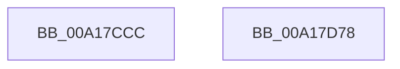

# MmInSwapVirtualAddresses

- RVA: `0x00A17CCC`–`0x00A17D79` (길이 `173` bytes)
- VA: `0x0000000140A17CCC`
- 실행 섹션: `PAGE`
- PDB 이름 있음: `예`; PDB Function 태그: `아니요`
- unwind 정보 RVA: `0x000AA0B4`
- 디코드: `45`개 명령, `173/173` bytes 표시
- 미해석 바이트: `0` (있으면 어셈블리에 `.byte`로 보존)

> 이 문서는 커널 이미지의 기계어와 PDB 기호를 분석해 생성했습니다. 4번과 5번은 함수 원형과 자료형을 바이너리 사용 방식에서 추정한 C 해석이며 원본 소스 복구 결과는 아닙니다.

## 1. Dependencies

- 직접 호출 지점: **7**; 고유 호출 대상: **6**
- 직접 호출자로 확인된 함수: **2**
- RIP 상대 이미지 참조: **1**

### Outgoing calls
- `0x00A17D13` → [EtwTraceWorkingSetSwap](EtwTraceWorkingSetSwap_function_00A17D80.md) (function, `0x00A17D80`)
- `0x00A17D1B` → [MiGetProcessPartition](../../text/44/MiGetProcessPartition_function_00443B10.md) (function, `0x00443B10`)
- `0x00A17D2B` → [MiProcessWsInSwapSupport](../../text/45/MiProcessWsInSwapSupport_function_0045B954.md) (function, `0x0045B954`)
- `0x00A17D35` → [ExFreePoolWithTag](../../poolcode/B8/ExFreePoolWithTag_function_00B82870.md) (function, `0x00B82870`)
- `0x00A17D3D` → [MiContractWsSwapPageFile](MiContractWsSwapPageFile_function_00A182C4.md) (function, `0x00A182C4`)
- `0x00A17D54` → [EtwTraceWorkingSetSwap](EtwTraceWorkingSetSwap_function_00A17D80.md) (function, `0x00A17D80`)
- `0x00A17D63` → [_security_check_cookie](../../text/6A/_security_check_cookie_function_006AC640.md) (function, `0x006AC640`)

### Direct callers
- [SmPerformStoreSwapOperation](../../text/2A/SmPerformStoreSwapOperation_function_002A8BE0.md) at `0x002A8C20`
- [SMKM_STORE&lt;SM_TRAITS&gt;::SmStInSwapStore](../../text/49/SMKM_STORE_SM_TRAITS_SmStInSwapStore_function_00496BC8.md) at `0x00496C39`

### Static image references
- `0x00A17CDC` → RVA `0x00E0A740` (`.data`; read)

## 2. Other-region calls and transfers

- 다른 실행 섹션으로 향하는 call: **4**
  - `0x00A17D1B` → [MiGetProcessPartition](../../text/44/MiGetProcessPartition_function_00443B10.md) (`PAGE` → `.text`)
  - `0x00A17D2B` → [MiProcessWsInSwapSupport](../../text/45/MiProcessWsInSwapSupport_function_0045B954.md) (`PAGE` → `.text`)
  - `0x00A17D35` → [ExFreePoolWithTag](../../poolcode/B8/ExFreePoolWithTag_function_00B82870.md) (`PAGE` → `POOLCODE`)
  - `0x00A17D63` → [_security_check_cookie](../../text/6A/_security_check_cookie_function_006AC640.md) (`PAGE` → `.text`)
- 별도 외부 분기/꼬리 이동을 확인하지 못했습니다.

## 3. Assembly (complete function range)

```asm
00A17CCC  4C 8B DC                        mov r11, rsp
00A17CCF  49 89 5B 18                     mov qword ptr [r11 + 0x18], rbx
00A17CD3  49 89 73 20                     mov qword ptr [r11 + 0x20], rsi
00A17CD7  57                              push rdi
00A17CD8  48 83 EC 50                     sub rsp, 0x50
00A17CDC  48 8B 05 5D 2A 3F 00            mov rax, qword ptr [rip + 0x3f2a5d]
00A17CE3  48 33 C4                        xor rax, rsp
00A17CE6  48 89 44 24 48                  mov qword ptr [rsp + 0x48], rax
00A17CEB  33 C0                           xor eax, eax
00A17CED  4D 8D 43 C8                     lea r8, [r11 - 0x38]
00A17CF1  0F 57 C0                        xorps xmm0, xmm0
00A17CF4  48 8B FA                        mov rdi, rdx
00A17CF7  0F 11 44 24 20                  movups xmmword ptr [rsp + 0x20], xmm0
00A17CFC  48 8B F1                        mov rsi, rcx
00A17CFF  0F 11 44 24 30                  movups xmmword ptr [rsp + 0x30], xmm0
00A17D04  49 89 43 E8                     mov qword ptr [r11 - 0x18], rax
00A17D08  8D 50 03                        lea edx, [rax + 3]
00A17D0B  C7 44 24 20 02 00 00 00         mov dword ptr [rsp + 0x20], 2
00A17D13  E8 68 00 00 00                  call 0x140a17d80
00A17D18  48 8B CE                        mov rcx, rsi
00A17D1B  E8 F0 BD A2 FF                  call 0x140443b10
00A17D20  BA 02 00 00 00                  mov edx, 2
00A17D25  48 8B CF                        mov rcx, rdi
00A17D28  48 8B D8                        mov rbx, rax
00A17D2B  E8 24 3C A4 FF                  call 0x14045b954
00A17D30  33 D2                           xor edx, edx
00A17D32  48 8B CF                        mov rcx, rdi
00A17D35  E8 36 AB 16 00                  call 0x140b82870
00A17D3A  48 8B CB                        mov rcx, rbx
00A17D3D  E8 82 05 00 00                  call 0x140a182c4
00A17D42  83 64 24 40 00                  and dword ptr [rsp + 0x40], 0
00A17D47  4C 8D 44 24 20                  lea r8, [rsp + 0x20]
00A17D4C  BA 01 00 00 00                  mov edx, 1
00A17D51  48 8B CE                        mov rcx, rsi
00A17D54  E8 27 00 00 00                  call 0x140a17d80
00A17D59  33 C0                           xor eax, eax
00A17D5B  48 8B 4C 24 48                  mov rcx, qword ptr [rsp + 0x48]
00A17D60  48 33 CC                        xor rcx, rsp
00A17D63  E8 D8 48 C9 FF                  call 0x1406ac640
00A17D68  48 8B 5C 24 70                  mov rbx, qword ptr [rsp + 0x70]
00A17D6D  48 8B 74 24 78                  mov rsi, qword ptr [rsp + 0x78]
00A17D72  48 83 C4 50                     add rsp, 0x50
00A17D76  5F                              pop rdi
00A17D77  C3                              ret
00A17D78  CC                              int3
```

## 4. C-style interpretation (structured pseudocode)

```c
__int64 __fastcall MmInSwapVirtualAddresses(__int64 a1, __int64 a2)
{
    __int64 result;
    __int64 v_rsp;
    unsigned __int64 v_stack_m10;
    unsigned int v_stack_m18;
    unsigned __int64 v_stack_m28;
    unsigned __int64 v_stack_m38;
    unsigned __int64 v_stack_p18;
    unsigned __int64 v_stack_p20;

    *(unsigned __int64 *)(v_rsp + 24) = v_rbx;
    *(unsigned __int64 *)(v_rsp + 32) = v_rsi;
    v_rsp = (v_rsp) - (80);
    result = (*(unsigned __int64 *)(v_rip + 4139613)) ^ (v_rsp);
    v_stack_m10 = result;
    result = 0;
    v_stack_m38 = v_xmm0;
    v_stack_m28 = v_xmm0;
    *(unsigned __int64 *)(v_rsp - 24) = 0;
    v_stack_m38 = 2;
    result = EtwTraceWorkingSetSwap(a1, result + 3, v_rsp - 56, a4);
    result = MiGetProcessPartition(a1, result + 3, v_rsp - 56, a4);
    result = MiProcessWsInSwapSupport(a2, 2, v_rsp - 56, a4);
    a2 = 0;
    result = ExFreePoolWithTag(0, a2, v_rsp - 56, a4);
    result = MiContractWsSwapPageFile(result, a2, v_rsp - 56, a4);
    result = EtwTraceWorkingSetSwap(a1, 1, v_stack_m38, a4);
    result = 0;
    a1 = (v_stack_m10) ^ (v_rsp);
    result = _security_check_cookie(a1, 1, v_stack_m38, a4);
    v_rsp = (v_rsp) + (80);
    return result;
}
```

## 5. (Beta) C Style

```c
int64_t MmInSwapVirtualAddresses(int64_t Arg1, int64_t Arg2)
{
    int64_t result;
    int64_t local_rsp;
    uint64_t v_stack_m10;
    uint32_t v_stack_m18;
    uint64_t v_stack_m28;
    uint64_t v_stack_m38;
    uint64_t v_stack_p18;
    uint64_t v_stack_p20;

    *(uint64_t *)(local_rsp + 0x18) = local_rbx;
    *(uint64_t *)(local_rsp + 0x20) = local_rsi;
    local_rsp = (local_rsp) - (80);
    result = (*(uint64_t *)(v_rip + 0x3F2A5D)) ^ (local_rsp);
    v_stack_m10 = result;
    result = 0;
    v_stack_m38 = v_xmm0;
    v_stack_m28 = v_xmm0;
    *(uint64_t *)(local_rsp - 0x18) = 0;
    v_stack_m38 = 2;
    result = EtwTraceWorkingSetSwap(Arg1, result + 3, local_rsp - 56, a4);
    result = MiGetProcessPartition(Arg1, result + 3, local_rsp - 56, a4);
    result = MiProcessWsInSwapSupport(Arg2, 2, local_rsp - 56, a4);
    Arg2 = 0;
    result = ExFreePoolWithTag(0, Arg2, local_rsp - 56, a4);
    result = MiContractWsSwapPageFile(result, Arg2, local_rsp - 56, a4);
    result = EtwTraceWorkingSetSwap(Arg1, 1, v_stack_m38, a4);
    result = 0;
    Arg1 = (v_stack_m10) ^ (local_rsp);
    result = _security_check_cookie(Arg1, 1, v_stack_m38, a4);
    local_rsp = (local_rsp) + (80);
    return result;
}
```

## 6. Execution-region graph

[열기: 2D/3D 그래프와 함수 탐색 컨트롤 패널](../../../control-panel.html?section=page&rva=0x00A17CCC&view=graph)

- 2D 그래프는 위에서 아래로 흐르고, 3D 그래프는 빈 공간을 드래그해 회전합니다. Shift+드래그는 이동, 휠은 확대·축소, 함수 노드 선택은 대상 보고서 이동입니다.

### Static fallback


