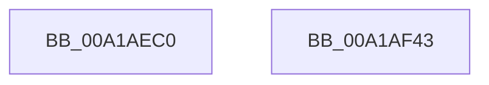

# NtAccessCheckAndAuditAlarm

- RVA: `0x00A1AEC0`–`0x00A1AF44` (길이 `132` bytes)
- VA: `0x0000000140A1AEC0`
- 실행 섹션: `PAGE`
- PDB 이름 있음: `예`; PDB Function 태그: `아니요`
- unwind 정보 RVA: `0x000AA4F0`
- 디코드: `28`개 명령, `132/132` bytes 표시
- 미해석 바이트: `0` (있으면 어셈블리에 `.byte`로 보존)

> 이 문서는 커널 이미지의 기계어와 PDB 기호를 분석해 생성했습니다. 4번과 5번은 함수 원형과 자료형을 바이너리 사용 방식에서 추정한 C 해석이며 원본 소스 복구 결과는 아닙니다.

## 1. Dependencies

- 직접 호출 지점: **1**; 고유 호출 대상: **1**
- 직접 호출자로 확인된 함수: **0**
- RIP 상대 이미지 참조: **0**

### Outgoing calls
- `0x00A1AF36` → [SepAccessCheckAndAuditAlarm](SepAccessCheckAndAuditAlarm_function_00A1AF4C.md) (function, `0x00A1AF4C`)

### Direct callers
- 이 함수 시작 RVA로 연결되는 직접 call은 확인되지 않았습니다. 간접 호출은 완전히 역산할 수 없습니다.

### Static image references
- 디코드된 RIP-relative 메모리 참조가 없습니다.

## 2. Other-region calls and transfers

- 다른 실행 섹션으로 향하는 call: **0**
- 별도 외부 분기/꼬리 이동을 확인하지 못했습니다.

## 3. Assembly (complete function range)

```asm
00A1AEC0  4C 8B DC                        mov r11, rsp
00A1AEC3  48 81 EC 98 00 00 00            sub rsp, 0x98
00A1AECA  48 8B 84 24 F0 00 00 00         mov rax, qword ptr [rsp + 0xf0]
00A1AED2  45 33 D2                        xor r10d, r10d
00A1AED5  45 88 53 E8                     mov byte ptr [r11 - 0x18], r10b
00A1AED9  49 89 43 E0                     mov qword ptr [r11 - 0x20], rax
00A1AEDD  48 8B 84 24 E8 00 00 00         mov rax, qword ptr [rsp + 0xe8]
00A1AEE5  49 89 43 D8                     mov qword ptr [r11 - 0x28], rax
00A1AEE9  48 8B 84 24 E0 00 00 00         mov rax, qword ptr [rsp + 0xe0]
00A1AEF1  49 89 43 D0                     mov qword ptr [r11 - 0x30], rax
00A1AEF5  48 8B 84 24 D0 00 00 00         mov rax, qword ptr [rsp + 0xd0]
00A1AEFD  49 89 43 C8                     mov qword ptr [r11 - 0x38], rax
00A1AF01  8B 84 24 C8 00 00 00            mov eax, dword ptr [rsp + 0xc8]
00A1AF08  45 89 53 C0                     mov dword ptr [r11 - 0x40], r10d
00A1AF0C  4D 89 53 B8                     mov qword ptr [r11 - 0x48], r10
00A1AF10  45 89 53 B0                     mov dword ptr [r11 - 0x50], r10d
00A1AF14  45 89 53 A8                     mov dword ptr [r11 - 0x58], r10d
00A1AF18  89 44 24 38                     mov dword ptr [rsp + 0x38], eax
00A1AF1C  48 8B 84 24 C0 00 00 00         mov rax, qword ptr [rsp + 0xc0]
00A1AF24  4D 89 53 98                     mov qword ptr [r11 - 0x68], r10
00A1AF28  49 89 43 90                     mov qword ptr [r11 - 0x70], rax
00A1AF2C  4D 89 4B 88                     mov qword ptr [r11 - 0x78], r9
00A1AF30  4D 8B C8                        mov r9, r8
00A1AF33  45 33 C0                        xor r8d, r8d
00A1AF36  E8 11 00 00 00                  call 0x140a1af4c
00A1AF3B  48 81 C4 98 00 00 00            add rsp, 0x98
00A1AF42  C3                              ret
00A1AF43  CC                              int3
```

## 4. C-style interpretation (structured pseudocode)

```c
__int64 __fastcall NtAccessCheckAndAuditAlarm(__int64 a1, __int64 a2, __int64 a3, __int64 a4, __int64 a5, unsigned int a6, __int64 a7, __int64 a8, __int64 a9, __int64 a10, __int64 a11)
{
    __int64 result;
    __int64 v_r10;
    __int64 v_rsp;
    unsigned int v_stack_m60;

    v_rsp = (v_rsp) - (152);
    v_r10 = 0;
    *(unsigned __int8 *)(v_rsp - 24) = 0;
    *(unsigned __int64 *)(v_rsp - 32) = a11;
    *(unsigned __int64 *)(v_rsp - 40) = a10;
    *(unsigned __int64 *)(v_rsp - 48) = a9;
    *(unsigned __int64 *)(v_rsp - 56) = a7;
    *(unsigned int *)(v_rsp - 64) = 0;
    *(unsigned __int64 *)(v_rsp - 72) = 0;
    *(unsigned int *)(v_rsp - 80) = 0;
    *(unsigned int *)(v_rsp - 88) = 0;
    v_stack_m60 = (unsigned int)((unsigned int)(a6));
    *(unsigned __int64 *)(v_rsp - 104) = 0;
    *(unsigned __int64 *)(v_rsp - 112) = a5;
    *(unsigned __int64 *)(v_rsp - 120) = a4;
    a3 = 0;
    result = SepAccessCheckAndAuditAlarm(a1, a2, a3, a3);
    v_rsp = (v_rsp) + (152);
    return result;
}
```

## 5. (Beta) C Style

```c
int64_t NtAccessCheckAndAuditAlarm(int64_t Arg1, int64_t Arg2, int64_t Arg3, int64_t Arg4, int64_t Arg5, uint32_t Arg6, int64_t Arg7, uint64_t Arg8, int64_t Arg9, int64_t Arg10, int64_t Arg11)
{
    int64_t result;
    int64_t local_r10;
    int64_t local_rsp;
    uint32_t v_stack_m60;

    local_rsp = (local_rsp) - (152);
    local_r10 = 0;
    *(uint8_t *)(local_rsp - 0x18) = 0;
    *(uint64_t *)(local_rsp - 0x20) = Arg11;
    *(uint64_t *)(local_rsp - 0x28) = Arg10;
    *(uint64_t *)(local_rsp - 0x30) = Arg9;
    *(uint64_t *)(local_rsp - 0x38) = Arg7;
    *(uint32_t *)(local_rsp - 0x40) = 0;
    *(uint64_t *)(local_rsp - 0x48) = 0;
    *(uint32_t *)(local_rsp - 0x50) = 0;
    *(uint32_t *)(local_rsp - 0x58) = 0;
    v_stack_m60 = (uint32_t)((uint32_t)(Arg6));
    *(uint64_t *)(local_rsp - 0x68) = 0;
    *(uint64_t *)(local_rsp - 0x70) = Arg5;
    *(uint64_t *)(local_rsp - 0x78) = Arg4;
    Arg3 = 0;
    result = SepAccessCheckAndAuditAlarm(Arg1, Arg2, Arg3, Arg3);
    local_rsp = (local_rsp) + (152);
    return result;
}
```

## 6. Execution-region graph

[열기: 2D/3D 그래프와 함수 탐색 컨트롤 패널](../../../control-panel.html?section=page&rva=0x00A1AEC0&view=graph)

- 2D 그래프는 위에서 아래로 흐르고, 3D 그래프는 빈 공간을 드래그해 회전합니다. Shift+드래그는 이동, 휠은 확대·축소, 함수 노드 선택은 대상 보고서 이동입니다.

### Static fallback


