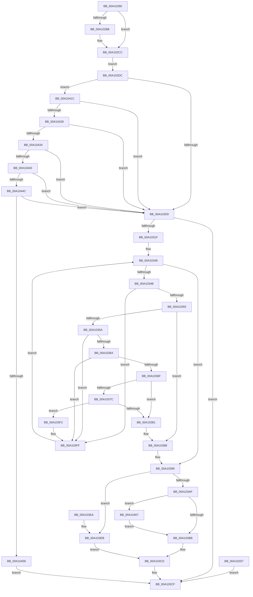

# NtDebugContinue

- RVA: `0x00A10280`–`0x00A10462` (길이 `482` bytes)
- VA: `0x0000000140A10280`
- 실행 섹션: `PAGE`
- PDB 이름 있음: `예`; PDB Function 태그: `아니요`
- unwind 정보 RVA: `0x000A9214`
- 디코드: `117`개 명령, `482/482` bytes 표시
- 미해석 바이트: `0` (있으면 어셈블리에 `.byte`로 보존)

> 이 문서는 커널 이미지의 기계어와 PDB 기호를 분석해 생성했습니다. 4번과 5번은 함수 원형과 자료형을 바이너리 사용 방식에서 추정한 C 해석이며 원본 소스 복구 결과는 아닙니다.

## 1. Dependencies

- 직접 호출 지점: **7**; 고유 호출 대상: **7**
- 직접 호출자로 확인된 함수: **0**
- RIP 상대 이미지 참조: **2**

### Outgoing calls
- `0x00A10310` → [ObReferenceObjectByHandle](../86/ObReferenceObjectByHandle_function_00868DB0.md) (function, `0x00868DB0`)
- `0x00A10330` → [ExAcquireFastMutex](../../text/20/ExAcquireFastMutex_function_0020E5A0.md) (function, `0x0020E5A0`)
- `0x00A10394` → [KeSetEvent](../../text/33/KeSetEvent_function_0033F310.md) (function, `0x0033F310`)
- `0x00A1039D` → [ExReleaseFastMutex](../../text/25/ExReleaseFastMutex_function_002519C0.md) (function, `0x002519C0`)
- `0x00A103A5` → [ObfDereferenceObject](../../text/2F/ObfDereferenceObject_function_002F9350.md) (function, `0x002F9350`)
- `0x00A103C8` → [DbgkpWakeTarget](DbgkpWakeTarget_function_00A106AC.md) (function, `0x00A106AC`)
- `0x00A10415` → [EtwTraceDebuggerEvent](../../text/4D/EtwTraceDebuggerEvent_function_004D2700.md) (function, `0x004D2700`)

### Direct callers
- 이 함수 시작 RVA로 연결되는 직접 call은 확인되지 않았습니다. 간접 호출은 완전히 역산할 수 없습니다.

### Static image references
- `0x00A102E8` → RVA `0x00FC5140` (`ALMOSTRO`; read)
- `0x00A103AF` → RVA `0x00FC6B00` (`ALMOSTRO`; read)

## 2. Other-region calls and transfers

- 다른 실행 섹션으로 향하는 call: **5**
  - `0x00A10330` → [ExAcquireFastMutex](../../text/20/ExAcquireFastMutex_function_0020E5A0.md) (`PAGE` → `.text`)
  - `0x00A10394` → [KeSetEvent](../../text/33/KeSetEvent_function_0033F310.md) (`PAGE` → `.text`)
  - `0x00A1039D` → [ExReleaseFastMutex](../../text/25/ExReleaseFastMutex_function_002519C0.md) (`PAGE` → `.text`)
  - `0x00A103A5` → [ObfDereferenceObject](../../text/2F/ObfDereferenceObject_function_002F9350.md) (`PAGE` → `.text`)
  - `0x00A10415` → [EtwTraceDebuggerEvent](../../text/4D/EtwTraceDebuggerEvent_function_004D2700.md) (`PAGE` → `.text`)
- 별도 외부 분기/꼬리 이동을 확인하지 못했습니다.

## 3. Assembly (complete function range)

```asm
00A10280  48 8B C4                        mov rax, rsp
00A10283  48 89 58 08                     mov qword ptr [rax + 8], rbx
00A10287  48 89 70 10                     mov qword ptr [rax + 0x10], rsi
00A1028B  48 89 78 18                     mov qword ptr [rax + 0x18], rdi
00A1028F  41 54                           push r12
00A10291  41 56                           push r14
00A10293  41 57                           push r15
00A10295  48 83 EC 50                     sub rsp, 0x50
00A10299  41 8B D8                        mov ebx, r8d
00A1029C  0F 57 C0                        xorps xmm0, xmm0
00A1029F  0F 11 40 D8                     movups xmmword ptr [rax - 0x28], xmm0
00A102A3  65 48 8B 04 25 88 01 00 00      mov rax, qword ptr gs:[0x188]
00A102AC  44 8A 88 32 02 00 00            mov r9b, byte ptr [rax + 0x232]
00A102B3  45 84 C9                        test r9b, r9b
00A102B6  74 14                           je 0x140a102cc
00A102B8  48 B8 00 00 FF FF FF 7F 00 00   movabs rax, 0x7fffffff0000
00A102C2  48 3B D0                        cmp rdx, rax
00A102C5  48 0F 42 C2                     cmovb rax, rdx
00A102C9  90                              nop
00A102CA  8A 00                           mov al, byte ptr [rax]
00A102CC  0F 10 02                        movups xmm0, xmmword ptr [rdx]
00A102CF  F3 0F 7F 44 24 40               movdqu xmmword ptr [rsp + 0x40], xmm0
00A102D5  EB 05                           jmp 0x140a102dc
00A102D7  E9 F3 00 00 00                  jmp 0x140a103cf
00A102DC  81 FB 02 00 01 00               cmp ebx, 0x10002
00A102E2  0F 85 34 01 00 00               jne 0x140a1041c
00A102E8  4C 8B 05 51 4E 5B 00            mov r8, qword ptr [rip + 0x5b4e51]
00A102EF  48 83 A4 24 88 00 00 00 00      and qword ptr [rsp + 0x88], 0
00A102F8  48 83 64 24 28 00               and qword ptr [rsp + 0x28], 0
00A102FE  48 8D 84 24 88 00 00 00         lea rax, [rsp + 0x88]
00A10306  48 89 44 24 20                  mov qword ptr [rsp + 0x20], rax
00A1030B  BA 01 00 00 00                  mov edx, 1
00A10310  E8 9B 8A E5 FF                  call 0x140868db0
00A10315  8B F8                           mov edi, eax
00A10317  85 C0                           test eax, eax
00A10319  0F 88 B0 00 00 00               js 0x140a103cf
00A1031F  45 32 FF                        xor r15b, r15b
00A10322  33 F6                           xor esi, esi
00A10324  4C 8B B4 24 88 00 00 00         mov r14, qword ptr [rsp + 0x88]
00A1032C  49 8D 4E 18                     lea rcx, [r14 + 0x18]
00A10330  E8 6B E2 7F FF                  call 0x14020e5a0
00A10335  4D 8D 46 50                     lea r8, [r14 + 0x50]
00A10339  49 8B 08                        mov rcx, qword ptr [r8]
00A1033C  4C 8B 4C 24 48                  mov r9, qword ptr [rsp + 0x48]
00A10341  4C 8B 54 24 40                  mov r10, qword ptr [rsp + 0x40]
00A10346  49 3B C8                        cmp rcx, r8
00A10349  74 4E                           je 0x140a10399
00A1034B  4C 39 51 28                     cmp qword ptr [rcx + 0x28], r10
00A1034F  0F 85 AA 00 00 00               jne 0x140a103ff
00A10355  45 84 FF                        test r15b, r15b
00A10358  75 2E                           jne 0x140a10388
00A1035A  4C 39 49 30                     cmp qword ptr [rcx + 0x30], r9
00A1035E  0F 85 9B 00 00 00               jne 0x140a103ff
00A10364  8B 41 4C                        mov eax, dword ptr [rcx + 0x4c]
00A10367  A8 01                           test al, 1
00A10369  0F 84 90 00 00 00               je 0x140a103ff
00A1036F  48 8B 11                        mov rdx, qword ptr [rcx]
00A10372  48 8B 41 08                     mov rax, qword ptr [rcx + 8]
00A10376  48 39 4A 08                     cmp qword ptr [rdx + 8], rcx
00A1037A  75 05                           jne 0x140a10381
00A1037C  48 39 08                        cmp qword ptr [rax], rcx
00A1037F  74 71                           je 0x140a103f2
00A10381  B9 03 00 00 00                  mov ecx, 3
00A10386  CD 29                           int 0x29
00A10388  83 61 4C FB                     and dword ptr [rcx + 0x4c], 0xfffffffb
00A1038C  45 33 C0                        xor r8d, r8d
00A1038F  33 D2                           xor edx, edx
00A10391  49 8B CE                        mov rcx, r14
00A10394  E8 77 EF 92 FF                  call 0x14033f310
00A10399  49 8D 4E 18                     lea rcx, [r14 + 0x18]
00A1039D  E8 1E 16 84 FF                  call 0x1402519c0
00A103A2  49 8B CE                        mov rcx, r14
00A103A5  E8 A6 8F 8E FF                  call 0x1402f9350
00A103AA  45 84 FF                        test r15b, r15b
00A103AD  74 3C                           je 0x140a103eb
00A103AF  F7 05 47 67 5B 00 00 00 40 00   test dword ptr [rip + 0x5b6747], 0x400000
00A103B9  75 4C                           jne 0x140a10407
00A103BB  89 9E 84 00 00 00               mov dword ptr [rsi + 0x84], ebx
00A103C1  83 66 48 00                     and dword ptr [rsi + 0x48], 0
00A103C5  48 8B CE                        mov rcx, rsi
00A103C8  E8 DF 02 00 00                  call 0x140a106ac
00A103CD  8B C7                           mov eax, edi
00A103CF  4C 8D 5C 24 50                  lea r11, [rsp + 0x50]
00A103D4  49 8B 5B 20                     mov rbx, qword ptr [r11 + 0x20]
00A103D8  49 8B 73 28                     mov rsi, qword ptr [r11 + 0x28]
00A103DC  49 8B 7B 30                     mov rdi, qword ptr [r11 + 0x30]
00A103E0  49 8B E3                        mov rsp, r11
00A103E3  41 5F                           pop r15
00A103E5  41 5E                           pop r14
00A103E7  41 5C                           pop r12
00A103E9  C3                              ret
00A103EA  CC                              int3
00A103EB  BF 0D 00 00 C0                  mov edi, 0xc000000d
00A103F0  EB DB                           jmp 0x140a103cd
00A103F2  48 89 10                        mov qword ptr [rax], rdx
00A103F5  48 89 42 08                     mov qword ptr [rdx + 8], rax
00A103F9  48 8B F1                        mov rsi, rcx
00A103FC  41 B7 01                        mov r15b, 1
00A103FF  48 8B 09                        mov rcx, qword ptr [rcx]
00A10402  E9 3F FF FF FF                  jmp 0x140a10346
00A10407  41 B8 02 00 00 00               mov r8d, 2
00A1040D  48 8B 56 40                     mov rdx, qword ptr [rsi + 0x40]
00A10411  48 8B 4E 38                     mov rcx, qword ptr [rsi + 0x38]
00A10415  E8 E6 22 AC FF                  call 0x1404d2700
00A1041A  EB 9F                           jmp 0x140a103bb
00A1041C  81 FB 01 00 01 80               cmp ebx, 0x80010001
00A10422  0F 84 C0 FE FF FF               je 0x140a102e8
00A10428  81 FB 01 00 01 00               cmp ebx, 0x10001
00A1042E  0F 84 B4 FE FF FF               je 0x140a102e8
00A10434  81 FB 01 00 01 40               cmp ebx, 0x40010001
00A1043A  0F 84 A8 FE FF FF               je 0x140a102e8
00A10440  81 FB 03 00 01 40               cmp ebx, 0x40010003
00A10446  0F 84 9C FE FF FF               je 0x140a102e8
00A1044C  81 FB 04 00 01 40               cmp ebx, 0x40010004
00A10452  0F 84 90 FE FF FF               je 0x140a102e8
00A10458  B8 0D 00 00 C0                  mov eax, 0xc000000d
00A1045D  E9 6D FF FF FF                  jmp 0x140a103cf
```

## 4. C-style interpretation (structured pseudocode)

```c
__int64 __fastcall NtDebugContinue(__int64 a1, __int64 a2, int a3)
{
    __int64 result;
    __int64 v_r15;
    __int64 v_rsi;
    __int64 v_rsp;
    unsigned __int64 v_stack_m18;
    unsigned __int64 v_stack_m20;
    unsigned __int64 v_stack_m28;
    unsigned __int64 v_stack_m40;
    unsigned __int64 v_stack_m48;
    unsigned __int64 v_stack_p20;

    *(unsigned __int64 *)(v_rsp + 8) = v_rbx;
    *(unsigned __int64 *)(v_rsp + 16) = v_rsi;
    *(unsigned __int64 *)(v_rsp + 24) = v_rdi;
    v_rsp = (v_rsp) - (80);
    *(unsigned __int64 *)(v_rsp - 40) = v_xmm0;
    result = *(unsigned __int64 *)(gs_base + (0 + 392));
    if ((unsigned __int8)(*(unsigned __int8 *)(*(unsigned __int64 *)(gs_base + (0 + 392)) + 562)) != 0) {
        result = *(unsigned __int64 *)(gs_base + (0 + 392));
        if (a2 < (*(unsigned __int64 *)(gs_base + (0 + 392)))) { result = a2; }
        result = *(unsigned __int8 *)(result);
    }
    v_stack_m28 = v_xmm0;
    goto loc_00A102DC;
loc_00A102DC:
    if (((unsigned int)((unsigned int)(a3))) != 0x10002ULL) goto loc_00A1041C;
loc_00A102E8:
    v_stack_m48 = v_stack_p20;
    result = ObReferenceObjectByHandle(a1, 1, *(unsigned __int64 *)(v_rip + 5983825), *(unsigned __int8 *)(*(unsigned __int64 *)(gs_base + (0 + 392)) + 562));
    if (sign_flag) goto loc_00A103CF;
    v_r15 = 0;
    v_rsi = 0;
    result = ExAcquireFastMutex(v_stack_p20 + 24, 1, *(unsigned __int64 *)(v_rip + 5983825), *(unsigned __int8 *)(*(unsigned __int64 *)(gs_base + (0 + 392)) + 562));
loc_00A10346:
    if ((*(unsigned __int64 *)(v_stack_p20 + 80)) == (v_stack_p20 + 80)) goto loc_00A10399;
    if ((*(unsigned __int64 *)(*(unsigned __int64 *)(v_stack_p20 + 80) + 40)) != v_stack_m28) goto loc_00A103FF;
    if (0 != 0) goto loc_00A10388;
    if ((*(unsigned __int64 *)(*(unsigned __int64 *)(v_stack_p20 + 80) + 48)) != v_stack_m20) goto loc_00A103FF;
    if ((((unsigned __int8)((unsigned int)(*(unsigned int *)(*(unsigned __int64 *)(v_stack_p20 + 80) + 76)))) & (1)) == 0) goto loc_00A103FF;
    if ((*(unsigned __int64 *)(*(unsigned __int64 *)(*(unsigned __int64 *)(v_stack_p20 + 80)) + 8)) != (*(unsigned __int64 *)(v_stack_p20 + 80))) goto loc_00A10381;
    if ((*(unsigned __int64 *)(*(unsigned __int64 *)(*(unsigned __int64 *)(v_stack_p20 + 80) + 8))) == (*(unsigned __int64 *)(v_stack_p20 + 80))) goto loc_00A103F2;
loc_00A10381:
loc_00A10388:
    a3 = 0;
    a2 = 0;
    result = KeSetEvent(v_stack_p20, a2, a3, v_stack_m20);
loc_00A10399:
    result = ExReleaseFastMutex(v_stack_p20 + 24, a2, a3, v_stack_m20);
    result = ObfDereferenceObject(v_stack_p20, a2, a3, v_stack_m20);
    if (0 == 0) goto loc_00A103EB;
    if (((*(unsigned int *)(v_rip + 5990215)) & (0x400000ULL)) != 0) goto loc_00A10407;
loc_00A103BB:
    *(unsigned int *)(v_rsi + 132) = (unsigned int)((unsigned int)(a3));
    result = DbgkpWakeTarget(0, a2, a3, v_stack_m20);
loc_00A103CD:
loc_00A103CF:
    return (unsigned int)((unsigned int)((unsigned int)((unsigned int)(result))));
loc_00A103EB:
    goto loc_00A103CD;
loc_00A103F2:
    *(unsigned __int64 *)((unsigned int)((unsigned int)((unsigned int)((unsigned int)(result))))) = 0;
    *(unsigned __int64 *)(a2 + 8) = (unsigned int)((unsigned int)((unsigned int)((unsigned int)(result))));
loc_00A103FF:
    goto loc_00A10346;
loc_00A10407:
    result = EtwTraceDebuggerEvent(*(unsigned __int64 *)(0 + 56), *(unsigned __int64 *)(0 + 64), 2, v_stack_m20);
    goto loc_00A103BB;
loc_00A1041C:
    if (((unsigned int)(*(unsigned __int64 *)(v_stack_m18 + 32))) == 0x80010001ULL) goto loc_00A102E8;
    if (((unsigned int)(*(unsigned __int64 *)(v_stack_m18 + 32))) == 0x10001ULL) goto loc_00A102E8;
    if (((unsigned int)(*(unsigned __int64 *)(v_stack_m18 + 32))) == 0x40010001ULL) goto loc_00A102E8;
    if (((unsigned int)(*(unsigned __int64 *)(v_stack_m18 + 32))) == 0x40010003ULL) goto loc_00A102E8;
    if (((unsigned int)(*(unsigned __int64 *)(v_stack_m18 + 32))) == 0x40010004ULL) goto loc_00A102E8;
    goto loc_00A103CF;
}
```

## 5. (Beta) C Style

```c
int64_t NtDebugContinue(int64_t Arg1, int64_t Arg2, int32_t Arg3)
{
    int64_t result;
    int64_t local_r15;
    int64_t local_rsi;
    int64_t local_rsp;
    uint64_t v_stack_m18;
    uint64_t v_stack_m20;
    uint64_t v_stack_m28;
    uint64_t v_stack_m40;
    uint64_t v_stack_m48;
    uint64_t v_stack_p20;

    *(uint64_t *)(local_rsp + 0x8) = local_rbx;
    *(uint64_t *)(local_rsp + 0x10) = local_rsi;
    *(uint64_t *)(local_rsp + 0x18) = local_rdi;
    local_rsp = (local_rsp) - (80);
    *(uint64_t *)(local_rsp - 0x28) = v_xmm0;
    result = *(uint64_t *)(gs_base + (0 + 0x188));
    if ((uint8_t)(*(uint8_t *)(*(uint64_t *)(gs_base + (0 + 0x188)) + 0x232)) != 0) {
        result = *(uint64_t *)(gs_base + (0 + 0x188));
        if (Arg2 < (*(uint64_t *)(gs_base + (0 + 0x188)))) { result = Arg2; }
        result = *(uint8_t *)(result);
    }
    v_stack_m28 = v_xmm0;
    goto loc_00A102DC;
loc_00A102DC:
    if (((uint32_t)((uint32_t)(Arg3))) != 0x10002ULL) goto loc_00A1041C;
loc_00A102E8:
    v_stack_m48 = v_stack_p20;
    result = ObReferenceObjectByHandle(Arg1, 1, *(uint64_t *)(v_rip + 0x5B4E51), *(uint8_t *)(*(uint64_t *)(gs_base + (0 + 0x188)) + 0x232));
    if (sign_flag) goto loc_00A103CF;
    local_r15 = 0;
    local_rsi = 0;
    result = ExAcquireFastMutex(v_stack_p20 + 24, 1, *(uint64_t *)(v_rip + 0x5B4E51), *(uint8_t *)(*(uint64_t *)(gs_base + (0 + 0x188)) + 0x232));
loc_00A10346:
    if ((*(uint64_t *)(v_stack_p20 + 0x50)) == (v_stack_p20 + 80)) goto loc_00A10399;
    if ((*(uint64_t *)(*(uint64_t *)(v_stack_p20 + 0x50) + 0x28)) != v_stack_m28) goto loc_00A103FF;
    if (0 != 0) goto loc_00A10388;
    if ((*(uint64_t *)(*(uint64_t *)(v_stack_p20 + 0x50) + 0x30)) != v_stack_m20) goto loc_00A103FF;
    if ((((uint8_t)((uint32_t)(*(uint32_t *)(*(uint64_t *)(v_stack_p20 + 0x50) + 0x4C)))) & (1)) == 0) goto loc_00A103FF;
    if ((*(uint64_t *)(*(uint64_t *)(*(uint64_t *)(v_stack_p20 + 0x50)) + 0x8)) != (*(uint64_t *)(v_stack_p20 + 0x50))) goto loc_00A10381;
    if ((*(uint64_t *)(*(uint64_t *)(*(uint64_t *)(v_stack_p20 + 0x50) + 0x8))) == (*(uint64_t *)(v_stack_p20 + 0x50))) goto loc_00A103F2;
loc_00A10381:
loc_00A10388:
    Arg3 = 0;
    Arg2 = 0;
    result = KeSetEvent(v_stack_p20, Arg2, Arg3, v_stack_m20);
loc_00A10399:
    result = ExReleaseFastMutex(v_stack_p20 + 24, Arg2, Arg3, v_stack_m20);
    result = ObfDereferenceObject(v_stack_p20, Arg2, Arg3, v_stack_m20);
    if (0 == 0) goto loc_00A103EB;
    if (((*(uint32_t *)(v_rip + 0x5B6747)) & (0x400000ULL)) != 0) goto loc_00A10407;
loc_00A103BB:
    *(uint32_t *)(local_rsi + 0x84) = (uint32_t)((uint32_t)(Arg3));
    result = DbgkpWakeTarget(0, Arg2, Arg3, v_stack_m20);
loc_00A103CD:
loc_00A103CF:
    return (uint32_t)((uint32_t)((uint32_t)((uint32_t)(result))));
loc_00A103EB:
    goto loc_00A103CD;
loc_00A103F2:
    *(uint64_t *)((uint32_t)((uint32_t)((uint32_t)((uint32_t)(result))))) = 0;
    *(uint64_t *)(Arg2 + 0x8) = (uint32_t)((uint32_t)((uint32_t)((uint32_t)(result))));
loc_00A103FF:
    goto loc_00A10346;
loc_00A10407:
    result = EtwTraceDebuggerEvent(*(uint64_t *)(0 + 0x38), *(uint64_t *)(0 + 0x40), 2, v_stack_m20);
    goto loc_00A103BB;
loc_00A1041C:
    if (((uint32_t)(*(uint64_t *)(v_stack_m18 + 0x20))) == 0x80010001ULL) goto loc_00A102E8;
    if (((uint32_t)(*(uint64_t *)(v_stack_m18 + 0x20))) == 0x10001ULL) goto loc_00A102E8;
    if (((uint32_t)(*(uint64_t *)(v_stack_m18 + 0x20))) == 0x40010001ULL) goto loc_00A102E8;
    if (((uint32_t)(*(uint64_t *)(v_stack_m18 + 0x20))) == 0x40010003ULL) goto loc_00A102E8;
    if (((uint32_t)(*(uint64_t *)(v_stack_m18 + 0x20))) == 0x40010004ULL) goto loc_00A102E8;
    goto loc_00A103CF;
}
```

## 6. Execution-region graph

[열기: 2D/3D 그래프와 함수 탐색 컨트롤 패널](../../../control-panel.html?section=page&rva=0x00A10280&view=graph)

- 2D 그래프는 위에서 아래로 흐르고, 3D 그래프는 빈 공간을 드래그해 회전합니다. Shift+드래그는 이동, 휠은 확대·축소, 함수 노드 선택은 대상 보고서 이동입니다.

### Static fallback


