# NtGetNlsSectionPtr

- RVA: `0x00A195B0`–`0x00A19ACA` (길이 `1,306` bytes)
- VA: `0x0000000140A195B0`
- 실행 섹션: `PAGE`
- PDB 이름 있음: `예`; PDB Function 태그: `아니요`
- unwind 정보 RVA: `0x000AA324`
- 디코드: `272`개 명령, `1,306/1,306` bytes 표시
- 미해석 바이트: `0` (있으면 어셈블리에 `.byte`로 보존)

> 이 문서는 커널 이미지의 기계어와 PDB 기호를 분석해 생성했습니다. 4번과 5번은 함수 원형과 자료형을 바이너리 사용 방식에서 추정한 C 해석이며 원본 소스 복구 결과는 아닙니다.

## 1. Dependencies

- 직접 호출 지점: **17**; 고유 호출 대상: **15**
- 직접 호출자로 확인된 함수: **2**
- RIP 상대 이미지 참조: **4**

### Outgoing calls
- `0x00A196AD` → [RtlpInitNlsSectionName](RtlpInitNlsSectionName_function_00A19AD0.md) (function, `0x00A19AD0`)
- `0x00A1971D` → [ZwOpenSection](../../text/6A/ZwOpenSection_function_006AD7B0.md) (function, `0x006AD7B0`)
- `0x00A1975F` → [ObReferenceObjectByHandle](../86/ObReferenceObjectByHandle_function_00868DB0.md) (function, `0x00868DB0`)
- `0x00A1976B` → [ZwClose](../../text/6A/ZwClose_function_006AD2B0.md) (function, `0x006AD2B0`)
- `0x00A197A5` → [MiSectionControlArea](../../text/29/MiSectionControlArea_function_00294CB0.md) (function, `0x00294CB0`)
- `0x00A197BD` → [memset](../../text/6C/memset_function_006C6C40.md) (function, `0x006C6C40`)
- `0x00A19896` → [MiMapViewOfSection](../89/MiMapViewOfSection_function_00898F10.md) (function, `0x00898F10`)
- `0x00A198B3` → [ObfDereferenceObject](../../text/2F/ObfDereferenceObject_function_002F9350.md) (function, `0x002F9350`)
- `0x00A198EF` → [_security_check_cookie](../../text/6A/_security_check_cookie_function_006AC640.md) (function, `0x006AC640`)
- `0x00A1995C` → [RtlpInitNlsFileName](RtlpInitNlsFileName_function_00A19B9C.md) (function, `0x00A19B9C`)
- `0x00A199CD` → [ZwOpenFile](../../text/6A/ZwOpenFile_function_006AD730.md) (function, `0x006AD730`)
- `0x00A19A08` → [ZwCreateSection](../../text/6A/ZwCreateSection_function_006ADA10.md) (function, `0x006ADA10`)
- `0x00A19A14` → [ZwClose](../../text/6A/ZwClose_function_006AD2B0.md) (function, `0x006AD2B0`)
- `0x00A19A30` → [MiSectionControlArea](../../text/29/MiSectionControlArea_function_00294CB0.md) (function, `0x00294CB0`)
- `0x00A19A3B` → [MiCheckPurgeAndUpMapCount](../../text/41/MiCheckPurgeAndUpMapCount_function_004186B0.md) (function, `0x004186B0`)
- `0x00A19A6E` → [MiInsertInSystemSpace](../../text/3B/MiInsertInSystemSpace_function_003B2F5C.md) (function, `0x003B2F5C`)
- `0x00A19A8E` → [MiDereferenceControlArea](../../text/47/MiDereferenceControlArea_function_00479A20.md) (function, `0x00479A20`)

### Direct callers
- [RtlpInitCodePageTables](../78/RtlpInitCodePageTables_function_0078C0F4.md) at `0x0078C15D`
- [RtlpInitCodePageTables](../78/RtlpInitCodePageTables_function_0078C0F4.md) at `0x0078C185`
- [RtlpInitUppercaseTables](../78/RtlpInitUppercaseTables_function_0078C29C.md) at `0x0078C2C7`

### Static image references
- `0x00A195C3` → RVA `0x00E0A740` (`.data`; read)
- `0x00A19737` → RVA `0x00FC6BD8` (`ALMOSTRO`; read)
- `0x00A19913` → RVA `0x00E302A8` (`.data`; read/write)
- `0x00A19ABF` → RVA `0x00E302AC` (`.data`; read/write)

## 2. Other-region calls and transfers

- 다른 실행 섹션으로 향하는 call: **13**
  - `0x00A1971D` → [ZwOpenSection](../../text/6A/ZwOpenSection_function_006AD7B0.md) (`PAGE` → `.text`)
  - `0x00A1976B` → [ZwClose](../../text/6A/ZwClose_function_006AD2B0.md) (`PAGE` → `.text`)
  - `0x00A197A5` → [MiSectionControlArea](../../text/29/MiSectionControlArea_function_00294CB0.md) (`PAGE` → `.text`)
  - `0x00A197BD` → [memset](../../text/6C/memset_function_006C6C40.md) (`PAGE` → `.text`)
  - `0x00A198B3` → [ObfDereferenceObject](../../text/2F/ObfDereferenceObject_function_002F9350.md) (`PAGE` → `.text`)
  - `0x00A198EF` → [_security_check_cookie](../../text/6A/_security_check_cookie_function_006AC640.md) (`PAGE` → `.text`)
  - `0x00A199CD` → [ZwOpenFile](../../text/6A/ZwOpenFile_function_006AD730.md) (`PAGE` → `.text`)
  - `0x00A19A08` → [ZwCreateSection](../../text/6A/ZwCreateSection_function_006ADA10.md) (`PAGE` → `.text`)
  - `0x00A19A14` → [ZwClose](../../text/6A/ZwClose_function_006AD2B0.md) (`PAGE` → `.text`)
  - `0x00A19A30` → [MiSectionControlArea](../../text/29/MiSectionControlArea_function_00294CB0.md) (`PAGE` → `.text`)
  - `0x00A19A3B` → [MiCheckPurgeAndUpMapCount](../../text/41/MiCheckPurgeAndUpMapCount_function_004186B0.md) (`PAGE` → `.text`)
  - `0x00A19A6E` → [MiInsertInSystemSpace](../../text/3B/MiInsertInSystemSpace_function_003B2F5C.md) (`PAGE` → `.text`)
  - `0x00A19A8E` → [MiDereferenceControlArea](../../text/47/MiDereferenceControlArea_function_00479A20.md) (`PAGE` → `.text`)
- 별도 외부 분기/꼬리 이동을 확인하지 못했습니다.

## 3. Assembly (complete function range)

```asm
00A195B0  40 53                           push rbx
00A195B2  56                              push rsi
00A195B3  57                              push rdi
00A195B4  41 54                           push r12
00A195B6  41 55                           push r13
00A195B8  41 56                           push r14
00A195BA  41 57                           push r15
00A195BC  48 81 EC B0 02 00 00            sub rsp, 0x2b0
00A195C3  48 8B 05 76 11 3F 00            mov rax, qword ptr [rip + 0x3f1176]
00A195CA  48 33 C4                        xor rax, rsp
00A195CD  48 89 84 24 A0 02 00 00         mov qword ptr [rsp + 0x2a0], rax
00A195D5  4D 8B F1                        mov r14, r9
00A195D8  49 8B F8                        mov rdi, r8
00A195DB  44 8B EA                        mov r13d, edx
00A195DE  8B F1                           mov esi, ecx
00A195E0  4C 8B BC 24 10 03 00 00         mov r15, qword ptr [rsp + 0x310]
00A195E8  33 DB                           xor ebx, ebx
00A195EA  89 9C 24 8C 00 00 00            mov dword ptr [rsp + 0x8c], ebx
00A195F1  89 9C 24 A4 00 00 00            mov dword ptr [rsp + 0xa4], ebx
00A195F8  0F 57 C0                        xorps xmm0, xmm0
00A195FB  0F 11 84 24 B8 00 00 00         movups xmmword ptr [rsp + 0xb8], xmm0
00A19603  48 89 5C 24 70                  mov qword ptr [rsp + 0x70], rbx
00A19608  48 89 5C 24 60                  mov qword ptr [rsp + 0x60], rbx
00A1960D  0F 11 84 24 90 01 00 00         movups xmmword ptr [rsp + 0x190], xmm0
00A19615  48 89 5C 24 50                  mov qword ptr [rsp + 0x50], rbx
00A1961A  48 89 5C 24 58                  mov qword ptr [rsp + 0x58], rbx
00A1961F  4D 85 C9                        test r9, r9
00A19622  0F 84 70 04 00 00               je 0x140a19a98
00A19628  65 48 8B 04 25 88 01 00 00      mov rax, qword ptr gs:[0x188]
00A19631  44 8A A0 32 02 00 00            mov r12b, byte ptr [rax + 0x232]
00A19638  45 84 E4                        test r12b, r12b
00A1963B  74 56                           je 0x140a19693
00A1963D  48 BA 00 00 FF FF FF 7F 00 00   movabs rdx, 0x7fffffff0000
00A19647  4D 85 F6                        test r14, r14
00A1964A  74 10                           je 0x140a1965c
00A1964C  48 8B CA                        mov rcx, rdx
00A1964F  4C 3B F2                        cmp r14, rdx
00A19652  49 0F 42 CE                     cmovb rcx, r14
00A19656  48 8B 01                        mov rax, qword ptr [rcx]
00A19659  48 89 01                        mov qword ptr [rcx], rax
00A1965C  4D 85 FF                        test r15, r15
00A1965F  74 10                           je 0x140a19671
00A19661  48 8B CA                        mov rcx, rdx
00A19664  4C 3B FA                        cmp r15, rdx
00A19667  49 0F 42 CF                     cmovb rcx, r15
00A1966B  48 8B 01                        mov rax, qword ptr [rcx]
00A1966E  48 89 01                        mov qword ptr [rcx], rax
00A19671  48 85 FF                        test rdi, rdi
00A19674  74 0D                           je 0x140a19683
00A19676  48 3B FA                        cmp rdi, rdx
00A19679  48 0F 42 D7                     cmovb rdx, rdi
00A1967D  48 8B 02                        mov rax, qword ptr [rdx]
00A19680  48 89 02                        mov qword ptr [rdx], rax
00A19683  EB 05                           jmp 0x140a1968a
00A19685  E9 5A 02 00 00                  jmp 0x140a198e4
00A1968A  48 85 FF                        test rdi, rdi
00A1968D  0F 85 18 04 00 00               jne 0x140a19aab
00A19693  48 8D 84 24 B8 00 00 00         lea rax, [rsp + 0xb8]
00A1969B  48 89 44 24 20                  mov qword ptr [rsp + 0x20], rax
00A196A0  4C 8D 84 24 A0 01 00 00         lea r8, [rsp + 0x1a0]
00A196A8  41 8B D5                        mov edx, r13d
00A196AB  8B CE                           mov ecx, esi
00A196AD  E8 1E 04 00 00                  call 0x140a19ad0
00A196B2  85 C0                           test eax, eax
00A196B4  0F 88 2A 02 00 00               js 0x140a198e4
00A196BA  C7 84 24 88 00 00 00 30 00 00 00  mov dword ptr [rsp + 0x88], 0x30
00A196C5  48 89 9C 24 90 00 00 00         mov qword ptr [rsp + 0x90], rbx
00A196CD  C7 84 24 A0 00 00 00 D0 02 00 00  mov dword ptr [rsp + 0xa0], 0x2d0
00A196D8  48 8D 84 24 B8 00 00 00         lea rax, [rsp + 0xb8]
00A196E0  48 89 84 24 98 00 00 00         mov qword ptr [rsp + 0x98], rax
00A196E8  0F 57 C0                        xorps xmm0, xmm0
00A196EB  F3 0F 7F 84 24 A8 00 00 00      movdqu xmmword ptr [rsp + 0xa8], xmm0
00A196F4  8D 46 F5                        lea eax, [rsi - 0xb]
00A196F7  A9 FC FF FF FF                  test eax, 0xfffffffc
00A196FC  0F 85 B3 03 00 00               jne 0x140a19ab5
00A19702  83 FE 0D                        cmp esi, 0xd
00A19705  0F 84 AA 03 00 00               je 0x140a19ab5
00A1970B  4C 8D 84 24 88 00 00 00         lea r8, [rsp + 0x88]
00A19713  BA 04 00 00 00                  mov edx, 4
00A19718  48 8D 4C 24 60                  lea rcx, [rsp + 0x60]
00A1971D  E8 8E 40 C9 FF                  call 0x1406ad7b0
00A19722  8B D8                           mov ebx, eax
00A19724  85 C0                           test eax, eax
00A19726  0F 88 F4 01 00 00               js 0x140a19920
00A1972C  45 33 ED                        xor r13d, r13d
00A1972F  85 DB                           test ebx, ebx
00A19731  0F 88 AB 01 00 00               js 0x140a198e2
00A19737  4C 8B 05 9A D4 5A 00            mov r8, qword ptr [rip + 0x5ad49a]
00A1973E  4C 89 6C 24 48                  mov qword ptr [rsp + 0x48], r13
00A19743  4C 89 6C 24 28                  mov qword ptr [rsp + 0x28], r13
00A19748  48 8D 44 24 48                  lea rax, [rsp + 0x48]
00A1974D  48 89 44 24 20                  mov qword ptr [rsp + 0x20], rax
00A19752  45 33 C9                        xor r9d, r9d
00A19755  BA 1F 00 0F 00                  mov edx, 0xf001f
00A1975A  48 8B 4C 24 60                  mov rcx, qword ptr [rsp + 0x60]
00A1975F  E8 4C F6 E4 FF                  call 0x140868db0
00A19764  8B D8                           mov ebx, eax
00A19766  48 8B 4C 24 60                  mov rcx, qword ptr [rsp + 0x60]
00A1976B  E8 40 3B C9 FF                  call 0x1406ad2b0
00A19770  85 DB                           test ebx, ebx
00A19772  0F 88 6A 01 00 00               js 0x140a198e2
00A19778  4D 85 F6                        test r14, r14
00A1977B  0F 84 98 01 00 00               je 0x140a19919
00A19781  48 83 64 24 78 00               and qword ptr [rsp + 0x78], 0
00A19787  45 84 E4                        test r12b, r12b
00A1978A  0F 84 8E 02 00 00               je 0x140a19a1e
00A19790  65 48 8B 04 25 88 01 00 00      mov rax, qword ptr gs:[0x188]
00A19799  48 8B 98 B8 00 00 00            mov rbx, qword ptr [rax + 0xb8]
00A197A0  48 8B 4C 24 48                  mov rcx, qword ptr [rsp + 0x48]
00A197A5  E8 06 B5 87 FF                  call 0x140294cb0
00A197AA  48 8B F0                        mov rsi, rax
00A197AD  33 D2                           xor edx, edx
00A197AF  41 B8 80 00 00 00               mov r8d, 0x80
00A197B5  48 8D 8C 24 10 01 00 00         lea rcx, [rsp + 0x110]
00A197BD  E8 7E D4 CA FF                  call 0x1406c6c40
00A197C2  65 48 8B 0C 25 88 01 00 00      mov rcx, qword ptr gs:[0x188]
00A197CB  48 8B 91 B8 00 00 00            mov rdx, qword ptr [rcx + 0xb8]
00A197D2  48 89 94 24 70 01 00 00         mov qword ptr [rsp + 0x170], rdx
00A197DA  48 89 9C 24 68 01 00 00         mov qword ptr [rsp + 0x168], rbx
00A197E2  65 48 8B 0C 25 88 01 00 00      mov rcx, qword ptr gs:[0x188]
00A197EB  8A 91 32 02 00 00               mov dl, byte ptr [rcx + 0x232]
00A197F1  88 94 24 49 01 00 00            mov byte ptr [rsp + 0x149], dl
00A197F8  44 89 AC 24 44 01 00 00         mov dword ptr [rsp + 0x144], r13d
00A19800  C7 84 24 38 01 00 00 00 00 40 00  mov dword ptr [rsp + 0x138], 0x400000
00A1980B  C7 84 24 3C 01 00 00 02 00 00 00  mov dword ptr [rsp + 0x13c], 2
00A19816  44 89 AC 24 50 01 00 00         mov dword ptr [rsp + 0x150], r13d
00A1981E  4C 39 6C 24 50                  cmp qword ptr [rsp + 0x50], r13
00A19823  74 08                           je 0x140a1982d
00A19825  83 8C 24 4C 01 00 00 01         or dword ptr [rsp + 0x14c], 1
00A1982D  4C 89 AC 24 28 01 00 00         mov qword ptr [rsp + 0x128], r13
00A19835  8B 46 38                        mov eax, dword ptr [rsi + 0x38]
00A19838  48 8B 83 68 03 00 00            mov rax, qword ptr [rbx + 0x368]
00A1983F  48 B9 FF FF FE FF FF 7F 00 00   movabs rcx, 0x7ffffffeffff
00A19849  48 FF C8                        dec rax
00A1984C  48 3B C1                        cmp rax, rcx
00A1984F  48 0F 43 C1                     cmovae rax, rcx
00A19853  48 89 84 24 18 01 00 00         mov qword ptr [rsp + 0x118], rax
00A1985B  48 C7 84 24 20 01 00 00 00 00 01 00  mov qword ptr [rsp + 0x120], 0x10000
00A19867  C7 44 24 30 01 00 00 00         mov dword ptr [rsp + 0x30], 1
00A1986F  C7 44 24 28 01 00 00 00         mov dword ptr [rsp + 0x28], 1
00A19877  48 8D 44 24 78                  lea rax, [rsp + 0x78]
00A1987C  48 89 44 24 20                  mov qword ptr [rsp + 0x20], rax
00A19881  45 33 C9                        xor r9d, r9d
00A19884  4C 8D 44 24 50                  lea r8, [rsp + 0x50]
00A19889  48 8D 94 24 10 01 00 00         lea rdx, [rsp + 0x110]
00A19891  48 8B 4C 24 48                  mov rcx, qword ptr [rsp + 0x48]
00A19896  E8 75 F6 E7 FF                  call 0x140898f10
00A1989B  8B D8                           mov ebx, eax
00A1989D  85 C0                           test eax, eax
00A1989F  78 67                           js 0x140a19908
00A198A1  4C 8B A4 24 28 01 00 00         mov r12, qword ptr [rsp + 0x128]
00A198A9  48 85 FF                        test rdi, rdi
00A198AC  75 0A                           jne 0x140a198b8
00A198AE  48 8B 4C 24 48                  mov rcx, qword ptr [rsp + 0x48]
00A198B3  E8 98 FA 8D FF                  call 0x1402f9350
00A198B8  85 DB                           test ebx, ebx
00A198BA  78 26                           js 0x140a198e2
00A198BC  4D 85 F6                        test r14, r14
00A198BF  74 08                           je 0x140a198c9
00A198C1  48 8B 44 24 50                  mov rax, qword ptr [rsp + 0x50]
00A198C6  49 89 06                        mov qword ptr [r14], rax
00A198C9  4D 85 FF                        test r15, r15
00A198CC  74 03                           je 0x140a198d1
00A198CE  4D 89 27                        mov qword ptr [r15], r12
00A198D1  48 85 FF                        test rdi, rdi
00A198D4  74 08                           je 0x140a198de
00A198D6  48 8B 44 24 48                  mov rax, qword ptr [rsp + 0x48]
00A198DB  48 89 07                        mov qword ptr [rdi], rax
00A198DE  EB 02                           jmp 0x140a198e2
00A198E0  8B D8                           mov ebx, eax
00A198E2  8B C3                           mov eax, ebx
00A198E4  48 8B 8C 24 A0 02 00 00         mov rcx, qword ptr [rsp + 0x2a0]
00A198EC  48 33 CC                        xor rcx, rsp
00A198EF  E8 4C 2D C9 FF                  call 0x1406ac640
00A198F4  48 81 C4 B0 02 00 00            add rsp, 0x2b0
00A198FB  41 5F                           pop r15
00A198FD  41 5E                           pop r14
00A198FF  41 5D                           pop r13
00A19901  41 5C                           pop r12
00A19903  5F                              pop rdi
00A19904  5E                              pop rsi
00A19905  5B                              pop rbx
00A19906  C3                              ret
00A19907  CC                              int3
00A19908  4C 39 6C 24 50                  cmp qword ptr [rsp + 0x50], r13
00A1990D  0F 85 AC 01 00 00               jne 0x140a19abf
00A19913  FF 05 8F 69 41 00               inc dword ptr [rip + 0x41698f]
00A19919  4C 8B 64 24 58                  mov r12, qword ptr [rsp + 0x58]
00A1991E  EB 89                           jmp 0x140a198a9
00A19920  33 C0                           xor eax, eax
00A19922  89 84 24 DC 00 00 00            mov dword ptr [rsp + 0xdc], eax
00A19929  21 84 24 DC 00 00 00            and dword ptr [rsp + 0xdc], eax
00A19930  21 84 24 F4 00 00 00            and dword ptr [rsp + 0xf4], eax
00A19937  0F 57 C0                        xorps xmm0, xmm0
00A1993A  0F 11 84 24 C8 00 00 00         movups xmmword ptr [rsp + 0xc8], xmm0
00A19942  48 8D 84 24 C8 00 00 00         lea rax, [rsp + 0xc8]
00A1994A  48 89 44 24 20                  mov qword ptr [rsp + 0x20], rax
00A1994F  4C 8D 84 24 20 02 00 00         lea r8, [rsp + 0x220]
00A19957  41 8B D5                        mov edx, r13d
00A1995A  8B CE                           mov ecx, esi
00A1995C  E8 3B 02 00 00                  call 0x140a19b9c
00A19961  45 33 ED                        xor r13d, r13d
00A19964  85 C0                           test eax, eax
00A19966  0F 88 78 FF FF FF               js 0x140a198e4
00A1996C  C7 84 24 D8 00 00 00 30 00 00 00  mov dword ptr [rsp + 0xd8], 0x30
00A19977  4C 89 AC 24 E0 00 00 00         mov qword ptr [rsp + 0xe0], r13
00A1997F  C7 84 24 F0 00 00 00 40 02 00 00  mov dword ptr [rsp + 0xf0], 0x240
00A1998A  48 8D 84 24 C8 00 00 00         lea rax, [rsp + 0xc8]
00A19992  48 89 84 24 E8 00 00 00         mov qword ptr [rsp + 0xe8], rax
00A1999A  0F 57 C0                        xorps xmm0, xmm0
00A1999D  F3 0F 7F 84 24 F8 00 00 00      movdqu xmmword ptr [rsp + 0xf8], xmm0
00A199A6  44 89 6C 24 28                  mov dword ptr [rsp + 0x28], r13d
00A199AB  C7 44 24 20 01 00 00 00         mov dword ptr [rsp + 0x20], 1
00A199B3  4C 8D 8C 24 90 01 00 00         lea r9, [rsp + 0x190]
00A199BB  4C 8D 84 24 D8 00 00 00         lea r8, [rsp + 0xd8]
00A199C3  BA 00 00 10 00                  mov edx, 0x100000
00A199C8  48 8D 4C 24 70                  lea rcx, [rsp + 0x70]
00A199CD  E8 5E 3D C9 FF                  call 0x1406ad730
00A199D2  85 C0                           test eax, eax
00A199D4  0F 88 0A FF FF FF               js 0x140a198e4
00A199DA  48 8B 44 24 70                  mov rax, qword ptr [rsp + 0x70]
00A199DF  48 89 44 24 30                  mov qword ptr [rsp + 0x30], rax
00A199E4  C7 44 24 28 00 00 00 08         mov dword ptr [rsp + 0x28], 0x8000000
00A199EC  C7 44 24 20 02 00 00 00         mov dword ptr [rsp + 0x20], 2
00A199F4  45 33 C9                        xor r9d, r9d
00A199F7  4C 8D 84 24 88 00 00 00         lea r8, [rsp + 0x88]
00A199FF  41 8D 55 04                     lea edx, [r13 + 4]
00A19A03  48 8D 4C 24 60                  lea rcx, [rsp + 0x60]
00A19A08  E8 03 40 C9 FF                  call 0x1406ada10
00A19A0D  8B D8                           mov ebx, eax
00A19A0F  48 8B 4C 24 70                  mov rcx, qword ptr [rsp + 0x70]
00A19A14  E8 97 38 C9 FF                  call 0x1406ad2b0
00A19A19  E9 11 FD FF FF                  jmp 0x140a1972f
00A19A1E  4C 89 6C 24 68                  mov qword ptr [rsp + 0x68], r13
00A19A23  4C 89 6C 24 58                  mov qword ptr [rsp + 0x58], r13
00A19A28  48 8B 5C 24 48                  mov rbx, qword ptr [rsp + 0x48]
00A19A2D  48 8B CB                        mov rcx, rbx
00A19A30  E8 7B B2 87 FF                  call 0x140294cb0
00A19A35  48 8B F0                        mov rsi, rax
00A19A38  48 8B C8                        mov rcx, rax
00A19A3B  E8 70 EC 9F FF                  call 0x1404186b0
00A19A40  81 64 24 68 00 00 FF FF         and dword ptr [rsp + 0x68], 0xffff0000
00A19A48  4C 8B 63 30                     mov r12, qword ptr [rbx + 0x30]
00A19A4C  4C 2B 64 24 68                  sub r12, qword ptr [rsp + 0x68]
00A19A51  48 8D 44 24 58                  lea rax, [rsp + 0x58]
00A19A56  48 89 44 24 28                  mov qword ptr [rsp + 0x28], rax
00A19A5B  4C 89 6C 24 20                  mov qword ptr [rsp + 0x20], r13
00A19A60  45 33 C9                        xor r9d, r9d
00A19A63  4C 8D 44 24 68                  lea r8, [rsp + 0x68]
00A19A68  48 8B D3                        mov rdx, rbx
00A19A6B  49 8B CC                        mov rcx, r12
00A19A6E  E8 E9 94 99 FF                  call 0x1403b2f5c
00A19A73  8B D8                           mov ebx, eax
00A19A75  85 C0                           test eax, eax
00A19A77  78 12                           js 0x140a19a8b
00A19A79  48 8B 44 24 58                  mov rax, qword ptr [rsp + 0x58]
00A19A7E  48 89 44 24 50                  mov qword ptr [rsp + 0x50], rax
00A19A83  41 8B DD                        mov ebx, r13d
00A19A86  E9 1E FE FF FF                  jmp 0x140a198a9
00A19A8B  48 8B CE                        mov rcx, rsi
00A19A8E  E8 8D FF A5 FF                  call 0x140479a20
00A19A93  E9 11 FE FF FF                  jmp 0x140a198a9
00A19A98  48 85 FF                        test rdi, rdi
00A19A9B  0F 85 87 FB FF FF               jne 0x140a19628
00A19AA1  B8 0D 00 00 C0                  mov eax, 0xc000000d
00A19AA6  E9 39 FE FF FF                  jmp 0x140a198e4
00A19AAB  B8 F1 00 00 C0                  mov eax, 0xc00000f1
00A19AB0  E9 2F FE FF FF                  jmp 0x140a198e4
00A19AB5  BB 01 00 00 C0                  mov ebx, 0xc0000001
00A19ABA  E9 6D FC FF FF                  jmp 0x140a1972c
00A19ABF  FF 05 E7 67 41 00               inc dword ptr [rip + 0x4167e7]
00A19AC5  E9 4F FE FF FF                  jmp 0x140a19919
```

## 4. C-style interpretation (structured pseudocode)

```c
__int64 __fastcall NtGetNlsSectionPtr(int a1, int a2, __int64 a3, __int64 a4, __int64 a5)
{
    __int64 result;
    __int64 v_r12;
    __int64 v_r13;
    __int64 v_rbx;
    __int64 v_rsp;
    unsigned __int64 v_stack_m148;
    unsigned __int64 v_stack_m158;
    unsigned __int64 v_stack_m178;
    unsigned __int64 v_stack_m180;
    unsigned int v_stack_m198;
    unsigned int v_stack_m19C;
    unsigned __int8 v_stack_m19F;
    unsigned int v_stack_m1A4;
    unsigned int v_stack_m1AC;
    unsigned int v_stack_m1B0;
    unsigned __int64 v_stack_m1C0;
    unsigned __int64 v_stack_m1C8;
    unsigned __int64 v_stack_m1D0;
    unsigned __int64 v_stack_m1D8;
    unsigned __int64 v_stack_m230;
    unsigned __int64 v_stack_m240;
    unsigned int v_stack_m244;
    unsigned int v_stack_m248;
    unsigned __int64 v_stack_m250;
    unsigned __int64 v_stack_m258;
    unsigned int v_stack_m25C;
    unsigned int v_stack_m260;
    unsigned __int64 v_stack_m270;
    unsigned __int64 v_stack_m278;
    unsigned __int64 v_stack_m288;
    unsigned __int64 v_stack_m290;
    unsigned __int64 v_stack_m298;
    unsigned __int64 v_stack_m2A0;
    unsigned int v_stack_m2B8;
    unsigned __int64 v_stack_m2C0;
    unsigned __int64 v_stack_m2C8;
    unsigned __int64 v_stack_m48;
    unsigned __int64 v_stack_p190;
    unsigned __int64 v_stack_p20;
    unsigned __int64 v_stack_p220;
    unsigned int v_stack_p28;
    unsigned __int64 v_stack_p30;
    unsigned __int64 v_stack_p48;
    unsigned __int64 v_stack_p50;
    unsigned __int64 v_stack_p58;
    unsigned __int64 v_stack_p60;
    unsigned __int64 v_stack_p68;
    unsigned __int64 v_stack_p70;
    unsigned __int64 v_stack_p88;
    unsigned __int64 v_stack_pC8;
    unsigned int v_stack_pD8;
    unsigned int v_stack_pDC;
    unsigned __int64 v_stack_pE0;
    unsigned __int64 v_stack_pE8;
    unsigned int v_stack_pF0;
    unsigned int v_stack_pF4;
    unsigned __int64 v_stack_pF8;

    v_rsp = (v_rsp) - (688);
    result = (*(unsigned __int64 *)(v_rip + 4133238)) ^ (v_rsp);
    v_stack_m48 = result;
    v_rbx = 0;
    v_stack_m25C = 0;
    v_stack_m244 = 0;
    v_stack_m230 = v_xmm0;
    v_stack_m278 = 0;
    v_stack_m288 = 0;
    v_stack_m158 = v_xmm0;
    v_stack_m298 = 0;
    v_stack_m290 = 0;
    if (a4 == 0) goto loc_00A19A98;
loc_00A19628:
    if ((unsigned __int8)(*(unsigned __int8 *)(*(unsigned __int64 *)(gs_base + (0 + 392)) + 562)) == 0) goto loc_00A19693;
    result = *(unsigned __int64 *)(gs_base + (0 + 392));
    if (a4 != 0) {
        a1 = a2;
        if (a4 < a2) { a1 = a4; }
        result = *(unsigned __int64 *)(a1);
        *(unsigned __int64 *)(a1) = result;
    }
    if (a5 != 0) {
        a1 = a2;
        if (a5 < a2) { a1 = a5; }
        result = *(unsigned __int64 *)(a1);
        *(unsigned __int64 *)(a1) = result;
    }
    if (a3 != 0) {
        if (a3 < a2) { a2 = a3; }
        result = *(unsigned __int64 *)(a2);
        *(unsigned __int64 *)(a2) = result;
    }
    goto loc_00A1968A;
loc_00A1968A:
    if (a3 != 0) goto loc_00A19AAB;
loc_00A19693:
    v_stack_m2C8 = v_stack_m230;
    result = RtlpInitNlsSectionName((unsigned int)((unsigned int)((unsigned int)(a1))), (unsigned int)((unsigned int)((unsigned int)(a2))), v_stack_m148, a4);
    if (sign_flag) goto loc_00A198E4;
    v_stack_m260 = 48;
    v_stack_m258 = 0;
    v_stack_m248 = 720;
    v_stack_m250 = v_stack_m230;
    v_stack_m240 = v_xmm0;
    if ((((unsigned int)((unsigned int)(a1) - 11)) & (0xFFFFFFFCULL)) != 0) goto loc_00A19AB5;
    if (((unsigned int)((unsigned int)(a1))) == 13) goto loc_00A19AB5;
    result = ZwOpenSection(v_stack_m288, 4, v_stack_m260, a4);
    if (sign_flag) goto loc_00A19920;
loc_00A1972C:
    v_r13 = 0;
loc_00A1972F:
    if (sign_flag) goto loc_00A198E2;
    v_stack_m2A0 = 0;
    v_stack_m2C0 = 0;
    v_stack_m2C8 = v_stack_m2A0;
    a4 = 0;
    result = ObReferenceObjectByHandle(v_stack_m288, (unsigned int)(0xF001FULL), *(unsigned __int64 *)(v_rip + 5952666), a4);
    result = ZwClose(v_stack_m288, (unsigned int)(0xF001FULL), *(unsigned __int64 *)(v_rip + 5952666), a4);
    if (sign_flag) goto loc_00A198E2;
    if (0 == 0) goto loc_00A19919;
    if ((unsigned __int8)(*(unsigned __int8 *)(*(unsigned __int64 *)(gs_base + (0 + 392)) + 562)) == 0) goto loc_00A19A1E;
    result = MiSectionControlArea(v_stack_m2A0, (unsigned int)(0xF001FULL), *(unsigned __int64 *)(v_rip + 5952666), a4);
    a2 = 0;
    result = memset(v_stack_m1D8, a2, 128, a4);
    v_stack_m178 = *(unsigned __int64 *)(*(unsigned __int64 *)(gs_base + (0 + 392)) + 184);
    v_stack_m180 = *(unsigned __int64 *)(*(unsigned __int64 *)(gs_base + (0 + 392)) + 184);
    v_stack_m19F = (unsigned __int8)(*(unsigned __int8 *)(*(unsigned __int64 *)(gs_base + (0 + 392)) + 562));
    v_stack_m1A4 = 0;
    v_stack_m1B0 = 0x400000ULL;
    v_stack_m1AC = 2;
    v_stack_m198 = 0;
    if (v_stack_m298 != 0) {
    }
    v_stack_m1C0 = 0;
    result = (*(unsigned __int64 *)(*(unsigned __int64 *)(*(unsigned __int64 *)(gs_base + (0 + 392)) + 184) + 872)) - 1;
    if (result >= (*(unsigned __int64 *)(gs_base + (0 + 392)))) { result = *(unsigned __int64 *)(gs_base + (0 + 392)); }
    v_stack_m1D0 = result;
    v_stack_m1C8 = 0x10000ULL;
    v_stack_m2B8 = 1;
    v_stack_m2C0 = 1;
    v_stack_m2C8 = v_stack_m270;
    a4 = 0;
    result = MiMapViewOfSection(v_stack_m2A0, v_stack_m1D8, v_stack_m298, a4);
    if (sign_flag) goto loc_00A19908;
loc_00A198A9:
    if (a3 == 0) {
        a1 = v_stack_m2A0;
        result = ObfDereferenceObject(a1, v_stack_m1D8, v_stack_m298, a4);
    }
    if (sign_flag) goto loc_00A198E2;
    if (0 != 0) {
        result = v_stack_m298;
        *(unsigned __int64 *)(a4) = result;
    }
    if (a5 != 0) {
        *(unsigned __int64 *)(a5) = v_stack_m1C0;
    }
    if (a3 != 0) {
        result = v_stack_m2A0;
        *(unsigned __int64 *)(a3) = result;
    }
    goto loc_00A198E2;
loc_00A198E2:
loc_00A198E4:
    a1 = (v_stack_m48) ^ (v_rsp);
    result = _security_check_cookie(a1, v_stack_m1D8, v_stack_m298, a4);
    v_rsp = (v_rsp) + (688);
    return result;
loc_00A19908:
    if (v_stack_p50 != 0) goto loc_00A19ABF;
loc_00A19919:
    goto loc_00A198A9;
loc_00A19920:
    result = 0;
    v_stack_pDC = 0;
    v_stack_pC8 = v_xmm0;
    v_stack_p20 = v_stack_pC8;
    result = RtlpInitNlsFileName(0, 0, v_stack_p220, a4);
    v_r13 = 0;
    if (sign_flag) goto loc_00A198E4;
    v_stack_pD8 = 48;
    v_stack_pE0 = 0;
    v_stack_pF0 = 576;
    v_stack_pE8 = v_stack_pC8;
    v_stack_pF8 = v_xmm0;
    v_stack_p28 = 0;
    v_stack_p20 = 1;
    result = ZwOpenFile(v_stack_p70, (unsigned int)(0x100000ULL), v_stack_pD8, v_stack_p190);
    if (sign_flag) goto loc_00A198E4;
    v_stack_p30 = v_stack_p70;
    v_stack_p28 = 0x8000000ULL;
    v_stack_p20 = 2;
    a4 = 0;
    result = ZwCreateSection(v_stack_p60, v_r13 + 4, v_stack_p88, a4);
    result = ZwClose(v_stack_p70, v_r13 + 4, v_stack_p88, a4);
    goto loc_00A1972F;
loc_00A19A1E:
    v_stack_p68 = 0;
    v_stack_p58 = 0;
    result = MiSectionControlArea(v_stack_p48, v_r13 + 4, v_stack_p88, a4);
    result = MiCheckPurgeAndUpMapCount(result, v_r13 + 4, v_stack_p88, a4);
    v_r12 = (*(unsigned __int64 *)(v_stack_p48 + 48)) - (v_stack_p68);
    v_stack_p28 = v_stack_p58;
    v_stack_p20 = 0;
    a4 = 0;
    result = MiInsertInSystemSpace(v_r12, v_stack_p48, v_stack_p68, a4);
    if (sign_flag) goto loc_00A19A8B;
    v_stack_p50 = v_stack_p58;
    goto loc_00A198A9;
loc_00A19A8B:
    result = MiDereferenceControlArea(result, v_stack_p48, v_stack_p68, a4);
    goto loc_00A198A9;
loc_00A19A98:
    if (a3 != 0) goto loc_00A19628;
    goto loc_00A198E4;
loc_00A19AAB:
    goto loc_00A198E4;
loc_00A19AB5:
    goto loc_00A1972C;
loc_00A19ABF:
    goto loc_00A19919;
}
```

## 5. (Beta) C Style

```c
int64_t NtGetNlsSectionPtr(void *Arg1, int32_t Arg2, int64_t Arg3, int64_t Arg4, int64_t Arg5)
{
    uint8_t *arg1 = (uint8_t *)Arg1;

    int64_t result;
    int64_t local_r12;
    int64_t local_r13;
    int64_t local_rbx;
    int64_t local_rsp;
    uint64_t v_stack_m148;
    uint64_t v_stack_m158;
    uint64_t v_stack_m178;
    uint64_t v_stack_m180;
    uint32_t v_stack_m198;
    uint32_t v_stack_m19C;
    uint8_t v_stack_m19F;
    uint32_t v_stack_m1A4;
    uint32_t v_stack_m1AC;
    uint32_t v_stack_m1B0;
    uint64_t v_stack_m1C0;
    uint64_t v_stack_m1C8;
    uint64_t v_stack_m1D0;
    uint64_t v_stack_m1D8;
    uint64_t v_stack_m230;
    uint64_t v_stack_m240;
    uint32_t v_stack_m244;
    uint32_t v_stack_m248;
    uint64_t v_stack_m250;
    uint64_t v_stack_m258;
    uint32_t v_stack_m25C;
    uint32_t v_stack_m260;
    uint64_t v_stack_m270;
    uint64_t v_stack_m278;
    uint64_t v_stack_m288;
    uint64_t v_stack_m290;
    uint64_t v_stack_m298;
    uint64_t v_stack_m2A0;
    uint32_t v_stack_m2B8;
    uint64_t v_stack_m2C0;
    uint64_t v_stack_m2C8;
    uint64_t v_stack_m48;
    uint64_t v_stack_p190;
    uint64_t v_stack_p20;
    uint64_t v_stack_p220;
    uint32_t v_stack_p28;
    uint64_t v_stack_p30;
    uint64_t v_stack_p48;
    uint64_t v_stack_p50;
    uint64_t v_stack_p58;
    uint64_t v_stack_p60;
    uint64_t v_stack_p68;
    uint64_t v_stack_p70;
    uint64_t v_stack_p88;
    uint64_t v_stack_pC8;
    uint32_t v_stack_pD8;
    uint32_t v_stack_pDC;
    uint64_t v_stack_pE0;
    uint64_t v_stack_pE8;
    uint32_t v_stack_pF0;
    uint32_t v_stack_pF4;
    uint64_t v_stack_pF8;

    local_rsp = (local_rsp) - (688);
    result = (*(uint64_t *)(v_rip + 0x3F1176)) ^ (local_rsp);
    v_stack_m48 = result;
    local_rbx = 0;
    v_stack_m25C = 0;
    v_stack_m244 = 0;
    v_stack_m230 = v_xmm0;
    v_stack_m278 = 0;
    v_stack_m288 = 0;
    v_stack_m158 = v_xmm0;
    v_stack_m298 = 0;
    v_stack_m290 = 0;
    if (Arg4 == 0) goto loc_00A19A98;
loc_00A19628:
    if ((uint8_t)(*(uint8_t *)(*(uint64_t *)(gs_base + (0 + 0x188)) + 0x232)) == 0) goto loc_00A19693;
    result = *(uint64_t *)(gs_base + (0 + 0x188));
    if (Arg4 != 0) {
        Arg1 = Arg2;
        if (Arg4 < Arg2) { Arg1 = Arg4; }
        result = *(uint64_t *)(arg1);
        *(uint64_t *)(arg1) = result;
    }
    if (Arg5 != 0) {
        Arg1 = Arg2;
        if (Arg5 < Arg2) { Arg1 = Arg5; }
        result = *(uint64_t *)(arg1);
        *(uint64_t *)(arg1) = result;
    }
    if (Arg3 != 0) {
        if (Arg3 < Arg2) { Arg2 = Arg3; }
        result = *(uint64_t *)(Arg2);
        *(uint64_t *)(Arg2) = result;
    }
    goto loc_00A1968A;
loc_00A1968A:
    if (Arg3 != 0) goto loc_00A19AAB;
loc_00A19693:
    v_stack_m2C8 = v_stack_m230;
    result = RtlpInitNlsSectionName((uint32_t)((uint32_t)((uint32_t)(Arg1))), (uint32_t)((uint32_t)((uint32_t)(Arg2))), v_stack_m148, Arg4);
    if (sign_flag) goto loc_00A198E4;
    v_stack_m260 = 48;
    v_stack_m258 = 0;
    v_stack_m248 = 720;
    v_stack_m250 = v_stack_m230;
    v_stack_m240 = v_xmm0;
    if ((((uint32_t)((uint32_t)(Arg1) - 11)) & (0xFFFFFFFCULL)) != 0) goto loc_00A19AB5;
    if (((uint32_t)((uint32_t)(Arg1))) == 13) goto loc_00A19AB5;
    result = ZwOpenSection(v_stack_m288, 4, v_stack_m260, Arg4);
    if (sign_flag) goto loc_00A19920;
loc_00A1972C:
    local_r13 = 0;
loc_00A1972F:
    if (sign_flag) goto loc_00A198E2;
    v_stack_m2A0 = 0;
    v_stack_m2C0 = 0;
    v_stack_m2C8 = v_stack_m2A0;
    Arg4 = 0;
    result = ObReferenceObjectByHandle(v_stack_m288, (uint32_t)(0xF001FULL), *(uint64_t *)(v_rip + 0x5AD49A), Arg4);
    result = ZwClose(v_stack_m288, (uint32_t)(0xF001FULL), *(uint64_t *)(v_rip + 0x5AD49A), Arg4);
    if (sign_flag) goto loc_00A198E2;
    if (0 == 0) goto loc_00A19919;
    if ((uint8_t)(*(uint8_t *)(*(uint64_t *)(gs_base + (0 + 0x188)) + 0x232)) == 0) goto loc_00A19A1E;
    result = MiSectionControlArea(v_stack_m2A0, (uint32_t)(0xF001FULL), *(uint64_t *)(v_rip + 0x5AD49A), Arg4);
    Arg2 = 0;
    result = memset(v_stack_m1D8, Arg2, 128, Arg4);
    v_stack_m178 = *(uint64_t *)(*(uint64_t *)(gs_base + (0 + 0x188)) + 0xB8);
    v_stack_m180 = *(uint64_t *)(*(uint64_t *)(gs_base + (0 + 0x188)) + 0xB8);
    v_stack_m19F = (uint8_t)(*(uint8_t *)(*(uint64_t *)(gs_base + (0 + 0x188)) + 0x232));
    v_stack_m1A4 = 0;
    v_stack_m1B0 = 0x400000ULL;
    v_stack_m1AC = 2;
    v_stack_m198 = 0;
    if (v_stack_m298 != 0) {
    }
    v_stack_m1C0 = 0;
    result = (*(uint64_t *)(*(uint64_t *)(*(uint64_t *)(gs_base + (0 + 0x188)) + 0xB8) + 0x368)) - 1;
    if (result >= (*(uint64_t *)(gs_base + (0 + 0x188)))) { result = *(uint64_t *)(gs_base + (0 + 0x188)); }
    v_stack_m1D0 = result;
    v_stack_m1C8 = 0x10000ULL;
    v_stack_m2B8 = 1;
    v_stack_m2C0 = 1;
    v_stack_m2C8 = v_stack_m270;
    Arg4 = 0;
    result = MiMapViewOfSection(v_stack_m2A0, v_stack_m1D8, v_stack_m298, Arg4);
    if (sign_flag) goto loc_00A19908;
loc_00A198A9:
    if (Arg3 == 0) {
        Arg1 = v_stack_m2A0;
        result = ObfDereferenceObject(Arg1, v_stack_m1D8, v_stack_m298, Arg4);
    }
    if (sign_flag) goto loc_00A198E2;
    if (0 != 0) {
        result = v_stack_m298;
        *(uint64_t *)(Arg4) = result;
    }
    if (Arg5 != 0) {
        *(uint64_t *)(Arg5) = v_stack_m1C0;
    }
    if (Arg3 != 0) {
        result = v_stack_m2A0;
        *(uint64_t *)(Arg3) = result;
    }
    goto loc_00A198E2;
loc_00A198E2:
loc_00A198E4:
    Arg1 = (v_stack_m48) ^ (local_rsp);
    result = _security_check_cookie(Arg1, v_stack_m1D8, v_stack_m298, Arg4);
    local_rsp = (local_rsp) + (688);
    return result;
loc_00A19908:
    if (v_stack_p50 != 0) goto loc_00A19ABF;
loc_00A19919:
    goto loc_00A198A9;
loc_00A19920:
    result = 0;
    v_stack_pDC = 0;
    v_stack_pC8 = v_xmm0;
    v_stack_p20 = v_stack_pC8;
    result = RtlpInitNlsFileName(0, 0, v_stack_p220, Arg4);
    local_r13 = 0;
    if (sign_flag) goto loc_00A198E4;
    v_stack_pD8 = 48;
    v_stack_pE0 = 0;
    v_stack_pF0 = 576;
    v_stack_pE8 = v_stack_pC8;
    v_stack_pF8 = v_xmm0;
    v_stack_p28 = 0;
    v_stack_p20 = 1;
    result = ZwOpenFile(v_stack_p70, (uint32_t)(0x100000ULL), v_stack_pD8, v_stack_p190);
    if (sign_flag) goto loc_00A198E4;
    v_stack_p30 = v_stack_p70;
    v_stack_p28 = 0x8000000ULL;
    v_stack_p20 = 2;
    Arg4 = 0;
    result = ZwCreateSection(v_stack_p60, local_r13 + 4, v_stack_p88, Arg4);
    result = ZwClose(v_stack_p70, local_r13 + 4, v_stack_p88, Arg4);
    goto loc_00A1972F;
loc_00A19A1E:
    v_stack_p68 = 0;
    v_stack_p58 = 0;
    result = MiSectionControlArea(v_stack_p48, local_r13 + 4, v_stack_p88, Arg4);
    result = MiCheckPurgeAndUpMapCount(result, local_r13 + 4, v_stack_p88, Arg4);
    local_r12 = (*(uint64_t *)(v_stack_p48 + 0x30)) - (v_stack_p68);
    v_stack_p28 = v_stack_p58;
    v_stack_p20 = 0;
    Arg4 = 0;
    result = MiInsertInSystemSpace(local_r12, v_stack_p48, v_stack_p68, Arg4);
    if (sign_flag) goto loc_00A19A8B;
    v_stack_p50 = v_stack_p58;
    goto loc_00A198A9;
loc_00A19A8B:
    result = MiDereferenceControlArea(result, v_stack_p48, v_stack_p68, Arg4);
    goto loc_00A198A9;
loc_00A19A98:
    if (Arg3 != 0) goto loc_00A19628;
    goto loc_00A198E4;
loc_00A19AAB:
    goto loc_00A198E4;
loc_00A19AB5:
    goto loc_00A1972C;
loc_00A19ABF:
    goto loc_00A19919;
}
```

### 관측된 메모리 오프셋

구조체 형식이 확인되지 않은 접근은 인자 기준의 오프셋으로만 기록했습니다.

| 기준 인자 | 오프셋 표현 | 폭 (bit) | 접근 |
|---|---:|---:|---|
| `Arg1` | `- 0xB` | `32` | `R` |

## 6. Execution-region graph

[열기: 2D/3D 그래프와 함수 탐색 컨트롤 패널](../../../control-panel.html?section=page&rva=0x00A195B0&view=graph)

- 2D 그래프는 위에서 아래로 흐르고, 3D 그래프는 빈 공간을 드래그해 회전합니다. Shift+드래그는 이동, 휠은 확대·축소, 함수 노드 선택은 대상 보고서 이동입니다.

### Static fallback

```mermaid
flowchart TD
  bb_00A195B0[BB_00A195B0]
  bb_00A19628[BB_00A19628]
  bb_00A1963D[BB_00A1963D]
  bb_00A1964C[BB_00A1964C]
  bb_00A1965C[BB_00A1965C]
  bb_00A19661[BB_00A19661]
  bb_00A19671[BB_00A19671]
  bb_00A19676[BB_00A19676]
  bb_00A19683[BB_00A19683]
  bb_00A19685[BB_00A19685]
  bb_00A1968A[BB_00A1968A]
  bb_00A19693[BB_00A19693]
  bb_00A196BA[BB_00A196BA]
  bb_00A19702[BB_00A19702]
  bb_00A1970B[BB_00A1970B]
  bb_00A1972C[BB_00A1972C]
  bb_00A1972F[BB_00A1972F]
  bb_00A19737[BB_00A19737]
  bb_00A19778[BB_00A19778]
  bb_00A19781[BB_00A19781]
  bb_00A19790[BB_00A19790]
  bb_00A19825[BB_00A19825]
  bb_00A1982D[BB_00A1982D]
  bb_00A198A1[BB_00A198A1]
  bb_00A198A9[BB_00A198A9]
  bb_00A198AE[BB_00A198AE]
  bb_00A198B8[BB_00A198B8]
  bb_00A198BC[BB_00A198BC]
  bb_00A198C1[BB_00A198C1]
  bb_00A198C9[BB_00A198C9]
  bb_00A198CE[BB_00A198CE]
  bb_00A198D1[BB_00A198D1]
  bb_00A198D6[BB_00A198D6]
  bb_00A198DE[BB_00A198DE]
  bb_00A198E0[BB_00A198E0]
  bb_00A198E2[BB_00A198E2]
  bb_00A198E4[BB_00A198E4]
  bb_00A19907[BB_00A19907]
  bb_00A19908[BB_00A19908]
  bb_00A19913[BB_00A19913]
  bb_00A19919[BB_00A19919]
  bb_00A19920[BB_00A19920]
  bb_00A1996C[BB_00A1996C]
  bb_00A199DA[BB_00A199DA]
  bb_00A19A1E[BB_00A19A1E]
  bb_00A19A79[BB_00A19A79]
  bb_00A19A8B[BB_00A19A8B]
  bb_00A19A98[BB_00A19A98]
  bb_00A19AA1[BB_00A19AA1]
  bb_00A19AAB[BB_00A19AAB]
  bb_00A19AB5[BB_00A19AB5]
  bb_00A19ABF[BB_00A19ABF]
  bb_00A195B0 -->|branch| bb_00A19A98
  bb_00A195B0 -->|fallthrough| bb_00A19628
  bb_00A19628 -->|branch| bb_00A19693
  bb_00A19628 -->|fallthrough| bb_00A1963D
  bb_00A1963D -->|branch| bb_00A1965C
  bb_00A1963D -->|fallthrough| bb_00A1964C
  bb_00A1964C -->|flow| bb_00A1965C
  bb_00A1965C -->|branch| bb_00A19671
  bb_00A1965C -->|fallthrough| bb_00A19661
  bb_00A19661 -->|flow| bb_00A19671
  bb_00A19671 -->|branch| bb_00A19683
  bb_00A19671 -->|fallthrough| bb_00A19676
  bb_00A19676 -->|flow| bb_00A19683
  bb_00A19683 -->|branch| bb_00A1968A
  bb_00A19685 -->|branch| bb_00A198E4
  bb_00A1968A -->|branch| bb_00A19AAB
  bb_00A1968A -->|fallthrough| bb_00A19693
  bb_00A19693 -->|branch| bb_00A198E4
  bb_00A19693 -->|fallthrough| bb_00A196BA
  bb_00A196BA -->|branch| bb_00A19AB5
  bb_00A196BA -->|fallthrough| bb_00A19702
  bb_00A19702 -->|branch| bb_00A19AB5
  bb_00A19702 -->|fallthrough| bb_00A1970B
  bb_00A1970B -->|branch| bb_00A19920
  bb_00A1970B -->|fallthrough| bb_00A1972C
  bb_00A1972C -->|flow| bb_00A1972F
  bb_00A1972F -->|branch| bb_00A198E2
  bb_00A1972F -->|fallthrough| bb_00A19737
  bb_00A19737 -->|branch| bb_00A198E2
  bb_00A19737 -->|fallthrough| bb_00A19778
  bb_00A19778 -->|branch| bb_00A19919
  bb_00A19778 -->|fallthrough| bb_00A19781
  bb_00A19781 -->|branch| bb_00A19A1E
  bb_00A19781 -->|fallthrough| bb_00A19790
  bb_00A19790 -->|branch| bb_00A1982D
  bb_00A19790 -->|fallthrough| bb_00A19825
  bb_00A19825 -->|flow| bb_00A1982D
  bb_00A1982D -->|branch| bb_00A19908
  bb_00A1982D -->|fallthrough| bb_00A198A1
  bb_00A198A1 -->|flow| bb_00A198A9
  bb_00A198A9 -->|branch| bb_00A198B8
  bb_00A198A9 -->|fallthrough| bb_00A198AE
  bb_00A198AE -->|flow| bb_00A198B8
  bb_00A198B8 -->|branch| bb_00A198E2
  bb_00A198B8 -->|fallthrough| bb_00A198BC
  bb_00A198BC -->|branch| bb_00A198C9
  bb_00A198BC -->|fallthrough| bb_00A198C1
  bb_00A198C1 -->|flow| bb_00A198C9
  bb_00A198C9 -->|branch| bb_00A198D1
  bb_00A198C9 -->|fallthrough| bb_00A198CE
  bb_00A198CE -->|flow| bb_00A198D1
  bb_00A198D1 -->|branch| bb_00A198DE
  bb_00A198D1 -->|fallthrough| bb_00A198D6
  bb_00A198D6 -->|flow| bb_00A198DE
  bb_00A198DE -->|branch| bb_00A198E2
  bb_00A198E0 -->|flow| bb_00A198E2
  bb_00A198E2 -->|flow| bb_00A198E4
  bb_00A19907 -->|flow| bb_00A19908
  bb_00A19908 -->|branch| bb_00A19ABF
  bb_00A19908 -->|fallthrough| bb_00A19913
  bb_00A19913 -->|flow| bb_00A19919
  bb_00A19919 -->|branch| bb_00A198A9
  bb_00A19920 -->|branch| bb_00A198E4
  bb_00A19920 -->|fallthrough| bb_00A1996C
  bb_00A1996C -->|branch| bb_00A198E4
  bb_00A1996C -->|fallthrough| bb_00A199DA
  bb_00A199DA -->|branch| bb_00A1972F
  bb_00A19A1E -->|branch| bb_00A19A8B
  bb_00A19A1E -->|fallthrough| bb_00A19A79
  bb_00A19A79 -->|branch| bb_00A198A9
  bb_00A19A8B -->|branch| bb_00A198A9
  bb_00A19A98 -->|branch| bb_00A19628
  bb_00A19A98 -->|fallthrough| bb_00A19AA1
  bb_00A19AA1 -->|branch| bb_00A198E4
  bb_00A19AAB -->|branch| bb_00A198E4
  bb_00A19AB5 -->|branch| bb_00A1972C
  bb_00A19ABF -->|branch| bb_00A19919
```


