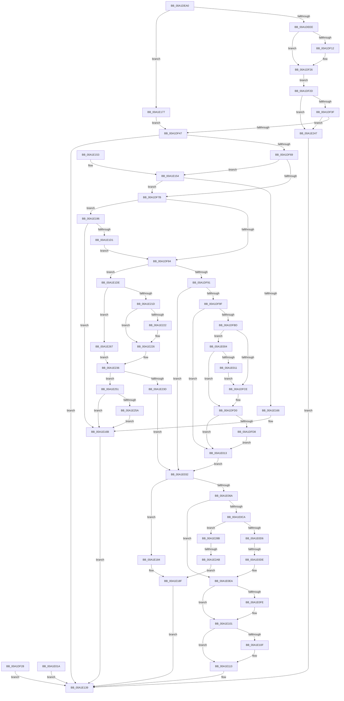

# NtNotifyChangeDirectoryFileEx

- RVA: `0x00A1DEA0`–`0x00A1E2CC` (길이 `1,068` bytes)
- VA: `0x0000000140A1DEA0`
- 실행 섹션: `PAGE`
- PDB 이름 있음: `예`; PDB Function 태그: `예`
- unwind 정보 RVA: `0x000AA8B8`
- 디코드: `256`개 명령, `1,068/1,068` bytes 표시
- 미해석 바이트: `0` (있으면 어셈블리에 `.byte`로 보존)

> 이 문서는 커널 이미지의 기계어와 PDB 기호를 분석해 생성했습니다. 4번과 5번은 함수 원형과 자료형을 바이너리 사용 방식에서 추정한 C 해석이며 원본 소스 복구 결과는 아닙니다.

## 1. Dependencies

- 직접 호출 지점: **17**; 고유 호출 대상: **15**
- 직접 호출자로 확인된 함수: **1**
- RIP 상대 이미지 참조: **1**

### Outgoing calls
- `0x00A1DF21` → [ProbeForWrite](../8E/ProbeForWrite_function_008E91C0.md) (function, `0x008E91C0`)
- `0x00A1DF5C` → [IopReferenceFileObject](../../text/29/IopReferenceFileObject_function_0029D530.md) (function, `0x0029D530`)
- `0x00A1E026` → [IopAllocateIrpCleanup](IopAllocateIrpCleanup_function_00A1E2D4.md) (function, `0x00A1E2D4`)
- `0x00A1E035` → [IopResetEvent](../../text/29/IopResetEvent_function_0029D5F0.md) (function, `0x0029D5F0`)
- `0x00A1E03D` → [IoGetRelatedDeviceObject](../../text/29/IoGetRelatedDeviceObject_function_0029B120.md) (function, `0x0029B120`)
- `0x00A1E054` → [IopAllocateIrpExReturn](../../text/20/IopAllocateIrpExReturn_function_00207720.md) (function, `0x00207720`)
- `0x00A1E134` → [IopSynchronousServiceTail](../8E/IopSynchronousServiceTail_function_008EB440.md) (function, `0x008EB440`)
- `0x00A1E16E` → [ObfDereferenceObject](../../text/2F/ObfDereferenceObject_function_002F9350.md) (function, `0x002F9350`)
- `0x00A1E18A` → [IopAllocateIrpCleanup](IopAllocateIrpCleanup_function_00A1E2D4.md) (function, `0x00A1E2D4`)
- `0x00A1E1BC` → [ObReferenceObjectByHandle](../86/ObReferenceObjectByHandle_function_00868DB0.md) (function, `0x00868DB0`)
- `0x00A1E1D4` → [KeResetEvent](../../text/24/KeResetEvent_function_00248350.md) (function, `0x00248350`)
- `0x00A1E207` → [KeAbPreAcquire](../../text/21/KeAbPreAcquire_function_00210230.md) (function, `0x00210230`)
- `0x00A1E22E` → [ObfReferenceObject](../../text/20/ObfReferenceObject_function_0020FA20.md) (function, `0x0020FA20`)
- `0x00A1E25D` → [ObfDereferenceObject](../../text/2F/ObfDereferenceObject_function_002F9350.md) (function, `0x002F9350`)
- `0x00A1E282` → [IopWaitAndAcquireFileObjectLock](../8A/IopWaitAndAcquireFileObjectLock_function_008AE6D8.md) (function, `0x008AE6D8`)
- `0x00A1E299` → [ExAllocatePool2](../../poolcode/B8/ExAllocatePool2_function_00B820F0.md) (function, `0x00B820F0`)
- `0x00A1E2C2` → [IopExceptionCleanupEx](../8A/IopExceptionCleanupEx_function_008AE5C8.md) (function, `0x008AE5C8`)

### Direct callers
- [NtNotifyChangeDirectoryFile](NtNotifyChangeDirectoryFile_function_00A1DE40.md) at `0x00A1DE87`

### Static image references
- `0x00A1E196` → RVA `0x00FC6B80` (`ALMOSTRO`; read)

## 2. Other-region calls and transfers

- 다른 실행 섹션으로 향하는 call: **10**
  - `0x00A1DF5C` → [IopReferenceFileObject](../../text/29/IopReferenceFileObject_function_0029D530.md) (`PAGE` → `.text`)
  - `0x00A1E035` → [IopResetEvent](../../text/29/IopResetEvent_function_0029D5F0.md) (`PAGE` → `.text`)
  - `0x00A1E03D` → [IoGetRelatedDeviceObject](../../text/29/IoGetRelatedDeviceObject_function_0029B120.md) (`PAGE` → `.text`)
  - `0x00A1E054` → [IopAllocateIrpExReturn](../../text/20/IopAllocateIrpExReturn_function_00207720.md) (`PAGE` → `.text`)
  - `0x00A1E16E` → [ObfDereferenceObject](../../text/2F/ObfDereferenceObject_function_002F9350.md) (`PAGE` → `.text`)
  - `0x00A1E1D4` → [KeResetEvent](../../text/24/KeResetEvent_function_00248350.md) (`PAGE` → `.text`)
  - `0x00A1E207` → [KeAbPreAcquire](../../text/21/KeAbPreAcquire_function_00210230.md) (`PAGE` → `.text`)
  - `0x00A1E22E` → [ObfReferenceObject](../../text/20/ObfReferenceObject_function_0020FA20.md) (`PAGE` → `.text`)
  - `0x00A1E25D` → [ObfDereferenceObject](../../text/2F/ObfDereferenceObject_function_002F9350.md) (`PAGE` → `.text`)
  - `0x00A1E299` → [ExAllocatePool2](../../poolcode/B8/ExAllocatePool2_function_00B820F0.md) (`PAGE` → `POOLCODE`)
- call이 아닌 외부 분기/꼬리 이동: **2**
  - `0x00A1E0D8` → [sub_00B3738C + 0x13](../B3/Unknown_function_00B3738C.md) (`tail-transfer`)
  - `0x00A1E2A5` → [sub_00B3738C](../B3/Unknown_function_00B3738C.md) (`tail-transfer`)

## 3. Assembly (complete function range)

```asm
00A1DEA0  48 8B C4                        mov rax, rsp
00A1DEA3  48 89 58 08                     mov qword ptr [rax + 8], rbx
00A1DEA7  48 89 70 10                     mov qword ptr [rax + 0x10], rsi
00A1DEAB  4C 89 48 20                     mov qword ptr [rax + 0x20], r9
00A1DEAF  4C 89 40 18                     mov qword ptr [rax + 0x18], r8
00A1DEB3  57                              push rdi
00A1DEB4  41 54                           push r12
00A1DEB6  41 55                           push r13
00A1DEB8  41 56                           push r14
00A1DEBA  41 57                           push r15
00A1DEBC  48 83 EC 70                     sub rsp, 0x70
00A1DEC0  48 8B FA                        mov rdi, rdx
00A1DEC3  48 8B D9                        mov rbx, rcx
00A1DEC6  45 33 FF                        xor r15d, r15d
00A1DEC9  4C 89 78 B0                     mov qword ptr [rax - 0x50], r15
00A1DECD  45 8B F7                        mov r14d, r15d
00A1DED0  4C 89 7C 24 50                  mov qword ptr [rsp + 0x50], r15
00A1DED5  65 48 8B 34 25 88 01 00 00      mov rsi, qword ptr gs:[0x188]
00A1DEDE  44 8A A6 32 02 00 00            mov r12b, byte ptr [rsi + 0x232]
00A1DEE5  45 84 E4                        test r12b, r12b
00A1DEE8  0F 84 89 02 00 00               je 0x140a1e177
00A1DEEE  48 B9 00 00 FF FF FF 7F 00 00   movabs rcx, 0x7fffffff0000
00A1DEF8  48 39 48 28                     cmp qword ptr [rax + 0x28], rcx
00A1DEFC  48 0F 42 48 28                  cmovb rcx, qword ptr [rax + 0x28]
00A1DF01  8B 01                           mov eax, dword ptr [rcx]
00A1DF03  89 01                           mov dword ptr [rcx], eax
00A1DF05  44 8B AC 24 D0 00 00 00         mov r13d, dword ptr [rsp + 0xd0]
00A1DF0D  45 85 ED                        test r13d, r13d
00A1DF10  74 14                           je 0x140a1df26
00A1DF12  41 8B D5                        mov edx, r13d
00A1DF15  45 8D 47 04                     lea r8d, [r15 + 4]
00A1DF19  48 8B 8C 24 C8 00 00 00         mov rcx, qword ptr [rsp + 0xc8]
00A1DF21  E8 9A B2 EC FF                  call 0x1408e91c0
00A1DF26  EB 05                           jmp 0x140a1df2d
00A1DF28  E9 0C 02 00 00                  jmp 0x140a1e139
00A1DF2D  8B 84 24 D8 00 00 00            mov eax, dword ptr [rsp + 0xd8]
00A1DF34  A9 00 F0 FF FF                  test eax, 0xfffff000
00A1DF39  0F 85 08 03 00 00               jne 0x140a1e247
00A1DF3F  85 C0                           test eax, eax
00A1DF41  0F 84 00 03 00 00               je 0x140a1e247
00A1DF47  4C 89 7C 24 20                  mov qword ptr [rsp + 0x20], r15
00A1DF4C  4C 8D 4C 24 48                  lea r9, [rsp + 0x48]
00A1DF51  45 8A C4                        mov r8b, r12b
00A1DF54  BA 01 00 00 00                  mov edx, 1
00A1DF59  48 8B CB                        mov rcx, rbx
00A1DF5C  E8 CF F5 87 FF                  call 0x14029d530
00A1DF61  85 C0                           test eax, eax
00A1DF63  0F 88 D0 01 00 00               js 0x140a1e139
00A1DF69  48 8B 5C 24 48                  mov rbx, qword ptr [rsp + 0x48]
00A1DF6E  4C 39 BB B0 00 00 00            cmp qword ptr [rbx + 0xb0], r15
00A1DF75  0F 85 D9 01 00 00               jne 0x140a1e154
00A1DF7B  48 85 FF                        test rdi, rdi
00A1DF7E  0F 85 12 02 00 00               jne 0x140a1e196
00A1DF84  8B 7B 50                        mov edi, dword ptr [rbx + 0x50]
00A1DF87  40 F6 C7 02                     test dil, 2
00A1DF8B  0F 85 4D 02 00 00               jne 0x140a1e1de
00A1DF91  44 88 7C 24 40                  mov byte ptr [rsp + 0x40], r15b
00A1DF96  45 84 E4                        test r12b, r12b
00A1DF99  0F 84 93 00 00 00               je 0x140a1e032
00A1DF9F  65 48 8B 04 25 88 01 00 00      mov rax, qword ptr gs:[0x188]
00A1DFA8  48 89 44 24 60                  mov qword ptr [rsp + 0x60], rax
00A1DFAD  48 8B 80 B8 00 00 00            mov rax, qword ptr [rax + 0xb8]
00A1DFB4  4C 39 B8 10 03 00 00            cmp qword ptr [rax + 0x310], r15
00A1DFBB  74 56                           je 0x140a1e013
00A1DFBD  0F B7 80 EC 06 00 00            movzx eax, word ptr [rax + 0x6ec]
00A1DFC4  B9 4C 01 00 00                  mov ecx, 0x14c
00A1DFC9  66 3B C1                        cmp ax, cx
00A1DFCC  75 36                           jne 0x140a1e004
00A1DFCE  B0 01                           mov al, 1
00A1DFD0  88 44 24 42                     mov byte ptr [rsp + 0x42], al
00A1DFD4  84 C0                           test al, al
00A1DFD6  74 3B                           je 0x140a1e013
00A1DFD8  48 8B 94 24 B0 00 00 00         mov rdx, qword ptr [rsp + 0xb0]
00A1DFE0  48 83 CA 01                     or rdx, 1
00A1DFE4  48 8B 84 24 C0 00 00 00         mov rax, qword ptr [rsp + 0xc0]
00A1DFEC  8B 08                           mov ecx, dword ptr [rax]
00A1DFEE  8B 01                           mov eax, dword ptr [rcx]
00A1DFF0  89 01                           mov dword ptr [rcx], eax
00A1DFF2  48 89 8C 24 C0 00 00 00         mov qword ptr [rsp + 0xc0], rcx
00A1DFFA  48 89 94 24 B0 00 00 00         mov qword ptr [rsp + 0xb0], rdx
00A1E002  EB 0F                           jmp 0x140a1e013
00A1E004  B9 C4 01 00 00                  mov ecx, 0x1c4
00A1E009  66 3B C1                        cmp ax, cx
00A1E00C  41 8A C7                        mov al, r15b
00A1E00F  75 BF                           jne 0x140a1dfd0
00A1E011  EB BB                           jmp 0x140a1dfce
00A1E013  48 8B 5C 24 48                  mov rbx, qword ptr [rsp + 0x48]
00A1E018  EB 18                           jmp 0x140a1e032
00A1E01A  8B D8                           mov ebx, eax
00A1E01C  48 8B 54 24 50                  mov rdx, qword ptr [rsp + 0x50]
00A1E021  48 8B 4C 24 48                  mov rcx, qword ptr [rsp + 0x48]
00A1E026  E8 A9 02 00 00                  call 0x140a1e2d4
00A1E02B  8B C3                           mov eax, ebx
00A1E02D  E9 07 01 00 00                  jmp 0x140a1e139
00A1E032  48 8B CB                        mov rcx, rbx
00A1E035  E8 B6 F5 87 FF                  call 0x14029d5f0
00A1E03A  48 8B CB                        mov rcx, rbx
00A1E03D  E8 DE D0 87 FF                  call 0x14029b120
00A1E042  4C 8B F8                        mov r15, rax
00A1E045  44 8A 44 24 40                  mov r8b, byte ptr [rsp + 0x40]
00A1E04A  41 80 F0 01                     xor r8b, 1
00A1E04E  8A 50 4C                        mov dl, byte ptr [rax + 0x4c]
00A1E051  48 8B C8                        mov rcx, rax
00A1E054  E8 C7 96 7E FF                  call 0x140207720
00A1E059  48 8B F8                        mov rdi, rax
00A1E05C  48 89 44 24 58                  mov qword ptr [rsp + 0x58], rax
00A1E061  48 85 C0                        test rax, rax
00A1E064  0F 84 1A 01 00 00               je 0x140a1e184
00A1E06A  48 89 98 C0 00 00 00            mov qword ptr [rax + 0xc0], rbx
00A1E071  48 89 B0 98 00 00 00            mov qword ptr [rax + 0x98], rsi
00A1E078  44 88 60 40                     mov byte ptr [rax + 0x40], r12b
00A1E07C  4C 89 70 50                     mov qword ptr [rax + 0x50], r14
00A1E080  48 8B 84 24 C0 00 00 00         mov rax, qword ptr [rsp + 0xc0]
00A1E088  48 89 47 48                     mov qword ptr [rdi + 0x48], rax
00A1E08C  48 8B 84 24 B0 00 00 00         mov rax, qword ptr [rsp + 0xb0]
00A1E094  48 89 47 58                     mov qword ptr [rdi + 0x58], rax
00A1E098  48 8B 84 24 B8 00 00 00         mov rax, qword ptr [rsp + 0xb8]
00A1E0A0  48 89 47 60                     mov qword ptr [rdi + 0x60], rax
00A1E0A4  48 8B B7 B8 00 00 00            mov rsi, qword ptr [rdi + 0xb8]
00A1E0AB  C6 46 B8 0C                     mov byte ptr [rsi - 0x48], 0xc
00A1E0AF  8B 8C 24 E8 00 00 00            mov ecx, dword ptr [rsp + 0xe8]
00A1E0B6  83 F9 01                        cmp ecx, 1
00A1E0B9  0F 95 C0                        setne al
00A1E0BC  04 02                           add al, 2
00A1E0BE  88 46 B9                        mov byte ptr [rsi - 0x47], al
00A1E0C1  48 89 5E E8                     mov qword ptr [rsi - 0x18], rbx
00A1E0C5  45 85 ED                        test r13d, r13d
00A1E0C8  74 20                           je 0x140a1e0ea
00A1E0CA  41 8B 47 30                     mov eax, dword ptr [r15 + 0x30]
00A1E0CE  A8 04                           test al, 4
00A1E0D0  0F 85 B5 01 00 00               jne 0x140a1e28b
00A1E0D6  A8 10                           test al, 0x10
00A1E0D8  0F 85 C1 92 11 00               jne 0x140b3739f
00A1E0DE  48 8B 84 24 C8 00 00 00         mov rax, qword ptr [rsp + 0xc8]
00A1E0E6  48 89 47 70                     mov qword ptr [rdi + 0x70], rax
00A1E0EA  44 89 6E C0                     mov dword ptr [rsi - 0x40], r13d
00A1E0EE  8B 84 24 D8 00 00 00            mov eax, dword ptr [rsp + 0xd8]
00A1E0F5  89 46 C8                        mov dword ptr [rsi - 0x38], eax
00A1E0F8  80 7E B9 03                     cmp byte ptr [rsi - 0x47], 3
00A1E0FC  75 03                           jne 0x140a1e101
00A1E0FE  89 4E D0                        mov dword ptr [rsi - 0x30], ecx
00A1E101  C6 46 BA 00                     mov byte ptr [rsi - 0x46], 0
00A1E105  80 BC 24 E0 00 00 00 00         cmp byte ptr [rsp + 0xe0], 0
00A1E10D  74 04                           je 0x140a1e113
00A1E10F  C6 46 BA 01                     mov byte ptr [rsi - 0x46], 1
00A1E113  C7 44 24 30 02 00 00 00         mov dword ptr [rsp + 0x30], 2
00A1E11B  8A 44 24 40                     mov al, byte ptr [rsp + 0x40]
00A1E11F  88 44 24 28                     mov byte ptr [rsp + 0x28], al
00A1E123  44 88 64 24 20                  mov byte ptr [rsp + 0x20], r12b
00A1E128  45 33 C9                        xor r9d, r9d
00A1E12B  4C 8B C3                        mov r8, rbx
00A1E12E  48 8B D7                        mov rdx, rdi
00A1E131  49 8B CF                        mov rcx, r15
00A1E134  E8 07 D3 EC FF                  call 0x1408eb440
00A1E139  4C 8D 5C 24 70                  lea r11, [rsp + 0x70]
00A1E13E  49 8B 5B 30                     mov rbx, qword ptr [r11 + 0x30]
00A1E142  49 8B 73 38                     mov rsi, qword ptr [r11 + 0x38]
00A1E146  49 8B E3                        mov rsp, r11
00A1E149  41 5F                           pop r15
00A1E14B  41 5E                           pop r14
00A1E14D  41 5D                           pop r13
00A1E14F  41 5C                           pop r12
00A1E151  5F                              pop rdi
00A1E152  C3                              ret
00A1E153  CC                              int3
00A1E154  48 F7 84 24 B0 00 00 00 FE FF FF FF  test qword ptr [rsp + 0xb0], -2
00A1E160  0F 84 15 FE FF FF               je 0x140a1df7b
00A1E166  BF 0D 00 00 C0                  mov edi, 0xc000000d
00A1E16B  48 8B CB                        mov rcx, rbx
00A1E16E  E8 DD B1 8D FF                  call 0x1402f9350
00A1E173  8B C7                           mov eax, edi
00A1E175  EB C2                           jmp 0x140a1e139
00A1E177  44 8B AC 24 D0 00 00 00         mov r13d, dword ptr [rsp + 0xd0]
00A1E17F  E9 C3 FD FF FF                  jmp 0x140a1df47
00A1E184  49 8B D6                        mov rdx, r14
00A1E187  48 8B CB                        mov rcx, rbx
00A1E18A  E8 45 01 00 00                  call 0x140a1e2d4
00A1E18F  B8 9A 00 00 C0                  mov eax, 0xc000009a
00A1E194  EB A3                           jmp 0x140a1e139
00A1E196  4C 8B 05 E3 89 5A 00            mov r8, qword ptr [rip + 0x5a89e3]
00A1E19D  4C 89 7C 24 58                  mov qword ptr [rsp + 0x58], r15
00A1E1A2  4C 89 7C 24 28                  mov qword ptr [rsp + 0x28], r15
00A1E1A7  48 8D 44 24 58                  lea rax, [rsp + 0x58]
00A1E1AC  48 89 44 24 20                  mov qword ptr [rsp + 0x20], rax
00A1E1B1  45 8A CC                        mov r9b, r12b
00A1E1B4  BA 02 00 00 00                  mov edx, 2
00A1E1B9  48 8B CF                        mov rcx, rdi
00A1E1BC  E8 EF AB E4 FF                  call 0x140868db0
00A1E1C1  8B F8                           mov edi, eax
00A1E1C3  4C 8B 74 24 58                  mov r14, qword ptr [rsp + 0x58]
00A1E1C8  4C 89 74 24 50                  mov qword ptr [rsp + 0x50], r14
00A1E1CD  85 C0                           test eax, eax
00A1E1CF  78 9A                           js 0x140a1e16b
00A1E1D1  49 8B CE                        mov rcx, r14
00A1E1D4  E8 77 A1 82 FF                  call 0x140248350
00A1E1D9  E9 A6 FD FF FF                  jmp 0x140a1df84
00A1E1DE  C1 EF 02                        shr edi, 2
00A1E1E1  40 80 E7 01                     and dil, 1
00A1E1E5  65 48 8B 04 25 88 01 00 00      mov rax, qword ptr gs:[0x188]
00A1E1EE  66 FF 88 E4 01 00 00            dec word ptr [rax + 0x1e4]
00A1E1F5  90                              nop
00A1E1F6  48 8B 5C 24 48                  mov rbx, qword ptr [rsp + 0x48]
00A1E1FB  48 8D 8B 80 00 00 00            lea rcx, [rbx + 0x80]
00A1E202  45 33 C0                        xor r8d, r8d
00A1E205  33 D2                           xor edx, edx
00A1E207  E8 24 20 7F FF                  call 0x140210230
00A1E20C  44 88 7C 24 41                  mov byte ptr [rsp + 0x41], r15b
00A1E211  B9 01 00 00 00                  mov ecx, 1
00A1E216  87 4B 74                        xchg dword ptr [rbx + 0x74], ecx
00A1E219  85 C9                           test ecx, ecx
00A1E21B  75 4A                           jne 0x140a1e267
00A1E21D  48 85 C0                        test rax, rax
00A1E220  74 04                           je 0x140a1e226
00A1E222  C6 40 0A 01                     mov byte ptr [rax + 0xa], 1
00A1E226  48 8B 5C 24 48                  mov rbx, qword ptr [rsp + 0x48]
00A1E22B  48 8B CB                        mov rcx, rbx
00A1E22E  E8 ED 17 7F FF                  call 0x14020fa20
00A1E233  41 8B FF                        mov edi, r15d
00A1E236  44 38 7C 24 41                  cmp byte ptr [rsp + 0x41], r15b
00A1E23B  75 14                           jne 0x140a1e251
00A1E23D  C6 44 24 40 01                  mov byte ptr [rsp + 0x40], 1
00A1E242  E9 EB FD FF FF                  jmp 0x140a1e032
00A1E247  B8 0D 00 00 C0                  mov eax, 0xc000000d
00A1E24C  E9 E8 FE FF FF                  jmp 0x140a1e139
00A1E251  4D 85 F6                        test r14, r14
00A1E254  0F 84 11 FF FF FF               je 0x140a1e16b
00A1E25A  49 8B CE                        mov rcx, r14
00A1E25D  E8 EE B0 8D FF                  call 0x1402f9350
00A1E262  E9 04 FF FF FF                  jmp 0x140a1e16b
00A1E267  48 8D 4C 24 41                  lea rcx, [rsp + 0x41]
00A1E26C  48 89 4C 24 20                  mov qword ptr [rsp + 0x20], rcx
00A1E271  4C 8B C8                        mov r9, rax
00A1E274  44 8A C7                        mov r8b, dil
00A1E277  41 8A D4                        mov dl, r12b
00A1E27A  48 8B 5C 24 48                  mov rbx, qword ptr [rsp + 0x48]
00A1E27F  48 8B CB                        mov rcx, rbx
00A1E282  E8 51 04 E9 FF                  call 0x1408ae6d8
00A1E287  8B F8                           mov edi, eax
00A1E289  EB AB                           jmp 0x140a1e236
00A1E28B  41 8B D5                        mov edx, r13d
00A1E28E  B9 41 00 00 00                  mov ecx, 0x41
00A1E293  41 B8 49 6F 53 42               mov r8d, 0x42536f49
00A1E299  E8 52 3E 16 00                  call 0x140b820f0
00A1E29E  48 89 47 18                     mov qword ptr [rdi + 0x18], rax
00A1E2A2  48 85 C0                        test rax, rax
00A1E2A5  0F 85 E1 90 11 00               jne 0x140b3738c
00A1E2AB  8B 43 50                        mov eax, dword ptr [rbx + 0x50]
00A1E2AE  D1 E8                           shr eax, 1
00A1E2B0  24 01                           and al, 1
00A1E2B2  88 44 24 20                     mov byte ptr [rsp + 0x20], al
00A1E2B6  45 33 C9                        xor r9d, r9d
00A1E2B9  4D 8B C6                        mov r8, r14
00A1E2BC  48 8B D7                        mov rdx, rdi
00A1E2BF  48 8B CB                        mov rcx, rbx
00A1E2C2  E8 01 03 E9 FF                  call 0x1408ae5c8
00A1E2C7  E9 C3 FE FF FF                  jmp 0x140a1e18f
```

## 4. C-style interpretation (structured pseudocode)

```c
__int64 __fastcall NtNotifyChangeDirectoryFileEx(__int64 a1, __int64 a2, __int64 a3, __int64 a4, __int64 a5, __int64 a6, unsigned int a7, unsigned int a8, unsigned __int8 a9, unsigned int a10)
{
    __int64 result;
    __int64 v_r15;
    __int64 v_rdi;
    __int64 v_rsp;
    unsigned __int64 v_stack_m18;
    unsigned __int64 v_stack_m20;
    unsigned __int64 v_stack_m28;
    unsigned __int8 v_stack_m2F;
    unsigned __int8 v_stack_m30;
    unsigned __int64 v_stack_m38;
    unsigned __int64 v_stack_m40;
    unsigned __int64 v_stack_m48;
    unsigned __int64 v_stack_m50;
    unsigned __int8 v_stack_m56;
    unsigned __int8 v_stack_m58;
    unsigned int v_stack_m68;
    unsigned __int8 v_stack_m70;
    unsigned __int64 v_stack_m78;
    unsigned __int64 v_stack_p18;
    unsigned __int64 v_stack_p20;
    unsigned __int64 v_stack_p28;
    unsigned __int64 v_stack_p40;

    *(unsigned __int64 *)(v_rsp + 8) = v_rbx;
    *(unsigned __int64 *)(v_rsp + 16) = v_rsi;
    *(unsigned __int64 *)(v_rsp + 32) = a4;
    *(unsigned __int64 *)(v_rsp + 24) = a3;
    v_rsp = (v_rsp) - (112);
    v_r15 = 0;
    *(unsigned __int64 *)(v_rsp - 80) = 0;
    v_stack_m48 = 0;
    if ((unsigned __int8)(*(unsigned __int8 *)(*(unsigned __int64 *)(gs_base + (0 + 392)) + 562)) == 0) goto loc_00A1E177;
    if ((*(unsigned __int64 *)(v_rsp + 40)) < a1) { a1 = *(unsigned __int64 *)(v_rsp + 40); }
    *(unsigned int *)(a1) = (unsigned int)((unsigned int)(*(unsigned int *)(a1)));
    result = (unsigned int)(*(unsigned int *)(a1));
    if ((unsigned int)((unsigned int)(a7)) != 0) {
        a2 = (unsigned int)((unsigned int)(a7));
        a3 = v_r15 + 4;
        a1 = a6;
        result = ProbeForWrite(a1, a2, a3, a4);
    }
    goto loc_00A1DF2D;
loc_00A1DF2D:
    if ((((unsigned int)((unsigned int)(a8))) & (0xFFFFF000ULL)) != 0) goto loc_00A1E247;
    if ((unsigned int)((unsigned int)(a8)) == 0) goto loc_00A1E247;
loc_00A1DF47:
    v_stack_m78 = 0;
    result = IopReferenceFileObject(a1, 1, (unsigned __int8)(*(unsigned __int8 *)(*(unsigned __int64 *)(gs_base + (0 + 392)) + 562)), v_stack_m50);
    if (sign_flag) goto loc_00A1E139;
    if ((*(unsigned __int64 *)(v_stack_m50 + 176)) != 0) goto loc_00A1E154;
loc_00A1DF7B:
    if (a2 != 0) goto loc_00A1E196;
loc_00A1DF84:
    if ((((unsigned __int8)((unsigned int)(*(unsigned int *)(v_stack_m50 + 80)))) & (2)) != 0) goto loc_00A1E1DE;
    v_stack_m58 = 0;
    if ((unsigned __int8)(*(unsigned __int8 *)(*(unsigned __int64 *)(gs_base + (0 + 392)) + 562)) == 0) goto loc_00A1E032;
    v_stack_m38 = *(unsigned __int64 *)(gs_base + (0 + 392));
    if ((*(unsigned __int64 *)(*(unsigned __int64 *)(*(unsigned __int64 *)(gs_base + (0 + 392)) + 184) + 784)) == 0) goto loc_00A1E013;
    if (((unsigned __int16)(*(unsigned __int16 *)(*(unsigned __int64 *)(*(unsigned __int64 *)(gs_base + (0 + 392)) + 184) + 1772))) != 332) goto loc_00A1E004;
loc_00A1DFCE:
loc_00A1DFD0:
    v_stack_m56 = 1;
    if (1 == 0) goto loc_00A1E013;
    a2 = (v_stack_p18) | (1);
    *(unsigned int *)((unsigned int)(*(unsigned int *)(a5))) = (unsigned int)((unsigned int)(*(unsigned int *)((unsigned int)(*(unsigned int *)(a5)))));
    v_stack_p28 = (unsigned int)(*(unsigned int *)(a5));
    v_stack_p18 = a2;
    goto loc_00A1E013;
loc_00A1E004:
    if (((unsigned __int16)((unsigned int)(*(unsigned int *)((unsigned int)(*(unsigned int *)(a5)))))) != 452) goto loc_00A1DFD0;
    goto loc_00A1DFCE;
loc_00A1E013:
    goto loc_00A1E032;
loc_00A1E032:
    result = IopResetEvent(v_stack_m50, a2, (unsigned __int8)(*(unsigned __int8 *)(*(unsigned __int64 *)(gs_base + (0 + 392)) + 562)), v_stack_m50);
    result = IoGetRelatedDeviceObject(v_stack_m50, a2, (unsigned __int8)(*(unsigned __int8 *)(*(unsigned __int64 *)(gs_base + (0 + 392)) + 562)), v_stack_m50);
    a3 = (unsigned __int8)((v_stack_m58) ^ (1));
    result = IopAllocateIrpExReturn(result, *(unsigned __int8 *)(result + 76), a3, v_stack_m50);
    v_stack_m40 = result;
    if (result == 0) goto loc_00A1E184;
    *(unsigned __int64 *)(result + 192) = v_stack_m50;
    *(unsigned __int64 *)(result + 152) = *(unsigned __int64 *)(gs_base + (0 + 392));
    *(unsigned __int8 *)(result + 64) = (unsigned __int8)(*(unsigned __int8 *)(*(unsigned __int64 *)(gs_base + (0 + 392)) + 562));
    *(unsigned __int64 *)(result + 80) = 0;
    *(unsigned __int64 *)(result + 72) = a5;
    *(unsigned __int64 *)(result + 88) = v_stack_p18;
    *(unsigned __int64 *)(result + 96) = v_stack_p20;
    *(unsigned __int8 *)(*(unsigned __int64 *)(result + 184) - 72) = 12;
    result = (((unsigned int)((unsigned int)(a10))) != 1) ? 1 : 0;
    result = (unsigned __int8)((result) + (2));
    *(unsigned __int8 *)(*(unsigned __int64 *)(result + 184) - 71) = (unsigned __int8)(result);
    *(unsigned __int64 *)(*(unsigned __int64 *)(result + 184) - 24) = v_stack_m50;
    if ((unsigned int)((unsigned int)(a7)) == 0) goto loc_00A1E0EA;
    if ((((unsigned __int8)((unsigned int)(*(unsigned int *)(result + 48)))) & (4)) != 0) goto loc_00A1E28B;
    *(unsigned __int64 *)(result + 112) = a6;
loc_00A1E0EA:
    *(unsigned int *)(*(unsigned __int64 *)(result + 184) - 64) = (unsigned int)((unsigned int)(a7));
    *(unsigned int *)(*(unsigned __int64 *)(result + 184) - 56) = (unsigned int)((unsigned int)(a8));
    if ((*(unsigned __int8 *)(*(unsigned __int64 *)(result + 184) - 71)) == 3) {
        *(unsigned int *)(*(unsigned __int64 *)(result + 184) - 48) = (unsigned int)((unsigned int)(a10));
    }
    *(unsigned __int8 *)(*(unsigned __int64 *)(result + 184) - 70) = 0;
    if (a9 != 0) {
        *(unsigned __int8 *)(*(unsigned __int64 *)(result + 184) - 70) = 1;
    }
    v_stack_m68 = 2;
    v_stack_m70 = (unsigned __int8)(v_stack_m58);
    v_stack_m78 = (unsigned __int8)(*(unsigned __int8 *)(*(unsigned __int64 *)(gs_base + (0 + 392)) + 562));
    a4 = 0;
    result = IopSynchronousServiceTail(result, result, v_stack_m50, a4);
loc_00A1E139:
    return result;
loc_00A1E154:
    if (((v_stack_p40) & (-2)) == 0) goto loc_00A1DF7B;
loc_00A1E16B:
    result = ObfDereferenceObject(*(unsigned __int64 *)(v_stack_m28 + 48), result, v_stack_m50, a4);
    goto loc_00A1E139;
loc_00A1E177:
    goto loc_00A1DF47;
loc_00A1E184:
    result = IopAllocateIrpCleanup(*(unsigned __int64 *)(v_stack_m28 + 48), 0, v_stack_m50, a4);
loc_00A1E18F:
    goto loc_00A1E139;
loc_00A1E196:
    v_stack_m18 = result;
    v_stack_m48 = result;
    v_stack_m50 = v_stack_m18;
    result = ObReferenceObjectByHandle((unsigned int)(0xC000000DULL), 2, *(unsigned __int64 *)(v_rip + 5933539), (unsigned __int8)(*(unsigned __int8 *)(*(unsigned __int64 *)(gs_base + (0 + 392)) + 562)));
    v_stack_m20 = v_stack_m18;
    if (sign_flag) goto loc_00A1E16B;
    result = KeResetEvent(v_stack_m18, 2, *(unsigned __int64 *)(v_rip + 5933539), (unsigned __int8)(*(unsigned __int8 *)(*(unsigned __int64 *)(gs_base + (0 + 392)) + 562)));
    goto loc_00A1DF84;
loc_00A1E1DE:
    v_rdi = (unsigned int)(((unsigned int)((unsigned int)(result))) >> (2));
    v_rdi = (unsigned __int8)((v_rdi) & (1));
    a3 = 0;
    a2 = 0;
    result = KeAbPreAcquire(v_stack_m28 + 128, a2, a3, (unsigned __int8)(*(unsigned __int8 *)(*(unsigned __int64 *)(gs_base + (0 + 392)) + 562)));
    v_stack_m2F = (unsigned __int8)(result);
    if (1 != 0) goto loc_00A1E267;
    if (result != 0) {
        *(unsigned __int8 *)(result + 10) = 1;
    }
    result = ObfReferenceObject(v_stack_m28, a2, a3, (unsigned __int8)(*(unsigned __int8 *)(*(unsigned __int64 *)(gs_base + (0 + 392)) + 562)));
loc_00A1E236:
    if (v_stack_m2F != ((unsigned __int8)(result))) goto loc_00A1E251;
    v_stack_m30 = 1;
    goto loc_00A1E032;
loc_00A1E247:
    goto loc_00A1E139;
loc_00A1E251:
    if (v_stack_m18 == 0) goto loc_00A1E16B;
    result = ObfDereferenceObject(v_stack_m18, a2, a3, (unsigned __int8)(*(unsigned __int8 *)(*(unsigned __int64 *)(gs_base + (0 + 392)) + 562)));
    goto loc_00A1E16B;
loc_00A1E267:
    v_stack_m50 = v_stack_m2F;
    result = IopWaitAndAcquireFileObjectLock(v_stack_m28, (unsigned __int8)(*(unsigned __int8 *)(*(unsigned __int64 *)(gs_base + (0 + 392)) + 562)), (unsigned __int8)((unsigned int)((unsigned int)(result))), result);
    goto loc_00A1E236;
loc_00A1E28B:
    result = ExAllocatePool2(65, (unsigned int)((unsigned int)((unsigned int)(a7))), (unsigned int)(0x42536F49ULL), result);
    *(unsigned __int64 *)((unsigned int)((unsigned int)(result)) + 24) = result;
    result = (unsigned int)(((unsigned int)(*(unsigned int *)(v_stack_m28 + 80))) >> (1));
    result = (unsigned __int8)((result) & (1));
    v_stack_m50 = (unsigned __int8)(result);
    a4 = 0;
    result = IopExceptionCleanupEx(v_stack_m28, (unsigned int)((unsigned int)(result)), v_stack_m18, a4);
    goto loc_00A1E18F;
}
```

## 5. (Beta) C Style

```c
int64_t NtNotifyChangeDirectoryFileEx(int64_t Arg1, int64_t Arg2, int64_t Arg3, int64_t Arg4, void *Arg5, int64_t Arg6, uint32_t Arg7, uint32_t Arg8, uint8_t Arg9, uint32_t Arg10)
{
    uint8_t *arg5 = (uint8_t *)Arg5;

    int64_t result;
    int64_t local_r15;
    int64_t local_rdi;
    int64_t local_rsp;
    uint64_t v_stack_m18;
    uint64_t v_stack_m20;
    uint64_t v_stack_m28;
    uint8_t v_stack_m2F;
    uint8_t v_stack_m30;
    uint64_t v_stack_m38;
    uint64_t v_stack_m40;
    uint64_t v_stack_m48;
    uint64_t v_stack_m50;
    uint8_t v_stack_m56;
    uint8_t v_stack_m58;
    uint32_t v_stack_m68;
    uint8_t v_stack_m70;
    uint64_t v_stack_m78;
    uint64_t v_stack_p18;
    uint64_t v_stack_p20;
    uint64_t v_stack_p28;
    uint64_t v_stack_p40;

    *(uint64_t *)(local_rsp + 0x8) = local_rbx;
    *(uint64_t *)(local_rsp + 0x10) = local_rsi;
    *(uint64_t *)(local_rsp + 0x20) = Arg4;
    *(uint64_t *)(local_rsp + 0x18) = Arg3;
    local_rsp = (local_rsp) - (112);
    local_r15 = 0;
    *(uint64_t *)(local_rsp - 0x50) = 0;
    v_stack_m48 = 0;
    if ((uint8_t)(*(uint8_t *)(*(uint64_t *)(gs_base + (0 + 0x188)) + 0x232)) == 0) goto loc_00A1E177;
    if ((*(uint64_t *)(local_rsp + 0x28)) < Arg1) { Arg1 = *(uint64_t *)(local_rsp + 0x28); }
    *(uint32_t *)(Arg1) = (uint32_t)((uint32_t)(*(uint32_t *)(Arg1)));
    result = (uint32_t)(*(uint32_t *)(Arg1));
    if ((uint32_t)((uint32_t)(Arg7)) != 0) {
        Arg2 = (uint32_t)((uint32_t)(Arg7));
        Arg3 = local_r15 + 4;
        Arg1 = Arg6;
        result = ProbeForWrite(Arg1, Arg2, Arg3, Arg4);
    }
    goto loc_00A1DF2D;
loc_00A1DF2D:
    if ((((uint32_t)((uint32_t)(Arg8))) & (0xFFFFF000ULL)) != 0) goto loc_00A1E247;
    if ((uint32_t)((uint32_t)(Arg8)) == 0) goto loc_00A1E247;
loc_00A1DF47:
    v_stack_m78 = 0;
    result = IopReferenceFileObject(Arg1, 1, (uint8_t)(*(uint8_t *)(*(uint64_t *)(gs_base + (0 + 0x188)) + 0x232)), v_stack_m50);
    if (sign_flag) goto loc_00A1E139;
    if ((*(uint64_t *)(v_stack_m50 + 0xB0)) != 0) goto loc_00A1E154;
loc_00A1DF7B:
    if (Arg2 != 0) goto loc_00A1E196;
loc_00A1DF84:
    if ((((uint8_t)((uint32_t)(*(uint32_t *)(v_stack_m50 + 0x50)))) & (2)) != 0) goto loc_00A1E1DE;
    v_stack_m58 = 0;
    if ((uint8_t)(*(uint8_t *)(*(uint64_t *)(gs_base + (0 + 0x188)) + 0x232)) == 0) goto loc_00A1E032;
    v_stack_m38 = *(uint64_t *)(gs_base + (0 + 0x188));
    if ((*(uint64_t *)(*(uint64_t *)(*(uint64_t *)(gs_base + (0 + 0x188)) + 0xB8) + 0x310)) == 0) goto loc_00A1E013;
    if (((uint16_t)(*(uint16_t *)(*(uint64_t *)(*(uint64_t *)(gs_base + (0 + 0x188)) + 0xB8) + 0x6EC))) != 332) goto loc_00A1E004;
loc_00A1DFCE:
loc_00A1DFD0:
    v_stack_m56 = 1;
    if (1 == 0) goto loc_00A1E013;
    Arg2 = (v_stack_p18) | (1);
    *(uint32_t *)((uint32_t)(*(uint32_t *)(arg5))) = (uint32_t)((uint32_t)(*(uint32_t *)((uint32_t)(*(uint32_t *)(arg5)))));
    v_stack_p28 = (uint32_t)(*(uint32_t *)(arg5));
    v_stack_p18 = Arg2;
    goto loc_00A1E013;
loc_00A1E004:
    if (((uint16_t)((uint32_t)(*(uint32_t *)((uint32_t)(*(uint32_t *)(arg5)))))) != 452) goto loc_00A1DFD0;
    goto loc_00A1DFCE;
loc_00A1E013:
    goto loc_00A1E032;
loc_00A1E032:
    result = IopResetEvent(v_stack_m50, Arg2, (uint8_t)(*(uint8_t *)(*(uint64_t *)(gs_base + (0 + 0x188)) + 0x232)), v_stack_m50);
    result = IoGetRelatedDeviceObject(v_stack_m50, Arg2, (uint8_t)(*(uint8_t *)(*(uint64_t *)(gs_base + (0 + 0x188)) + 0x232)), v_stack_m50);
    Arg3 = (uint8_t)((v_stack_m58) ^ (1));
    result = IopAllocateIrpExReturn(result, *(uint8_t *)(result + 0x4C), Arg3, v_stack_m50);
    v_stack_m40 = result;
    if (result == 0) goto loc_00A1E184;
    *(uint64_t *)(result + 0xC0) = v_stack_m50;
    *(uint64_t *)(result + 0x98) = *(uint64_t *)(gs_base + (0 + 0x188));
    *(uint8_t *)(result + 0x40) = (uint8_t)(*(uint8_t *)(*(uint64_t *)(gs_base + (0 + 0x188)) + 0x232));
    *(uint64_t *)(result + 0x50) = 0;
    *(void **)(result + 0x48) = Arg5;
    *(uint64_t *)(result + 0x58) = v_stack_p18;
    *(uint64_t *)(result + 0x60) = v_stack_p20;
    *(uint8_t *)(*(uint64_t *)(result + 0xB8) - 0x48) = 12;
    result = (((uint32_t)((uint32_t)(Arg10))) != 1) ? 1 : 0;
    result = (uint8_t)((result) + (2));
    *(uint8_t *)(*(uint64_t *)(result + 0xB8) - 0x47) = (uint8_t)(result);
    *(uint64_t *)(*(uint64_t *)(result + 0xB8) - 0x18) = v_stack_m50;
    if ((uint32_t)((uint32_t)(Arg7)) == 0) goto loc_00A1E0EA;
    if ((((uint8_t)((uint32_t)(*(uint32_t *)(result + 0x30)))) & (4)) != 0) goto loc_00A1E28B;
    *(uint64_t *)(result + 0x70) = Arg6;
loc_00A1E0EA:
    *(uint32_t *)(*(uint64_t *)(result + 0xB8) - 0x40) = (uint32_t)((uint32_t)(Arg7));
    *(uint32_t *)(*(uint64_t *)(result + 0xB8) - 0x38) = (uint32_t)((uint32_t)(Arg8));
    if ((*(uint8_t *)(*(uint64_t *)(result + 0xB8) - 0x47)) == 3) {
        *(uint32_t *)(*(uint64_t *)(result + 0xB8) - 0x30) = (uint32_t)((uint32_t)(Arg10));
    }
    *(uint8_t *)(*(uint64_t *)(result + 0xB8) - 0x46) = 0;
    if (Arg9 != 0) {
        *(uint8_t *)(*(uint64_t *)(result + 0xB8) - 0x46) = 1;
    }
    v_stack_m68 = 2;
    v_stack_m70 = (uint8_t)(v_stack_m58);
    v_stack_m78 = (uint8_t)(*(uint8_t *)(*(uint64_t *)(gs_base + (0 + 0x188)) + 0x232));
    Arg4 = 0;
    result = IopSynchronousServiceTail(result, result, v_stack_m50, Arg4);
loc_00A1E139:
    return result;
loc_00A1E154:
    if (((v_stack_p40) & (-2)) == 0) goto loc_00A1DF7B;
loc_00A1E16B:
    result = ObfDereferenceObject(*(uint64_t *)(v_stack_m28 + 0x30), result, v_stack_m50, Arg4);
    goto loc_00A1E139;
loc_00A1E177:
    goto loc_00A1DF47;
loc_00A1E184:
    result = IopAllocateIrpCleanup(*(uint64_t *)(v_stack_m28 + 0x30), 0, v_stack_m50, Arg4);
loc_00A1E18F:
    goto loc_00A1E139;
loc_00A1E196:
    v_stack_m18 = result;
    v_stack_m48 = result;
    v_stack_m50 = v_stack_m18;
    result = ObReferenceObjectByHandle((uint32_t)(0xC000000DULL), 2, *(uint64_t *)(v_rip + 0x5A89E3), (uint8_t)(*(uint8_t *)(*(uint64_t *)(gs_base + (0 + 0x188)) + 0x232)));
    v_stack_m20 = v_stack_m18;
    if (sign_flag) goto loc_00A1E16B;
    result = KeResetEvent(v_stack_m18, 2, *(uint64_t *)(v_rip + 0x5A89E3), (uint8_t)(*(uint8_t *)(*(uint64_t *)(gs_base + (0 + 0x188)) + 0x232)));
    goto loc_00A1DF84;
loc_00A1E1DE:
    local_rdi = (uint32_t)(((uint32_t)((uint32_t)(result))) >> (2));
    local_rdi = (uint8_t)((local_rdi) & (1));
    Arg3 = 0;
    Arg2 = 0;
    result = KeAbPreAcquire(v_stack_m28 + 128, Arg2, Arg3, (uint8_t)(*(uint8_t *)(*(uint64_t *)(gs_base + (0 + 0x188)) + 0x232)));
    v_stack_m2F = (uint8_t)(result);
    if (1 != 0) goto loc_00A1E267;
    if (result != 0) {
        *(uint8_t *)(result + 0xA) = 1;
    }
    result = ObfReferenceObject(v_stack_m28, Arg2, Arg3, (uint8_t)(*(uint8_t *)(*(uint64_t *)(gs_base + (0 + 0x188)) + 0x232)));
loc_00A1E236:
    if (v_stack_m2F != ((uint8_t)(result))) goto loc_00A1E251;
    v_stack_m30 = 1;
    goto loc_00A1E032;
loc_00A1E247:
    goto loc_00A1E139;
loc_00A1E251:
    if (v_stack_m18 == 0) goto loc_00A1E16B;
    result = ObfDereferenceObject(v_stack_m18, Arg2, Arg3, (uint8_t)(*(uint8_t *)(*(uint64_t *)(gs_base + (0 + 0x188)) + 0x232)));
    goto loc_00A1E16B;
loc_00A1E267:
    v_stack_m50 = v_stack_m2F;
    result = IopWaitAndAcquireFileObjectLock(v_stack_m28, (uint8_t)(*(uint8_t *)(*(uint64_t *)(gs_base + (0 + 0x188)) + 0x232)), (uint8_t)((uint32_t)((uint32_t)(result))), result);
    goto loc_00A1E236;
loc_00A1E28B:
    result = ExAllocatePool2(65, (uint32_t)((uint32_t)((uint32_t)(Arg7))), (uint32_t)(0x42536F49ULL), result);
    *(uint64_t *)((uint32_t)((uint32_t)(result)) + 0x18) = result;
    result = (uint32_t)(((uint32_t)(*(uint32_t *)(v_stack_m28 + 0x50))) >> (1));
    result = (uint8_t)((result) & (1));
    v_stack_m50 = (uint8_t)(result);
    Arg4 = 0;
    result = IopExceptionCleanupEx(v_stack_m28, (uint32_t)((uint32_t)(result)), v_stack_m18, Arg4);
    goto loc_00A1E18F;
}
```

### 관측된 메모리 오프셋

구조체 형식이 확인되지 않은 접근은 인자 기준의 오프셋으로만 기록했습니다.

| 기준 인자 | 오프셋 표현 | 폭 (bit) | 접근 |
|---|---:|---:|---|
| `Arg5` | `+ 0x0` | `32` | `R` |

## 6. Execution-region graph

[열기: 2D/3D 그래프와 함수 탐색 컨트롤 패널](../../../control-panel.html?section=page&rva=0x00A1DEA0&view=graph)

- 2D 그래프는 위에서 아래로 흐르고, 3D 그래프는 빈 공간을 드래그해 회전합니다. Shift+드래그는 이동, 휠은 확대·축소, 함수 노드 선택은 대상 보고서 이동입니다.

### Static fallback


