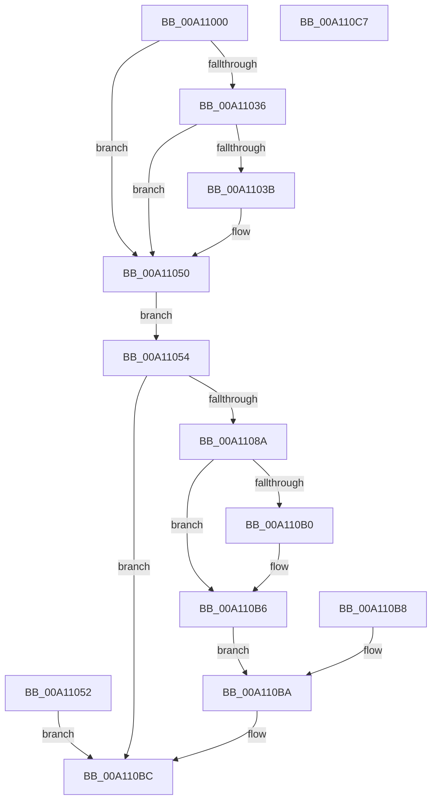

# NtSuspendThread

- RVA: `0x00A11000`–`0x00A110C8` (길이 `200` bytes)
- VA: `0x0000000140A11000`
- 실행 섹션: `PAGE`
- PDB 이름 있음: `예`; PDB Function 태그: `아니요`
- unwind 정보 RVA: `0x000A9364`
- 디코드: `51`개 명령, `200/200` bytes 표시
- 미해석 바이트: `0` (있으면 어셈블리에 `.byte`로 보존)

> 이 문서는 커널 이미지의 기계어와 PDB 기호를 분석해 생성했습니다. 4번과 5번은 함수 원형과 자료형을 바이너리 사용 방식에서 추정한 C 해석이며 원본 소스 복구 결과는 아닙니다.

## 1. Dependencies

- 직접 호출 지점: **3**; 고유 호출 대상: **3**
- 직접 호출자로 확인된 함수: **0**
- RIP 상대 이미지 참조: **1**

### Outgoing calls
- `0x00A11081` → [ObpReferenceObjectByHandleWithTag](../86/ObpReferenceObjectByHandleWithTag_function_00869650.md) (function, `0x00869650`)
- `0x00A11094` → [PsSuspendThread](PsSuspendThread_function_00A110D0.md) (function, `0x00A110D0`)
- `0x00A110A5` → [ObfDereferenceObjectWithTag](../../text/2F/ObfDereferenceObjectWithTag_function_002F78E0.md) (function, `0x002F78E0`)

### Direct callers
- 이 함수 시작 RVA로 연결되는 직접 call은 확인되지 않았습니다. 간접 호출은 완전히 역산할 수 없습니다.

### Static image references
- `0x00A11054` → RVA `0x00FC6AC8` (`ALMOSTRO`; read)

## 2. Other-region calls and transfers

- 다른 실행 섹션으로 향하는 call: **1**
  - `0x00A110A5` → [ObfDereferenceObjectWithTag](../../text/2F/ObfDereferenceObjectWithTag_function_002F78E0.md) (`PAGE` → `.text`)
- 별도 외부 분기/꼬리 이동을 확인하지 못했습니다.

## 3. Assembly (complete function range)

```asm
00A11000  48 89 5C 24 08                  mov qword ptr [rsp + 8], rbx
00A11005  57                              push rdi
00A11006  48 83 EC 50                     sub rsp, 0x50
00A1100A  48 8B DA                        mov rbx, rdx
00A1100D  4C 8B D1                        mov r10, rcx
00A11010  C7 44 24 70 00 00 00 00         mov dword ptr [rsp + 0x70], 0
00A11018  48 C7 44 24 78 00 00 00 00      mov qword ptr [rsp + 0x78], 0
00A11021  65 48 8B 04 25 88 01 00 00      mov rax, qword ptr gs:[0x188]
00A1102A  44 8A 88 32 02 00 00            mov r9b, byte ptr [rax + 0x232]
00A11031  45 84 C9                        test r9b, r9b
00A11034  74 1A                           je 0x140a11050
00A11036  48 85 D2                        test rdx, rdx
00A11039  74 15                           je 0x140a11050
00A1103B  48 B9 00 00 FF FF FF 7F 00 00   movabs rcx, 0x7fffffff0000
00A11045  48 3B D1                        cmp rdx, rcx
00A11048  48 0F 42 CA                     cmovb rcx, rdx
00A1104C  8B 01                           mov eax, dword ptr [rcx]
00A1104E  89 01                           mov dword ptr [rcx], eax
00A11050  EB 02                           jmp 0x140a11054
00A11052  EB 68                           jmp 0x140a110bc
00A11054  4C 8B 05 6D 5A 5B 00            mov r8, qword ptr [rip + 0x5b5a6d]
00A1105B  48 83 64 24 38 00               and qword ptr [rsp + 0x38], 0
00A11061  48 83 64 24 30 00               and qword ptr [rsp + 0x30], 0
00A11067  48 8D 44 24 78                  lea rax, [rsp + 0x78]
00A1106C  48 89 44 24 28                  mov qword ptr [rsp + 0x28], rax
00A11071  C7 44 24 20 50 73 53 75         mov dword ptr [rsp + 0x20], 0x75537350
00A11079  BA 02 00 00 00                  mov edx, 2
00A1107E  49 8B CA                        mov rcx, r10
00A11081  E8 CA 85 E5 FF                  call 0x140869650
00A11086  85 C0                           test eax, eax
00A11088  78 32                           js 0x140a110bc
00A1108A  48 8D 54 24 70                  lea rdx, [rsp + 0x70]
00A1108F  48 8B 4C 24 78                  mov rcx, qword ptr [rsp + 0x78]
00A11094  E8 37 00 00 00                  call 0x140a110d0
00A11099  8B F8                           mov edi, eax
00A1109B  BA 50 73 53 75                  mov edx, 0x75537350
00A110A0  48 8B 4C 24 78                  mov rcx, qword ptr [rsp + 0x78]
00A110A5  E8 36 68 8E FF                  call 0x1402f78e0
00A110AA  90                              nop
00A110AB  48 85 DB                        test rbx, rbx
00A110AE  74 06                           je 0x140a110b6
00A110B0  8B 4C 24 70                     mov ecx, dword ptr [rsp + 0x70]
00A110B4  89 0B                           mov dword ptr [rbx], ecx
00A110B6  EB 02                           jmp 0x140a110ba
00A110B8  8B F8                           mov edi, eax
00A110BA  8B C7                           mov eax, edi
00A110BC  48 8B 5C 24 60                  mov rbx, qword ptr [rsp + 0x60]
00A110C1  48 83 C4 50                     add rsp, 0x50
00A110C5  5F                              pop rdi
00A110C6  C3                              ret
00A110C7  CC                              int3
```

## 4. C-style interpretation (structured pseudocode)

```c
__int64 __fastcall NtSuspendThread(__int64 a1, __int64 a2)
{
    __int64 result;
    __int64 v_rsp;
    unsigned __int64 v_stack_m20;
    unsigned __int64 v_stack_m28;
    unsigned __int64 v_stack_m30;
    unsigned int v_stack_m38;
    unsigned int v_stack_p18;
    unsigned __int64 v_stack_p20;
    unsigned __int64 v_stack_p8;

    v_stack_p8 = v_rbx;
    v_rsp = (v_rsp) - (80);
    v_stack_p18 = 0;
    v_stack_p20 = 0;
    if ((unsigned __int8)(*(unsigned __int8 *)(*(unsigned __int64 *)(gs_base + (0 + 392)) + 562)) == 0) goto loc_00A11050;
    result = *(unsigned __int64 *)(gs_base + (0 + 392));
    if (a2 != 0) {
        if (a2 < a1) { a1 = a2; }
        result = *(unsigned int *)(a1);
        *(unsigned int *)(a1) = (unsigned int)(result);
    }
    goto loc_00A11054;
loc_00A11054:
    v_stack_m30 = v_stack_p20;
    v_stack_m38 = 0x75537350ULL;
    result = ObpReferenceObjectByHandleWithTag(a1, 2, *(unsigned __int64 *)(v_rip + 5986925), *(unsigned __int8 *)(*(unsigned __int64 *)(gs_base + (0 + 392)) + 562));
    if (sign_flag) goto loc_00A110BC;
    result = PsSuspendThread(v_stack_p20, v_stack_p18, *(unsigned __int64 *)(v_rip + 5986925), *(unsigned __int8 *)(*(unsigned __int64 *)(gs_base + (0 + 392)) + 562));
    result = ObfDereferenceObjectWithTag(v_stack_p20, (unsigned int)(0x75537350ULL), *(unsigned __int64 *)(v_rip + 5986925), *(unsigned __int8 *)(*(unsigned __int64 *)(gs_base + (0 + 392)) + 562));
    if (a2 != 0) {
        a1 = v_stack_p18;
        *(unsigned int *)(a2) = (unsigned int)(a1);
    }
    goto loc_00A110BA;
loc_00A110BA:
loc_00A110BC:
    v_rsp = (v_rsp) + (80);
    return (unsigned int)((unsigned int)((unsigned int)((unsigned int)(result))));
}
```

## 5. (Beta) C Style

```c
int64_t NtSuspendThread(int64_t Arg1, int64_t Arg2)
{
    int64_t result;
    int64_t local_rsp;
    uint64_t v_stack_m20;
    uint64_t v_stack_m28;
    uint64_t v_stack_m30;
    uint32_t v_stack_m38;
    uint32_t v_stack_p18;
    uint64_t v_stack_p20;
    uint64_t v_stack_p8;

    v_stack_p8 = local_rbx;
    local_rsp = (local_rsp) - (80);
    v_stack_p18 = 0;
    v_stack_p20 = 0;
    if ((uint8_t)(*(uint8_t *)(*(uint64_t *)(gs_base + (0 + 0x188)) + 0x232)) == 0) goto loc_00A11050;
    result = *(uint64_t *)(gs_base + (0 + 0x188));
    if (Arg2 != 0) {
        if (Arg2 < Arg1) { Arg1 = Arg2; }
        result = *(uint32_t *)(Arg1);
        *(uint32_t *)(Arg1) = (uint32_t)(result);
    }
    goto loc_00A11054;
loc_00A11054:
    v_stack_m30 = v_stack_p20;
    v_stack_m38 = 0x75537350ULL;
    result = ObpReferenceObjectByHandleWithTag(Arg1, 2, *(uint64_t *)(v_rip + 0x5B5A6D), *(uint8_t *)(*(uint64_t *)(gs_base + (0 + 0x188)) + 0x232));
    if (sign_flag) goto loc_00A110BC;
    result = PsSuspendThread(v_stack_p20, v_stack_p18, *(uint64_t *)(v_rip + 0x5B5A6D), *(uint8_t *)(*(uint64_t *)(gs_base + (0 + 0x188)) + 0x232));
    result = ObfDereferenceObjectWithTag(v_stack_p20, (uint32_t)(0x75537350ULL), *(uint64_t *)(v_rip + 0x5B5A6D), *(uint8_t *)(*(uint64_t *)(gs_base + (0 + 0x188)) + 0x232));
    if (Arg2 != 0) {
        Arg1 = v_stack_p18;
        *(uint32_t *)(Arg2) = (uint32_t)(Arg1);
    }
    goto loc_00A110BA;
loc_00A110BA:
loc_00A110BC:
    local_rsp = (local_rsp) + (80);
    return (uint32_t)((uint32_t)((uint32_t)((uint32_t)(result))));
}
```

## 6. Execution-region graph

[열기: 2D/3D 그래프와 함수 탐색 컨트롤 패널](../../../control-panel.html?section=page&rva=0x00A11000&view=graph)

- 2D 그래프는 위에서 아래로 흐르고, 3D 그래프는 빈 공간을 드래그해 회전합니다. Shift+드래그는 이동, 휠은 확대·축소, 함수 노드 선택은 대상 보고서 이동입니다.

### Static fallback


