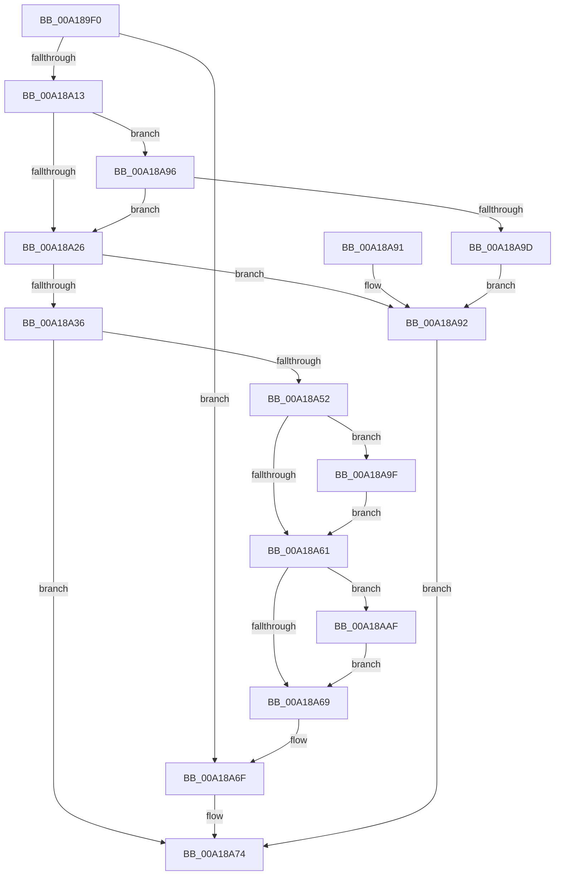

# PfSnArrayGrow

- RVA: `0x00A189F0`–`0x00A18AB8` (길이 `200` bytes)
- VA: `0x0000000140A189F0`
- 실행 섹션: `PAGE`
- PDB 이름 있음: `예`; PDB Function 태그: `아니요`
- unwind 정보 RVA: `0x000AA1C8`
- 디코드: `65`개 명령, `200/200` bytes 표시
- 미해석 바이트: `0` (있으면 어셈블리에 `.byte`로 보존)

> 이 문서는 커널 이미지의 기계어와 PDB 기호를 분석해 생성했습니다. 4번과 5번은 함수 원형과 자료형을 바이너리 사용 방식에서 추정한 C 해석이며 원본 소스 복구 결과는 아닙니다.

## 1. Dependencies

- 직접 호출 지점: **3**; 고유 호출 대상: **3**
- 직접 호출자로 확인된 함수: **1**
- RIP 상대 이미지 참조: **0**

### Outgoing calls
- `0x00A18A43` → [ExAllocatePool2](../../poolcode/B8/ExAllocatePool2_function_00B820F0.md) (function, `0x00B820F0`)
- `0x00A18AA8` → [memcpy](../../text/6C/memcpy_function_006C6840.md) (function, `0x006C6840`)
- `0x00A18AB1` → [ExFreePoolWithTag](../../poolcode/B8/ExFreePoolWithTag_function_00B82870.md) (function, `0x00B82870`)

### Direct callers
- [PfSnVolumeKeyQuery](PfSnVolumeKeyQuery_function_00A18928.md) at `0x00A18994`

### Static image references
- 디코드된 RIP-relative 메모리 참조가 없습니다.

## 2. Other-region calls and transfers

- 다른 실행 섹션으로 향하는 call: **3**
  - `0x00A18A43` → [ExAllocatePool2](../../poolcode/B8/ExAllocatePool2_function_00B820F0.md) (`PAGE` → `POOLCODE`)
  - `0x00A18AA8` → [memcpy](../../text/6C/memcpy_function_006C6840.md) (`PAGE` → `.text`)
  - `0x00A18AB1` → [ExFreePoolWithTag](../../poolcode/B8/ExFreePoolWithTag_function_00B82870.md) (`PAGE` → `POOLCODE`)
- 별도 외부 분기/꼬리 이동을 확인하지 못했습니다.

## 3. Assembly (complete function range)

```asm
00A189F0  48 8B C4                        mov rax, rsp
00A189F3  48 89 58 08                     mov qword ptr [rax + 8], rbx
00A189F7  48 89 68 10                     mov qword ptr [rax + 0x10], rbp
00A189FB  48 89 70 18                     mov qword ptr [rax + 0x18], rsi
00A189FF  48 89 78 20                     mov qword ptr [rax + 0x20], rdi
00A18A03  41 56                           push r14
00A18A05  48 83 EC 20                     sub rsp, 0x20
00A18A09  41 8B 01                        mov eax, dword ptr [r9]
00A18A0C  4D 8B F1                        mov r14, r9
00A18A0F  3B C8                           cmp ecx, eax
00A18A11  72 5C                           jb 0x140a18a6f
00A18A13  8D 3C 40                        lea edi, [rax + rax*2]
00A18A16  B8 04 00 00 00                  mov eax, 4
00A18A1B  D1 EF                           shr edi, 1
00A18A1D  3B F8                           cmp edi, eax
00A18A1F  0F 42 F8                        cmovb edi, eax
00A18A22  3B CF                           cmp ecx, edi
00A18A24  73 70                           jae 0x140a18a96
00A18A26  8B C7                           mov eax, edi
00A18A28  B9 FF FF FF FF                  mov ecx, 0xffffffff
00A18A2D  48 C1 E0 03                     shl rax, 3
00A18A31  48 3B C1                        cmp rax, rcx
00A18A34  77 5C                           ja 0x140a18a92
00A18A36  8B D0                           mov edx, eax
00A18A38  B9 00 01 00 00                  mov ecx, 0x100
00A18A3D  41 B8 43 63 50 56               mov r8d, 0x56506343
00A18A43  E8 A8 96 16 00                  call 0x140b820f0
00A18A48  33 DB                           xor ebx, ebx
00A18A4A  48 8B E8                        mov rbp, rax
00A18A4D  48 85 C0                        test rax, rax
00A18A50  74 22                           je 0x140a18a74
00A18A52  41 8B 06                        mov eax, dword ptr [r14]
00A18A55  48 8B 74 24 50                  mov rsi, qword ptr [rsp + 0x50]
00A18A5A  C1 E0 03                        shl eax, 3
00A18A5D  85 C0                           test eax, eax
00A18A5F  75 3E                           jne 0x140a18a9f
00A18A61  48 8B 0E                        mov rcx, qword ptr [rsi]
00A18A64  48 85 C9                        test rcx, rcx
00A18A67  75 46                           jne 0x140a18aaf
00A18A69  48 89 2E                        mov qword ptr [rsi], rbp
00A18A6C  41 89 3E                        mov dword ptr [r14], edi
00A18A6F  BB 01 00 00 00                  mov ebx, 1
00A18A74  48 8B 6C 24 38                  mov rbp, qword ptr [rsp + 0x38]
00A18A79  8B C3                           mov eax, ebx
00A18A7B  48 8B 5C 24 30                  mov rbx, qword ptr [rsp + 0x30]
00A18A80  48 8B 74 24 40                  mov rsi, qword ptr [rsp + 0x40]
00A18A85  48 8B 7C 24 48                  mov rdi, qword ptr [rsp + 0x48]
00A18A8A  48 83 C4 20                     add rsp, 0x20
00A18A8E  41 5E                           pop r14
00A18A90  C3                              ret
00A18A91  CC                              int3
00A18A92  33 DB                           xor ebx, ebx
00A18A94  EB DE                           jmp 0x140a18a74
00A18A96  8D 79 04                        lea edi, [rcx + 4]
00A18A99  3B F9                           cmp edi, ecx
00A18A9B  73 89                           jae 0x140a18a26
00A18A9D  EB F3                           jmp 0x140a18a92
00A18A9F  48 8B 16                        mov rdx, qword ptr [rsi]
00A18AA2  48 8B CD                        mov rcx, rbp
00A18AA5  44 8B C0                        mov r8d, eax
00A18AA8  E8 93 DD CA FF                  call 0x1406c6840
00A18AAD  EB B2                           jmp 0x140a18a61
00A18AAF  33 D2                           xor edx, edx
00A18AB1  E8 BA 9D 16 00                  call 0x140b82870
00A18AB6  EB B1                           jmp 0x140a18a69
```

## 4. C-style interpretation (structured pseudocode)

```c
__int64 __fastcall PfSnArrayGrow(int a1, __int64 a2, __int64 a3, __int64 a4, __int64 a5)
{
    __int64 result;
    __int64 v_rbx;
    __int64 v_rdi;
    __int64 v_rsp;
    unsigned __int64 v_stack_p10;
    unsigned __int64 v_stack_p18;
    unsigned __int64 v_stack_p20;
    unsigned __int64 v_stack_p8;

    *(unsigned __int64 *)(v_rsp + 8) = v_rbx;
    *(unsigned __int64 *)(v_rsp + 16) = v_rbp;
    *(unsigned __int64 *)(v_rsp + 24) = v_rsi;
    *(unsigned __int64 *)(v_rsp + 32) = v_rdi;
    v_rsp = (v_rsp) - (32);
    if (a1 < ((unsigned int)((unsigned int)(*(unsigned int *)(a4))))) goto loc_00A18A6F;
    v_rdi = (unsigned int)(((unsigned int)(*(unsigned int *)(a4)) + (unsigned int)(*(unsigned int *)(a4)) * 2) >> (1));
    if (((unsigned int)(v_rdi)) < 4) { v_rdi = 4; }
    if (a1 >= ((unsigned int)(v_rdi))) goto loc_00A18A96;
loc_00A18A26:
    result = ((unsigned int)((unsigned int)(v_rdi))) << (3);
    if (result > ((unsigned int)(0xFFFFFFFFULL))) goto loc_00A18A92;
    result = ExAllocatePool2(256, (unsigned int)((unsigned int)(result)), (unsigned int)(0x56506343ULL), a4);
    v_rbx = 0;
    if (result == 0) goto loc_00A18A74;
    result = (unsigned int)(((unsigned int)(*(unsigned int *)(a4))) << (3));
    if ((unsigned int)(result) != 0) goto loc_00A18A9F;
loc_00A18A61:
    if (*(unsigned __int64 *)(a5) != 0) goto loc_00A18AAF;
loc_00A18A69:
    *(unsigned __int64 *)(a5) = result;
    *(unsigned int *)(a4) = (unsigned int)(v_rdi);
loc_00A18A6F:
loc_00A18A74:
    v_rsp = (v_rsp) + (32);
    return 1;
loc_00A18A92:
    v_rbx = 0;
    goto loc_00A18A74;
loc_00A18A96:
    if (((unsigned int)(*(unsigned __int64 *)(a5) + 4)) >= ((unsigned int)(*(unsigned __int64 *)(a5)))) goto loc_00A18A26;
    goto loc_00A18A92;
loc_00A18A9F:
    result = memcpy(v_stack_p10, *(unsigned __int64 *)(v_stack_p18), 1, a4);
    goto loc_00A18A61;
loc_00A18AAF:
    a2 = 0;
    result = ExFreePoolWithTag(v_stack_p10, a2, 1, a4);
    goto loc_00A18A69;
}
```

## 5. (Beta) C Style

```c
int64_t PfSnArrayGrow(int32_t Arg1, int64_t Arg2, int64_t Arg3, void *Arg4, void *Arg5)
{
    uint8_t *arg4 = (uint8_t *)Arg4;
    uint8_t *arg5 = (uint8_t *)Arg5;

    int64_t result;
    int64_t local_rbx;
    int64_t local_rdi;
    int64_t local_rsp;
    uint64_t v_stack_p10;
    uint64_t v_stack_p18;
    uint64_t v_stack_p20;
    uint64_t v_stack_p8;

    *(uint64_t *)(local_rsp + 0x8) = local_rbx;
    *(uint64_t *)(local_rsp + 0x10) = local_rbp;
    *(uint64_t *)(local_rsp + 0x18) = local_rsi;
    *(uint64_t *)(local_rsp + 0x20) = local_rdi;
    local_rsp = (local_rsp) - (32);
    if (Arg1 < ((uint32_t)((uint32_t)(*(uint32_t *)(arg4))))) goto loc_00A18A6F;
    local_rdi = (uint32_t)(((uint32_t)(*(uint32_t *)(arg4)) + (uint32_t)(*(uint32_t *)(arg4)) * 2) >> (1));
    if (((uint32_t)(local_rdi)) < 4) { local_rdi = 4; }
    if (Arg1 >= ((uint32_t)(local_rdi))) goto loc_00A18A96;
loc_00A18A26:
    result = ((uint32_t)((uint32_t)(local_rdi))) << (3);
    if (result > ((uint32_t)(0xFFFFFFFFULL))) goto loc_00A18A92;
    result = ExAllocatePool2(256, (uint32_t)((uint32_t)(result)), (uint32_t)(0x56506343ULL), Arg4);
    local_rbx = 0;
    if (result == 0) goto loc_00A18A74;
    result = (uint32_t)(((uint32_t)(*(uint32_t *)(arg4))) << (3));
    if ((uint32_t)(result) != 0) goto loc_00A18A9F;
loc_00A18A61:
    if (*(uint64_t *)(arg5) != 0) goto loc_00A18AAF;
loc_00A18A69:
    *(uint64_t *)(arg5) = result;
    *(uint32_t *)(arg4) = (uint32_t)(local_rdi);
loc_00A18A6F:
loc_00A18A74:
    local_rsp = (local_rsp) + (32);
    return 1;
loc_00A18A92:
    local_rbx = 0;
    goto loc_00A18A74;
loc_00A18A96:
    if (((uint32_t)(*(uint64_t *)(arg5) + 4)) >= ((uint32_t)(*(uint64_t *)(arg5)))) goto loc_00A18A26;
    goto loc_00A18A92;
loc_00A18A9F:
    result = memcpy(v_stack_p10, *(uint64_t *)(v_stack_p18), 1, Arg4);
    goto loc_00A18A61;
loc_00A18AAF:
    Arg2 = 0;
    result = ExFreePoolWithTag(v_stack_p10, Arg2, 1, Arg4);
    goto loc_00A18A69;
}
```

### 관측된 메모리 오프셋

구조체 형식이 확인되지 않은 접근은 인자 기준의 오프셋으로만 기록했습니다.

| 기준 인자 | 오프셋 표현 | 폭 (bit) | 접근 |
|---|---:|---:|---|
| `Arg4` | `+ 0x0` | `32` | `R` |
| `Arg4` | `+ 0x0` | `32` | `W` |
| `Arg5` | `+ 0x0` | `64` | `R` |
| `Arg5` | `+ 0x0` | `64` | `W` |

## 6. Execution-region graph

[열기: 2D/3D 그래프와 함수 탐색 컨트롤 패널](../../../control-panel.html?section=page&rva=0x00A189F0&view=graph)

- 2D 그래프는 위에서 아래로 흐르고, 3D 그래프는 빈 공간을 드래그해 회전합니다. Shift+드래그는 이동, 휠은 확대·축소, 함수 노드 선택은 대상 보고서 이동입니다.

### Static fallback


