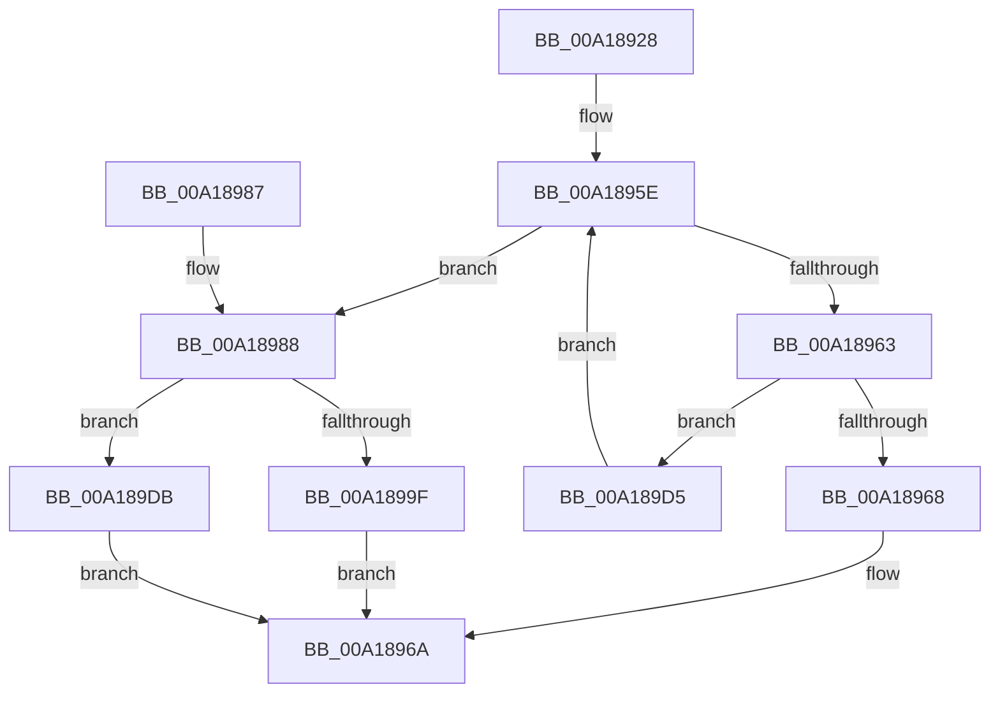

# PfSnVolumeKeyQuery

- RVA: `0x00A18928`–`0x00A189EA` (길이 `194` bytes)
- VA: `0x0000000140A18928`
- 실행 섹션: `PAGE`
- PDB 이름 있음: `예`; PDB Function 태그: `아니요`
- unwind 정보 RVA: `0x000AA1AC`
- 디코드: `53`개 명령, `194/194` bytes 표시
- 미해석 바이트: `0` (있으면 어셈블리에 `.byte`로 보존)

> 이 문서는 커널 이미지의 기계어와 PDB 기호를 분석해 생성했습니다. 4번과 5번은 함수 원형과 자료형을 바이너리 사용 방식에서 추정한 C 해석이며 원본 소스 복구 결과는 아닙니다.

## 1. Dependencies

- 직접 호출 지점: **3**; 고유 호출 대상: **3**
- 직접 호출자로 확인된 함수: **1**
- RIP 상대 이미지 참조: **1**

### Outgoing calls
- `0x00A18994` → [PfSnArrayGrow](PfSnArrayGrow_function_00A189F0.md) (function, `0x00A189F0`)
- `0x00A189C7` → [guard_dispatch_icall](../../text/6B/guard_dispatch_icall_function_006BAAD0.md) (function, `0x006BAAD0`)
- `0x00A189DE` → [PfSnFailProcessTrace](../96/PfSnFailProcessTrace_function_00960DB0.md) (function, `0x00960DB0`)

### Direct callers
- [PfSnNameQueryWorker](../../text/2C/PfSnNameQueryWorker_function_002C0E20.md) at `0x002C0EA0`

### Static image references
- `0x00A189B5` → RVA `0x00E671E8` (`.data`; read)

## 2. Other-region calls and transfers

- 다른 실행 섹션으로 향하는 call: **1**
  - `0x00A189C7` → [guard_dispatch_icall](../../text/6B/guard_dispatch_icall_function_006BAAD0.md) (`PAGE` → `.text`)
- 별도 외부 분기/꼬리 이동을 확인하지 못했습니다.

## 3. Assembly (complete function range)

```asm
00A18928  48 8B C4                        mov rax, rsp
00A1892B  48 89 58 08                     mov qword ptr [rax + 8], rbx
00A1892F  48 89 68 10                     mov qword ptr [rax + 0x10], rbp
00A18933  48 89 70 18                     mov qword ptr [rax + 0x18], rsi
00A18937  48 89 78 20                     mov qword ptr [rax + 0x20], rdi
00A1893B  41 56                           push r14
00A1893D  48 83 EC 30                     sub rsp, 0x30
00A18941  48 8D B1 48 02 00 00            lea rsi, [rcx + 0x248]
00A18948  48 8B F9                        mov rdi, rcx
00A1894B  48 8B 06                        mov rax, qword ptr [rsi]
00A1894E  48 8B EA                        mov rbp, rdx
00A18951  8B 89 54 02 00 00               mov ecx, dword ptr [rcx + 0x254]
00A18957  4D 8B F0                        mov r14, r8
00A1895A  48 8D 14 C8                     lea rdx, [rax + rcx*8]
00A1895E  48 3B C2                        cmp rax, rdx
00A18961  73 25                           jae 0x140a18988
00A18963  48 39 28                        cmp qword ptr [rax], rbp
00A18966  75 6D                           jne 0x140a189d5
00A18968  33 DB                           xor ebx, ebx
00A1896A  48 8B 6C 24 48                  mov rbp, qword ptr [rsp + 0x48]
00A1896F  8B C3                           mov eax, ebx
00A18971  48 8B 5C 24 40                  mov rbx, qword ptr [rsp + 0x40]
00A18976  48 8B 74 24 50                  mov rsi, qword ptr [rsp + 0x50]
00A1897B  48 8B 7C 24 58                  mov rdi, qword ptr [rsp + 0x58]
00A18980  48 83 C4 30                     add rsp, 0x30
00A18984  41 5E                           pop r14
00A18986  C3                              ret
00A18987  CC                              int3
00A18988  4C 8D 8F 50 02 00 00            lea r9, [rdi + 0x250]
00A1898F  48 89 74 24 20                  mov qword ptr [rsp + 0x20], rsi
00A18994  E8 57 00 00 00                  call 0x140a189f0
00A18999  33 DB                           xor ebx, ebx
00A1899B  85 C0                           test eax, eax
00A1899D  74 3C                           je 0x140a189db
00A1899F  8B 8F 54 02 00 00               mov ecx, dword ptr [rdi + 0x254]
00A189A5  49 8B D6                        mov rdx, r14
00A189A8  48 8B 06                        mov rax, qword ptr [rsi]
00A189AB  48 89 2C C8                     mov qword ptr [rax + rcx*8], rbp
00A189AF  FF 87 54 02 00 00               inc dword ptr [rdi + 0x254]
00A189B5  48 8B 0D 2C E8 44 00            mov rcx, qword ptr [rip + 0x44e82c]
00A189BC  48 8B 41 18                     mov rax, qword ptr [rcx + 0x18]
00A189C0  48 8B 8F 60 01 00 00            mov rcx, qword ptr [rdi + 0x160]
00A189C7  E8 04 21 CA FF                  call 0x1406baad0
00A189CC  85 C0                           test eax, eax
00A189CE  0F 49 C3                        cmovns eax, ebx
00A189D1  8B D8                           mov ebx, eax
00A189D3  EB 95                           jmp 0x140a1896a
00A189D5  48 83 C0 08                     add rax, 8
00A189D9  EB 83                           jmp 0x140a1895e
00A189DB  48 8B CF                        mov rcx, rdi
00A189DE  E8 CD 83 F4 FF                  call 0x140960db0
00A189E3  BB 9A 00 00 C0                  mov ebx, 0xc000009a
00A189E8  EB 80                           jmp 0x140a1896a
```

## 4. C-style interpretation (structured pseudocode)

```c
__int64 __fastcall PfSnVolumeKeyQuery(__int64 a1, __int64 a2, __int64 a3)
{
    __int64 result;
    __int64 v_rbx;
    __int64 v_rsp;
    unsigned __int64 v_stack_p10;
    unsigned __int64 v_stack_p18;
    unsigned __int64 v_stack_p20;
    unsigned __int64 v_stack_p8;

    *(unsigned __int64 *)(v_rsp + 8) = v_rbx;
    *(unsigned __int64 *)(v_rsp + 16) = v_rbp;
    *(unsigned __int64 *)(v_rsp + 24) = v_rsi;
    *(unsigned __int64 *)(v_rsp + 32) = v_rdi;
    v_rsp = (v_rsp) - (48);
loc_00A1895E:
    if ((*(unsigned __int64 *)(a1 + 584)) >= (*(unsigned __int64 *)(a1 + 584) + (unsigned int)(*(unsigned int *)(a1 + 596)) * 8)) goto loc_00A18988;
    if ((*(unsigned __int64 *)(*(unsigned __int64 *)(a1 + 584))) != a2) goto loc_00A189D5;
    v_rbx = 0;
loc_00A1896A:
    v_rsp = (v_rsp) + (48);
    return 0;
loc_00A18988:
    v_stack_p20 = v_stack_p18;
    result = PfSnArrayGrow((unsigned int)(*(unsigned int *)(a1 + 596)), *(unsigned __int64 *)(a1 + 584) + (unsigned int)(*(unsigned int *)(a1 + 596)) * 8, a3, v_stack_p20 + 592);
    v_rbx = 0;
    if ((unsigned int)(result) == 0) goto loc_00A189DB;
    *(unsigned __int64 *)(*(unsigned __int64 *)(v_stack_p18) + (unsigned int)(*(unsigned int *)(v_stack_p20 + 596)) * 8) = v_stack_p10;
    result = guard_dispatch_icall(*(unsigned __int64 *)(v_stack_p20 + 352), a3, a3, v_stack_p20 + 592);
    if (!sign_flag) { result = 0; }
    goto loc_00A1896A;
loc_00A189D5:
    result = (result) + (8);
    goto loc_00A1895E;
loc_00A189DB:
    result = PfSnFailProcessTrace(v_stack_p20, a3, a3, v_stack_p20 + 592);
    goto loc_00A1896A;
}
```

## 5. (Beta) C Style

```c
int64_t PfSnVolumeKeyQuery(void *Arg1, int64_t Arg2, int64_t Arg3)
{
    uint8_t *arg1 = (uint8_t *)Arg1;

    int64_t result;
    int64_t local_rbx;
    int64_t local_rsp;
    uint64_t v_stack_p10;
    uint64_t v_stack_p18;
    uint64_t v_stack_p20;
    uint64_t v_stack_p8;

    *(uint64_t *)(local_rsp + 0x8) = local_rbx;
    *(uint64_t *)(local_rsp + 0x10) = local_rbp;
    *(uint64_t *)(local_rsp + 0x18) = local_rsi;
    *(uint64_t *)(local_rsp + 0x20) = local_rdi;
    local_rsp = (local_rsp) - (48);
loc_00A1895E:
    if ((*(uint64_t *)(arg1 + 0x248)) >= (*(uint64_t *)(arg1 + 0x248) + (uint32_t)(*(uint32_t *)(arg1 + 0x254)) * 8)) goto loc_00A18988;
    if ((*(uint64_t *)(*(uint64_t *)(arg1 + 0x248))) != Arg2) goto loc_00A189D5;
    local_rbx = 0;
loc_00A1896A:
    local_rsp = (local_rsp) + (48);
    return 0;
loc_00A18988:
    v_stack_p20 = v_stack_p18;
    result = PfSnArrayGrow((uint32_t)(*(uint32_t *)(arg1 + 0x254)), *(uint64_t *)(arg1 + 0x248) + (uint32_t)(*(uint32_t *)(arg1 + 0x254)) * 8, Arg3, v_stack_p20 + 592);
    local_rbx = 0;
    if ((uint32_t)(result) == 0) goto loc_00A189DB;
    *(uint64_t *)(*(uint64_t *)(v_stack_p18) + (uint32_t)(*(uint32_t *)(v_stack_p20 + 0x254)) * 8) = v_stack_p10;
    result = guard_dispatch_icall(*(uint64_t *)(v_stack_p20 + 0x160), Arg3, Arg3, v_stack_p20 + 592);
    if (!sign_flag) { result = 0; }
    goto loc_00A1896A;
loc_00A189D5:
    result = (result) + (8);
    goto loc_00A1895E;
loc_00A189DB:
    result = PfSnFailProcessTrace(v_stack_p20, Arg3, Arg3, v_stack_p20 + 592);
    goto loc_00A1896A;
}
```

### 관측된 메모리 오프셋

구조체 형식이 확인되지 않은 접근은 인자 기준의 오프셋으로만 기록했습니다.

| 기준 인자 | 오프셋 표현 | 폭 (bit) | 접근 |
|---|---:|---:|---|
| `Arg1` | `+ 0x0` | `64` | `R` |
| `Arg1` | `+ 0x160` | `64` | `R` |
| `Arg1` | `+ 0x248` | `64` | `R` |
| `Arg1` | `+ 0x250` | `64` | `R` |
| `Arg1` | `+ 0x254` | `32` | `R` |
| `Arg1` | `+ 0x254` | `32` | `R/W` |

## 6. Execution-region graph

[열기: 2D/3D 그래프와 함수 탐색 컨트롤 패널](../../../control-panel.html?section=page&rva=0x00A18928&view=graph)

- 2D 그래프는 위에서 아래로 흐르고, 3D 그래프는 빈 공간을 드래그해 회전합니다. Shift+드래그는 이동, 휠은 확대·축소, 함수 노드 선택은 대상 보고서 이동입니다.

### Static fallback


