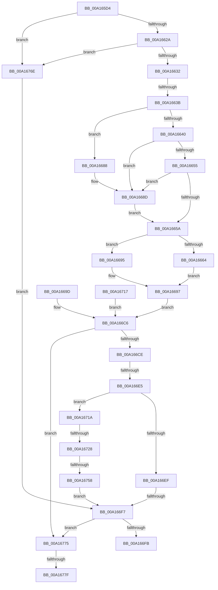

# PiCMCaptureInterfaceListInputData

- RVA: `0x00A165D4`–`0x00A16795` (길이 `449` bytes)
- VA: `0x0000000140A165D4`
- 실행 섹션: `PAGE`
- PDB 이름 있음: `예`; PDB Function 태그: `예`
- unwind 정보 RVA: `0x000A9C20`
- 디코드: `121`개 명령, `449/449` bytes 표시
- 미해석 바이트: `0` (있으면 어셈블리에 `.byte`로 보존)

> 이 문서는 커널 이미지의 기계어와 PDB 기호를 분석해 생성했습니다. 4번과 5번은 함수 원형과 자료형을 바이너리 사용 방식에서 추정한 C 해석이며 원본 소스 복구 결과는 아닙니다.

## 1. Dependencies

- 직접 호출 지점: **4**; 고유 호출 대상: **4**
- 직접 호출자로 확인된 함수: **1**
- RIP 상대 이미지 참조: **0**

### Outgoing calls
- `0x00A16688` → [ExRaiseDatatypeMisalignment](../89/ExRaiseDatatypeMisalignment_function_00899FD0.md) (function, `0x00899FD0`)
- `0x00A166D8` → [Feature_KernelPnP_InterfaceListFilterUpdates__private_IsEnabledDeviceUsageNoInline](../../text/4F/Feature_KernelPnP_InterfaceListFilterUpdates__private_IsEnabledDeviceUsageNoInline_function_004F4340.md) (function, `0x004F4340`)
- `0x00A16749` → [PiControlMakeUserModeCallersCopy](../8E/PiControlMakeUserModeCallersCopy_function_008E4630.md) (function, `0x008E4630`)
- `0x00A1678A` → [PiControlFreeUserModeCallersBuffer](../../text/44/PiControlFreeUserModeCallersBuffer_function_00448990.md) (function, `0x00448990`)

### Direct callers
- [PiCMGetDeviceInterfaceList](PiCMGetDeviceInterfaceList_function_00A163D0.md) at `0x00A16436`

### Static image references
- 디코드된 RIP-relative 메모리 참조가 없습니다.

## 2. Other-region calls and transfers

- 다른 실행 섹션으로 향하는 call: **2**
  - `0x00A166D8` → [Feature_KernelPnP_InterfaceListFilterUpdates__private_IsEnabledDeviceUsageNoInline](../../text/4F/Feature_KernelPnP_InterfaceListFilterUpdates__private_IsEnabledDeviceUsageNoInline_function_004F4340.md) (`PAGE` → `.text`)
  - `0x00A1678A` → [PiControlFreeUserModeCallersBuffer](../../text/44/PiControlFreeUserModeCallersBuffer_function_00448990.md) (`PAGE` → `.text`)
- call이 아닌 외부 분기/꼬리 이동: **7**
  - `0x00A16635` → [sub_00B36E7C](../B3/Unknown_function_00B36E7C.md) (`tail-transfer`)
  - `0x00A166DF` → [sub_00B36E7C + 0xAE](../B3/Unknown_function_00B36E7C.md) (`tail-transfer`)
  - `0x00A166F1` → [sub_00B36E7C + 0x131](../B3/Unknown_function_00B36E7C.md) (`tail-transfer`)
  - `0x00A16722` → [sub_00B36E7C + 0x131](../B3/Unknown_function_00B36E7C.md) (`tail-transfer`)
  - `0x00A16752` → [sub_00B36E7C + 0xA1](../B3/Unknown_function_00B36E7C.md) (`tail-transfer`)
  - `0x00A16779` → [sub_00B36E7C + 0x138](../B3/Unknown_function_00B36E7C.md) (`tail-transfer`)
  - `0x00A16790` → [sub_00B36E7C + 0x138](../B3/Unknown_function_00B36E7C.md) (`tail-transfer`)

## 3. Assembly (complete function range)

```asm
00A165D4  48 89 5C 24 10                  mov qword ptr [rsp + 0x10], rbx
00A165D9  48 89 74 24 18                  mov qword ptr [rsp + 0x18], rsi
00A165DE  4C 89 4C 24 20                  mov qword ptr [rsp + 0x20], r9
00A165E3  57                              push rdi
00A165E4  41 54                           push r12
00A165E6  41 55                           push r13
00A165E8  41 56                           push r14
00A165EA  41 57                           push r15
00A165EC  48 83 EC 50                     sub rsp, 0x50
00A165F0  4D 8B F1                        mov r14, r9
00A165F3  4D 8B E1                        mov r12, r9
00A165F6  4C 89 4C 24 40                  mov qword ptr [rsp + 0x40], r9
00A165FB  33 FF                           xor edi, edi
00A165FD  89 7C 24 38                     mov dword ptr [rsp + 0x38], edi
00A16601  65 48 8B 04 25 88 01 00 00      mov rax, qword ptr gs:[0x188]
00A1660A  8A 80 32 02 00 00               mov al, byte ptr [rax + 0x232]
00A16610  88 84 24 80 00 00 00            mov byte ptr [rsp + 0x80], al
00A16617  88 44 24 30                     mov byte ptr [rsp + 0x30], al
00A1661B  8B DF                           mov ebx, edi
00A1661D  89 5C 24 34                     mov dword ptr [rsp + 0x34], ebx
00A16621  48 85 C9                        test rcx, rcx
00A16624  0F 84 44 01 00 00               je 0x140a1676e
00A1662A  85 D2                           test edx, edx
00A1662C  0F 84 3C 01 00 00               je 0x140a1676e
00A16632  45 85 C0                        test r8d, r8d
00A16635  0F 85 41 08 12 00               jne 0x140b36e7c
00A1663B  F6 C1 07                        test cl, 7
00A1663E  75 48                           jne 0x140a16688
00A16640  44 8B C2                        mov r8d, edx
00A16643  4C 03 C1                        add r8, rcx
00A16646  48 B8 00 00 FF FF FF 7F 00 00   movabs rax, 0x7fffffff0000
00A16650  4C 3B C0                        cmp r8, rax
00A16653  77 38                           ja 0x140a1668d
00A16655  4C 3B C1                        cmp r8, rcx
00A16658  72 33                           jb 0x140a1668d
00A1665A  BE 0D 00 00 C0                  mov esi, 0xc000000d
00A1665F  83 FA 28                        cmp edx, 0x28
00A16662  72 31                           jb 0x140a16695
00A16664  0F 10 01                        movups xmm0, xmmword ptr [rcx]
00A16667  41 0F 11 01                     movups xmmword ptr [r9], xmm0
00A1666B  0F 10 49 10                     movups xmm1, xmmword ptr [rcx + 0x10]
00A1666F  41 0F 11 49 10                  movups xmmword ptr [r9 + 0x10], xmm1
00A16674  F2 0F 10 41 20                  movsd xmm0, qword ptr [rcx + 0x20]
00A16679  F2 41 0F 11 41 20               movsd qword ptr [r9 + 0x20], xmm0
00A1667F  41 83 39 28                     cmp dword ptr [r9], 0x28
00A16683  0F 45 DE                        cmovne ebx, esi
00A16686  EB 0F                           jmp 0x140a16697
00A16688  E8 43 39 E8 FF                  call 0x140899fd0
00A1668D  8A 00                           mov al, byte ptr [rax]
00A1668F  8B 5C 24 34                     mov ebx, dword ptr [rsp + 0x34]
00A16693  EB C5                           jmp 0x140a1665a
00A16695  8B DE                           mov ebx, esi
00A16697  89 5C 24 34                     mov dword ptr [rsp + 0x34], ebx
00A1669B  EB 29                           jmp 0x140a166c6
00A1669D  8B D8                           mov ebx, eax
00A1669F  89 44 24 34                     mov dword ptr [rsp + 0x34], eax
00A166A3  33 FF                           xor edi, edi
00A166A5  BE 0D 00 00 C0                  mov esi, 0xc000000d
00A166AA  4C 8B B4 24 98 00 00 00         mov r14, qword ptr [rsp + 0x98]
00A166B2  89 7C 24 38                     mov dword ptr [rsp + 0x38], edi
00A166B6  8A 44 24 30                     mov al, byte ptr [rsp + 0x30]
00A166BA  88 84 24 80 00 00 00            mov byte ptr [rsp + 0x80], al
00A166C1  4C 8B 64 24 40                  mov r12, qword ptr [rsp + 0x40]
00A166C6  85 DB                           test ebx, ebx
00A166C8  0F 88 A7 00 00 00               js 0x140a16775
00A166CE  4D 8D 7E 18                     lea r15, [r14 + 0x18]
00A166D2  4D 8B 2F                        mov r13, qword ptr [r15]
00A166D5  49 89 3F                        mov qword ptr [r15], rdi
00A166D8  E8 63 DC AD FF                  call 0x1404f4340
00A166DD  85 C0                           test eax, eax
00A166DF  0F 84 45 08 12 00               je 0x140b36f2a
00A166E5  41 8B 4C 24 20                  mov ecx, dword ptr [r12 + 0x20]
00A166EA  4D 85 ED                        test r13, r13
00A166ED  75 2B                           jne 0x140a1671a
00A166EF  85 C9                           test ecx, ecx
00A166F1  0F 85 B6 08 12 00               jne 0x140b36fad
00A166F7  85 DB                           test ebx, ebx
00A166F9  78 7A                           js 0x140a16775
00A166FB  8B C3                           mov eax, ebx
00A166FD  4C 8D 5C 24 50                  lea r11, [rsp + 0x50]
00A16702  49 8B 5B 38                     mov rbx, qword ptr [r11 + 0x38]
00A16706  49 8B 73 40                     mov rsi, qword ptr [r11 + 0x40]
00A1670A  49 8B E3                        mov rsp, r11
00A1670D  41 5F                           pop r15
00A1670F  41 5E                           pop r14
00A16711  41 5D                           pop r13
00A16713  41 5C                           pop r12
00A16715  5F                              pop rdi
00A16716  C3                              ret
00A16717  CC                              int3
00A16718  EB AC                           jmp 0x140a166c6
00A1671A  8D 41 FE                        lea eax, [rcx - 2]
00A1671D  3D 8E 01 00 00                  cmp eax, 0x18e
00A16722  0F 87 85 08 12 00               ja 0x140b36fad
00A16728  BE 01 00 00 00                  mov esi, 1
00A1672D  89 74 24 28                     mov dword ptr [rsp + 0x28], esi
00A16731  8A 84 24 80 00 00 00            mov al, byte ptr [rsp + 0x80]
00A16738  88 44 24 20                     mov byte ptr [rsp + 0x20], al
00A1673C  44 8D 4E 01                     lea r9d, [rsi + 1]
00A16740  44 8B C1                        mov r8d, ecx
00A16743  49 8B D5                        mov rdx, r13
00A16746  49 8B CF                        mov rcx, r15
00A16749  E8 E2 DE EC FF                  call 0x1408e4630
00A1674E  8B D8                           mov ebx, eax
00A16750  85 C0                           test eax, eax
00A16752  0F 88 C5 07 12 00               js 0x140b36f1d
00A16758  89 74 24 38                     mov dword ptr [rsp + 0x38], esi
00A1675C  41 8B 54 24 20                  mov edx, dword ptr [r12 + 0x20]
00A16761  48 D1 EA                        shr rdx, 1
00A16764  49 8B 0F                        mov rcx, qword ptr [r15]
00A16767  66 89 7C 51 FE                  mov word ptr [rcx + rdx*2 - 2], di
00A1676C  EB 89                           jmp 0x140a166f7
00A1676E  BB 0D 00 00 C0                  mov ebx, 0xc000000d
00A16773  EB 82                           jmp 0x140a166f7
00A16775  39 7C 24 38                     cmp dword ptr [rsp + 0x38], edi
00A16779  0F 84 35 08 12 00               je 0x140b36fb4
00A1677F  49 8B 56 18                     mov rdx, qword ptr [r14 + 0x18]
00A16783  8A 8C 24 80 00 00 00            mov cl, byte ptr [rsp + 0x80]
00A1678A  E8 01 22 A3 FF                  call 0x140448990
00A1678F  90                              nop
00A16790  E9 1F 08 12 00                  jmp 0x140b36fb4
```

## 4. C-style interpretation (structured pseudocode)

```c
__int64 __fastcall PiCMCaptureInterfaceListInputData(__int64 a1, int a2, int a3, __int64 a4)
{
    __int64 result;
    __int64 v_rbx;
    __int64 v_rdi;
    __int64 v_rsp;
    unsigned int v_stack_m18;
    unsigned __int64 v_stack_m28;
    unsigned __int8 v_stack_m30;
    unsigned __int64 v_stack_m38;
    unsigned int v_stack_m40;
    unsigned int v_stack_m44;
    unsigned __int8 v_stack_m48;
    unsigned __int64 v_stack_p10;
    unsigned __int64 v_stack_p18;
    unsigned __int64 v_stack_p20;
    unsigned __int8 v_stack_p30;
    unsigned __int8 v_stack_p8;

    v_stack_p10 = v_rbx;
    v_stack_p18 = v_rsi;
    v_stack_p20 = a4;
    v_rsp = (v_rsp) - (80);
    v_stack_m38 = a4;
    v_rdi = 0;
    v_stack_m40 = 0;
    v_stack_p8 = (unsigned __int8)(*(unsigned __int8 *)(*(unsigned __int64 *)(gs_base + (0 + 392)) + 562));
    v_stack_m48 = (unsigned __int8)(*(unsigned __int8 *)(*(unsigned __int64 *)(gs_base + (0 + 392)) + 562));
    v_stack_m44 = 0;
    if (a1 == 0) goto loc_00A1676E;
    if (a2 == 0) goto loc_00A1676E;
    if ((((unsigned __int8)(a1)) & (7)) != 0) goto loc_00A16688;
    a3 = ((unsigned int)(a2)) + (a1);
    if (a3 > (*(unsigned __int8 *)(*(unsigned __int64 *)(gs_base + (0 + 392)) + 562))) goto loc_00A1668D;
    if (a3 < a1) goto loc_00A1668D;
loc_00A1665A:
    if (a2 < 40) goto loc_00A16695;
    *(unsigned __int64 *)(a4) = v_xmm0;
    *(unsigned __int64 *)(a4 + 16) = v_xmm1;
    *(unsigned __int64 *)(a4 + 32) = v_xmm0;
    v_rbx = 0;
    if ((*(unsigned int *)(a4)) != 40) { v_rbx = (unsigned int)((unsigned int)(0xC000000DULL)); }
    goto loc_00A16697;
loc_00A16688:
    result = ExRaiseDatatypeMisalignment(a1, a2, a3, a4);
loc_00A1668D:
    goto loc_00A1665A;
loc_00A16695:
loc_00A16697:
    v_stack_m44 = (unsigned int)((unsigned int)((unsigned int)((unsigned int)(0xC000000DULL))));
    goto loc_00A166C6;
loc_00A166C6:
    if (sign_flag) goto loc_00A16775;
    *(unsigned __int64 *)(a4 + 24) = 0;
    result = Feature_KernelPnP_InterfaceListFilterUpdates__private_IsEnabledDeviceUsageNoInline(a1, a2, a3, a4);
    if (*(unsigned __int64 *)(a4 + 24) != 0) goto loc_00A1671A;
loc_00A166F7:
    if (sign_flag) goto loc_00A16775;
    return (unsigned int)((unsigned int)((unsigned int)((unsigned int)((unsigned int)(0xC000000DULL)))));
loc_00A1671A:
    v_stack_m28 = 1;
    v_stack_m30 = (unsigned __int8)(v_stack_p30);
    result = PiControlMakeUserModeCallersCopy(a4 + 24, *(unsigned __int64 *)(a4 + 24), (unsigned int)((unsigned int)((unsigned int)(*(unsigned int *)(a4 + 32)))), 1 + 1);
    v_stack_m18 = 1;
    a2 = ((unsigned int)(*(unsigned int *)(a4 + 32))) >> (1);
    *(unsigned __int16 *)(*(unsigned __int64 *)(a4 + 24) + a2 * 2 - 2) = 0;
    goto loc_00A166F7;
loc_00A1676E:
    goto loc_00A166F7;
loc_00A16775:
    result = PiControlFreeUserModeCallersBuffer(v_stack_p30, *(unsigned __int64 *)(a4 + 24), (unsigned int)((unsigned int)((unsigned int)(*(unsigned int *)(a4 + 32)))), 1 + 1);
}
```

## 5. (Beta) C Style

```c
int64_t PiCMCaptureInterfaceListInputData(int64_t Arg1, int32_t Arg2, int32_t Arg3, void *Arg4)
{
    uint8_t *arg4 = (uint8_t *)Arg4;

    int64_t result;
    int64_t local_rbx;
    int64_t local_rdi;
    int64_t local_rsp;
    uint32_t v_stack_m18;
    uint64_t v_stack_m28;
    uint8_t v_stack_m30;
    uint64_t v_stack_m38;
    uint32_t v_stack_m40;
    uint32_t v_stack_m44;
    uint8_t v_stack_m48;
    uint64_t v_stack_p10;
    uint64_t v_stack_p18;
    uint64_t v_stack_p20;
    uint8_t v_stack_p30;
    uint8_t v_stack_p8;

    v_stack_p10 = local_rbx;
    v_stack_p18 = local_rsi;
    v_stack_p20 = Arg4;
    local_rsp = (local_rsp) - (80);
    v_stack_m38 = Arg4;
    local_rdi = 0;
    v_stack_m40 = 0;
    v_stack_p8 = (uint8_t)(*(uint8_t *)(*(uint64_t *)(gs_base + (0 + 0x188)) + 0x232));
    v_stack_m48 = (uint8_t)(*(uint8_t *)(*(uint64_t *)(gs_base + (0 + 0x188)) + 0x232));
    v_stack_m44 = 0;
    if (Arg1 == 0) goto loc_00A1676E;
    if (Arg2 == 0) goto loc_00A1676E;
    if ((((uint8_t)(Arg1)) & (7)) != 0) goto loc_00A16688;
    Arg3 = ((uint32_t)(Arg2)) + (Arg1);
    if (Arg3 > (*(uint8_t *)(*(uint64_t *)(gs_base + (0 + 0x188)) + 0x232))) goto loc_00A1668D;
    if (Arg3 < Arg1) goto loc_00A1668D;
loc_00A1665A:
    if (Arg2 < 40) goto loc_00A16695;
    *(uint64_t *)(arg4) = v_xmm0;
    *(uint64_t *)(arg4 + 0x10) = v_xmm1;
    *(uint64_t *)(arg4 + 0x20) = v_xmm0;
    local_rbx = 0;
    if ((*(uint32_t *)(arg4)) != 40) { local_rbx = (uint32_t)((uint32_t)(0xC000000DULL)); }
    goto loc_00A16697;
loc_00A16688:
    result = ExRaiseDatatypeMisalignment(Arg1, Arg2, Arg3, Arg4);
loc_00A1668D:
    goto loc_00A1665A;
loc_00A16695:
loc_00A16697:
    v_stack_m44 = (uint32_t)((uint32_t)((uint32_t)((uint32_t)(0xC000000DULL))));
    goto loc_00A166C6;
loc_00A166C6:
    if (sign_flag) goto loc_00A16775;
    *(uint64_t *)(arg4 + 0x18) = 0;
    result = Feature_KernelPnP_InterfaceListFilterUpdates__private_IsEnabledDeviceUsageNoInline(Arg1, Arg2, Arg3, Arg4);
    if (*(uint64_t *)(arg4 + 0x18) != 0) goto loc_00A1671A;
loc_00A166F7:
    if (sign_flag) goto loc_00A16775;
    return (uint32_t)((uint32_t)((uint32_t)((uint32_t)((uint32_t)(0xC000000DULL)))));
loc_00A1671A:
    v_stack_m28 = 1;
    v_stack_m30 = (uint8_t)(v_stack_p30);
    result = PiControlMakeUserModeCallersCopy(Arg4 + 24, *(uint64_t *)(arg4 + 0x18), (uint32_t)((uint32_t)((uint32_t)(*(uint32_t *)(arg4 + 0x20)))), 1 + 1);
    v_stack_m18 = 1;
    Arg2 = ((uint32_t)(*(uint32_t *)(arg4 + 0x20))) >> (1);
    *(uint16_t *)(*(uint64_t *)(arg4 + 0x18) + Arg2 * 2 - 0x2) = 0;
    goto loc_00A166F7;
loc_00A1676E:
    goto loc_00A166F7;
loc_00A16775:
    result = PiControlFreeUserModeCallersBuffer(v_stack_p30, *(uint64_t *)(arg4 + 0x18), (uint32_t)((uint32_t)((uint32_t)(*(uint32_t *)(arg4 + 0x20)))), 1 + 1);
}
```

### 관측된 메모리 오프셋

구조체 형식이 확인되지 않은 접근은 인자 기준의 오프셋으로만 기록했습니다.

| 기준 인자 | 오프셋 표현 | 폭 (bit) | 접근 |
|---|---:|---:|---|
| `Arg4` | `+ 0x0` | `64` | `R` |
| `Arg4` | `+ 0x0` | `64` | `W` |
| `Arg4` | `+ 0x18` | `64` | `R` |
| `Arg4` | `+ 0x20` | `32` | `R` |

## 6. Execution-region graph

[열기: 2D/3D 그래프와 함수 탐색 컨트롤 패널](../../../control-panel.html?section=page&rva=0x00A165D4&view=graph)

- 2D 그래프는 위에서 아래로 흐르고, 3D 그래프는 빈 공간을 드래그해 회전합니다. Shift+드래그는 이동, 휠은 확대·축소, 함수 노드 선택은 대상 보고서 이동입니다.

### Static fallback


