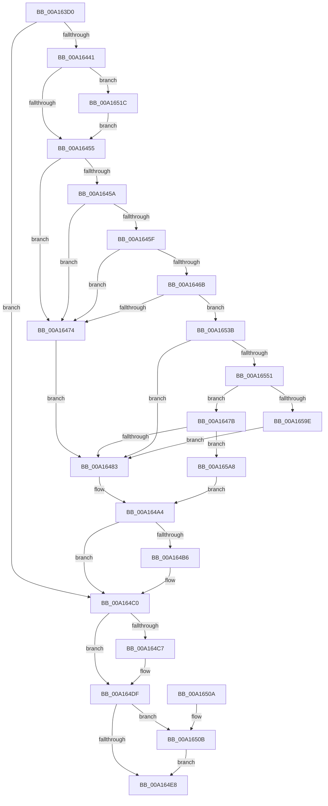

# PiCMGetDeviceInterfaceList

- RVA: `0x00A163D0`–`0x00A165CE` (길이 `510` bytes)
- VA: `0x0000000140A163D0`
- 실행 섹션: `PAGE`
- PDB 이름 있음: `예`; PDB Function 태그: `아니요`
- unwind 정보 RVA: `0x000A9BFC`
- 디코드: `142`개 명령, `510/510` bytes 표시
- 미해석 바이트: `0` (있으면 어셈블리에 `.byte`로 보존)

> 이 문서는 커널 이미지의 기계어와 PDB 기호를 분석해 생성했습니다. 4번과 5번은 함수 원형과 자료형을 바이너리 사용 방식에서 추정한 C 해석이며 원본 소스 복구 결과는 아닙니다.

## 1. Dependencies

- 직접 호출 지점: **9**; 고유 호출 대상: **9**
- 직접 호출자로 확인된 함수: **1**
- RIP 상대 이미지 참조: **3**

### Outgoing calls
- `0x00A16436` → [PiCMCaptureInterfaceListInputData](PiCMCaptureInterfaceListInputData_function_00A165D4.md) (function, `0x00A165D4`)
- `0x00A164AA` → [PiCMReturnBufferResultData](../8E/PiCMReturnBufferResultData_function_008ED6D0.md) (function, `0x008ED6D0`)
- `0x00A164BB` → [ExFreePoolWithTag](../../poolcode/B8/ExFreePoolWithTag_function_00B82870.md) (function, `0x00B82870`)
- `0x00A164DA` → [PiControlFreeUserModeCallersBuffer](../../text/44/PiControlFreeUserModeCallersBuffer_function_00448990.md) (function, `0x00448990`)
- `0x00A164F1` → [_security_check_cookie](../../text/6A/_security_check_cookie_function_006AC640.md) (function, `0x006AC640`)
- `0x00A16515` → [McTemplateK0d_EtwWriteTransfer](../../text/42/McTemplateK0d_EtwWriteTransfer_function_00423380.md) (function, `0x00423380`)
- `0x00A16531` → [McTemplateK0jzt_EtwWriteTransfer](../../text/42/McTemplateK0jzt_EtwWriteTransfer_function_00424358.md) (function, `0x00424358`)
- `0x00A16542` → [RtlInitUnicodeStringEx](../../text/46/RtlInitUnicodeStringEx_function_00463960.md) (function, `0x00463960`)
- `0x00A16586` → [IopGetDeviceInterfaces](../8F/IopGetDeviceInterfaces_function_008F0120.md) (function, `0x008F0120`)

### Direct callers
- [PiCMHandleIoctl](../8E/PiCMHandleIoctl_function_008EB880.md) at `0x008EBEBF`

### Static image references
- `0x00A163E9` → RVA `0x00E0A740` (`.data`; read)
- `0x00A16441` → RVA `0x00EF012B` (`.data`; read)
- `0x00A1650E` → RVA `0x000199A0` (`.rdata`; read)

## 2. Other-region calls and transfers

- 다른 실행 섹션으로 향하는 call: **6**
  - `0x00A164BB` → [ExFreePoolWithTag](../../poolcode/B8/ExFreePoolWithTag_function_00B82870.md) (`PAGE` → `POOLCODE`)
  - `0x00A164DA` → [PiControlFreeUserModeCallersBuffer](../../text/44/PiControlFreeUserModeCallersBuffer_function_00448990.md) (`PAGE` → `.text`)
  - `0x00A164F1` → [_security_check_cookie](../../text/6A/_security_check_cookie_function_006AC640.md) (`PAGE` → `.text`)
  - `0x00A16515` → [McTemplateK0d_EtwWriteTransfer](../../text/42/McTemplateK0d_EtwWriteTransfer_function_00423380.md) (`PAGE` → `.text`)
  - `0x00A16531` → [McTemplateK0jzt_EtwWriteTransfer](../../text/42/McTemplateK0jzt_EtwWriteTransfer_function_00424358.md) (`PAGE` → `.text`)
  - `0x00A16542` → [RtlInitUnicodeStringEx](../../text/46/RtlInitUnicodeStringEx_function_00463960.md) (`PAGE` → `.text`)
- 별도 외부 분기/꼬리 이동을 확인하지 못했습니다.

## 3. Assembly (complete function range)

```asm
00A163D0  40 55                           push rbp
00A163D2  53                              push rbx
00A163D3  56                              push rsi
00A163D4  57                              push rdi
00A163D5  41 54                           push r12
00A163D7  41 55                           push r13
00A163D9  41 56                           push r14
00A163DB  41 57                           push r15
00A163DD  48 8D 6C 24 F1                  lea rbp, [rsp - 0xf]
00A163E2  48 81 EC B8 00 00 00            sub rsp, 0xb8
00A163E9  48 8B 05 50 43 3F 00            mov rax, qword ptr [rip + 0x3f4350]
00A163F0  48 33 C4                        xor rax, rsp
00A163F3  48 89 45 F7                     mov qword ptr [rbp - 9], rax
00A163F7  48 8B 45 7F                     mov rax, qword ptr [rbp + 0x7f]
00A163FB  4D 8B E0                        mov r12, r8
00A163FE  45 33 C0                        xor r8d, r8d
00A16401  48 89 45 B7                     mov qword ptr [rbp - 0x49], rax
00A16405  0F 57 C9                        xorps xmm1, xmm1
00A16408  4C 89 45 EF                     mov qword ptr [rbp - 0x11], r8
00A1640C  41 8B F1                        mov esi, r9d
00A1640F  0F 57 C0                        xorps xmm0, xmm0
00A16412  44 21 00                        and dword ptr [rax], r8d
00A16415  4C 8D 4D CF                     lea r9, [rbp - 0x31]
00A16419  44 8B 45 77                     mov r8d, dword ptr [rbp + 0x77]
00A1641D  33 DB                           xor ebx, ebx
00A1641F  45 33 F6                        xor r14d, r14d
00A16422  48 89 5D AF                     mov qword ptr [rbp - 0x51], rbx
00A16426  0F 11 45 BF                     movups xmmword ptr [rbp - 0x41], xmm0
00A1642A  44 89 75 A7                     mov dword ptr [rbp - 0x59], r14d
00A1642E  0F 11 4D CF                     movups xmmword ptr [rbp - 0x31], xmm1
00A16432  0F 11 4D DF                     movups xmmword ptr [rbp - 0x21], xmm1
00A16436  E8 99 01 00 00                  call 0x140a165d4
00A1643B  8B F8                           mov edi, eax
00A1643D  85 C0                           test eax, eax
00A1643F  78 7F                           js 0x140a164c0
00A16441  F6 05 E3 9C 4D 00 04            test byte ptr [rip + 0x4d9ce3], 4
00A16448  8B 7D D3                        mov edi, dword ptr [rbp - 0x2d]
00A1644B  4C 8B 7D E7                     mov r15, qword ptr [rbp - 0x19]
00A1644F  0F 85 C7 00 00 00               jne 0x140a1651c
00A16455  4D 85 E4                        test r12, r12
00A16458  74 1A                           je 0x140a16474
00A1645A  83 FE 14                        cmp esi, 0x14
00A1645D  72 15                           jb 0x140a16474
00A1645F  44 8D 6E EC                     lea r13d, [rsi - 0x14]
00A16463  F7 C7 00 00 FE FF               test edi, 0xfffe0000
00A16469  75 09                           jne 0x140a16474
00A1646B  66 85 FF                        test di, di
00A1646E  0F 84 C7 00 00 00               je 0x140a1653b
00A16474  B9 0D 00 00 C0                  mov ecx, 0xc000000d
00A16479  EB 08                           jmp 0x140a16483
00A1647B  85 C9                           test ecx, ecx
00A1647D  0F 89 25 01 00 00               jns 0x140a165a8
00A16483  48 8B 45 B7                     mov rax, qword ptr [rbp - 0x49]
00A16487  48 89 44 24 40                  mov qword ptr [rsp + 0x40], rax
00A1648C  8B 45 F3                        mov eax, dword ptr [rbp - 0xd]
00A1648F  89 74 24 38                     mov dword ptr [rsp + 0x38], esi
00A16493  4C 89 64 24 30                  mov qword ptr [rsp + 0x30], r12
00A16498  89 44 24 28                     mov dword ptr [rsp + 0x28], eax
00A1649C  83 64 24 20 00                  and dword ptr [rsp + 0x20], 0
00A164A1  45 33 C9                        xor r9d, r9d
00A164A4  45 33 C0                        xor r8d, r8d
00A164A7  41 8B D6                        mov edx, r14d
00A164AA  E8 21 72 ED FF                  call 0x1408ed6d0
00A164AF  8B F8                           mov edi, eax
00A164B1  48 85 DB                        test rbx, rbx
00A164B4  74 0A                           je 0x140a164c0
00A164B6  33 D2                           xor edx, edx
00A164B8  48 8B CB                        mov rcx, rbx
00A164BB  E8 B0 C3 16 00                  call 0x140b82870
00A164C0  48 83 7D E7 00                  cmp qword ptr [rbp - 0x19], 0
00A164C5  74 18                           je 0x140a164df
00A164C7  65 48 8B 0C 25 88 01 00 00      mov rcx, qword ptr gs:[0x188]
00A164D0  48 8B 55 E7                     mov rdx, qword ptr [rbp - 0x19]
00A164D4  8A 89 32 02 00 00               mov cl, byte ptr [rcx + 0x232]
00A164DA  E8 B1 24 A3 FF                  call 0x140448990
00A164DF  F6 05 45 9C 4D 00 04            test byte ptr [rip + 0x4d9c45], 4
00A164E6  75 23                           jne 0x140a1650b
00A164E8  8B C7                           mov eax, edi
00A164EA  48 8B 4D F7                     mov rcx, qword ptr [rbp - 9]
00A164EE  48 33 CC                        xor rcx, rsp
00A164F1  E8 4A 61 C9 FF                  call 0x1406ac640
00A164F6  48 81 C4 B8 00 00 00            add rsp, 0xb8
00A164FD  41 5F                           pop r15
00A164FF  41 5E                           pop r14
00A16501  41 5D                           pop r13
00A16503  41 5C                           pop r12
00A16505  5F                              pop rdi
00A16506  5E                              pop rsi
00A16507  5B                              pop rbx
00A16508  5D                              pop rbp
00A16509  C3                              ret
00A1650A  CC                              int3
00A1650B  44 8B CF                        mov r9d, edi
00A1650E  48 8D 15 8B 34 60 FF            lea rdx, [rip - 0x9fcb75]
00A16515  E8 66 CE A0 FF                  call 0x140423380
00A1651A  EB CC                           jmp 0x140a164e8
00A1651C  8B C7                           mov eax, edi
00A1651E  4C 8D 4D D7                     lea r9, [rbp - 0x29]
00A16522  C1 E8 10                        shr eax, 0x10
00A16525  83 E0 01                        and eax, 1
00A16528  89 44 24 28                     mov dword ptr [rsp + 0x28], eax
00A1652C  4C 89 7C 24 20                  mov qword ptr [rsp + 0x20], r15
00A16531  E8 22 DE A0 FF                  call 0x140424358
00A16536  E9 1A FF FF FF                  jmp 0x140a16455
00A1653B  49 8B D7                        mov rdx, r15
00A1653E  48 8D 4D BF                     lea rcx, [rbp - 0x41]
00A16542  E8 19 D4 A4 FF                  call 0x140463960
00A16547  8B C8                           mov ecx, eax
00A16549  85 C0                           test eax, eax
00A1654B  0F 88 32 FF FF FF               js 0x140a16483
00A16551  0F B7 45 BF                     movzx eax, word ptr [rbp - 0x41]
00A16555  48 8D 4D D7                     lea rcx, [rbp - 0x29]
00A16559  C1 EF 10                        shr edi, 0x10
00A1655C  41 B1 01                        mov r9b, 1
00A1655F  F7 D7                           not edi
00A16561  83 E7 01                        and edi, 1
00A16564  66 F7 D8                        neg ax
00A16567  44 8B C7                        mov r8d, edi
00A1656A  48 8D 45 BF                     lea rax, [rbp - 0x41]
00A1656E  48 1B D2                        sbb rdx, rdx
00A16571  48 23 D0                        and rdx, rax
00A16574  48 8D 45 A7                     lea rax, [rbp - 0x59]
00A16578  48 89 44 24 28                  mov qword ptr [rsp + 0x28], rax
00A1657D  48 8D 45 AF                     lea rax, [rbp - 0x51]
00A16581  48 89 44 24 20                  mov qword ptr [rsp + 0x20], rax
00A16586  E8 95 9B ED FF                  call 0x1408f0120
00A1658B  44 8B 75 A7                     mov r14d, dword ptr [rbp - 0x59]
00A1658F  8B C8                           mov ecx, eax
00A16591  48 8B 5D AF                     mov rbx, qword ptr [rbp - 0x51]
00A16595  45 3B EE                        cmp r13d, r14d
00A16598  0F 83 DD FE FF FF               jae 0x140a1647b
00A1659E  B9 23 00 00 C0                  mov ecx, 0xc0000023
00A165A3  E9 DB FE FF FF                  jmp 0x140a16483
00A165A8  48 8B 45 B7                     mov rax, qword ptr [rbp - 0x49]
00A165AC  4C 8B CB                        mov r9, rbx
00A165AF  48 89 44 24 40                  mov qword ptr [rsp + 0x40], rax
00A165B4  8B 45 F3                        mov eax, dword ptr [rbp - 0xd]
00A165B7  89 74 24 38                     mov dword ptr [rsp + 0x38], esi
00A165BB  4C 89 64 24 30                  mov qword ptr [rsp + 0x30], r12
00A165C0  89 44 24 28                     mov dword ptr [rsp + 0x28], eax
00A165C4  44 89 74 24 20                  mov dword ptr [rsp + 0x20], r14d
00A165C9  E9 D6 FE FF FF                  jmp 0x140a164a4
```

## 4. C-style interpretation (structured pseudocode)

```c
__int64 __fastcall PiCMGetDeviceInterfaceList(__int64 a1, __int64 a2, __int64 a3, int a4, unsigned int a5, __int64 a6)
{
    __int64 result;
    __int64 v_r14;
    __int64 v_rbx;
    __int64 v_rdi;
    __int64 v_rsp;
    unsigned __int64 v_stack_m4F;
    unsigned __int64 v_stack_m58;
    unsigned int v_stack_m5C;
    unsigned __int64 v_stack_m60;
    unsigned __int64 v_stack_m68;
    unsigned __int64 v_stack_m70;
    unsigned __int64 v_stack_m78;
    unsigned int v_stack_m7C;
    unsigned __int64 v_stack_m80;
    unsigned __int64 v_stack_m90;
    unsigned __int64 v_stack_m98;
    unsigned __int64 v_stack_mA0;
    unsigned int v_stack_mA8;
    unsigned __int64 v_stack_mB8;
    unsigned int v_stack_mC0;
    unsigned __int64 v_stack_mC8;
    unsigned int v_stack_mD0;
    unsigned int v_stack_mD8;
    unsigned __int64 v_stack_p20;
    unsigned int v_stack_p28;
    unsigned __int64 v_stack_p30;
    unsigned int v_stack_p38;
    unsigned __int64 v_stack_p40;

    v_rsp = (v_rsp) - (184);
    result = (*(unsigned __int64 *)(v_rip + 4146000)) ^ (v_rsp);
    v_stack_m58 = result;
    a3 = 0;
    v_stack_m98 = a6;
    v_stack_m60 = 0;
    v_rbx = 0;
    v_r14 = 0;
    v_stack_mA0 = 0;
    v_stack_m90 = v_xmm0;
    v_stack_mA8 = 0;
    v_stack_m80 = v_xmm1;
    v_stack_m70 = v_xmm1;
    result = PiCMCaptureInterfaceListInputData(a1, a2, (unsigned int)(a5), v_stack_m80);
    if (sign_flag) goto loc_00A164C0;
    if (((*(unsigned __int8 *)(v_rip + 5086435)) & (4)) != 0) goto loc_00A1651C;
loc_00A16455:
    if (0 == 0) goto loc_00A16474;
    if (((unsigned int)((unsigned int)(a4))) < 20) goto loc_00A16474;
    if ((((unsigned int)((unsigned int)(v_stack_m7C))) & (0xFFFE0000ULL)) != 0) goto loc_00A16474;
    if ((unsigned __int16)((unsigned int)(v_stack_m7C)) == 0) goto loc_00A1653B;
loc_00A16474:
    goto loc_00A16483;
loc_00A1647B:
    if (!sign_flag) goto loc_00A165A8;
loc_00A16483:
    v_stack_mB8 = v_stack_m98;
    v_stack_mC0 = (unsigned int)((unsigned int)(a4));
    v_stack_mC8 = 0;
    v_stack_mD0 = (unsigned int)((unsigned int)(v_stack_m5C));
    a4 = 0;
loc_00A164A4:
    a3 = 0;
    result = PiCMReturnBufferResultData((unsigned int)(0xC000000DULL), 0, a3, a4);
    if (0 != 0) {
        a2 = 0;
        a1 = 0;
        result = ExFreePoolWithTag(a1, a2, a3, a4);
    }
    if (v_stack_m68 != 0) {
        a1 = *(unsigned __int64 *)(gs_base + (0 + 392));
        a2 = v_stack_m68;
        a1 = *(unsigned __int8 *)(a1 + 562);
        result = PiControlFreeUserModeCallersBuffer(a1, a2, a3, a4);
    }
    if (((*(unsigned __int8 *)(v_rip + 5086277)) & (4)) != 0) goto loc_00A1650B;
loc_00A164E8:
    a1 = (v_stack_m58) ^ (v_rsp);
    result = _security_check_cookie(a1, a2, a3, a4);
    v_rsp = (v_rsp) + (184);
    return result;
loc_00A1650B:
    result = McTemplateK0d_EtwWriteTransfer(a1, v_rip - 10472309, a3, (unsigned int)((unsigned int)((unsigned int)((unsigned int)(result)))));
    goto loc_00A164E8;
loc_00A1651C:
    result = (unsigned int)(((unsigned int)((unsigned int)((unsigned int)((unsigned int)(result))))) >> (16));
    result = (unsigned int)((result) & (1));
    v_stack_p28 = (unsigned int)(result);
    v_stack_p20 = v_stack_m68;
    result = McTemplateK0jzt_EtwWriteTransfer(a1, v_rip - 10472309, a3, v_stack_m78);
    goto loc_00A16455;
loc_00A1653B:
    result = RtlInitUnicodeStringEx(v_stack_m90, v_stack_m68, a3, v_stack_m78);
    if (sign_flag) goto loc_00A16483;
    v_rdi = (unsigned int)(((unsigned int)((unsigned int)(result))) >> (16));
    v_rdi = (unsigned int)(~(v_rdi));
    v_rdi = (unsigned int)((v_rdi) & (1));
    result = (unsigned __int16)(-(v_stack_m90));
    a2 = (v_stack_m68) & (v_stack_m90);
    v_stack_p28 = v_stack_mA8;
    v_stack_p20 = v_stack_mA0;
    result = IopGetDeviceInterfaces(v_stack_m78, a2, (unsigned int)((unsigned int)(v_rdi)), 1);
    if (((unsigned int)((unsigned int)(a4) - 20)) >= ((unsigned int)((unsigned int)(v_stack_mA8)))) goto loc_00A1647B;
    goto loc_00A16483;
loc_00A165A8:
    v_stack_p40 = v_stack_m98;
    v_stack_p38 = (unsigned int)((unsigned int)(a4));
    v_stack_p30 = 0;
    v_stack_p28 = (unsigned int)((unsigned int)(v_stack_m5C));
    v_stack_p20 = (unsigned int)((unsigned int)(v_stack_mA8));
    goto loc_00A164A4;
}
```

## 5. (Beta) C Style

```c
int64_t PiCMGetDeviceInterfaceList(int64_t Arg1, int64_t Arg2, int64_t Arg3, int32_t Arg4, uint32_t Arg5, void *Arg6)
{
    uint8_t *arg6 = (uint8_t *)Arg6;

    int64_t result;
    int64_t local_r14;
    int64_t local_rbx;
    int64_t local_rdi;
    int64_t local_rsp;
    uint64_t v_stack_m4F;
    uint64_t v_stack_m58;
    uint32_t v_stack_m5C;
    uint64_t v_stack_m60;
    uint64_t v_stack_m68;
    uint64_t v_stack_m70;
    uint64_t v_stack_m78;
    uint32_t v_stack_m7C;
    uint64_t v_stack_m80;
    uint64_t v_stack_m90;
    uint64_t v_stack_m98;
    uint64_t v_stack_mA0;
    uint32_t v_stack_mA8;
    uint64_t v_stack_mB8;
    uint32_t v_stack_mC0;
    uint64_t v_stack_mC8;
    uint32_t v_stack_mD0;
    uint32_t v_stack_mD8;
    uint64_t v_stack_p20;
    uint32_t v_stack_p28;
    uint64_t v_stack_p30;
    uint32_t v_stack_p38;
    uint64_t v_stack_p40;

    local_rsp = (local_rsp) - (184);
    result = (*(uint64_t *)(v_rip + 0x3F4350)) ^ (local_rsp);
    v_stack_m58 = result;
    Arg3 = 0;
    v_stack_m98 = Arg6;
    v_stack_m60 = 0;
    local_rbx = 0;
    local_r14 = 0;
    v_stack_mA0 = 0;
    v_stack_m90 = v_xmm0;
    v_stack_mA8 = 0;
    v_stack_m80 = v_xmm1;
    v_stack_m70 = v_xmm1;
    result = PiCMCaptureInterfaceListInputData(Arg1, Arg2, (uint32_t)(Arg5), v_stack_m80);
    if (sign_flag) goto loc_00A164C0;
    if (((*(uint8_t *)(v_rip + 0x4D9CE3)) & (4)) != 0) goto loc_00A1651C;
loc_00A16455:
    if (0 == 0) goto loc_00A16474;
    if (((uint32_t)((uint32_t)(Arg4))) < 20) goto loc_00A16474;
    if ((((uint32_t)((uint32_t)(v_stack_m7C))) & (0xFFFE0000ULL)) != 0) goto loc_00A16474;
    if ((uint16_t)((uint32_t)(v_stack_m7C)) == 0) goto loc_00A1653B;
loc_00A16474:
    goto loc_00A16483;
loc_00A1647B:
    if (!sign_flag) goto loc_00A165A8;
loc_00A16483:
    v_stack_mB8 = v_stack_m98;
    v_stack_mC0 = (uint32_t)((uint32_t)(Arg4));
    v_stack_mC8 = 0;
    v_stack_mD0 = (uint32_t)((uint32_t)(v_stack_m5C));
    Arg4 = 0;
loc_00A164A4:
    Arg3 = 0;
    result = PiCMReturnBufferResultData((uint32_t)(0xC000000DULL), 0, Arg3, Arg4);
    if (0 != 0) {
        Arg2 = 0;
        Arg1 = 0;
        result = ExFreePoolWithTag(Arg1, Arg2, Arg3, Arg4);
    }
    if (v_stack_m68 != 0) {
        Arg1 = *(uint64_t *)(gs_base + (0 + 0x188));
        Arg2 = v_stack_m68;
        Arg1 = *(uint8_t *)(Arg1 + 0x232);
        result = PiControlFreeUserModeCallersBuffer(Arg1, Arg2, Arg3, Arg4);
    }
    if (((*(uint8_t *)(v_rip + 0x4D9C45)) & (4)) != 0) goto loc_00A1650B;
loc_00A164E8:
    Arg1 = (v_stack_m58) ^ (local_rsp);
    result = _security_check_cookie(Arg1, Arg2, Arg3, Arg4);
    local_rsp = (local_rsp) + (184);
    return result;
loc_00A1650B:
    result = McTemplateK0d_EtwWriteTransfer(Arg1, v_rip - 10472309, Arg3, (uint32_t)((uint32_t)((uint32_t)((uint32_t)(result)))));
    goto loc_00A164E8;
loc_00A1651C:
    result = (uint32_t)(((uint32_t)((uint32_t)((uint32_t)((uint32_t)(result))))) >> (16));
    result = (uint32_t)((result) & (1));
    v_stack_p28 = (uint32_t)(result);
    v_stack_p20 = v_stack_m68;
    result = McTemplateK0jzt_EtwWriteTransfer(Arg1, v_rip - 10472309, Arg3, v_stack_m78);
    goto loc_00A16455;
loc_00A1653B:
    result = RtlInitUnicodeStringEx(v_stack_m90, v_stack_m68, Arg3, v_stack_m78);
    if (sign_flag) goto loc_00A16483;
    local_rdi = (uint32_t)(((uint32_t)((uint32_t)(result))) >> (16));
    local_rdi = (uint32_t)(~(local_rdi));
    local_rdi = (uint32_t)((local_rdi) & (1));
    result = (uint16_t)(-(v_stack_m90));
    Arg2 = (v_stack_m68) & (v_stack_m90);
    v_stack_p28 = v_stack_mA8;
    v_stack_p20 = v_stack_mA0;
    result = IopGetDeviceInterfaces(v_stack_m78, Arg2, (uint32_t)((uint32_t)(local_rdi)), 1);
    if (((uint32_t)((uint32_t)(Arg4) - 20)) >= ((uint32_t)((uint32_t)(v_stack_mA8)))) goto loc_00A1647B;
    goto loc_00A16483;
loc_00A165A8:
    v_stack_p40 = v_stack_m98;
    v_stack_p38 = (uint32_t)((uint32_t)(Arg4));
    v_stack_p30 = 0;
    v_stack_p28 = (uint32_t)((uint32_t)(v_stack_m5C));
    v_stack_p20 = (uint32_t)((uint32_t)(v_stack_mA8));
    goto loc_00A164A4;
}
```

### 관측된 메모리 오프셋

구조체 형식이 확인되지 않은 접근은 인자 기준의 오프셋으로만 기록했습니다.

| 기준 인자 | 오프셋 표현 | 폭 (bit) | 접근 |
|---|---:|---:|---|
| `Arg6` | `+ 0x0` | `32` | `R/W` |

## 6. Execution-region graph

[열기: 2D/3D 그래프와 함수 탐색 컨트롤 패널](../../../control-panel.html?section=page&rva=0x00A163D0&view=graph)

- 2D 그래프는 위에서 아래로 흐르고, 3D 그래프는 빈 공간을 드래그해 회전합니다. Shift+드래그는 이동, 휠은 확대·축소, 함수 노드 선택은 대상 보고서 이동입니다.

### Static fallback


