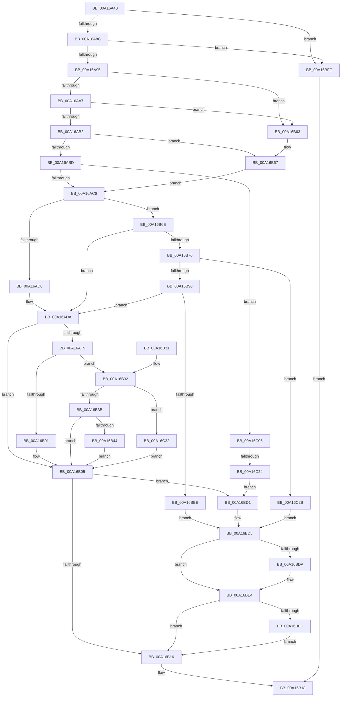

# PiControlGetRelatedDevice

- RVA: `0x00A16A40`–`0x00A16C3C` (길이 `508` bytes)
- VA: `0x0000000140A16A40`
- 실행 섹션: `PAGE`
- PDB 이름 있음: `예`; PDB Function 태그: `예`
- unwind 정보 RVA: `0x000A9D44`
- 디코드: `139`개 명령, `508/508` bytes 표시
- 미해석 바이트: `0` (있으면 어셈블리에 `.byte`로 보존)

> 이 문서는 커널 이미지의 기계어와 PDB 기호를 분석해 생성했습니다. 4번과 5번은 함수 원형과 자료형을 바이너리 사용 방식에서 추정한 C 해석이며 원본 소스 복구 결과는 아닙니다.

## 1. Dependencies

- 직접 호출 지점: **8**; 고유 호출 대상: **4**
- 직접 호출자로 확인된 함수: **0**
- RIP 상대 이미지 참조: **0**

### Outgoing calls
- `0x00A16AE9` → [PiGetRelatedDevice](../8E/PiGetRelatedDevice_function_008E846C.md) (function, `0x008E846C`)
- `0x00A16B57` → [PiControlCopyUserModeCallersBuffer](../8E/PiControlCopyUserModeCallersBuffer_function_008E4720.md) (function, `0x008E4720`)
- `0x00A16B84` → [ExAllocatePool2](../../poolcode/B8/ExAllocatePool2_function_00B820F0.md) (function, `0x00B820F0`)
- `0x00A16BAF` → [PiControlCopyUserModeCallersBuffer](../8E/PiControlCopyUserModeCallersBuffer_function_008E4720.md) (function, `0x008E4720`)
- `0x00A16BC4` → [ExFreePoolWithTag](../../poolcode/B8/ExFreePoolWithTag_function_00B82870.md) (function, `0x00B82870`)
- `0x00A16BDF` → [ExFreePoolWithTag](../../poolcode/B8/ExFreePoolWithTag_function_00B82870.md) (function, `0x00B82870`)
- `0x00A16BF2` → [ExFreePoolWithTag](../../poolcode/B8/ExFreePoolWithTag_function_00B82870.md) (function, `0x00B82870`)
- `0x00A16C13` → [ExAllocatePool2](../../poolcode/B8/ExAllocatePool2_function_00B820F0.md) (function, `0x00B820F0`)

### Direct callers
- 이 함수 시작 RVA로 연결되는 직접 call은 확인되지 않았습니다. 간접 호출은 완전히 역산할 수 없습니다.

### Static image references
- 디코드된 RIP-relative 메모리 참조가 없습니다.

## 2. Other-region calls and transfers

- 다른 실행 섹션으로 향하는 call: **5**
  - `0x00A16B84` → [ExAllocatePool2](../../poolcode/B8/ExAllocatePool2_function_00B820F0.md) (`PAGE` → `POOLCODE`)
  - `0x00A16BC4` → [ExFreePoolWithTag](../../poolcode/B8/ExFreePoolWithTag_function_00B82870.md) (`PAGE` → `POOLCODE`)
  - `0x00A16BDF` → [ExFreePoolWithTag](../../poolcode/B8/ExFreePoolWithTag_function_00B82870.md) (`PAGE` → `POOLCODE`)
  - `0x00A16BF2` → [ExFreePoolWithTag](../../poolcode/B8/ExFreePoolWithTag_function_00B82870.md) (`PAGE` → `POOLCODE`)
  - `0x00A16C13` → [ExAllocatePool2](../../poolcode/B8/ExAllocatePool2_function_00B820F0.md) (`PAGE` → `POOLCODE`)
- call이 아닌 외부 분기/꼬리 이동: **1**
  - `0x00A16C1E` → [sub_00B36FCC](../B3/Unknown_function_00B36FCC.md) (`tail-transfer`)

## 3. Assembly (complete function range)

```asm
00A16A40  48 89 5C 24 08                  mov qword ptr [rsp + 8], rbx
00A16A45  48 89 74 24 18                  mov qword ptr [rsp + 0x18], rsi
00A16A4A  55                              push rbp
00A16A4B  57                              push rdi
00A16A4C  41 55                           push r13
00A16A4E  41 56                           push r14
00A16A50  41 57                           push r15
00A16A52  48 8B EC                        mov rbp, rsp
00A16A55  48 83 EC 40                     sub rsp, 0x40
00A16A59  0F B7 0A                        movzx ecx, word ptr [rdx]
00A16A5C  41 BD 01 00 00 00               mov r13d, 1
00A16A62  0F B7 C1                        movzx eax, cx
00A16A65  48 8B F2                        mov rsi, rdx
00A16A68  66 41 2B C5                     sub ax, r13w
00A16A6C  0F 57 C0                        xorps xmm0, xmm0
00A16A6F  0F 11 45 F0                     movups xmmword ptr [rbp - 0x10], xmm0
00A16A73  BA 8F 01 00 00                  mov edx, 0x18f
00A16A78  66 89 4D F2                     mov word ptr [rbp - 0xe], cx
00A16A7C  66 89 4D F0                     mov word ptr [rbp - 0x10], cx
00A16A80  45 8A F1                        mov r14b, r9b
00A16A83  66 3B C2                        cmp ax, dx
00A16A86  0F 87 70 01 00 00               ja 0x140a16bfc
00A16A8C  41 84 CD                        test r13b, cl
00A16A8F  0F 85 67 01 00 00               jne 0x140a16bfc
00A16A95  48 83 65 F8 00                  and qword ptr [rbp - 8], 0
00A16A9A  48 8B 5E 18                     mov rbx, qword ptr [rsi + 0x18]
00A16A9E  48 85 DB                        test rbx, rbx
00A16AA1  0F 84 BC 00 00 00               je 0x140a16b63
00A16AA7  8B 46 20                        mov eax, dword ptr [rsi + 0x20]
00A16AAA  85 C0                           test eax, eax
00A16AAC  0F 84 B1 00 00 00               je 0x140a16b63
00A16AB2  03 C0                           add eax, eax
00A16AB4  89 45 38                        mov dword ptr [rbp + 0x38], eax
00A16AB7  0F 84 AA 00 00 00               je 0x140a16b67
00A16ABD  45 84 C9                        test r9b, r9b
00A16AC0  0F 85 40 01 00 00               jne 0x140a16c06
00A16AC6  4C 8B 7E 08                     mov r15, qword ptr [rsi + 8]
00A16ACA  0F B7 F9                        movzx edi, cx
00A16ACD  45 84 F6                        test r14b, r14b
00A16AD0  0F 85 98 00 00 00               jne 0x140a16b6e
00A16AD6  4C 89 7D F8                     mov qword ptr [rbp - 8], r15
00A16ADA  44 8B 4E 10                     mov r9d, dword ptr [rsi + 0x10]
00A16ADE  4C 8D 45 38                     lea r8, [rbp + 0x38]
00A16AE2  48 8B D3                        mov rdx, rbx
00A16AE5  48 8D 4D F0                     lea rcx, [rbp - 0x10]
00A16AE9  E8 7E 19 ED FF                  call 0x1408e846c
00A16AEE  8B F8                           mov edi, eax
00A16AF0  48 85 DB                        test rbx, rbx
00A16AF3  74 10                           je 0x140a16b05
00A16AF5  44 8B 46 20                     mov r8d, dword ptr [rsi + 0x20]
00A16AF9  45 03 C0                        add r8d, r8d
00A16AFC  45 84 F6                        test r14b, r14b
00A16AFF  75 31                           jne 0x140a16b32
00A16B01  48 89 5E 18                     mov qword ptr [rsi + 0x18], rbx
00A16B05  8B 45 38                        mov eax, dword ptr [rbp + 0x38]
00A16B08  D1 E8                           shr eax, 1
00A16B0A  89 46 20                        mov dword ptr [rsi + 0x20], eax
00A16B0D  45 84 F6                        test r14b, r14b
00A16B10  0F 85 BB 00 00 00               jne 0x140a16bd1
00A16B16  8B C7                           mov eax, edi
00A16B18  4C 8D 5C 24 40                  lea r11, [rsp + 0x40]
00A16B1D  49 8B 5B 30                     mov rbx, qword ptr [r11 + 0x30]
00A16B21  49 8B 73 40                     mov rsi, qword ptr [r11 + 0x40]
00A16B25  49 8B E3                        mov rsp, r11
00A16B28  41 5F                           pop r15
00A16B2A  41 5E                           pop r14
00A16B2C  41 5D                           pop r13
00A16B2E  5F                              pop rdi
00A16B2F  5D                              pop rbp
00A16B30  C3                              ret
00A16B31  CC                              int3
00A16B32  45 85 C0                        test r8d, r8d
00A16B35  0F 84 F7 00 00 00               je 0x140a16c32
00A16B3B  48 8B 4E 18                     mov rcx, qword ptr [rsi + 0x18]
00A16B3F  48 85 C9                        test rcx, rcx
00A16B42  74 C1                           je 0x140a16b05
00A16B44  83 64 24 28 00                  and dword ptr [rsp + 0x28], 0
00A16B49  41 B9 02 00 00 00               mov r9d, 2
00A16B4F  48 8B D3                        mov rdx, rbx
00A16B52  44 88 74 24 20                  mov byte ptr [rsp + 0x20], r14b
00A16B57  E8 C4 DB EC FF                  call 0x1408e4720
00A16B5C  85 C0                           test eax, eax
00A16B5E  0F 48 F8                        cmovs edi, eax
00A16B61  EB A2                           jmp 0x140a16b05
00A16B63  83 65 38 00                     and dword ptr [rbp + 0x38], 0
00A16B67  33 DB                           xor ebx, ebx
00A16B69  E9 58 FF FF FF                  jmp 0x140a16ac6
00A16B6E  85 FF                           test edi, edi
00A16B70  0F 84 64 FF FF FF               je 0x140a16ada
00A16B76  48 8B D7                        mov rdx, rdi
00A16B79  B9 01 01 00 00                  mov ecx, 0x101
00A16B7E  41 B8 50 70 20 20               mov r8d, 0x20207050
00A16B84  E8 67 B5 16 00                  call 0x140b820f0
00A16B89  48 89 45 F8                     mov qword ptr [rbp - 8], rax
00A16B8D  48 85 C0                        test rax, rax
00A16B90  0F 84 95 00 00 00               je 0x140a16c2b
00A16B96  44 89 6C 24 28                  mov dword ptr [rsp + 0x28], r13d
00A16B9B  41 B9 02 00 00 00               mov r9d, 2
00A16BA1  44 8B C7                        mov r8d, edi
00A16BA4  44 88 74 24 20                  mov byte ptr [rsp + 0x20], r14b
00A16BA9  49 8B D7                        mov rdx, r15
00A16BAC  48 8B C8                        mov rcx, rax
00A16BAF  E8 6C DB EC FF                  call 0x1408e4720
00A16BB4  8B F8                           mov edi, eax
00A16BB6  85 C0                           test eax, eax
00A16BB8  0F 89 1C FF FF FF               jns 0x140a16ada
00A16BBE  48 8B 4D F8                     mov rcx, qword ptr [rbp - 8]
00A16BC2  33 D2                           xor edx, edx
00A16BC4  E8 A7 BC 16 00                  call 0x140b82870
00A16BC9  33 C0                           xor eax, eax
00A16BCB  48 89 45 F8                     mov qword ptr [rbp - 8], rax
00A16BCF  EB 04                           jmp 0x140a16bd5
00A16BD1  48 8B 45 F8                     mov rax, qword ptr [rbp - 8]
00A16BD5  48 85 C0                        test rax, rax
00A16BD8  74 0A                           je 0x140a16be4
00A16BDA  33 D2                           xor edx, edx
00A16BDC  48 8B C8                        mov rcx, rax
00A16BDF  E8 8C BC 16 00                  call 0x140b82870
00A16BE4  48 85 DB                        test rbx, rbx
00A16BE7  0F 84 29 FF FF FF               je 0x140a16b16
00A16BED  33 D2                           xor edx, edx
00A16BEF  48 8B CB                        mov rcx, rbx
00A16BF2  E8 79 BC 16 00                  call 0x140b82870
00A16BF7  E9 1A FF FF FF                  jmp 0x140a16b16
00A16BFC  B8 0D 00 00 C0                  mov eax, 0xc000000d
00A16C01  E9 12 FF FF FF                  jmp 0x140a16b18
00A16C06  8B D0                           mov edx, eax
00A16C08  B9 01 01 00 00                  mov ecx, 0x101
00A16C0D  41 B8 50 70 20 20               mov r8d, 0x20207050
00A16C13  E8 D8 B4 16 00                  call 0x140b820f0
00A16C18  48 8B D8                        mov rbx, rax
00A16C1B  48 85 C0                        test rax, rax
00A16C1E  0F 85 A8 03 12 00               jne 0x140b36fcc
00A16C24  BF 9A 00 00 C0                  mov edi, 0xc000009a
00A16C29  EB A6                           jmp 0x140a16bd1
00A16C2B  BF 9A 00 00 C0                  mov edi, 0xc000009a
00A16C30  EB A3                           jmp 0x140a16bd5
00A16C32  48 83 66 18 00                  and qword ptr [rsi + 0x18], 0
00A16C37  E9 C9 FE FF FF                  jmp 0x140a16b05
```

## 4. C-style interpretation (structured pseudocode)

```c
__int64 __fastcall PiControlGetRelatedDevice(__int64 a1, __int64 a2, __int64 a3, unsigned __int8 a4)
{
    __int64 result;
    __int64 v_rbx;
    __int64 v_rdi;
    __int64 v_rsp;
    unsigned int v_stack_m18;
    unsigned __int8 v_stack_m20;
    unsigned __int64 v_stack_m28;
    unsigned __int64 v_stack_m30;
    unsigned __int16 v_stack_m36;
    unsigned __int64 v_stack_m38;
    unsigned int v_stack_p10;
    unsigned __int64 v_stack_p18;
    unsigned __int64 v_stack_p8;

    v_stack_p8 = v_rbx;
    v_stack_p18 = v_rsi;
    v_rsp = (v_rsp) - (64);
    result = (unsigned __int16)(((unsigned __int16)(*(unsigned __int16 *)(a2))) - (1));
    v_stack_m38 = v_xmm0;
    v_stack_m36 = (unsigned __int16)(*(unsigned __int16 *)(a2));
    v_stack_m38 = (unsigned __int16)(*(unsigned __int16 *)(a2));
    if (((unsigned __int16)(result)) > 399) goto loc_00A16BFC;
    if (((1) & ((unsigned __int8)(*(unsigned __int16 *)(a2)))) != 0) goto loc_00A16BFC;
    if (*(unsigned __int64 *)(a2 + 24) == 0) goto loc_00A16B63;
    if ((unsigned int)((unsigned int)(*(unsigned int *)(a2 + 32))) == 0) goto loc_00A16B63;
    result = (unsigned int)(((unsigned int)(*(unsigned int *)(a2 + 32))) + ((unsigned int)((unsigned int)(*(unsigned int *)(a2 + 32)))));
    v_stack_p10 = (unsigned int)(result);
    if (condition_is_equal) goto loc_00A16B67;
    if (a4 != 0) goto loc_00A16C06;
loc_00A16AC6:
    if (a4 != 0) goto loc_00A16B6E;
    v_stack_m30 = *(unsigned __int64 *)(a2 + 8);
loc_00A16ADA:
    result = PiGetRelatedDevice(v_stack_m38, *(unsigned __int64 *)(a2 + 24), v_stack_p10, (unsigned int)(*(unsigned int *)(a2 + 16)));
    if (*(unsigned __int64 *)(a2 + 24) == 0) goto loc_00A16B05;
    a3 = (unsigned int)(((unsigned int)(*(unsigned int *)(a2 + 32))) + ((unsigned int)((unsigned int)(*(unsigned int *)(a2 + 32)))));
    if (a4 != 0) goto loc_00A16B32;
    *(unsigned __int64 *)(a2 + 24) = *(unsigned __int64 *)(a2 + 24);
loc_00A16B05:
    result = (unsigned int)(((unsigned int)(v_stack_p10)) >> (1));
    *(unsigned int *)(a2 + 32) = (unsigned int)(result);
    if (a4 != 0) goto loc_00A16BD1;
loc_00A16B16:
loc_00A16B18:
    return (unsigned int)((unsigned int)((unsigned int)((unsigned int)(result))));
loc_00A16B32:
    if ((unsigned int)(a3) == 0) goto loc_00A16C32;
    if (*(unsigned __int64 *)(*(unsigned __int64 *)(v_stack_m28 + 64) + 24) == 0) goto loc_00A16B05;
    v_stack_m20 = a4;
    result = PiControlCopyUserModeCallersBuffer(*(unsigned __int64 *)(*(unsigned __int64 *)(v_stack_m28 + 64) + 24), *(unsigned __int64 *)(v_stack_m28 + 48), a3, 2);
    v_rdi = (unsigned int)((unsigned int)(result));
    if (sign_flag) { v_rdi = (unsigned int)(result); }
    goto loc_00A16B05;
loc_00A16B63:
loc_00A16B67:
    v_rbx = 0;
    goto loc_00A16AC6;
loc_00A16B6E:
    if ((unsigned int)(v_rdi) == 0) goto loc_00A16ADA;
    result = ExAllocatePool2(257, v_rdi, (unsigned int)(0x20207050ULL), 2);
    v_stack_m30 = result;
    if (result == 0) goto loc_00A16C2B;
    v_stack_m18 = 1;
    v_stack_m20 = a4;
    result = PiControlCopyUserModeCallersBuffer(result, *(unsigned __int64 *)(a2 + 8), (unsigned int)((unsigned int)(v_rdi)), 2);
    if (!sign_flag) goto loc_00A16ADA;
    a2 = 0;
    result = ExFreePoolWithTag(v_stack_m30, a2, (unsigned int)((unsigned int)(v_rdi)), 2);
    result = 0;
    v_stack_m30 = 0;
    goto loc_00A16BD5;
loc_00A16BD1:
loc_00A16BD5:
    result = v_stack_m30;
    if (v_stack_m30 != 0) {
        a2 = 0;
        a1 = v_stack_m30;
        result = ExFreePoolWithTag(a1, a2, (unsigned int)((unsigned int)(v_rdi)), 2);
    }
    if (0 == 0) goto loc_00A16B16;
    a2 = 0;
    result = ExFreePoolWithTag(0, a2, (unsigned int)((unsigned int)(v_rdi)), 2);
    goto loc_00A16B16;
loc_00A16BFC:
    goto loc_00A16B18;
loc_00A16C06:
    result = ExAllocatePool2(257, (unsigned int)((unsigned int)((unsigned int)(0xC000000DULL))), (unsigned int)(0x20207050ULL), 2);
    goto loc_00A16BD1;
loc_00A16C2B:
    goto loc_00A16BD5;
loc_00A16C32:
    goto loc_00A16B05;
}
```

## 5. (Beta) C Style

```c
int64_t PiControlGetRelatedDevice(int64_t Arg1, void *Arg2, int64_t Arg3, uint8_t Arg4)
{
    uint8_t *arg2 = (uint8_t *)Arg2;

    int64_t result;
    int64_t local_rbx;
    int64_t local_rdi;
    int64_t local_rsp;
    uint32_t v_stack_m18;
    uint8_t v_stack_m20;
    uint64_t v_stack_m28;
    uint64_t v_stack_m30;
    uint16_t v_stack_m36;
    uint64_t v_stack_m38;
    uint32_t v_stack_p10;
    uint64_t v_stack_p18;
    uint64_t v_stack_p8;

    v_stack_p8 = local_rbx;
    v_stack_p18 = local_rsi;
    local_rsp = (local_rsp) - (64);
    result = (uint16_t)(((uint16_t)(*(uint16_t *)(arg2))) - (1));
    v_stack_m38 = v_xmm0;
    v_stack_m36 = (uint16_t)(*(uint16_t *)(arg2));
    v_stack_m38 = (uint16_t)(*(uint16_t *)(arg2));
    if (((uint16_t)(result)) > 399) goto loc_00A16BFC;
    if (((1) & ((uint8_t)(*(uint16_t *)(arg2)))) != 0) goto loc_00A16BFC;
    if (*(uint64_t *)(arg2 + 0x18) == 0) goto loc_00A16B63;
    if ((uint32_t)((uint32_t)(*(uint32_t *)(arg2 + 0x20))) == 0) goto loc_00A16B63;
    result = (uint32_t)(((uint32_t)(*(uint32_t *)(arg2 + 0x20))) + ((uint32_t)((uint32_t)(*(uint32_t *)(arg2 + 0x20)))));
    v_stack_p10 = (uint32_t)(result);
    if (condition_is_equal) goto loc_00A16B67;
    if (Arg4 != 0) goto loc_00A16C06;
loc_00A16AC6:
    if (Arg4 != 0) goto loc_00A16B6E;
    v_stack_m30 = *(uint64_t *)(arg2 + 0x8);
loc_00A16ADA:
    result = PiGetRelatedDevice(v_stack_m38, *(uint64_t *)(arg2 + 0x18), v_stack_p10, (uint32_t)(*(uint32_t *)(arg2 + 0x10)));
    if (*(uint64_t *)(arg2 + 0x18) == 0) goto loc_00A16B05;
    Arg3 = (uint32_t)(((uint32_t)(*(uint32_t *)(arg2 + 0x20))) + ((uint32_t)((uint32_t)(*(uint32_t *)(arg2 + 0x20)))));
    if (Arg4 != 0) goto loc_00A16B32;
    *(uint64_t *)(arg2 + 0x18) = *(uint64_t *)(arg2 + 0x18);
loc_00A16B05:
    result = (uint32_t)(((uint32_t)(v_stack_p10)) >> (1));
    *(uint32_t *)(arg2 + 0x20) = (uint32_t)(result);
    if (Arg4 != 0) goto loc_00A16BD1;
loc_00A16B16:
loc_00A16B18:
    return (uint32_t)((uint32_t)((uint32_t)((uint32_t)(result))));
loc_00A16B32:
    if ((uint32_t)(Arg3) == 0) goto loc_00A16C32;
    if (*(uint64_t *)(*(uint64_t *)(v_stack_m28 + 0x40) + 0x18) == 0) goto loc_00A16B05;
    v_stack_m20 = Arg4;
    result = PiControlCopyUserModeCallersBuffer(*(uint64_t *)(*(uint64_t *)(v_stack_m28 + 0x40) + 0x18), *(uint64_t *)(v_stack_m28 + 0x30), Arg3, 2);
    local_rdi = (uint32_t)((uint32_t)(result));
    if (sign_flag) { local_rdi = (uint32_t)(result); }
    goto loc_00A16B05;
loc_00A16B63:
loc_00A16B67:
    local_rbx = 0;
    goto loc_00A16AC6;
loc_00A16B6E:
    if ((uint32_t)(local_rdi) == 0) goto loc_00A16ADA;
    result = ExAllocatePool2(257, local_rdi, (uint32_t)(0x20207050ULL), 2);
    v_stack_m30 = result;
    if (result == 0) goto loc_00A16C2B;
    v_stack_m18 = 1;
    v_stack_m20 = Arg4;
    result = PiControlCopyUserModeCallersBuffer(result, *(uint64_t *)(arg2 + 0x8), (uint32_t)((uint32_t)(local_rdi)), 2);
    if (!sign_flag) goto loc_00A16ADA;
    Arg2 = 0;
    result = ExFreePoolWithTag(v_stack_m30, Arg2, (uint32_t)((uint32_t)(local_rdi)), 2);
    result = 0;
    v_stack_m30 = 0;
    goto loc_00A16BD5;
loc_00A16BD1:
loc_00A16BD5:
    result = v_stack_m30;
    if (v_stack_m30 != 0) {
        Arg2 = 0;
        Arg1 = v_stack_m30;
        result = ExFreePoolWithTag(Arg1, Arg2, (uint32_t)((uint32_t)(local_rdi)), 2);
    }
    if (0 == 0) goto loc_00A16B16;
    Arg2 = 0;
    result = ExFreePoolWithTag(0, Arg2, (uint32_t)((uint32_t)(local_rdi)), 2);
    goto loc_00A16B16;
loc_00A16BFC:
    goto loc_00A16B18;
loc_00A16C06:
    result = ExAllocatePool2(257, (uint32_t)((uint32_t)((uint32_t)(0xC000000DULL))), (uint32_t)(0x20207050ULL), 2);
    goto loc_00A16BD1;
loc_00A16C2B:
    goto loc_00A16BD5;
loc_00A16C32:
    goto loc_00A16B05;
}
```

### 관측된 메모리 오프셋

구조체 형식이 확인되지 않은 접근은 인자 기준의 오프셋으로만 기록했습니다.

| 기준 인자 | 오프셋 표현 | 폭 (bit) | 접근 |
|---|---:|---:|---|
| `Arg2` | `+ 0x0` | `16` | `R` |
| `Arg2` | `+ 0x8` | `64` | `R` |
| `Arg2` | `+ 0x10` | `32` | `R` |
| `Arg2` | `+ 0x18` | `64` | `R` |
| `Arg2` | `+ 0x18` | `64` | `R/W` |
| `Arg2` | `+ 0x18` | `64` | `W` |
| `Arg2` | `+ 0x20` | `32` | `R` |
| `Arg2` | `+ 0x20` | `32` | `W` |

## 6. Execution-region graph

[열기: 2D/3D 그래프와 함수 탐색 컨트롤 패널](../../../control-panel.html?section=page&rva=0x00A16A40&view=graph)

- 2D 그래프는 위에서 아래로 흐르고, 3D 그래프는 빈 공간을 드래그해 회전합니다. Shift+드래그는 이동, 휠은 확대·축소, 함수 노드 선택은 대상 보고서 이동입니다.

### Static fallback


