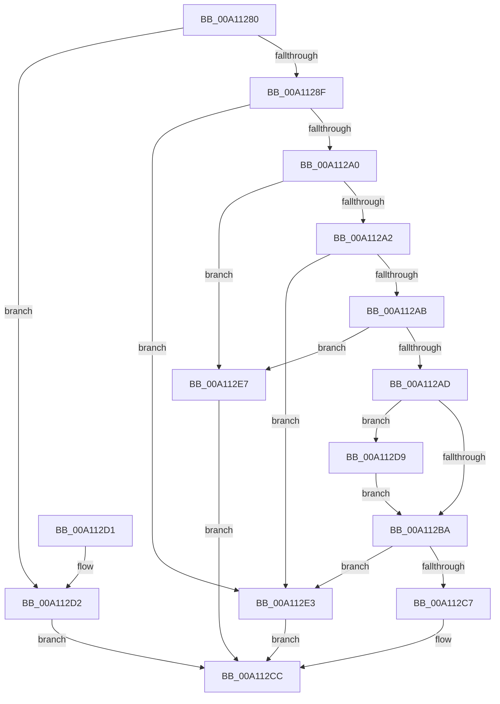

# PiPnpRtlObjectEventCompareObjects

- RVA: `0x00A11280`–`0x00A112EE` (길이 `110` bytes)
- VA: `0x0000000140A11280`
- 실행 섹션: `PAGE`
- PDB 이름 있음: `예`; PDB Function 태그: `아니요`
- unwind 정보 RVA: `0x0005FC2C`
- 디코드: `38`개 명령, `110/110` bytes 표시
- 미해석 바이트: `0` (있으면 어셈블리에 `.byte`로 보존)

> 이 문서는 커널 이미지의 기계어와 PDB 기호를 분석해 생성했습니다. 4번과 5번은 함수 원형과 자료형을 바이너리 사용 방식에서 추정한 C 해석이며 원본 소스 복구 결과는 아닙니다.

## 1. Dependencies

- 직접 호출 지점: **1**; 고유 호출 대상: **1**
- 직접 호출자로 확인된 함수: **5**
- RIP 상대 이미지 참조: **0**

### Outgoing calls
- `0x00A112BA` → [wcsicmp](../../text/50/wcsicmp_function_00500080.md) (function, `0x00500080`)

### Direct callers
- [sub_003E5CDB](../../text/3E/Unknown_function_003E5CDB.md) at `0x003E5CEE`
- [RtlInsertElementGenericTableAvl](../../text/3E/RtlInsertElementGenericTableAvl_function_003EE510.md) at `0x003EE713`
- [RtlDeleteElementGenericTableAvl](../../text/3E/RtlDeleteElementGenericTableAvl_function_003EE750.md) at `0x003EEA04`
- [RtlLookupElementGenericTableFullAvl](../../text/3E/RtlLookupElementGenericTableFullAvl_function_003EF460.md) at `0x003EF550`
- [sub_003FF07D](../../text/3F/Unknown_function_003FF07D.md) at `0x003FF090`

### Static image references
- 디코드된 RIP-relative 메모리 참조가 없습니다.

## 2. Other-region calls and transfers

- 다른 실행 섹션으로 향하는 call: **1**
  - `0x00A112BA` → [wcsicmp](../../text/50/wcsicmp_function_00500080.md) (`PAGE` → `.text`)
- 별도 외부 분기/꼬리 이동을 확인하지 못했습니다.

## 3. Assembly (complete function range)

```asm
00A11280  48 83 EC 28                     sub rsp, 0x28
00A11284  48 8B 02                        mov rax, qword ptr [rdx]
00A11287  49 8B 10                        mov rdx, qword ptr [r8]
00A1128A  48 3B C2                        cmp rax, rdx
00A1128D  74 43                           je 0x140a112d2
00A1128F  4C 8B 40 08                     mov r8, qword ptr [rax + 8]
00A11293  48 8B 52 08                     mov rdx, qword ptr [rdx + 8]
00A11297  41 8B 40 18                     mov eax, dword ptr [r8 + 0x18]
00A1129B  3B 42 18                        cmp eax, dword ptr [rdx + 0x18]
00A1129E  72 43                           jb 0x140a112e3
00A112A0  77 45                           ja 0x140a112e7
00A112A2  41 8B 40 1C                     mov eax, dword ptr [r8 + 0x1c]
00A112A6  3B 42 1C                        cmp eax, dword ptr [rdx + 0x1c]
00A112A9  7C 38                           jl 0x140a112e3
00A112AB  7F 3A                           jg 0x140a112e7
00A112AD  48 8B 52 10                     mov rdx, qword ptr [rdx + 0x10]
00A112B1  49 8B 48 10                     mov rcx, qword ptr [r8 + 0x10]
00A112B5  83 F8 03                        cmp eax, 3
00A112B8  74 1F                           je 0x140a112d9
00A112BA  E8 C1 ED AE FF                  call 0x140500080
00A112BF  8B C8                           mov ecx, eax
00A112C1  33 C0                           xor eax, eax
00A112C3  85 C9                           test ecx, ecx
00A112C5  78 1C                           js 0x140a112e3
00A112C7  0F 9E C0                        setle al
00A112CA  FF C0                           inc eax
00A112CC  48 83 C4 28                     add rsp, 0x28
00A112D0  C3                              ret
00A112D1  CC                              int3
00A112D2  B8 02 00 00 00                  mov eax, 2
00A112D7  EB F3                           jmp 0x140a112cc
00A112D9  48 83 C1 08                     add rcx, 8
00A112DD  48 83 C2 08                     add rdx, 8
00A112E1  EB D7                           jmp 0x140a112ba
00A112E3  33 C0                           xor eax, eax
00A112E5  EB E5                           jmp 0x140a112cc
00A112E7  B8 01 00 00 00                  mov eax, 1
00A112EC  EB DE                           jmp 0x140a112cc
```

## 4. C-style interpretation (structured pseudocode)

```c
__int64 __fastcall PiPnpRtlObjectEventCompareObjects(__int64 a1, __int64 a2, __int64 a3)
{
    __int64 result;
    __int64 v_rsp;

    v_rsp = (v_rsp) - (40);
    if ((*(unsigned __int64 *)(a2)) == (*(unsigned __int64 *)(a3))) goto loc_00A112D2;
    if (((unsigned int)((unsigned int)(*(unsigned int *)(*(unsigned __int64 *)(*(unsigned __int64 *)(a2) + 8) + 24)))) < (*(unsigned int *)(*(unsigned __int64 *)(*(unsigned __int64 *)(a3) + 8) + 24))) goto loc_00A112E3;
    if (((unsigned int)((unsigned int)(*(unsigned int *)(*(unsigned __int64 *)(*(unsigned __int64 *)(a2) + 8) + 24)))) > (*(unsigned int *)(*(unsigned __int64 *)(*(unsigned __int64 *)(a3) + 8) + 24))) goto loc_00A112E7;
    if (((unsigned int)((unsigned int)(*(unsigned int *)(*(unsigned __int64 *)(*(unsigned __int64 *)(a2) + 8) + 28)))) < (*(unsigned int *)(*(unsigned __int64 *)(*(unsigned __int64 *)(a3) + 8) + 28))) goto loc_00A112E3;
    if (((unsigned int)((unsigned int)(*(unsigned int *)(*(unsigned __int64 *)(*(unsigned __int64 *)(a2) + 8) + 28)))) > (*(unsigned int *)(*(unsigned __int64 *)(*(unsigned __int64 *)(a3) + 8) + 28))) goto loc_00A112E7;
    if (((unsigned int)((unsigned int)(*(unsigned int *)(*(unsigned __int64 *)(*(unsigned __int64 *)(a2) + 8) + 28)))) == 3) goto loc_00A112D9;
loc_00A112BA:
    result = wcsicmp(*(unsigned __int64 *)(*(unsigned __int64 *)(*(unsigned __int64 *)(a2) + 8) + 16), *(unsigned __int64 *)(*(unsigned __int64 *)(*(unsigned __int64 *)(a3) + 8) + 16), *(unsigned __int64 *)(*(unsigned __int64 *)(a2) + 8), a4);
    result = 0;
    if (sign_flag) goto loc_00A112E3;
    result = (condition_is_less_or_equal) ? 1 : 0;
    result = (unsigned int)((result) + 1);
loc_00A112CC:
    v_rsp = (v_rsp) + (40);
    return result;
loc_00A112D2:
    goto loc_00A112CC;
loc_00A112D9:
    a1 = ((unsigned int)((unsigned int)(result))) + (8);
    a2 = (*(unsigned __int64 *)(*(unsigned __int64 *)(*(unsigned __int64 *)(a3) + 8) + 16)) + (8);
    goto loc_00A112BA;
loc_00A112E3:
    result = 0;
    goto loc_00A112CC;
loc_00A112E7:
    goto loc_00A112CC;
}
```

## 5. (Beta) C Style

```c
int64_t PiPnpRtlObjectEventCompareObjects(int64_t Arg1, void *Arg2, void *Arg3)
{
    uint8_t *arg2 = (uint8_t *)Arg2;
    uint8_t *arg3 = (uint8_t *)Arg3;

    int64_t result;
    int64_t local_rsp;

    local_rsp = (local_rsp) - (40);
    if ((*(uint64_t *)(arg2)) == (*(uint64_t *)(arg3))) goto loc_00A112D2;
    if (((uint32_t)((uint32_t)(*(uint32_t *)(*(uint64_t *)(*(uint64_t *)(arg2) + 0x8) + 0x18)))) < (*(uint32_t *)(*(uint64_t *)(*(uint64_t *)(arg3) + 0x8) + 0x18))) goto loc_00A112E3;
    if (((uint32_t)((uint32_t)(*(uint32_t *)(*(uint64_t *)(*(uint64_t *)(arg2) + 0x8) + 0x18)))) > (*(uint32_t *)(*(uint64_t *)(*(uint64_t *)(arg3) + 0x8) + 0x18))) goto loc_00A112E7;
    if (((uint32_t)((uint32_t)(*(uint32_t *)(*(uint64_t *)(*(uint64_t *)(arg2) + 0x8) + 0x1C)))) < (*(uint32_t *)(*(uint64_t *)(*(uint64_t *)(arg3) + 0x8) + 0x1C))) goto loc_00A112E3;
    if (((uint32_t)((uint32_t)(*(uint32_t *)(*(uint64_t *)(*(uint64_t *)(arg2) + 0x8) + 0x1C)))) > (*(uint32_t *)(*(uint64_t *)(*(uint64_t *)(arg3) + 0x8) + 0x1C))) goto loc_00A112E7;
    if (((uint32_t)((uint32_t)(*(uint32_t *)(*(uint64_t *)(*(uint64_t *)(arg2) + 0x8) + 0x1C)))) == 3) goto loc_00A112D9;
loc_00A112BA:
    result = wcsicmp(*(uint64_t *)(*(uint64_t *)(*(uint64_t *)(arg2) + 0x8) + 0x10), *(uint64_t *)(*(uint64_t *)(*(uint64_t *)(arg3) + 0x8) + 0x10), *(uint64_t *)(*(uint64_t *)(arg2) + 0x8), a4);
    result = 0;
    if (sign_flag) goto loc_00A112E3;
    result = (condition_is_less_or_equal) ? 1 : 0;
    result = (uint32_t)((result) + 1);
loc_00A112CC:
    local_rsp = (local_rsp) + (40);
    return result;
loc_00A112D2:
    goto loc_00A112CC;
loc_00A112D9:
    Arg1 = ((uint32_t)((uint32_t)(result))) + (8);
    Arg2 = (*(uint64_t *)(*(uint64_t *)(*(uint64_t *)(arg3) + 0x8) + 0x10)) + (8);
    goto loc_00A112BA;
loc_00A112E3:
    result = 0;
    goto loc_00A112CC;
loc_00A112E7:
    goto loc_00A112CC;
}
```

### 관측된 메모리 오프셋

구조체 형식이 확인되지 않은 접근은 인자 기준의 오프셋으로만 기록했습니다.

| 기준 인자 | 오프셋 표현 | 폭 (bit) | 접근 |
|---|---:|---:|---|
| `Arg2` | `+ 0x0` | `64` | `R` |
| `Arg3` | `+ 0x0` | `64` | `R` |

## 6. Execution-region graph

[열기: 2D/3D 그래프와 함수 탐색 컨트롤 패널](../../../control-panel.html?section=page&rva=0x00A11280&view=graph)

- 2D 그래프는 위에서 아래로 흐르고, 3D 그래프는 빈 공간을 드래그해 회전합니다. Shift+드래그는 이동, 휠은 확대·축소, 함수 노드 선택은 대상 보고서 이동입니다.

### Static fallback


