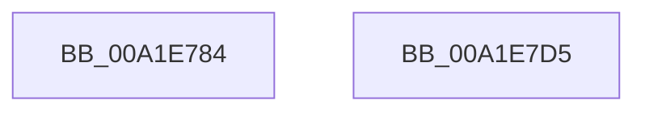

# PiUEventNotifyClientPendingEvent

- RVA: `0x00A1E784`–`0x00A1E7D6` (길이 `82` bytes)
- VA: `0x0000000140A1E784`
- 실행 섹션: `PAGE`
- PDB 이름 있음: `예`; PDB Function 태그: `아니요`
- unwind 정보 RVA: `0x000697A4`
- 디코드: `23`개 명령, `82/82` bytes 표시
- 미해석 바이트: `0` (있으면 어셈블리에 `.byte`로 보존)

> 이 문서는 커널 이미지의 기계어와 PDB 기호를 분석해 생성했습니다. 4번과 5번은 함수 원형과 자료형을 바이너리 사용 방식에서 추정한 C 해석이며 원본 소스 복구 결과는 아닙니다.

## 1. Dependencies

- 직접 호출 지점: **4**; 고유 호출 대상: **4**
- 직접 호출자로 확인된 함수: **2**
- RIP 상대 이미지 참조: **0**

### Outgoing calls
- `0x00A1E791` → [ExAcquireFastMutex](../../text/20/ExAcquireFastMutex_function_0020E5A0.md) (function, `0x0020E5A0`)
- `0x00A1E799` → [PiUEventEstimateRequiredClientBufferSize](../../text/47/PiUEventEstimateRequiredClientBufferSize_function_004749AC.md) (function, `0x004749AC`)
- `0x00A1E7A6` → [ExReleaseFastMutex](../../text/25/ExReleaseFastMutex_function_002519C0.md) (function, `0x002519C0`)
- `0x00A1E7CA` → [ZwUpdateWnfStateData](../../text/6B/ZwUpdateWnfStateData_function_006B0D10.md) (function, `0x006B0D10`)

### Direct callers
- [PiUEventNotifyClient](../8E/PiUEventNotifyClient_function_008E6BEC.md) at `0x008E6CAA`
- [PiUEventHandleGetEvent](../9C/PiUEventHandleGetEvent_function_009C2C30.md) at `0x009C2E7F`

### Static image references
- 디코드된 RIP-relative 메모리 참조가 없습니다.

## 2. Other-region calls and transfers

- 다른 실행 섹션으로 향하는 call: **4**
  - `0x00A1E791` → [ExAcquireFastMutex](../../text/20/ExAcquireFastMutex_function_0020E5A0.md) (`PAGE` → `.text`)
  - `0x00A1E799` → [PiUEventEstimateRequiredClientBufferSize](../../text/47/PiUEventEstimateRequiredClientBufferSize_function_004749AC.md) (`PAGE` → `.text`)
  - `0x00A1E7A6` → [ExReleaseFastMutex](../../text/25/ExReleaseFastMutex_function_002519C0.md) (`PAGE` → `.text`)
  - `0x00A1E7CA` → [ZwUpdateWnfStateData](../../text/6B/ZwUpdateWnfStateData_function_006B0D10.md) (`PAGE` → `.text`)
- 별도 외부 분기/꼬리 이동을 확인하지 못했습니다.

## 3. Assembly (complete function range)

```asm
00A1E784  40 53                           push rbx
00A1E786  48 83 EC 40                     sub rsp, 0x40
00A1E78A  48 8B D9                        mov rbx, rcx
00A1E78D  48 8B 49 10                     mov rcx, qword ptr [rcx + 0x10]
00A1E791  E8 0A FE 7E FF                  call 0x14020e5a0
00A1E796  48 8B CB                        mov rcx, rbx
00A1E799  E8 0E 62 A5 FF                  call 0x1404749ac
00A1E79E  48 8B 4B 10                     mov rcx, qword ptr [rbx + 0x10]
00A1E7A2  89 44 24 50                     mov dword ptr [rsp + 0x50], eax
00A1E7A6  E8 15 32 83 FF                  call 0x1402519c0
00A1E7AB  33 C0                           xor eax, eax
00A1E7AD  48 8D 4B 58                     lea rcx, [rbx + 0x58]
00A1E7B1  89 44 24 30                     mov dword ptr [rsp + 0x30], eax
00A1E7B5  48 8D 54 24 50                  lea rdx, [rsp + 0x50]
00A1E7BA  89 44 24 28                     mov dword ptr [rsp + 0x28], eax
00A1E7BE  45 33 C9                        xor r9d, r9d
00A1E7C1  48 89 44 24 20                  mov qword ptr [rsp + 0x20], rax
00A1E7C6  44 8D 40 04                     lea r8d, [rax + 4]
00A1E7CA  E8 41 25 C9 FF                  call 0x1406b0d10
00A1E7CF  48 83 C4 40                     add rsp, 0x40
00A1E7D3  5B                              pop rbx
00A1E7D4  C3                              ret
00A1E7D5  CC                              int3
```

## 4. C-style interpretation (structured pseudocode)

```c
__int64 __fastcall PiUEventNotifyClientPendingEvent(__int64 a1, __int64 a2, __int64 a3, int a4)
{
    __int64 result;
    __int64 v_rsp;
    unsigned int v_stack_m18;
    unsigned int v_stack_m20;
    unsigned __int64 v_stack_m28;
    unsigned int v_stack_p8;

    v_rsp = (v_rsp) - (64);
    result = ExAcquireFastMutex(*(unsigned __int64 *)(a1 + 16), a2, a3, a4);
    result = PiUEventEstimateRequiredClientBufferSize(a1, a2, a3, a4);
    v_stack_p8 = (unsigned int)(result);
    result = ExReleaseFastMutex(*(unsigned __int64 *)(a1 + 16), a2, a3, a4);
    result = 0;
    v_stack_m18 = 0;
    v_stack_m20 = 0;
    a4 = 0;
    v_stack_m28 = 0;
    result = ZwUpdateWnfStateData(a1 + 88, v_stack_p8, result + 4, a4);
    v_rsp = (v_rsp) + (64);
    return result;
}
```

## 5. (Beta) C Style

```c
int64_t PiUEventNotifyClientPendingEvent(void *Arg1, int64_t Arg2, int64_t Arg3, int32_t Arg4)
{
    uint8_t *arg1 = (uint8_t *)Arg1;

    int64_t result;
    int64_t local_rsp;
    uint32_t v_stack_m18;
    uint32_t v_stack_m20;
    uint64_t v_stack_m28;
    uint32_t v_stack_p8;

    local_rsp = (local_rsp) - (64);
    result = ExAcquireFastMutex(*(uint64_t *)(arg1 + 0x10), Arg2, Arg3, Arg4);
    result = PiUEventEstimateRequiredClientBufferSize(Arg1, Arg2, Arg3, Arg4);
    v_stack_p8 = (uint32_t)(result);
    result = ExReleaseFastMutex(*(uint64_t *)(arg1 + 0x10), Arg2, Arg3, Arg4);
    result = 0;
    v_stack_m18 = 0;
    v_stack_m20 = 0;
    Arg4 = 0;
    v_stack_m28 = 0;
    result = ZwUpdateWnfStateData(Arg1 + 88, v_stack_p8, result + 4, Arg4);
    local_rsp = (local_rsp) + (64);
    return result;
}
```

### 관측된 메모리 오프셋

구조체 형식이 확인되지 않은 접근은 인자 기준의 오프셋으로만 기록했습니다.

| 기준 인자 | 오프셋 표현 | 폭 (bit) | 접근 |
|---|---:|---:|---|
| `Arg1` | `+ 0x10` | `64` | `R` |
| `Arg1` | `+ 0x58` | `64` | `R` |

## 6. Execution-region graph

[열기: 2D/3D 그래프와 함수 탐색 컨트롤 패널](../../../control-panel.html?section=page&rva=0x00A1E784&view=graph)

- 2D 그래프는 위에서 아래로 흐르고, 3D 그래프는 빈 공간을 드래그해 회전합니다. Shift+드래그는 이동, 휠은 확대·축소, 함수 노드 선택은 대상 보고서 이동입니다.

### Static fallback


