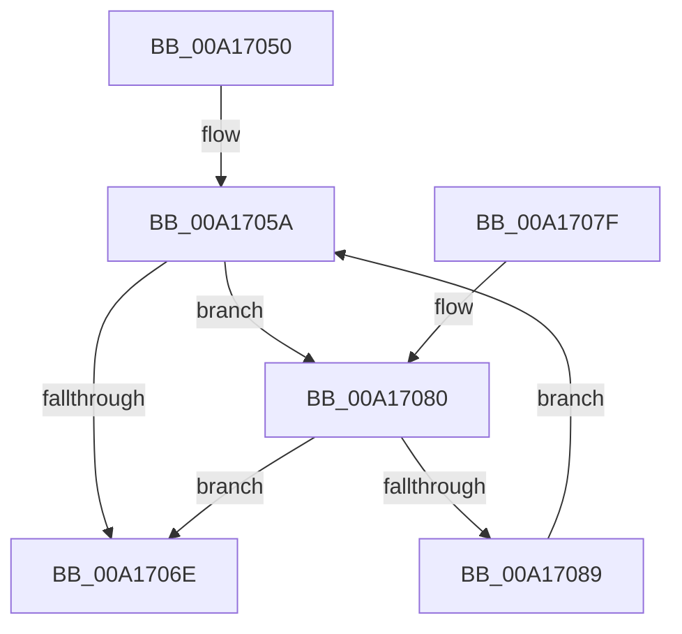

# PopFxPluginWork

- RVA: `0x00A17050`–`0x00A1708B` (길이 `59` bytes)
- VA: `0x0000000140A17050`
- 실행 섹션: `PAGE`
- PDB 이름 있음: `예`; PDB Function 태그: `아니요`
- unwind 정보 RVA: `0x00068784`
- 디코드: `18`개 명령, `59/59` bytes 표시
- 미해석 바이트: `0` (있으면 어셈블리에 `.byte`로 보존)

> 이 문서는 커널 이미지의 기계어와 PDB 기호를 분석해 생성했습니다. 4번과 5번은 함수 원형과 자료형을 바이너리 사용 방식에서 추정한 C 해석이며 원본 소스 복구 결과는 아닙니다.

## 1. Dependencies

- 직접 호출 지점: **1**; 고유 호출 대상: **1**
- 직접 호출자로 확인된 함수: **0**
- RIP 상대 이미지 참조: **0**

### Outgoing calls
- `0x00A17075` → [PopFxProcessWorkPool](../../text/49/PopFxProcessWorkPool_function_0049E8A0.md) (function, `0x0049E8A0`)

### Direct callers
- 이 함수 시작 RVA로 연결되는 직접 call은 확인되지 않았습니다. 간접 호출은 완전히 역산할 수 없습니다.

### Static image references
- 디코드된 RIP-relative 메모리 참조가 없습니다.

## 2. Other-region calls and transfers

- 다른 실행 섹션으로 향하는 call: **1**
  - `0x00A17075` → [PopFxProcessWorkPool](../../text/49/PopFxProcessWorkPool_function_0049E8A0.md) (`PAGE` → `.text`)
- 별도 외부 분기/꼬리 이동을 확인하지 못했습니다.

## 3. Assembly (complete function range)

```asm
00A17050  48 83 EC 28                     sub rsp, 0x28
00A17054  4C 8B 09                        mov r9, qword ptr [rcx]
00A17057  45 33 C0                        xor r8d, r8d
00A1705A  4A 8D 04 85 0D 00 00 00         lea rax, [r8*4 + 0xd]
00A17062  49 03 C0                        add rax, r8
00A17065  49 8D 04 C1                     lea rax, [r9 + rax*8]
00A17069  48 3B C1                        cmp rax, rcx
00A1706C  75 12                           jne 0x140a17080
00A1706E  41 8D 50 01                     lea edx, [r8 + 1]
00A17072  49 8B C9                        mov rcx, r9
00A17075  E8 26 78 A8 FF                  call 0x14049e8a0
00A1707A  48 83 C4 28                     add rsp, 0x28
00A1707E  C3                              ret
00A1707F  CC                              int3
00A17080  41 FF C0                        inc r8d
00A17083  41 83 F8 04                     cmp r8d, 4
00A17087  73 E5                           jae 0x140a1706e
00A17089  EB CF                           jmp 0x140a1705a
```

## 4. C-style interpretation (structured pseudocode)

```c
__int64 __fastcall PopFxPluginWork(__int64 a1, __int64 a2, int a3)
{
    __int64 result;
    __int64 v_rsp;

    v_rsp = (v_rsp) - (40);
    a3 = 0;
loc_00A1705A:
    result = (a3 * 4 + 13) + (0);
    if ((*(unsigned __int64 *)(a1) + result * 8) != a1) goto loc_00A17080;
loc_00A1706E:
    result = PopFxProcessWorkPool(*(unsigned __int64 *)(a1), a3 + 1, a3, *(unsigned __int64 *)(a1));
    v_rsp = (v_rsp) + (40);
    return result;
loc_00A17080:
    a3 = (unsigned int)((a3) + 1);
    if (a3 >= 4) goto loc_00A1706E;
    goto loc_00A1705A;
}
```

## 5. (Beta) C Style

```c
int64_t PopFxPluginWork(void *Arg1, int64_t Arg2, int32_t Arg3)
{
    uint8_t *arg1 = (uint8_t *)Arg1;

    int64_t result;
    int64_t local_rsp;

    local_rsp = (local_rsp) - (40);
    Arg3 = 0;
loc_00A1705A:
    result = (Arg3 * 4 + 13) + (0);
    if ((*(uint64_t *)(arg1) + result * 8) != Arg1) goto loc_00A17080;
loc_00A1706E:
    result = PopFxProcessWorkPool(*(uint64_t *)(arg1), Arg3 + 1, Arg3, *(uint64_t *)(arg1));
    local_rsp = (local_rsp) + (40);
    return result;
loc_00A17080:
    Arg3 = (uint32_t)((Arg3) + 1);
    if (Arg3 >= 4) goto loc_00A1706E;
    goto loc_00A1705A;
}
```

### 관측된 메모리 오프셋

구조체 형식이 확인되지 않은 접근은 인자 기준의 오프셋으로만 기록했습니다.

| 기준 인자 | 오프셋 표현 | 폭 (bit) | 접근 |
|---|---:|---:|---|
| `Arg1` | `+ 0x0` | `64` | `R` |

## 6. Execution-region graph

[열기: 2D/3D 그래프와 함수 탐색 컨트롤 패널](../../../control-panel.html?section=page&rva=0x00A17050&view=graph)

- 2D 그래프는 위에서 아래로 흐르고, 3D 그래프는 빈 공간을 드래그해 회전합니다. Shift+드래그는 이동, 휠은 확대·축소, 함수 노드 선택은 대상 보고서 이동입니다.

### Static fallback


