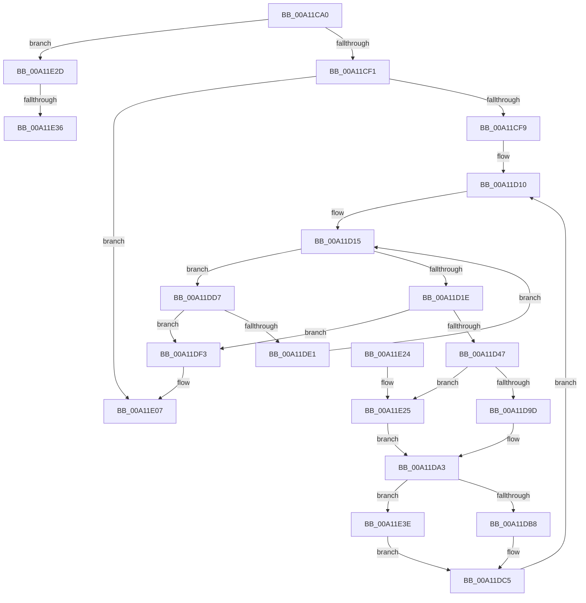

# PopProcessorInformation

- RVA: `0x00A11CA0`–`0x00A11E4A` (길이 `426` bytes)
- VA: `0x0000000140A11CA0`
- 실행 섹션: `PAGE`
- PDB 이름 있음: `예`; PDB Function 태그: `예`
- unwind 정보 RVA: `0x000A95F8`
- 디코드: `110`개 명령, `426/426` bytes 표시
- 미해석 바이트: `0` (있으면 어셈블리에 `.byte`로 보존)

> 이 문서는 커널 이미지의 기계어와 PDB 기호를 분석해 생성했습니다. 4번과 5번은 함수 원형과 자료형을 바이너리 사용 방식에서 추정한 C 해석이며 원본 소스 복구 결과는 아닙니다.

## 1. Dependencies

- 직접 호출 지점: **5**; 고유 호출 대상: **5**
- 직접 호출자로 확인된 함수: **1**
- RIP 상대 이미지 참조: **2**

### Outgoing calls
- `0x00A11CC7` → [KeQueryGroupAffinity](../../text/47/KeQueryGroupAffinity_function_00471A60.md) (function, `0x00471A60`)
- `0x00A11D03` → [PopAcquireRwLockShared](../../text/2D/PopAcquireRwLockShared_function_002D9A40.md) (function, `0x002D9A40`)
- `0x00A11D47` → [KeGetPrcb](../../text/2D/KeGetPrcb_function_002D85D0.md) (function, `0x002D85D0`)
- `0x00A11D83` → [PpmPerfGetCurrentState](../../text/44/PpmPerfGetCurrentState_function_00448C08.md) (function, `0x00448C08`)
- `0x00A11DFA` → [PopReleaseRwLock](../../text/2D/PopReleaseRwLock_function_002DFBBC.md) (function, `0x002DFBBC`)

### Direct callers
- [NtPowerInformation](../95/NtPowerInformation_function_00955D80.md) at `0x009565A5`
- [NtPowerInformation](../95/NtPowerInformation_function_00955D80.md) at `0x0095717F`

### Static image references
- `0x00A11CF9` → RVA `0x00F0CA70` (`.data`; read)
- `0x00A11D34` → RVA `0x00F231B8` (`.data`; read)

## 2. Other-region calls and transfers

- 다른 실행 섹션으로 향하는 call: **5**
  - `0x00A11CC7` → [KeQueryGroupAffinity](../../text/47/KeQueryGroupAffinity_function_00471A60.md) (`PAGE` → `.text`)
  - `0x00A11D03` → [PopAcquireRwLockShared](../../text/2D/PopAcquireRwLockShared_function_002D9A40.md) (`PAGE` → `.text`)
  - `0x00A11D47` → [KeGetPrcb](../../text/2D/KeGetPrcb_function_002D85D0.md) (`PAGE` → `.text`)
  - `0x00A11D83` → [PpmPerfGetCurrentState](../../text/44/PpmPerfGetCurrentState_function_00448C08.md) (`PAGE` → `.text`)
  - `0x00A11DFA` → [PopReleaseRwLock](../../text/2D/PopReleaseRwLock_function_002DFBBC.md) (`PAGE` → `.text`)
- call이 아닌 외부 분기/꼬리 이동: **2**
  - `0x00A11E30` → [sub_00B36D52](../B3/Unknown_function_00B36D52.md) (`tail-transfer`)
  - `0x00A11E39` → [sub_00B36D52](../B3/Unknown_function_00B36D52.md) (`tail-transfer`)

## 3. Assembly (complete function range)

```asm
00A11CA0  48 89 5C 24 08                  mov qword ptr [rsp + 8], rbx
00A11CA5  4C 89 4C 24 20                  mov qword ptr [rsp + 0x20], r9
00A11CAA  55                              push rbp
00A11CAB  56                              push rsi
00A11CAC  57                              push rdi
00A11CAD  41 54                           push r12
00A11CAF  41 55                           push r13
00A11CB1  41 56                           push r14
00A11CB3  41 57                           push r15
00A11CB5  48 83 EC 40                     sub rsp, 0x40
00A11CB9  4C 8B F1                        mov r14, rcx
00A11CBC  4D 8B F9                        mov r15, r9
00A11CBF  41 0F B7 C8                     movzx ecx, r8w
00A11CC3  41 0F B7 F8                     movzx edi, r8w
00A11CC7  E8 94 FD A5 FF                  call 0x140471a60
00A11CCC  48 8B F0                        mov rsi, rax
00A11CCF  33 DB                           xor ebx, ebx
00A11CD1  F3 48 0F B8 C0                  popcnt rax, rax
00A11CD6  90                              nop
00A11CD7  48 89 44 24 30                  mov qword ptr [rsp + 0x30], rax
00A11CDC  44 8D 24 40                     lea r12d, [rax + rax*2]
00A11CE0  41 C1 E4 03                     shl r12d, 3
00A11CE4  41 81 FC 00 06 00 00            cmp r12d, 0x600
00A11CEB  0F 87 3C 01 00 00               ja 0x140a11e2d
00A11CF1  85 C0                           test eax, eax
00A11CF3  0F 84 0E 01 00 00               je 0x140a11e07
00A11CF9  48 8D 0D 70 AD 4F 00            lea rcx, [rip + 0x4fad70]
00A11D00  44 8B EB                        mov r13d, ebx
00A11D03  E8 38 7D 8C FF                  call 0x1402d9a40
00A11D08  4C 8B 7C 24 30                  mov r15, qword ptr [rsp + 0x30]
00A11D0D  8D 43 01                        lea eax, [rbx + 1]
00A11D10  0F B7 CF                        movzx ecx, di
00A11D13  03 C8                           add ecx, eax
00A11D15  48 85 F6                        test rsi, rsi
00A11D18  0F 84 B9 00 00 00               je 0x140a11dd7
00A11D1E  48 0F BC D6                     bsf rdx, rsi
00A11D22  0F B7 CF                        movzx ecx, di
00A11D25  0F B6 C2                        movzx eax, dl
00A11D28  48 0F B3 C6                     btr rsi, rax
00A11D2C  C1 E1 06                        shl ecx, 6
00A11D2F  0F B6 C2                        movzx eax, dl
00A11D32  03 C8                           add ecx, eax
00A11D34  48 8B 05 7D 14 51 00            mov rax, qword ptr [rip + 0x51147d]
00A11D3B  8B 0C 88                        mov ecx, dword ptr [rax + rcx*4]
00A11D3E  45 3B EF                        cmp r13d, r15d
00A11D41  0F 83 AC 00 00 00               jae 0x140a11df3
00A11D47  E8 84 68 8C FF                  call 0x1402d85d0
00A11D4C  48 8B C8                        mov rcx, rax
00A11D4F  48 89 44 24 30                  mov qword ptr [rsp + 0x30], rax
00A11D54  41 8B C5                        mov eax, r13d
00A11D57  4D 8D 46 0C                     lea r8, [r14 + 0xc]
00A11D5B  49 8D 56 08                     lea rdx, [r14 + 8]
00A11D5F  48 89 5C 24 28                  mov qword ptr [rsp + 0x28], rbx
00A11D64  45 33 C9                        xor r9d, r9d
00A11D67  48 89 5C 24 20                  mov qword ptr [rsp + 0x20], rbx
00A11D6C  48 8D 2C 40                     lea rbp, [rax + rax*2]
00A11D70  0F B6 81 D1 00 00 00            movzx eax, byte ptr [rcx + 0xd1]
00A11D77  4D 8D 04 E8                     lea r8, [r8 + rbp*8]
00A11D7B  41 89 04 EE                     mov dword ptr [r14 + rbp*8], eax
00A11D7F  48 8D 14 EA                     lea rdx, [rdx + rbp*8]
00A11D83  E8 80 6E A3 FF                  call 0x140448c08
00A11D88  48 8B 4C 24 30                  mov rcx, qword ptr [rsp + 0x30]
00A11D8D  48 8B 81 B0 89 00 00            mov rax, qword ptr [rcx + 0x89b0]
00A11D94  48 85 C0                        test rax, rax
00A11D97  0F 84 88 00 00 00               je 0x140a11e25
00A11D9D  8B 80 C0 01 00 00               mov eax, dword ptr [rax + 0x1c0]
00A11DA3  41 89 44 EE 04                  mov dword ptr [r14 + rbp*8 + 4], eax
00A11DA8  48 8B 89 40 88 00 00            mov rcx, qword ptr [rcx + 0x8840]
00A11DAF  48 85 C9                        test rcx, rcx
00A11DB2  0F 84 86 00 00 00               je 0x140a11e3e
00A11DB8  8B 41 28                        mov eax, dword ptr [rcx + 0x28]
00A11DBB  41 89 44 EE 10                  mov dword ptr [r14 + rbp*8 + 0x10], eax
00A11DC0  8B 41 18                        mov eax, dword ptr [rcx + 0x18]
00A11DC3  FF C0                           inc eax
00A11DC5  41 89 44 EE 14                  mov dword ptr [r14 + rbp*8 + 0x14], eax
00A11DCA  B8 01 00 00 00                  mov eax, 1
00A11DCF  44 03 E8                        add r13d, eax
00A11DD2  E9 39 FF FF FF                  jmp 0x140a11d10
00A11DD7  66 03 F8                        add di, ax
00A11DDA  0F B7 FF                        movzx edi, di
00A11DDD  3B F9                           cmp edi, ecx
00A11DDF  73 12                           jae 0x140a11df3
00A11DE1  48 8B 34 FD 08 00 00 00         mov rsi, qword ptr [rdi*8 + 8]
00A11DE9  B8 01 00 00 00                  mov eax, 1
00A11DEE  E9 22 FF FF FF                  jmp 0x140a11d15
00A11DF3  48 8D 0D 76 AC 4F 00            lea rcx, [rip + 0x4fac76]
00A11DFA  E8 BD DD 8C FF                  call 0x1402dfbbc
00A11DFF  4C 8B BC 24 98 00 00 00         mov r15, qword ptr [rsp + 0x98]
00A11E07  45 89 27                        mov dword ptr [r15], r12d
00A11E0A  8B C3                           mov eax, ebx
00A11E0C  48 8B 9C 24 80 00 00 00         mov rbx, qword ptr [rsp + 0x80]
00A11E14  48 83 C4 40                     add rsp, 0x40
00A11E18  41 5F                           pop r15
00A11E1A  41 5E                           pop r14
00A11E1C  41 5D                           pop r13
00A11E1E  41 5C                           pop r12
00A11E20  5F                              pop rdi
00A11E21  5E                              pop rsi
00A11E22  5D                              pop rbp
00A11E23  C3                              ret
00A11E24  CC                              int3
00A11E25  8B 41 44                        mov eax, dword ptr [rcx + 0x44]
00A11E28  E9 76 FF FF FF                  jmp 0x140a11da3
00A11E2D  4D 85 FF                        test r15, r15
00A11E30  0F 84 1C 4F 12 00               je 0x140b36d52
00A11E36  41 89 1F                        mov dword ptr [r15], ebx
00A11E39  E9 14 4F 12 00                  jmp 0x140b36d52
00A11E3E  41 89 5C EE 10                  mov dword ptr [r14 + rbp*8 + 0x10], ebx
00A11E43  8B C3                           mov eax, ebx
00A11E45  E9 7B FF FF FF                  jmp 0x140a11dc5
```

## 4. C-style interpretation (structured pseudocode)

```c
__int64 __fastcall PopProcessorInformation(__int64 a1, __int64 a2, unsigned __int16 a3, __int64 a4)
{
    __int64 result;
    __int64 v_r12;
    __int64 v_r13;
    __int64 v_rbx;
    __int64 v_rdi;
    __int64 v_rsp;
    unsigned __int64 v_stack_m48;
    unsigned __int64 v_stack_m50;
    unsigned __int64 v_stack_m58;
    unsigned __int64 v_stack_p20;
    unsigned __int64 v_stack_p8;

    v_stack_p8 = v_rbx;
    v_stack_p20 = a4;
    v_rsp = (v_rsp) - (64);
    result = KeQueryGroupAffinity(a3, a2, a3, a4);
    v_rbx = 0;
    v_stack_m48 = result;
    v_r12 = (unsigned int)((result + result * 2) << (3));
    if (((unsigned int)(v_r12)) > 0x600ULL) goto loc_00A11E2D;
    if ((unsigned int)(result) == 0) goto loc_00A11E07;
    result = PopAcquireRwLockShared(v_rip + 5221744, a2, a3, a4);
loc_00A11D10:
    a1 = (unsigned int)((a3) + ((unsigned int)(v_rbx + 1)));
loc_00A11D15:
    if (result == 0) goto loc_00A11DD7;
    a1 = (unsigned int)((a3) << (6));
    a1 = (unsigned int)((a1) + ((unsigned int)((unsigned __int8)(a2))));
    if (0 >= ((unsigned int)(v_stack_m48))) goto loc_00A11DF3;
    result = KeGetPrcb((unsigned int)(*(unsigned int *)(*(unsigned __int64 *)(v_rip + 5313661) + a1 * 4)), a2, a3, a4);
    v_stack_m48 = result;
    v_stack_m50 = 0;
    a4 = 0;
    v_stack_m58 = 0;
    *(unsigned int *)(a1 + 0 + 0 * 2 * 8) = (unsigned int)(*(unsigned __int8 *)(result + 209));
    result = PpmPerfGetCurrentState(result, a1 + 8 + 0 + 0 * 2 * 8, a1 + 12 + 0 + 0 * 2 * 8, a4);
    if (*(unsigned __int64 *)(v_stack_m48 + 35248) == 0) goto loc_00A11E25;
loc_00A11DA3:
    *(unsigned int *)(a1 + 0 + 0 * 2 * 8 + 4) = (unsigned int)((unsigned int)(*(unsigned int *)(*(unsigned __int64 *)(v_stack_m48 + 35248) + 448)));
    if (*(unsigned __int64 *)(v_stack_m48 + 34880) == 0) goto loc_00A11E3E;
    *(unsigned int *)(a1 + 0 + 0 * 2 * 8 + 16) = (unsigned int)((unsigned int)(*(unsigned int *)(*(unsigned __int64 *)(v_stack_m48 + 34880) + 40)));
    result = (unsigned int)(((unsigned int)(*(unsigned int *)(*(unsigned __int64 *)(v_stack_m48 + 34880) + 24))) + 1);
loc_00A11DC5:
    *(unsigned int *)(a1 + 0 + 0 * 2 * 8 + 20) = (unsigned int)(result);
    v_r13 = (unsigned int)((0) + (1));
    goto loc_00A11D10;
loc_00A11DD7:
    v_rdi = (unsigned __int16)((a3) + (1));
    if (((unsigned int)((unsigned __int16)(v_rdi))) >= ((unsigned int)(*(unsigned __int64 *)(v_stack_m48 + 34880)))) goto loc_00A11DF3;
    goto loc_00A11D15;
loc_00A11DF3:
    result = PopReleaseRwLock(v_rip + 5221494, a1 + 8 + 0 + 0 * 2 * 8, a1 + 12 + 0 + 0 * 2 * 8, a4);
loc_00A11E07:
    *(unsigned int *)(v_stack_p20) = (unsigned int)(v_r12);
    v_rsp = (v_rsp) + (64);
    return 0;
loc_00A11E25:
    goto loc_00A11DA3;
loc_00A11E2D:
    *(unsigned int *)(v_stack_p20) = (unsigned int)(v_stack_p8);
loc_00A11E3E:
    *(unsigned int *)(a1 + 0 + 0 * 2 * 8 + 16) = (unsigned int)(v_stack_p8);
    goto loc_00A11DC5;
}
```

## 5. (Beta) C Style

```c
int64_t PopProcessorInformation(void *Arg1, int64_t Arg2, uint16_t Arg3, int64_t Arg4)
{
    uint8_t *arg1 = (uint8_t *)Arg1;

    int64_t result;
    int64_t local_r12;
    int64_t local_r13;
    int64_t local_rbx;
    int64_t local_rdi;
    int64_t local_rsp;
    uint64_t v_stack_m48;
    uint64_t v_stack_m50;
    uint64_t v_stack_m58;
    uint64_t v_stack_p20;
    uint64_t v_stack_p8;

    v_stack_p8 = local_rbx;
    v_stack_p20 = Arg4;
    local_rsp = (local_rsp) - (64);
    result = KeQueryGroupAffinity(Arg3, Arg2, Arg3, Arg4);
    local_rbx = 0;
    v_stack_m48 = result;
    local_r12 = (uint32_t)((result + result * 2) << (3));
    if (((uint32_t)(local_r12)) > 0x600ULL) goto loc_00A11E2D;
    if ((uint32_t)(result) == 0) goto loc_00A11E07;
    result = PopAcquireRwLockShared(v_rip + 5221744, Arg2, Arg3, Arg4);
loc_00A11D10:
    Arg1 = (uint32_t)((Arg3) + ((uint32_t)(local_rbx + 1)));
loc_00A11D15:
    if (result == 0) goto loc_00A11DD7;
    Arg1 = (uint32_t)((Arg3) << (6));
    Arg1 = (uint32_t)((Arg1) + ((uint32_t)((uint8_t)(Arg2))));
    if (0 >= ((uint32_t)(v_stack_m48))) goto loc_00A11DF3;
    result = KeGetPrcb((uint32_t)(*(uint32_t *)(*(uint64_t *)(v_rip + 0x51147D) + arg1 * 4)), Arg2, Arg3, Arg4);
    v_stack_m48 = result;
    v_stack_m50 = 0;
    Arg4 = 0;
    v_stack_m58 = 0;
    *(uint32_t *)(arg1 + 0x0 + 0x0 * 2 * 8) = (uint32_t)(*(uint8_t *)(result + 0xD1));
    result = PpmPerfGetCurrentState(result, Arg1 + 8 + 0 + 0 * 2 * 8, Arg1 + 12 + 0 + 0 * 2 * 8, Arg4);
    if (*(uint64_t *)(v_stack_m48 + 0x89B0) == 0) goto loc_00A11E25;
loc_00A11DA3:
    *(uint32_t *)(arg1 + 0x0 + 0x0 * 2 * 8 + 0x4) = (uint32_t)((uint32_t)(*(uint32_t *)(*(uint64_t *)(v_stack_m48 + 0x89B0) + 0x1C0)));
    if (*(uint64_t *)(v_stack_m48 + 0x8840) == 0) goto loc_00A11E3E;
    *(uint32_t *)(arg1 + 0x0 + 0x0 * 2 * 8 + 0x10) = (uint32_t)((uint32_t)(*(uint32_t *)(*(uint64_t *)(v_stack_m48 + 0x8840) + 0x28)));
    result = (uint32_t)(((uint32_t)(*(uint32_t *)(*(uint64_t *)(v_stack_m48 + 0x8840) + 0x18))) + 1);
loc_00A11DC5:
    *(uint32_t *)(arg1 + 0x0 + 0x0 * 2 * 8 + 0x14) = (uint32_t)(result);
    local_r13 = (uint32_t)((0) + (1));
    goto loc_00A11D10;
loc_00A11DD7:
    local_rdi = (uint16_t)((Arg3) + (1));
    if (((uint32_t)((uint16_t)(local_rdi))) >= ((uint32_t)(*(uint64_t *)(v_stack_m48 + 0x8840)))) goto loc_00A11DF3;
    goto loc_00A11D15;
loc_00A11DF3:
    result = PopReleaseRwLock(v_rip + 5221494, Arg1 + 8 + 0 + 0 * 2 * 8, Arg1 + 12 + 0 + 0 * 2 * 8, Arg4);
loc_00A11E07:
    *(uint32_t *)(v_stack_p20) = (uint32_t)(local_r12);
    local_rsp = (local_rsp) + (64);
    return 0;
loc_00A11E25:
    goto loc_00A11DA3;
loc_00A11E2D:
    *(uint32_t *)(v_stack_p20) = (uint32_t)(v_stack_p8);
loc_00A11E3E:
    *(uint32_t *)(arg1 + 0x0 + 0x0 * 2 * 8 + 0x10) = (uint32_t)(v_stack_p8);
    goto loc_00A11DC5;
}
```

### 관측된 메모리 오프셋

구조체 형식이 확인되지 않은 접근은 인자 기준의 오프셋으로만 기록했습니다.

| 기준 인자 | 오프셋 표현 | 폭 (bit) | 접근 |
|---|---:|---:|---|
| `Arg1` | `+ 0x0 + rbp*8` | `32` | `W` |
| `Arg1` | `+ 0x0 + rbp*8` | `64` | `R` |
| `Arg1` | `+ 0x4 + rbp*8` | `32` | `W` |
| `Arg1` | `+ 0x8` | `64` | `R` |
| `Arg1` | `+ 0xC` | `64` | `R` |
| `Arg1` | `+ 0x10 + rbp*8` | `32` | `W` |
| `Arg1` | `+ 0x14 + rbp*8` | `32` | `W` |

## 6. Execution-region graph

[열기: 2D/3D 그래프와 함수 탐색 컨트롤 패널](../../../control-panel.html?section=page&rva=0x00A11CA0&view=graph)

- 2D 그래프는 위에서 아래로 흐르고, 3D 그래프는 빈 공간을 드래그해 회전합니다. Shift+드래그는 이동, 휠은 확대·축소, 함수 노드 선택은 대상 보고서 이동입니다.

### Static fallback


