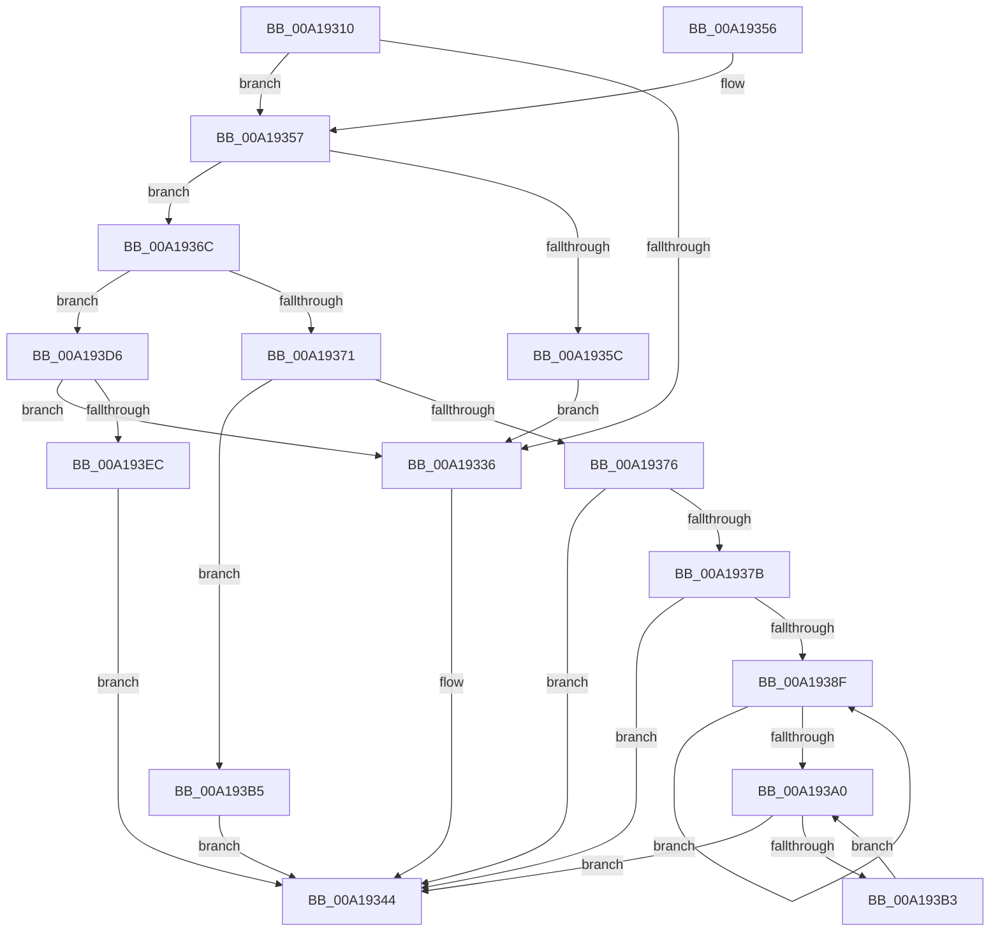

# PpDevNodeLockTree

- RVA: `0x00A19310`–`0x00A193F8` (길이 `232` bytes)
- VA: `0x0000000140A19310`
- 실행 섹션: `PAGE`
- PDB 이름 있음: `예`; PDB Function 태그: `아니요`
- unwind 정보 RVA: `0x000AA2F0`
- 디코드: `63`개 명령, `232/232` bytes 표시
- 미해석 바이트: `0` (있으면 어셈블리에 `.byte`로 보존)

> 이 문서는 커널 이미지의 기계어와 PDB 기호를 분석해 생성했습니다. 4번과 5번은 함수 원형과 자료형을 바이너리 사용 방식에서 추정한 C 해석이며 원본 소스 복구 결과는 아닙니다.

## 1. Dependencies

- 직접 호출 지점: **9**; 고유 호출 대상: **5**
- 직접 호출자로 확인된 함수: **19**
- RIP 상대 이미지 참조: **2**

### Outgoing calls
- `0x00A1933F` → [ExAcquireResourceSharedLite](../../text/21/ExAcquireResourceSharedLite_function_00211BC0.md) (function, `0x00211BC0`)
- `0x00A19365` → [ExAcquireResourceExclusiveLite](../../text/21/ExAcquireResourceExclusiveLite_function_00214E20.md) (function, `0x00214E20`)
- `0x00A19382` → [ExIsResourceAcquiredSharedLite](../../text/34/ExIsResourceAcquiredSharedLite_function_00341B10.md) (function, `0x00341B10`)
- `0x00A19396` → [ExReleaseResourceLite](../../text/25/ExReleaseResourceLite_function_0025FA10.md) (function, `0x0025FA10`)
- `0x00A193A9` → [ExAcquireResourceExclusiveLite](../../text/21/ExAcquireResourceExclusiveLite_function_00214E20.md) (function, `0x00214E20`)
- `0x00A193BE` → [ExAcquireResourceExclusiveLite](../../text/21/ExAcquireResourceExclusiveLite_function_00214E20.md) (function, `0x00214E20`)
- `0x00A193CC` → [ExAcquireResourceExclusiveLite](../../text/21/ExAcquireResourceExclusiveLite_function_00214E20.md) (function, `0x00214E20`)
- `0x00A193DF` → [ExAcquireResourceExclusiveLite](../../text/21/ExAcquireResourceExclusiveLite_function_00214E20.md) (function, `0x00214E20`)
- `0x00A193EE` → [KeLeaveCriticalRegion](../../text/25/KeLeaveCriticalRegion_function_0025D8B0.md) (function, `0x0025D8B0`)

### Direct callers
- [PnpDeviceActionWorker](../../text/47/PnpDeviceActionWorker_function_00478400.md) at `0x00478479`
- [PnpLockDeviceActionQueue](../../text/4A/PnpLockDeviceActionQueue_function_004A4388.md) at `0x004A4393`
- [IoTranslateBusAddress](../../text/5A/IoTranslateBusAddress_function_005A5F60.md) at `0x005A5FF8`
- [IoReportDetectedDevice](../72/IoReportDetectedDevice_function_00725CD0.md) at `0x00725E3E`
- [IoReportRootDevice](../72/IoReportRootDevice_function_00726780.md) at `0x0072685C`
- [PiPagePathSetState](../72/PiPagePathSetState_function_0072BDE0.md) at `0x0072BE64`
- [PpSystemHiveLimitCallback](../72/PpSystemHiveLimitCallback_function_0072C310.md) at `0x0072C358`
- [PnpRestartDeviceNode](../72/PnpRestartDeviceNode_function_0072CD60.md) at `0x0072CD72`
- [PnpProcessCompletedEject](../72/PnpProcessCompletedEject_function_0072D090.md) at `0x0072D0EC`
- [PnpQueuePendingEject](../72/PnpQueuePendingEject_function_0072D334.md) at `0x0072D342`
- [PipSetDevNodeStateFlags](../72/PipSetDevNodeStateFlags_function_0072DB98.md) at `0x0072DBA6`
- [PpDevCfgProcessDevices](../73/PpDevCfgProcessDevices_function_007373C0.md) at `0x00737497`
- [PiProfileUpdateDeviceTreeWorker](../73/PiProfileUpdateDeviceTreeWorker_function_007376F0.md) at `0x007376FE`
- [PiCMDeleteDeviceWorker](../73/PiCMDeleteDeviceWorker_function_0073B420.md) at `0x0073B501`
- [PiCMDeleteDeviceWorker](../73/PiCMDeleteDeviceWorker_function_0073B420.md) at `0x0073B5C2`
- [PiInitializeDevice](../73/PiInitializeDevice_function_0073EC5C.md) at `0x0073ECA0`
- [PnpIommuBlockUnblockDevice](../74/PnpIommuBlockUnblockDevice_function_00740408.md) at `0x00740440`
- [IopWarmEjectDevice](../74/IopWarmEjectDevice_function_007405EC.md) at `0x0074061A`
- [IopWarmEjectDevice](../74/IopWarmEjectDevice_function_007405EC.md) at `0x0074066B`
- [PnpDiagRundownRegisterCallback](../A5/PnpDiagRundownRegisterCallback_function_00A516A0.md) at `0x00A517E8`
- [PiCMCreateDevice](../AC/PiCMCreateDevice_function_00ACB824.md) at `0x00ACBB74`

### Static image references
- `0x00A19338` → RVA `0x00F8C560` (`.data`; read)
- `0x00A1935E` → RVA `0x00F8C4E0` (`.data`; read)

## 2. Other-region calls and transfers

- 다른 실행 섹션으로 향하는 call: **9**
  - `0x00A1933F` → [ExAcquireResourceSharedLite](../../text/21/ExAcquireResourceSharedLite_function_00211BC0.md) (`PAGE` → `.text`)
  - `0x00A19365` → [ExAcquireResourceExclusiveLite](../../text/21/ExAcquireResourceExclusiveLite_function_00214E20.md) (`PAGE` → `.text`)
  - `0x00A19382` → [ExIsResourceAcquiredSharedLite](../../text/34/ExIsResourceAcquiredSharedLite_function_00341B10.md) (`PAGE` → `.text`)
  - `0x00A19396` → [ExReleaseResourceLite](../../text/25/ExReleaseResourceLite_function_0025FA10.md) (`PAGE` → `.text`)
  - `0x00A193A9` → [ExAcquireResourceExclusiveLite](../../text/21/ExAcquireResourceExclusiveLite_function_00214E20.md) (`PAGE` → `.text`)
  - `0x00A193BE` → [ExAcquireResourceExclusiveLite](../../text/21/ExAcquireResourceExclusiveLite_function_00214E20.md) (`PAGE` → `.text`)
  - `0x00A193CC` → [ExAcquireResourceExclusiveLite](../../text/21/ExAcquireResourceExclusiveLite_function_00214E20.md) (`PAGE` → `.text`)
  - `0x00A193DF` → [ExAcquireResourceExclusiveLite](../../text/21/ExAcquireResourceExclusiveLite_function_00214E20.md) (`PAGE` → `.text`)
  - `0x00A193EE` → [KeLeaveCriticalRegion](../../text/25/KeLeaveCriticalRegion_function_0025D8B0.md) (`PAGE` → `.text`)
- 별도 외부 분기/꼬리 이동을 확인하지 못했습니다.

## 3. Assembly (complete function range)

```asm
00A19310  48 89 5C 24 08                  mov qword ptr [rsp + 8], rbx
00A19315  48 89 74 24 10                  mov qword ptr [rsp + 0x10], rsi
00A1931A  57                              push rdi
00A1931B  48 83 EC 20                     sub rsp, 0x20
00A1931F  65 48 8B 04 25 88 01 00 00      mov rax, qword ptr gs:[0x188]
00A19328  B3 01                           mov bl, 1
00A1932A  66 FF 88 E4 01 00 00            dec word ptr [rax + 0x1e4]
00A19331  90                              nop
00A19332  85 C9                           test ecx, ecx
00A19334  75 21                           jne 0x140a19357
00A19336  8A D3                           mov dl, bl
00A19338  48 8D 0D 21 32 57 00            lea rcx, [rip + 0x573221]
00A1933F  E8 7C 88 7F FF                  call 0x140211bc0
00A19344  48 8B 74 24 38                  mov rsi, qword ptr [rsp + 0x38]
00A19349  8A C3                           mov al, bl
00A1934B  48 8B 5C 24 30                  mov rbx, qword ptr [rsp + 0x30]
00A19350  48 83 C4 20                     add rsp, 0x20
00A19354  5F                              pop rdi
00A19355  C3                              ret
00A19356  CC                              int3
00A19357  83 E9 01                        sub ecx, 1
00A1935A  75 10                           jne 0x140a1936c
00A1935C  8A D3                           mov dl, bl
00A1935E  48 8D 0D 7B 31 57 00            lea rcx, [rip + 0x57317b]
00A19365  E8 B6 BA 7F FF                  call 0x140214e20
00A1936A  EB CA                           jmp 0x140a19336
00A1936C  83 E9 01                        sub ecx, 1
00A1936F  74 65                           je 0x140a193d6
00A19371  83 E9 01                        sub ecx, 1
00A19374  74 3F                           je 0x140a193b5
00A19376  83 F9 01                        cmp ecx, 1
00A19379  75 C9                           jne 0x140a19344
00A1937B  48 8D 0D DE 31 57 00            lea rcx, [rip + 0x5731de]
00A19382  E8 89 87 92 FF                  call 0x140341b10
00A19387  8B F8                           mov edi, eax
00A19389  8B F0                           mov esi, eax
00A1938B  85 C0                           test eax, eax
00A1938D  74 B5                           je 0x140a19344
00A1938F  48 8D 0D CA 31 57 00            lea rcx, [rip + 0x5731ca]
00A19396  E8 75 66 84 FF                  call 0x14025fa10
00A1939B  83 C6 FF                        add esi, -1
00A1939E  75 EF                           jne 0x140a1938f
00A193A0  8A D3                           mov dl, bl
00A193A2  48 8D 0D B7 31 57 00            lea rcx, [rip + 0x5731b7]
00A193A9  E8 72 BA 7F FF                  call 0x140214e20
00A193AE  83 C7 FF                        add edi, -1
00A193B1  74 91                           je 0x140a19344
00A193B3  EB EB                           jmp 0x140a193a0
00A193B5  8A D3                           mov dl, bl
00A193B7  48 8D 0D 22 31 57 00            lea rcx, [rip + 0x573122]
00A193BE  E8 5D BA 7F FF                  call 0x140214e20
00A193C3  8A D3                           mov dl, bl
00A193C5  48 8D 0D 94 31 57 00            lea rcx, [rip + 0x573194]
00A193CC  E8 4F BA 7F FF                  call 0x140214e20
00A193D1  E9 6E FF FF FF                  jmp 0x140a19344
00A193D6  33 D2                           xor edx, edx
00A193D8  48 8D 0D 01 31 57 00            lea rcx, [rip + 0x573101]
00A193DF  E8 3C BA 7F FF                  call 0x140214e20
00A193E4  84 C0                           test al, al
00A193E6  0F 85 4A FF FF FF               jne 0x140a19336
00A193EC  32 DB                           xor bl, bl
00A193EE  E8 BD 44 84 FF                  call 0x14025d8b0
00A193F3  E9 4C FF FF FF                  jmp 0x140a19344
```

## 4. C-style interpretation (structured pseudocode)

```c
__int64 __fastcall PpDevNodeLockTree(int a1)
{
    __int64 result;
    __int64 v_rbx;
    __int64 v_rdi;
    __int64 v_rsi;
    __int64 v_rsp;
    unsigned __int64 v_stack_p10;
    unsigned __int64 v_stack_p8;

    v_stack_p8 = v_rbx;
    v_stack_p10 = v_rsi;
    v_rsp = (v_rsp) - (32);
    if (a1 != 0) goto loc_00A19357;
loc_00A19336:
    result = ExAcquireResourceSharedLite(v_rip + 5714465, 1, a3, a4);
loc_00A19344:
    v_rsp = (v_rsp) + (32);
    return 1;
loc_00A19357:
    a1 = (unsigned int)((v_rip + 5714465) - (1));
    if (condition_is_not_equal) goto loc_00A1936C;
    result = ExAcquireResourceExclusiveLite(v_rip + 5714299, (unsigned __int8)(v_stack_p8), a3, a4);
    goto loc_00A19336;
loc_00A1936C:
    a1 = (unsigned int)((v_rip + 5714299) - (1));
    if (condition_is_equal) goto loc_00A193D6;
    a1 = (unsigned int)((a1) - (1));
    if (condition_is_equal) goto loc_00A193B5;
    if (a1 != 1) goto loc_00A19344;
    result = ExIsResourceAcquiredSharedLite(v_rip + 5714398, (unsigned __int8)(v_stack_p8), a3, a4);
    if ((unsigned int)(result) == 0) goto loc_00A19344;
loc_00A1938F:
    result = ExReleaseResourceLite(v_rip + 5714378, (unsigned __int8)(v_stack_p8), a3, a4);
    v_rsi = (unsigned int)(((unsigned int)((unsigned int)(result))) + (-1));
    if (condition_is_not_equal) goto loc_00A1938F;
loc_00A193A0:
    result = ExAcquireResourceExclusiveLite(v_rip + 5714359, (unsigned __int8)(v_stack_p8), a3, a4);
    v_rdi = (unsigned int)(((unsigned int)((unsigned int)(result))) + (-1));
    if (condition_is_equal) goto loc_00A19344;
    goto loc_00A193A0;
loc_00A193B5:
    result = ExAcquireResourceExclusiveLite(v_rip + 5714210, (unsigned __int8)(v_stack_p8), a3, a4);
    result = ExAcquireResourceExclusiveLite(v_rip + 5714324, (unsigned __int8)(v_stack_p8), a3, a4);
    goto loc_00A19344;
loc_00A193D6:
    a2 = 0;
    result = ExAcquireResourceExclusiveLite(v_rip + 5714177, a2, a3, a4);
    if ((unsigned __int8)(result) != 0) goto loc_00A19336;
    v_rbx = 0;
    result = KeLeaveCriticalRegion(v_rip + 5714177, a2, a3, a4);
    goto loc_00A19344;
}
```

## 5. (Beta) C Style

```c
int64_t PpDevNodeLockTree(int32_t Arg1)
{
    int64_t result;
    int64_t local_rbx;
    int64_t local_rdi;
    int64_t local_rsi;
    int64_t local_rsp;
    uint64_t v_stack_p10;
    uint64_t v_stack_p8;

    v_stack_p8 = local_rbx;
    v_stack_p10 = local_rsi;
    local_rsp = (local_rsp) - (32);
    if (Arg1 != 0) goto loc_00A19357;
loc_00A19336:
    result = ExAcquireResourceSharedLite(v_rip + 5714465, 1, a3, a4);
loc_00A19344:
    local_rsp = (local_rsp) + (32);
    return 1;
loc_00A19357:
    Arg1 = (uint32_t)((v_rip + 5714465) - (1));
    if (condition_is_not_equal) goto loc_00A1936C;
    result = ExAcquireResourceExclusiveLite(v_rip + 5714299, (uint8_t)(v_stack_p8), a3, a4);
    goto loc_00A19336;
loc_00A1936C:
    Arg1 = (uint32_t)((v_rip + 5714299) - (1));
    if (condition_is_equal) goto loc_00A193D6;
    Arg1 = (uint32_t)((Arg1) - (1));
    if (condition_is_equal) goto loc_00A193B5;
    if (Arg1 != 1) goto loc_00A19344;
    result = ExIsResourceAcquiredSharedLite(v_rip + 5714398, (uint8_t)(v_stack_p8), a3, a4);
    if ((uint32_t)(result) == 0) goto loc_00A19344;
loc_00A1938F:
    result = ExReleaseResourceLite(v_rip + 5714378, (uint8_t)(v_stack_p8), a3, a4);
    local_rsi = (uint32_t)(((uint32_t)((uint32_t)(result))) + (-1));
    if (condition_is_not_equal) goto loc_00A1938F;
loc_00A193A0:
    result = ExAcquireResourceExclusiveLite(v_rip + 5714359, (uint8_t)(v_stack_p8), a3, a4);
    local_rdi = (uint32_t)(((uint32_t)((uint32_t)(result))) + (-1));
    if (condition_is_equal) goto loc_00A19344;
    goto loc_00A193A0;
loc_00A193B5:
    result = ExAcquireResourceExclusiveLite(v_rip + 5714210, (uint8_t)(v_stack_p8), a3, a4);
    result = ExAcquireResourceExclusiveLite(v_rip + 5714324, (uint8_t)(v_stack_p8), a3, a4);
    goto loc_00A19344;
loc_00A193D6:
    a2 = 0;
    result = ExAcquireResourceExclusiveLite(v_rip + 5714177, a2, a3, a4);
    if ((uint8_t)(result) != 0) goto loc_00A19336;
    local_rbx = 0;
    result = KeLeaveCriticalRegion(v_rip + 5714177, a2, a3, a4);
    goto loc_00A19344;
}
```

## 6. Execution-region graph

[열기: 2D/3D 그래프와 함수 탐색 컨트롤 패널](../../../control-panel.html?section=page&rva=0x00A19310&view=graph)

- 2D 그래프는 위에서 아래로 흐르고, 3D 그래프는 빈 공간을 드래그해 회전합니다. Shift+드래그는 이동, 휠은 확대·축소, 함수 노드 선택은 대상 보고서 이동입니다.

### Static fallback


