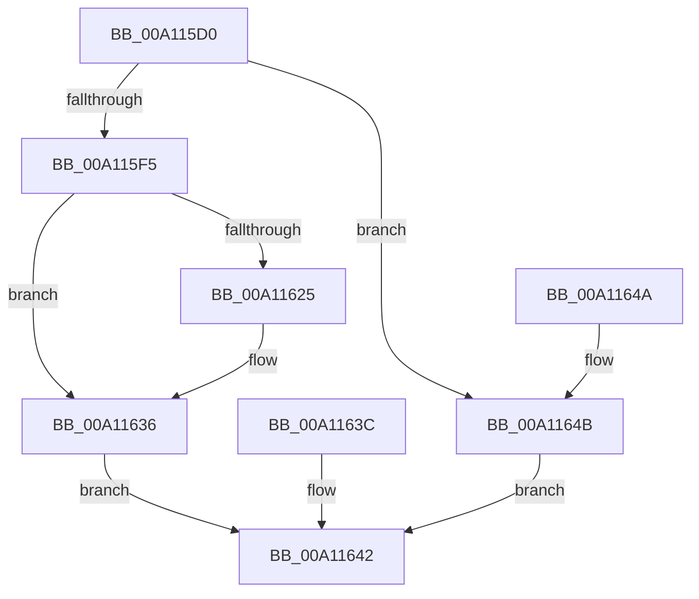

# PsQueryFullProcessImageName

- RVA: `0x00A115D0`–`0x00A11652` (길이 `130` bytes)
- VA: `0x0000000140A115D0`
- 실행 섹션: `PAGE`
- PDB 이름 있음: `예`; PDB Function 태그: `아니요`
- unwind 정보 RVA: `0x000A952C`
- 디코드: `39`개 명령, `130/130` bytes 표시
- 미해석 바이트: `0` (있으면 어셈블리에 `.byte`로 보존)

> 이 문서는 커널 이미지의 기계어와 PDB 기호를 분석해 생성했습니다. 4번과 5번은 함수 원형과 자료형을 바이너리 사용 방식에서 추정한 C 해석이며 원본 소스 복구 결과는 아닙니다.

## 1. Dependencies

- 직접 호출 지점: **1**; 고유 호출 대상: **1**
- 직접 호출자로 확인된 함수: **2**
- RIP 상대 이미지 참조: **0**

### Outgoing calls
- `0x00A11631` → [memcpy](../../text/6C/memcpy_function_006C6840.md) (function, `0x006C6840`)

### Direct callers
- [NtQueryInformationProcess](../9A/NtQueryInformationProcess_function_009AA250.md) at `0x009AB0D4`
- [ExpQuerySystemInformation](../A5/ExpQuerySystemInformation_function_00A57858.md) at `0x00A58F8A`

### Static image references
- 디코드된 RIP-relative 메모리 참조가 없습니다.

## 2. Other-region calls and transfers

- 다른 실행 섹션으로 향하는 call: **1**
  - `0x00A11631` → [memcpy](../../text/6C/memcpy_function_006C6840.md) (`PAGE` → `.text`)
- 별도 외부 분기/꼬리 이동을 확인하지 못했습니다.

## 3. Assembly (complete function range)

```asm
00A115D0  40 53                           push rbx
00A115D2  48 83 EC 40                     sub rsp, 0x40
00A115D6  4D 8B D0                        mov r10, r8
00A115D9  4C 8B C2                        mov r8, rdx
00A115DC  48 8B 91 50 03 00 00            mov rdx, qword ptr [rcx + 0x350]
00A115E3  41 8B 09                        mov ecx, dword ptr [r9]
00A115E6  0F B7 42 02                     movzx eax, word ptr [rdx + 2]
00A115EA  41 89 01                        mov dword ptr [r9], eax
00A115ED  0F B7 42 02                     movzx eax, word ptr [rdx + 2]
00A115F1  3B C1                           cmp eax, ecx
00A115F3  77 56                           ja 0x140a1164b
00A115F5  0F 10 02                        movups xmm0, xmmword ptr [rdx]
00A115F8  0F 11 44 24 28                  movups xmmword ptr [rsp + 0x28], xmm0
00A115FD  66 48 0F 7E C1                  movq rcx, xmm0
00A11602  48 C1 E9 10                     shr rcx, 0x10
00A11606  33 DB                           xor ebx, ebx
00A11608  8B C3                           mov eax, ebx
00A1160A  66 85 C9                        test cx, cx
00A1160D  49 0F 45 C2                     cmovne rax, r10
00A11611  48 89 44 24 30                  mov qword ptr [rsp + 0x30], rax
00A11616  0F 10 44 24 28                  movups xmm0, xmmword ptr [rsp + 0x28]
00A1161B  F3 41 0F 7F 00                  movdqu xmmword ptr [r8], xmm0
00A11620  66 85 C9                        test cx, cx
00A11623  74 11                           je 0x140a11636
00A11625  44 0F B7 42 02                  movzx r8d, word ptr [rdx + 2]
00A1162A  48 8B 52 08                     mov rdx, qword ptr [rdx + 8]
00A1162E  49 8B CA                        mov rcx, r10
00A11631  E8 0A 52 CB FF                  call 0x1406c6840
00A11636  89 5C 24 20                     mov dword ptr [rsp + 0x20], ebx
00A1163A  EB 06                           jmp 0x140a11642
00A1163C  8B D8                           mov ebx, eax
00A1163E  89 44 24 20                     mov dword ptr [rsp + 0x20], eax
00A11642  8B C3                           mov eax, ebx
00A11644  48 83 C4 40                     add rsp, 0x40
00A11648  5B                              pop rbx
00A11649  C3                              ret
00A1164A  CC                              int3
00A1164B  BB 04 00 00 C0                  mov ebx, 0xc0000004
00A11650  EB F0                           jmp 0x140a11642
```

## 4. C-style interpretation (structured pseudocode)

```c
__int64 __fastcall PsQueryFullProcessImageName(__int64 a1, __int64 a2, __int64 a3, __int64 a4)
{
    __int64 result;
    __int64 v_rbx;
    __int64 v_rsp;
    unsigned __int64 v_stack_m18;
    unsigned __int64 v_stack_m20;
    unsigned int v_stack_m28;

    v_rsp = (v_rsp) - (64);
    *(unsigned int *)(a4) = (unsigned int)(*(unsigned __int16 *)(*(unsigned __int64 *)(a1 + 848) + 2));
    if (((unsigned int)(*(unsigned __int16 *)(*(unsigned __int64 *)(a1 + 848) + 2))) > ((unsigned int)((unsigned int)(*(unsigned int *)(a4))))) goto loc_00A1164B;
    v_stack_m20 = v_xmm0;
    a1 = ((unsigned int)(*(unsigned int *)(a4))) >> (16);
    v_rbx = 0;
    result = 0;
    if ((unsigned __int16)(a1) != 0) { result = a3; }
    v_stack_m18 = result;
    *(unsigned __int64 *)(a2) = v_xmm0;
    if ((unsigned __int16)(a1) != 0) {
        a3 = *(unsigned __int16 *)(*(unsigned __int64 *)(a1 + 848) + 2);
        a2 = *(unsigned __int64 *)(*(unsigned __int64 *)(a1 + 848) + 8);
        a1 = a3;
        result = memcpy(a1, a2, a3, a4);
    }
    v_stack_m28 = 0;
    goto loc_00A11642;
loc_00A11642:
    v_rsp = (v_rsp) + (64);
    return 0;
loc_00A1164B:
    goto loc_00A11642;
}
```

## 5. (Beta) C Style

```c
int64_t PsQueryFullProcessImageName(void *Arg1, void *Arg2, int64_t Arg3, void *Arg4)
{
    uint8_t *arg1 = (uint8_t *)Arg1;
    uint8_t *arg2 = (uint8_t *)Arg2;
    uint8_t *arg4 = (uint8_t *)Arg4;

    int64_t result;
    int64_t local_rbx;
    int64_t local_rsp;
    uint64_t v_stack_m18;
    uint64_t v_stack_m20;
    uint32_t v_stack_m28;

    local_rsp = (local_rsp) - (64);
    *(uint32_t *)(arg4) = (uint32_t)(*(uint16_t *)(*(uint64_t *)(arg1 + 0x350) + 0x2));
    if (((uint32_t)(*(uint16_t *)(*(uint64_t *)(arg1 + 0x350) + 0x2))) > ((uint32_t)((uint32_t)(*(uint32_t *)(arg4))))) goto loc_00A1164B;
    v_stack_m20 = v_xmm0;
    Arg1 = ((uint32_t)(*(uint32_t *)(arg4))) >> (16);
    local_rbx = 0;
    result = 0;
    if ((uint16_t)(Arg1) != 0) { result = Arg3; }
    v_stack_m18 = result;
    *(uint64_t *)(arg2) = v_xmm0;
    if ((uint16_t)(Arg1) != 0) {
        Arg3 = *(uint16_t *)(*(uint64_t *)(arg1 + 0x350) + 0x2);
        Arg2 = *(uint64_t *)(*(uint64_t *)(arg1 + 0x350) + 0x8);
        Arg1 = Arg3;
        result = memcpy(Arg1, Arg2, Arg3, Arg4);
    }
    v_stack_m28 = 0;
    goto loc_00A11642;
loc_00A11642:
    local_rsp = (local_rsp) + (64);
    return 0;
loc_00A1164B:
    goto loc_00A11642;
}
```

### 관측된 메모리 오프셋

구조체 형식이 확인되지 않은 접근은 인자 기준의 오프셋으로만 기록했습니다.

| 기준 인자 | 오프셋 표현 | 폭 (bit) | 접근 |
|---|---:|---:|---|
| `Arg1` | `+ 0x350` | `64` | `R` |
| `Arg2` | `+ 0x0` | `128` | `W` |
| `Arg4` | `+ 0x0` | `32` | `R` |
| `Arg4` | `+ 0x0` | `32` | `W` |

## 6. Execution-region graph

[열기: 2D/3D 그래프와 함수 탐색 컨트롤 패널](../../../control-panel.html?section=page&rva=0x00A115D0&view=graph)

- 2D 그래프는 위에서 아래로 흐르고, 3D 그래프는 빈 공간을 드래그해 회전합니다. Shift+드래그는 이동, 휠은 확대·축소, 함수 노드 선택은 대상 보고서 이동입니다.

### Static fallback


