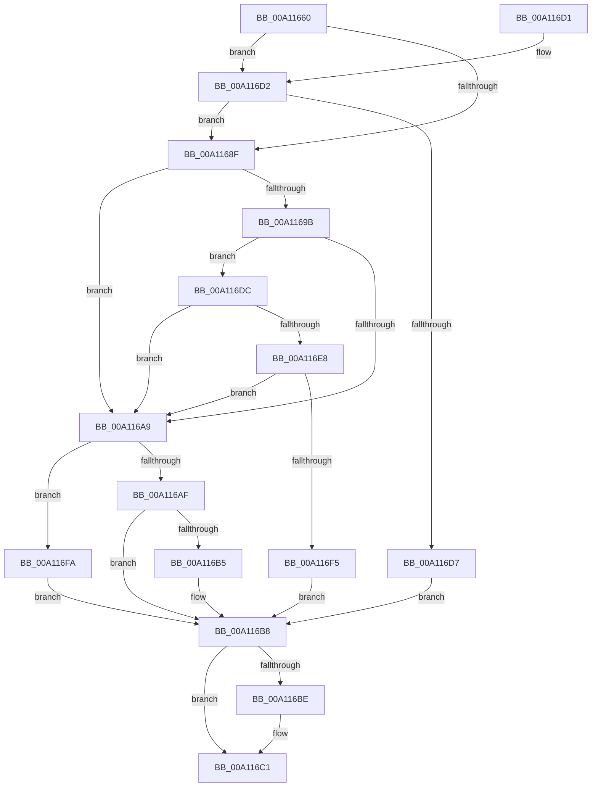

# PsQueryProcessSignatureMitigationPolicy

- RVA: `0x00A11660`–`0x00A116FF` (길이 `159` bytes)
- VA: `0x0000000140A11660`
- 실행 섹션: `PAGE`
- PDB 이름 있음: `예`; PDB Function 태그: `아니요`
- unwind 정보 RVA: `0x0005C878`
- 디코드: `49`개 명령, `159/159` bytes 표시
- 미해석 바이트: `0` (있으면 어셈블리에 `.byte`로 보존)

> 이 문서는 커널 이미지의 기계어와 PDB 기호를 분석해 생성했습니다. 4번과 5번은 함수 원형과 자료형을 바이너리 사용 방식에서 추정한 C 해석이며 원본 소스 복구 결과는 아닙니다.

## 1. Dependencies

- 직접 호출 지점: **2**; 고유 호출 대상: **1**
- 직접 호출자로 확인된 함수: **1**
- RIP 상대 이미지 참조: **1**

### Outgoing calls
- `0x00A116A0` → [guard_dispatch_icall](../../text/6B/guard_dispatch_icall_function_006BAAD0.md) (function, `0x006BAAD0`)
- `0x00A116EC` → [guard_dispatch_icall](../../text/6B/guard_dispatch_icall_function_006BAAD0.md) (function, `0x006BAAD0`)

### Direct callers
- [NtQueryInformationProcess](../9A/NtQueryInformationProcess_function_009AA250.md) at `0x009AAE11`

### Static image references
- `0x00A1168F` → RVA `0x00F04E80` (`.data`; read)

## 2. Other-region calls and transfers

- 다른 실행 섹션으로 향하는 call: **2**
  - `0x00A116A0` → [guard_dispatch_icall](../../text/6B/guard_dispatch_icall_function_006BAAD0.md) (`PAGE` → `.text`)
  - `0x00A116EC` → [guard_dispatch_icall](../../text/6B/guard_dispatch_icall_function_006BAAD0.md) (`PAGE` → `.text`)
- 별도 외부 분기/꼬리 이동을 확인하지 못했습니다.

## 3. Assembly (complete function range)

```asm
00A11660  48 89 5C 24 08                  mov qword ptr [rsp + 8], rbx
00A11665  48 89 74 24 10                  mov qword ptr [rsp + 0x10], rsi
00A1166A  57                              push rdi
00A1166B  48 83 EC 20                     sub rsp, 0x20
00A1166F  83 22 00                        and dword ptr [rdx], 0
00A11672  48 8D B1 F9 05 00 00            lea rsi, [rcx + 0x5f9]
00A11679  8B B9 50 07 00 00               mov edi, dword ptr [rcx + 0x750]
00A1167F  48 8B DA                        mov rbx, rdx
00A11682  44 8A 81 F8 05 00 00            mov r8b, byte ptr [rcx + 0x5f8]
00A11689  41 80 F8 08                     cmp r8b, 8
00A1168D  73 43                           jae 0x140a116d2
00A1168F  48 8B 05 EA 37 4F 00            mov rax, qword ptr [rip + 0x4f37ea]
00A11696  48 85 C0                        test rax, rax
00A11699  74 0E                           je 0x140a116a9
00A1169B  B2 06                           mov dl, 6
00A1169D  41 8A C8                        mov cl, r8b
00A116A0  E8 2B 94 CA FF                  call 0x1406baad0
00A116A5  85 C0                           test eax, eax
00A116A7  75 33                           jne 0x140a116dc
00A116A9  0F BA E7 18                     bt edi, 0x18
00A116AD  72 4B                           jb 0x140a116fa
00A116AF  0F BA E7 19                     bt edi, 0x19
00A116B3  73 03                           jae 0x140a116b8
00A116B5  83 0B 10                        or dword ptr [rbx], 0x10
00A116B8  0F BA E7 17                     bt edi, 0x17
00A116BC  73 03                           jae 0x140a116c1
00A116BE  83 0B 04                        or dword ptr [rbx], 4
00A116C1  48 8B 5C 24 30                  mov rbx, qword ptr [rsp + 0x30]
00A116C6  48 8B 74 24 38                  mov rsi, qword ptr [rsp + 0x38]
00A116CB  48 83 C4 20                     add rsp, 0x20
00A116CF  5F                              pop rdi
00A116D0  C3                              ret
00A116D1  CC                              int3
00A116D2  80 3E 08                        cmp byte ptr [rsi], 8
00A116D5  72 B8                           jb 0x140a1168f
00A116D7  83 0A 01                        or dword ptr [rdx], 1
00A116DA  EB DC                           jmp 0x140a116b8
00A116DC  48 8B 05 9D 37 4F 00            mov rax, qword ptr [rip + 0x4f379d]
00A116E3  48 85 C0                        test rax, rax
00A116E6  74 C1                           je 0x140a116a9
00A116E8  8A 0E                           mov cl, byte ptr [rsi]
00A116EA  B2 06                           mov dl, 6
00A116EC  E8 DF 93 CA FF                  call 0x1406baad0
00A116F1  85 C0                           test eax, eax
00A116F3  74 B4                           je 0x140a116a9
00A116F5  83 0B 02                        or dword ptr [rbx], 2
00A116F8  EB BE                           jmp 0x140a116b8
00A116FA  83 0B 08                        or dword ptr [rbx], 8
00A116FD  EB B9                           jmp 0x140a116b8
```

## 4. C-style interpretation (structured pseudocode)

```c
__int64 __fastcall PsQueryProcessSignatureMitigationPolicy(__int64 a1, __int64 a2)
{
    __int64 result;
    __int64 v_rsp;
    unsigned __int64 v_stack_p10;
    unsigned __int64 v_stack_p8;

    v_stack_p8 = v_rbx;
    v_stack_p10 = v_rsi;
    v_rsp = (v_rsp) - (32);
    if (((unsigned __int8)(*(unsigned __int8 *)(a1 + 1528))) >= 8) goto loc_00A116D2;
loc_00A1168F:
    if (*(unsigned __int64 *)(v_rip + 5191658) == 0) goto loc_00A116A9;
    result = guard_dispatch_icall((unsigned __int8)(*(unsigned __int8 *)(a1 + 1528)), 6, *(unsigned __int8 *)(a1 + 1528), a4);
    if ((unsigned int)(result) != 0) goto loc_00A116DC;
loc_00A116A9:
    if (condition_is_below) goto loc_00A116FA;
    if (!(condition_is_above_or_equal)) {
    }
    if (!(condition_is_above_or_equal)) {
    }
    v_rsp = (v_rsp) + (32);
    return result;
loc_00A116D2:
    if ((*(unsigned __int8 *)(v_stack_p10)) < 8) goto loc_00A1168F;
    goto loc_00A116B8;
loc_00A116DC:
    if (*(unsigned __int64 *)(v_rip + 5191581) == 0) goto loc_00A116A9;
    result = guard_dispatch_icall(*(unsigned __int8 *)(v_stack_p10), 6, *(unsigned __int8 *)(a1 + 1528), a4);
    if ((unsigned int)(result) == 0) goto loc_00A116A9;
    goto loc_00A116B8;
loc_00A116FA:
    goto loc_00A116B8;
}
```

## 5. (Beta) C Style

```c
int64_t PsQueryProcessSignatureMitigationPolicy(void *Arg1, void *Arg2)
{
    uint8_t *arg1 = (uint8_t *)Arg1;
    uint8_t *arg2 = (uint8_t *)Arg2;

    int64_t result;
    int64_t local_rsp;
    uint64_t v_stack_p10;
    uint64_t v_stack_p8;

    v_stack_p8 = local_rbx;
    v_stack_p10 = local_rsi;
    local_rsp = (local_rsp) - (32);
    if (((uint8_t)(*(uint8_t *)(arg1 + 0x5F8))) >= 8) goto loc_00A116D2;
loc_00A1168F:
    if (*(uint64_t *)(v_rip + 0x4F37EA) == 0) goto loc_00A116A9;
    result = guard_dispatch_icall((uint8_t)(*(uint8_t *)(arg1 + 0x5F8)), 6, *(uint8_t *)(arg1 + 0x5F8), a4);
    if ((uint32_t)(result) != 0) goto loc_00A116DC;
loc_00A116A9:
    if (condition_is_below) goto loc_00A116FA;
    if (!(condition_is_above_or_equal)) {
    }
    if (!(condition_is_above_or_equal)) {
    }
    local_rsp = (local_rsp) + (32);
    return result;
loc_00A116D2:
    if ((*(uint8_t *)(v_stack_p10)) < 8) goto loc_00A1168F;
    goto loc_00A116B8;
loc_00A116DC:
    if (*(uint64_t *)(v_rip + 0x4F379D) == 0) goto loc_00A116A9;
    result = guard_dispatch_icall(*(uint8_t *)(v_stack_p10), 6, *(uint8_t *)(arg1 + 0x5F8), a4);
    if ((uint32_t)(result) == 0) goto loc_00A116A9;
    goto loc_00A116B8;
loc_00A116FA:
    goto loc_00A116B8;
}
```

### 관측된 메모리 오프셋

구조체 형식이 확인되지 않은 접근은 인자 기준의 오프셋으로만 기록했습니다.

| 기준 인자 | 오프셋 표현 | 폭 (bit) | 접근 |
|---|---:|---:|---|
| `Arg1` | `+ 0x0` | `8` | `R` |
| `Arg1` | `+ 0x5F8` | `8` | `R` |
| `Arg1` | `+ 0x5F9` | `64` | `R` |
| `Arg1` | `+ 0x750` | `32` | `R` |
| `Arg2` | `+ 0x0` | `32` | `R/W` |

## 6. Execution-region graph

[열기: 2D/3D 그래프와 함수 탐색 컨트롤 패널](../../../control-panel.html?section=page&rva=0x00A11660&view=graph)

- 2D 그래프는 위에서 아래로 흐르고, 3D 그래프는 빈 공간을 드래그해 회전합니다. Shift+드래그는 이동, 휠은 확대·축소, 함수 노드 선택은 대상 보고서 이동입니다.

### Static fallback


