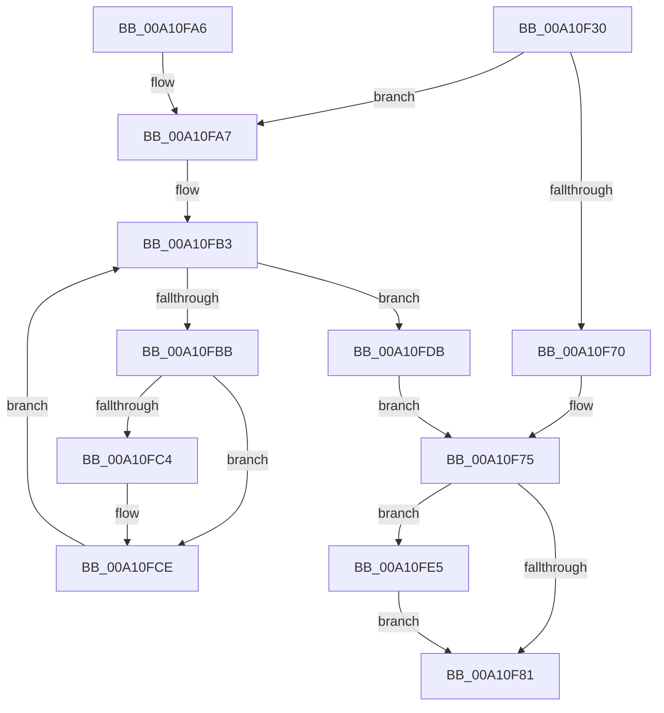

# PsSuspendProcess

- RVA: `0x00A10F30`–`0x00A10FF7` (길이 `199` bytes)
- VA: `0x0000000140A10F30`
- 실행 섹션: `PAGE`
- PDB 이름 있음: `예`; PDB Function 태그: `아니요`
- unwind 정보 RVA: `0x000A9348`
- 디코드: `55`개 명령, `199/199` bytes 표시
- 미해석 바이트: `0` (있으면 어셈블리에 `.byte`로 보존)

> 이 문서는 커널 이미지의 기계어와 PDB 기호를 분석해 생성했습니다. 4번과 5번은 함수 원형과 자료형을 바이너리 사용 방식에서 추정한 C 해석이며 원본 소스 복구 결과는 아닙니다.

## 1. Dependencies

- 직접 호출 지점: **7**; 고유 호출 대상: **6**
- 직접 호출자로 확인된 함수: **2**
- RIP 상대 이미지 참조: **0**

### Outgoing calls
- `0x00A10F67` → [ExAcquireRundownProtection](../../text/21/ExAcquireRundownProtection_function_00216620.md) (function, `0x00216620`)
- `0x00A10F84` → [KiLeaveCriticalRegionUnsafe](../../text/25/KiLeaveCriticalRegionUnsafe_function_0025F010.md) (function, `0x0025F010`)
- `0x00A10FAC` → [PsGetNextProcessThread](../8C/PsGetNextProcessThread_function_008C9CF0.md) (function, `0x008C9CF0`)
- `0x00A10FC9` → [PsSuspendThread](PsSuspendThread_function_00A110D0.md) (function, `0x00A110D0`)
- `0x00A10FD4` → [PsGetNextProcessThread](../8C/PsGetNextProcessThread_function_008C9CF0.md) (function, `0x008C9CF0`)
- `0x00A10FDE` → [ExReleaseRundownProtection](../../text/34/ExReleaseRundownProtection_function_00349E80.md) (function, `0x00349E80`)
- `0x00A10FF0` → [EtwTiLogSuspendResumeProcess](../A7/EtwTiLogSuspendResumeProcess_function_00A7956C.md) (function, `0x00A7956C`)

### Direct callers
- [PspFreezeProcessWorker](../78/PspFreezeProcessWorker_function_007865B0.md) at `0x00786606`
- [NtSuspendProcess](NtSuspendProcess_function_00A10850.md) at `0x00A108AC`

### Static image references
- 디코드된 RIP-relative 메모리 참조가 없습니다.

## 2. Other-region calls and transfers

- 다른 실행 섹션으로 향하는 call: **3**
  - `0x00A10F67` → [ExAcquireRundownProtection](../../text/21/ExAcquireRundownProtection_function_00216620.md) (`PAGE` → `.text`)
  - `0x00A10F84` → [KiLeaveCriticalRegionUnsafe](../../text/25/KiLeaveCriticalRegionUnsafe_function_0025F010.md) (`PAGE` → `.text`)
  - `0x00A10FDE` → [ExReleaseRundownProtection](../../text/34/ExReleaseRundownProtection_function_00349E80.md) (`PAGE` → `.text`)
- 별도 외부 분기/꼬리 이동을 확인하지 못했습니다.

## 3. Assembly (complete function range)

```asm
00A10F30  48 8B C4                        mov rax, rsp
00A10F33  48 89 58 08                     mov qword ptr [rax + 8], rbx
00A10F37  48 89 68 10                     mov qword ptr [rax + 0x10], rbp
00A10F3B  48 89 70 18                     mov qword ptr [rax + 0x18], rsi
00A10F3F  48 89 78 20                     mov qword ptr [rax + 0x20], rdi
00A10F43  41 56                           push r14
00A10F45  48 83 EC 20                     sub rsp, 0x20
00A10F49  65 48 8B 2C 25 88 01 00 00      mov rbp, qword ptr gs:[0x188]
00A10F52  4C 8D B1 E8 01 00 00            lea r14, [rcx + 0x1e8]
00A10F59  48 8B F1                        mov rsi, rcx
00A10F5C  49 8B CE                        mov rcx, r14
00A10F5F  66 FF 8D E4 01 00 00            dec word ptr [rbp + 0x1e4]
00A10F66  90                              nop
00A10F67  E8 B4 56 80 FF                  call 0x140216620
00A10F6C  3C 01                           cmp al, 1
00A10F6E  74 37                           je 0x140a10fa7
00A10F70  BB 0A 01 00 C0                  mov ebx, 0xc000010a
00A10F75  F7 86 FC 05 00 00 00 00 08 00   test dword ptr [rsi + 0x5fc], 0x80000
00A10F7F  75 64                           jne 0x140a10fe5
00A10F81  48 8B CD                        mov rcx, rbp
00A10F84  E8 87 E0 84 FF                  call 0x14025f010
00A10F89  48 8B 6C 24 38                  mov rbp, qword ptr [rsp + 0x38]
00A10F8E  8B C3                           mov eax, ebx
00A10F90  48 8B 5C 24 30                  mov rbx, qword ptr [rsp + 0x30]
00A10F95  48 8B 74 24 40                  mov rsi, qword ptr [rsp + 0x40]
00A10F9A  48 8B 7C 24 48                  mov rdi, qword ptr [rsp + 0x48]
00A10F9F  48 83 C4 20                     add rsp, 0x20
00A10FA3  41 5E                           pop r14
00A10FA5  C3                              ret
00A10FA6  CC                              int3
00A10FA7  33 D2                           xor edx, edx
00A10FA9  48 8B CE                        mov rcx, rsi
00A10FAC  E8 3F 8D EB FF                  call 0x1408c9cf0
00A10FB1  33 DB                           xor ebx, ebx
00A10FB3  48 8B F8                        mov rdi, rax
00A10FB6  48 85 C0                        test rax, rax
00A10FB9  74 20                           je 0x140a10fdb
00A10FBB  F7 40 74 00 00 20 00            test dword ptr [rax + 0x74], 0x200000
00A10FC2  75 0A                           jne 0x140a10fce
00A10FC4  33 D2                           xor edx, edx
00A10FC6  48 8B C8                        mov rcx, rax
00A10FC9  E8 02 01 00 00                  call 0x140a110d0
00A10FCE  48 8B D7                        mov rdx, rdi
00A10FD1  48 8B CE                        mov rcx, rsi
00A10FD4  E8 17 8D EB FF                  call 0x1408c9cf0
00A10FD9  EB D8                           jmp 0x140a10fb3
00A10FDB  49 8B CE                        mov rcx, r14
00A10FDE  E8 9D 8E 93 FF                  call 0x140349e80
00A10FE3  EB 90                           jmp 0x140a10f75
00A10FE5  45 33 C9                        xor r9d, r9d
00A10FE8  4C 8B C6                        mov r8, rsi
00A10FEB  48 8B D5                        mov rdx, rbp
00A10FEE  8B CB                           mov ecx, ebx
00A10FF0  E8 77 85 06 00                  call 0x140a7956c
00A10FF5  EB 8A                           jmp 0x140a10f81
```

## 4. C-style interpretation (structured pseudocode)

```c
__int64 __fastcall PsSuspendProcess(__int64 a1, int a2, __int64 a3, int a4)
{
    __int64 result;
    __int64 v_rbx;
    __int64 v_rsp;
    unsigned __int64 v_stack_p10;
    unsigned __int64 v_stack_p18;
    unsigned __int64 v_stack_p20;
    unsigned __int64 v_stack_p8;

    *(unsigned __int64 *)(v_rsp + 8) = v_rbx;
    *(unsigned __int64 *)(v_rsp + 16) = v_rbp;
    *(unsigned __int64 *)(v_rsp + 24) = v_rsi;
    *(unsigned __int64 *)(v_rsp + 32) = v_rdi;
    v_rsp = (v_rsp) - (32);
    result = ExAcquireRundownProtection(a1 + 488, a2, a3, a4);
    if (((unsigned __int8)(result)) == 1) goto loc_00A10FA7;
loc_00A10F75:
    if (((*(unsigned int *)(a1 + 1532)) & (0x80000ULL)) != 0) goto loc_00A10FE5;
loc_00A10F81:
    result = KiLeaveCriticalRegionUnsafe(*(unsigned __int64 *)(gs_base + (0 + 392)), a2, a3, a4);
    v_rsp = (v_rsp) + (32);
    return (unsigned int)((unsigned int)((unsigned int)(0xC000010AULL)));
loc_00A10FA7:
    a2 = 0;
    result = PsGetNextProcessThread(v_stack_p18, a2, a3, a4);
    v_rbx = 0;
loc_00A10FB3:
    if (result == 0) goto loc_00A10FDB;
    if (((*(unsigned int *)(result + 116)) & (0x200000ULL)) == 0) {
        a2 = 0;
        a1 = result;
        result = PsSuspendThread(a1, a2, a3, a4);
    }
    result = PsGetNextProcessThread(v_stack_p18, result, a3, a4);
    goto loc_00A10FB3;
loc_00A10FDB:
    result = ExReleaseRundownProtection(a1 + 488, result, a3, a4);
    goto loc_00A10F75;
loc_00A10FE5:
    a4 = 0;
    result = EtwTiLogSuspendResumeProcess(0, v_stack_p10, v_stack_p18, a4);
    goto loc_00A10F81;
}
```

## 5. (Beta) C Style

```c
int64_t PsSuspendProcess(void *Arg1, int32_t Arg2, int64_t Arg3, int32_t Arg4)
{
    uint8_t *arg1 = (uint8_t *)Arg1;

    int64_t result;
    int64_t local_rbx;
    int64_t local_rsp;
    uint64_t v_stack_p10;
    uint64_t v_stack_p18;
    uint64_t v_stack_p20;
    uint64_t v_stack_p8;

    *(uint64_t *)(local_rsp + 0x8) = local_rbx;
    *(uint64_t *)(local_rsp + 0x10) = local_rbp;
    *(uint64_t *)(local_rsp + 0x18) = local_rsi;
    *(uint64_t *)(local_rsp + 0x20) = local_rdi;
    local_rsp = (local_rsp) - (32);
    result = ExAcquireRundownProtection(Arg1 + 488, Arg2, Arg3, Arg4);
    if (((uint8_t)(result)) == 1) goto loc_00A10FA7;
loc_00A10F75:
    if (((*(uint32_t *)(arg1 + 0x5FC)) & (0x80000ULL)) != 0) goto loc_00A10FE5;
loc_00A10F81:
    result = KiLeaveCriticalRegionUnsafe(*(uint64_t *)(gs_base + (0 + 0x188)), Arg2, Arg3, Arg4);
    local_rsp = (local_rsp) + (32);
    return (uint32_t)((uint32_t)((uint32_t)(0xC000010AULL)));
loc_00A10FA7:
    Arg2 = 0;
    result = PsGetNextProcessThread(v_stack_p18, Arg2, Arg3, Arg4);
    local_rbx = 0;
loc_00A10FB3:
    if (result == 0) goto loc_00A10FDB;
    if (((*(uint32_t *)(result + 0x74)) & (0x200000ULL)) == 0) {
        Arg2 = 0;
        Arg1 = result;
        result = PsSuspendThread(Arg1, Arg2, Arg3, Arg4);
    }
    result = PsGetNextProcessThread(v_stack_p18, result, Arg3, Arg4);
    goto loc_00A10FB3;
loc_00A10FDB:
    result = ExReleaseRundownProtection(Arg1 + 488, result, Arg3, Arg4);
    goto loc_00A10F75;
loc_00A10FE5:
    Arg4 = 0;
    result = EtwTiLogSuspendResumeProcess(0, v_stack_p10, v_stack_p18, Arg4);
    goto loc_00A10F81;
}
```

### 관측된 메모리 오프셋

구조체 형식이 확인되지 않은 접근은 인자 기준의 오프셋으로만 기록했습니다.

| 기준 인자 | 오프셋 표현 | 폭 (bit) | 접근 |
|---|---:|---:|---|
| `Arg1` | `+ 0x1E8` | `64` | `R` |
| `Arg1` | `+ 0x5FC` | `32` | `R` |

## 6. Execution-region graph

[열기: 2D/3D 그래프와 함수 탐색 컨트롤 패널](../../../control-panel.html?section=page&rva=0x00A10F30&view=graph)

- 2D 그래프는 위에서 아래로 흐르고, 3D 그래프는 빈 공간을 드래그해 회전합니다. Shift+드래그는 이동, 휠은 확대·축소, 함수 노드 선택은 대상 보고서 이동입니다.

### Static fallback


