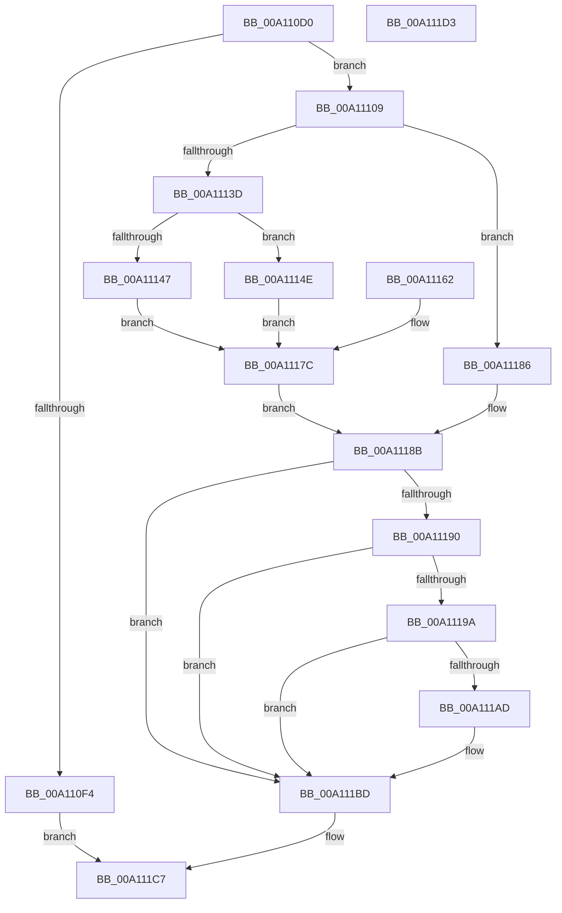

# PsSuspendThread

- RVA: `0x00A110D0`–`0x00A111D4` (길이 `260` bytes)
- VA: `0x0000000140A110D0`
- 실행 섹션: `PAGE`
- PDB 이름 있음: `예`; PDB Function 태그: `아니요`
- unwind 정보 RVA: `0x000A93A8`
- 디코드: `76`개 명령, `260/260` bytes 표시
- 미해석 바이트: `0` (있으면 어셈블리에 `.byte`로 보존)

> 이 문서는 커널 이미지의 기계어와 PDB 기호를 분석해 생성했습니다. 4번과 5번은 함수 원형과 자료형을 바이너리 사용 방식에서 추정한 C 해석이며 원본 소스 복구 결과는 아닙니다.

## 1. Dependencies

- 직접 호출 지점: **7**; 고유 호출 대상: **7**
- 직접 호출자로 확인된 함수: **7**
- RIP 상대 이미지 참조: **0**

### Outgoing calls
- `0x00A110EB` → [Feature_SuspendThread2__private_IsEnabledNoReportingNoInline](../../text/5C/Feature_SuspendThread2__private_IsEnabledNoReportingNoInline_function_005C357C.md) (function, `0x005C357C`)
- `0x00A110FF` → [PspSuspendThread](../78/PspSuspendThread_function_00787A0C.md) (function, `0x00787A0C`)
- `0x00A11134` → [ExAcquireRundownProtection](../../text/21/ExAcquireRundownProtection_function_00216620.md) (function, `0x00216620`)
- `0x00A11151` → [KeSuspendThreadOld](../../text/5B/KeSuspendThreadOld_function_005B9000.md) (function, `0x005B9000`)
- `0x00A1117F` → [ExReleaseRundownProtection](../../text/34/ExReleaseRundownProtection_function_00349E80.md) (function, `0x00349E80`)
- `0x00A111B8` → [EtwTiLogSuspendResumeThread](../A3/EtwTiLogSuspendResumeThread_function_00A34DE0.md) (function, `0x00A34DE0`)
- `0x00A111C0` → [KiLeaveCriticalRegionUnsafe](../../text/25/KiLeaveCriticalRegionUnsafe_function_0025F010.md) (function, `0x0025F010`)

### Direct callers
- [DbgkQueueUserExceptionReport](../71/DbgkQueueUserExceptionReport_function_00710B04.md) at `0x00710C83`
- [PspWow64SetContextThread](../8C/PspWow64SetContextThread_function_008CCC88.md) at `0x008CD155`
- [DbgkpPostFakeThreadMessages](DbgkpPostFakeThreadMessages_function_00A108CC.md) at `0x00A10A08`
- [PsSuspendProcess](PsSuspendProcess_function_00A10F30.md) at `0x00A10FC9`
- [NtSuspendThread](NtSuspendThread_function_00A11000.md) at `0x00A11094`
- [PspWow64GetContextThread](PspWow64GetContextThread_function_00A11E90.md) at `0x00A122F1`
- [NtChangeThreadState](../AE/NtChangeThreadState_function_00AEA210.md) at `0x00AEA5D5`

### Static image references
- 디코드된 RIP-relative 메모리 참조가 없습니다.

## 2. Other-region calls and transfers

- 다른 실행 섹션으로 향하는 call: **5**
  - `0x00A110EB` → [Feature_SuspendThread2__private_IsEnabledNoReportingNoInline](../../text/5C/Feature_SuspendThread2__private_IsEnabledNoReportingNoInline_function_005C357C.md) (`PAGE` → `.text`)
  - `0x00A11134` → [ExAcquireRundownProtection](../../text/21/ExAcquireRundownProtection_function_00216620.md) (`PAGE` → `.text`)
  - `0x00A11151` → [KeSuspendThreadOld](../../text/5B/KeSuspendThreadOld_function_005B9000.md) (`PAGE` → `.text`)
  - `0x00A1117F` → [ExReleaseRundownProtection](../../text/34/ExReleaseRundownProtection_function_00349E80.md) (`PAGE` → `.text`)
  - `0x00A111C0` → [KiLeaveCriticalRegionUnsafe](../../text/25/KiLeaveCriticalRegionUnsafe_function_0025F010.md) (`PAGE` → `.text`)
- 별도 외부 분기/꼬리 이동을 확인하지 못했습니다.

## 3. Assembly (complete function range)

```asm
00A110D0  48 89 54 24 10                  mov qword ptr [rsp + 0x10], rdx
00A110D5  48 89 4C 24 08                  mov qword ptr [rsp + 8], rcx
00A110DA  53                              push rbx
00A110DB  56                              push rsi
00A110DC  57                              push rdi
00A110DD  41 56                           push r14
00A110DF  41 57                           push r15
00A110E1  48 83 EC 30                     sub rsp, 0x30
00A110E5  48 8B F2                        mov rsi, rdx
00A110E8  48 8B F9                        mov rdi, rcx
00A110EB  E8 8C 24 BB FF                  call 0x1405c357c
00A110F0  85 C0                           test eax, eax
00A110F2  74 15                           je 0x140a11109
00A110F4  4C 8B CE                        mov r9, rsi
00A110F7  45 33 C0                        xor r8d, r8d
00A110FA  33 D2                           xor edx, edx
00A110FC  48 8B CF                        mov rcx, rdi
00A110FF  E8 08 69 D7 FF                  call 0x140787a0c
00A11104  E9 BE 00 00 00                  jmp 0x140a111c7
00A11109  83 64 24 20 00                  and dword ptr [rsp + 0x20], 0
00A1110E  65 4C 8B 34 25 88 01 00 00      mov r14, qword ptr gs:[0x188]
00A11117  4C 89 74 24 70                  mov qword ptr [rsp + 0x70], r14
00A1111C  66 41 FF 8E E4 01 00 00         dec word ptr [r14 + 0x1e4]
00A11124  90                              nop
00A11125  4C 8D BF 88 05 00 00            lea r15, [rdi + 0x588]
00A1112C  4C 89 7C 24 78                  mov qword ptr [rsp + 0x78], r15
00A11131  49 8B CF                        mov rcx, r15
00A11134  E8 E7 54 80 FF                  call 0x140216620
00A11139  84 C0                           test al, al
00A1113B  74 49                           je 0x140a11186
00A1113D  8B 87 A0 05 00 00               mov eax, dword ptr [rdi + 0x5a0]
00A11143  A8 01                           test al, 1
00A11145  74 07                           je 0x140a1114e
00A11147  BB 4B 00 00 C0                  mov ebx, 0xc000004b
00A1114C  EB 2E                           jmp 0x140a1117c
00A1114E  48 8B CF                        mov rcx, rdi
00A11151  E8 AA 7E BA FF                  call 0x1405b9000
00A11156  89 44 24 20                     mov dword ptr [rsp + 0x20], eax
00A1115A  33 DB                           xor ebx, ebx
00A1115C  89 5C 24 24                     mov dword ptr [rsp + 0x24], ebx
00A11160  EB 1A                           jmp 0x140a1117c
00A11162  8B D8                           mov ebx, eax
00A11164  89 44 24 24                     mov dword ptr [rsp + 0x24], eax
00A11168  48 8B 74 24 68                  mov rsi, qword ptr [rsp + 0x68]
00A1116D  48 8B 7C 24 60                  mov rdi, qword ptr [rsp + 0x60]
00A11172  4C 8B 74 24 70                  mov r14, qword ptr [rsp + 0x70]
00A11177  4C 8B 7C 24 78                  mov r15, qword ptr [rsp + 0x78]
00A1117C  49 8B CF                        mov rcx, r15
00A1117F  E8 FC 8C 93 FF                  call 0x140349e80
00A11184  EB 05                           jmp 0x140a1118b
00A11186  BB 4B 00 00 C0                  mov ebx, 0xc000004b
00A1118B  48 85 F6                        test rsi, rsi
00A1118E  74 2D                           je 0x140a111bd
00A11190  8B 44 24 20                     mov eax, dword ptr [rsp + 0x20]
00A11194  89 06                           mov dword ptr [rsi], eax
00A11196  85 C0                           test eax, eax
00A11198  75 23                           jne 0x140a111bd
00A1119A  48 8B 97 20 02 00 00            mov rdx, qword ptr [rdi + 0x220]
00A111A1  F7 82 FC 05 00 00 00 00 10 00   test dword ptr [rdx + 0x5fc], 0x100000
00A111AB  74 10                           je 0x140a111bd
00A111AD  41 B1 01                        mov r9b, 1
00A111B0  4C 8B C7                        mov r8, rdi
00A111B3  49 8B D6                        mov rdx, r14
00A111B6  8B CB                           mov ecx, ebx
00A111B8  E8 23 3C 02 00                  call 0x140a34de0
00A111BD  49 8B CE                        mov rcx, r14
00A111C0  E8 4B DE 84 FF                  call 0x14025f010
00A111C5  8B C3                           mov eax, ebx
00A111C7  48 83 C4 30                     add rsp, 0x30
00A111CB  41 5F                           pop r15
00A111CD  41 5E                           pop r14
00A111CF  5F                              pop rdi
00A111D0  5E                              pop rsi
00A111D1  5B                              pop rbx
00A111D2  C3                              ret
00A111D3  CC                              int3
```

## 4. C-style interpretation (structured pseudocode)

```c
__int64 __fastcall PsSuspendThread(__int64 a1, __int64 a2, int a3)
{
    __int64 result;
    __int64 v_rbx;
    __int64 v_rsp;
    unsigned int v_stack_m34;
    unsigned int v_stack_m38;
    unsigned __int64 v_stack_p10;
    unsigned __int64 v_stack_p18;
    unsigned __int64 v_stack_p20;
    unsigned __int64 v_stack_p8;

    v_stack_p10 = a2;
    v_stack_p8 = a1;
    v_rsp = (v_rsp) - (48);
    result = Feature_SuspendThread2__private_IsEnabledNoReportingNoInline(a1, a2, a3, a4);
    if ((unsigned int)(result) == 0) goto loc_00A11109;
    a3 = 0;
    a2 = 0;
    result = PspSuspendThread(a1, a2, a3, a2);
    goto loc_00A111C7;
loc_00A11109:
    v_stack_p18 = *(unsigned __int64 *)(gs_base + (0 + 392));
    v_stack_p20 = a1 + 1416;
    result = ExAcquireRundownProtection(a1 + 1416, a2, a3, a2);
    if ((unsigned __int8)(result) == 0) goto loc_00A11186;
    if ((((unsigned __int8)((unsigned int)(*(unsigned int *)(a1 + 1440)))) & (1)) == 0) goto loc_00A1114E;
    goto loc_00A1117C;
loc_00A1114E:
    result = KeSuspendThreadOld(a1, a2, a3, a2);
    v_stack_m38 = (unsigned int)(result);
    v_rbx = 0;
    v_stack_m34 = 0;
    goto loc_00A1117C;
loc_00A1117C:
    result = ExReleaseRundownProtection(a1 + 1416, a2, a3, a2);
    goto loc_00A1118B;
loc_00A11186:
loc_00A1118B:
    if (0 == 0) goto loc_00A111BD;
    *(unsigned int *)(a2) = (unsigned int)((unsigned int)(v_stack_m38));
    if ((unsigned int)((unsigned int)(v_stack_m38)) != 0) goto loc_00A111BD;
    result = (unsigned int)(v_stack_m38);
    if (((*(unsigned int *)(*(unsigned __int64 *)(a1 + 544) + 1532)) & (0x100000ULL)) != 0) {
        a4 = 1;
        a3 = a1;
        a2 = *(unsigned __int64 *)(gs_base + (0 + 392));
        a1 = (unsigned int)((unsigned int)(0xC000004BULL));
        result = EtwTiLogSuspendResumeThread(a1, a2, a3, a4);
    }
    result = KiLeaveCriticalRegionUnsafe(*(unsigned __int64 *)(gs_base + (0 + 392)), a2, a3, a4);
loc_00A111C7:
    v_rsp = (v_rsp) + (48);
    return (unsigned int)((unsigned int)((unsigned int)(0xC000004BULL)));
}
```

## 5. (Beta) C Style

```c
int64_t PsSuspendThread(void *Arg1, int64_t Arg2, int32_t Arg3)
{
    uint8_t *arg1 = (uint8_t *)Arg1;

    int64_t result;
    int64_t local_rbx;
    int64_t local_rsp;
    uint32_t v_stack_m34;
    uint32_t v_stack_m38;
    uint64_t v_stack_p10;
    uint64_t v_stack_p18;
    uint64_t v_stack_p20;
    uint64_t v_stack_p8;

    v_stack_p10 = Arg2;
    v_stack_p8 = Arg1;
    local_rsp = (local_rsp) - (48);
    result = Feature_SuspendThread2__private_IsEnabledNoReportingNoInline(Arg1, Arg2, Arg3, a4);
    if ((uint32_t)(result) == 0) goto loc_00A11109;
    Arg3 = 0;
    Arg2 = 0;
    result = PspSuspendThread(Arg1, Arg2, Arg3, Arg2);
    goto loc_00A111C7;
loc_00A11109:
    v_stack_p18 = *(uint64_t *)(gs_base + (0 + 0x188));
    v_stack_p20 = Arg1 + 1416;
    result = ExAcquireRundownProtection(Arg1 + 1416, Arg2, Arg3, Arg2);
    if ((uint8_t)(result) == 0) goto loc_00A11186;
    if ((((uint8_t)((uint32_t)(*(uint32_t *)(arg1 + 0x5A0)))) & (1)) == 0) goto loc_00A1114E;
    goto loc_00A1117C;
loc_00A1114E:
    result = KeSuspendThreadOld(Arg1, Arg2, Arg3, Arg2);
    v_stack_m38 = (uint32_t)(result);
    local_rbx = 0;
    v_stack_m34 = 0;
    goto loc_00A1117C;
loc_00A1117C:
    result = ExReleaseRundownProtection(Arg1 + 1416, Arg2, Arg3, Arg2);
    goto loc_00A1118B;
loc_00A11186:
loc_00A1118B:
    if (0 == 0) goto loc_00A111BD;
    *(uint32_t *)(Arg2) = (uint32_t)((uint32_t)(v_stack_m38));
    if ((uint32_t)((uint32_t)(v_stack_m38)) != 0) goto loc_00A111BD;
    result = (uint32_t)(v_stack_m38);
    if (((*(uint32_t *)(*(uint64_t *)(arg1 + 0x220) + 0x5FC)) & (0x100000ULL)) != 0) {
        a4 = 1;
        Arg3 = Arg1;
        Arg2 = *(uint64_t *)(gs_base + (0 + 0x188));
        Arg1 = (uint32_t)((uint32_t)(0xC000004BULL));
        result = EtwTiLogSuspendResumeThread(Arg1, Arg2, Arg3, a4);
    }
    result = KiLeaveCriticalRegionUnsafe(*(uint64_t *)(gs_base + (0 + 0x188)), Arg2, Arg3, a4);
loc_00A111C7:
    local_rsp = (local_rsp) + (48);
    return (uint32_t)((uint32_t)((uint32_t)(0xC000004BULL)));
}
```

### 관측된 메모리 오프셋

구조체 형식이 확인되지 않은 접근은 인자 기준의 오프셋으로만 기록했습니다.

| 기준 인자 | 오프셋 표현 | 폭 (bit) | 접근 |
|---|---:|---:|---|
| `Arg1` | `+ 0x220` | `64` | `R` |
| `Arg1` | `+ 0x588` | `64` | `R` |
| `Arg1` | `+ 0x5A0` | `32` | `R` |

## 6. Execution-region graph

[열기: 2D/3D 그래프와 함수 탐색 컨트롤 패널](../../../control-panel.html?section=page&rva=0x00A110D0&view=graph)

- 2D 그래프는 위에서 아래로 흐르고, 3D 그래프는 빈 공간을 드래그해 회전합니다. Shift+드래그는 이동, 휠은 확대·축소, 함수 노드 선택은 대상 보고서 이동입니다.

### Static fallback


