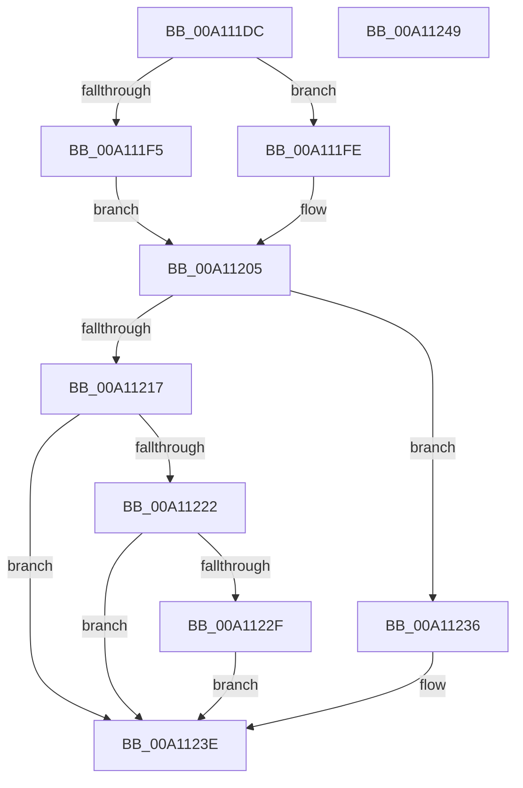

# PsSynchronizeWithThreadInsertion

- RVA: `0x00A111DC`–`0x00A1124A` (길이 `110` bytes)
- VA: `0x0000000140A111DC`
- 실행 섹션: `PAGE`
- PDB 이름 있음: `예`; PDB Function 태그: `아니요`
- unwind 정보 RVA: `0x0005CAAC`
- 디코드: `33`개 명령, `110/110` bytes 표시
- 미해석 바이트: `0` (있으면 어셈블리에 `.byte`로 보존)

> 이 문서는 커널 이미지의 기계어와 PDB 기호를 분석해 생성했습니다. 4번과 5번은 함수 원형과 자료형을 바이너리 사용 방식에서 추정한 C 해석이며 원본 소스 복구 결과는 아닙니다.

## 1. Dependencies

- 직접 호출 지점: **5**; 고유 호출 대상: **4**
- 직접 호출자로 확인된 함수: **2**
- RIP 상대 이미지 참조: **0**

### Outgoing calls
- `0x00A111EC` → [Feature_ThreadLockGuardedRegion__private_IsEnabledDeviceUsageNoInline](../../text/5E/Feature_ThreadLockGuardedRegion__private_IsEnabledDeviceUsageNoInline_function_005E2CEC.md) (function, `0x005E2CEC`)
- `0x00A11209` → [PspLockUnlockThreadSecurityExclusiveUnsafe](../../text/4E/PspLockUnlockThreadSecurityExclusiveUnsafe_function_004E96AC.md) (function, `0x004E96AC`)
- `0x00A1120E` → [Feature_ThreadLockGuardedRegion__private_IsEnabledDeviceUsageNoInline](../../text/5E/Feature_ThreadLockGuardedRegion__private_IsEnabledDeviceUsageNoInline_function_005E2CEC.md) (function, `0x005E2CEC`)
- `0x00A1122F` → [KiCheckForKernelApcDelivery](../../text/2E/KiCheckForKernelApcDelivery_function_002E2C80.md) (function, `0x002E2C80`)
- `0x00A11239` → [KiLeaveCriticalRegionUnsafe](../../text/25/KiLeaveCriticalRegionUnsafe_function_0025F010.md) (function, `0x0025F010`)

### Direct callers
- [NtGetNextThread](../8C/NtGetNextThread_function_008C7D40.md) at `0x008C8044`
- [DbgkpPostFakeThreadMessages](DbgkpPostFakeThreadMessages_function_00A108CC.md) at `0x00A10AE3`

### Static image references
- 디코드된 RIP-relative 메모리 참조가 없습니다.

## 2. Other-region calls and transfers

- 다른 실행 섹션으로 향하는 call: **5**
  - `0x00A111EC` → [Feature_ThreadLockGuardedRegion__private_IsEnabledDeviceUsageNoInline](../../text/5E/Feature_ThreadLockGuardedRegion__private_IsEnabledDeviceUsageNoInline_function_005E2CEC.md) (`PAGE` → `.text`)
  - `0x00A11209` → [PspLockUnlockThreadSecurityExclusiveUnsafe](../../text/4E/PspLockUnlockThreadSecurityExclusiveUnsafe_function_004E96AC.md) (`PAGE` → `.text`)
  - `0x00A1120E` → [Feature_ThreadLockGuardedRegion__private_IsEnabledDeviceUsageNoInline](../../text/5E/Feature_ThreadLockGuardedRegion__private_IsEnabledDeviceUsageNoInline_function_005E2CEC.md) (`PAGE` → `.text`)
  - `0x00A1122F` → [KiCheckForKernelApcDelivery](../../text/2E/KiCheckForKernelApcDelivery_function_002E2C80.md) (`PAGE` → `.text`)
  - `0x00A11239` → [KiLeaveCriticalRegionUnsafe](../../text/25/KiLeaveCriticalRegionUnsafe_function_0025F010.md) (`PAGE` → `.text`)
- 별도 외부 분기/꼬리 이동을 확인하지 못했습니다.

## 3. Assembly (complete function range)

```asm
00A111DC  48 89 5C 24 08                  mov qword ptr [rsp + 8], rbx
00A111E1  57                              push rdi
00A111E2  48 83 EC 20                     sub rsp, 0x20
00A111E6  48 8B DA                        mov rbx, rdx
00A111E9  48 8B F9                        mov rdi, rcx
00A111EC  E8 FB 1A BD FF                  call 0x1405e2cec
00A111F1  85 C0                           test eax, eax
00A111F3  74 09                           je 0x140a111fe
00A111F5  66 FF 8B E6 01 00 00            dec word ptr [rbx + 0x1e6]
00A111FC  EB 07                           jmp 0x140a11205
00A111FE  66 FF 8B E4 01 00 00            dec word ptr [rbx + 0x1e4]
00A11205  48 8B CF                        mov rcx, rdi
00A11208  90                              nop
00A11209  E8 9E 84 AD FF                  call 0x1404e96ac
00A1120E  E8 D9 1A BD FF                  call 0x1405e2cec
00A11213  85 C0                           test eax, eax
00A11215  74 1F                           je 0x140a11236
00A11217  90                              nop
00A11218  66 83 83 E6 01 00 00 01         add word ptr [rbx + 0x1e6], 1
00A11220  75 1C                           jne 0x140a1123e
00A11222  48 8D 83 98 00 00 00            lea rax, [rbx + 0x98]
00A11229  90                              nop
00A1122A  48 39 00                        cmp qword ptr [rax], rax
00A1122D  74 0F                           je 0x140a1123e
00A1122F  E8 4C 1A 8D FF                  call 0x1402e2c80
00A11234  EB 08                           jmp 0x140a1123e
00A11236  48 8B CB                        mov rcx, rbx
00A11239  E8 D2 DD 84 FF                  call 0x14025f010
00A1123E  48 8B 5C 24 30                  mov rbx, qword ptr [rsp + 0x30]
00A11243  48 83 C4 20                     add rsp, 0x20
00A11247  5F                              pop rdi
00A11248  C3                              ret
00A11249  CC                              int3
```

## 4. C-style interpretation (structured pseudocode)

```c
__int64 __fastcall PsSynchronizeWithThreadInsertion(__int64 a1, __int64 a2)
{
    __int64 result;
    __int64 v_rsp;
    unsigned __int64 v_stack_p8;

    v_stack_p8 = v_rbx;
    v_rsp = (v_rsp) - (32);
    result = Feature_ThreadLockGuardedRegion__private_IsEnabledDeviceUsageNoInline(a1, a2, a3, a4);
    if ((unsigned int)(result) == 0) goto loc_00A111FE;
    goto loc_00A11205;
loc_00A111FE:
loc_00A11205:
    result = PspLockUnlockThreadSecurityExclusiveUnsafe(a1, a2, a3, a4);
    result = Feature_ThreadLockGuardedRegion__private_IsEnabledDeviceUsageNoInline(a1, a2, a3, a4);
    if ((unsigned int)(result) == 0) goto loc_00A11236;
    if ((unsigned int)(result) != 0) goto loc_00A1123E;
    if ((*(unsigned __int64 *)(a2 + 152)) == (a2 + 152)) goto loc_00A1123E;
    result = KiCheckForKernelApcDelivery(a1, a2, a3, a4);
    goto loc_00A1123E;
loc_00A11236:
    result = KiLeaveCriticalRegionUnsafe(a2, a2, a3, a4);
loc_00A1123E:
    v_rsp = (v_rsp) + (32);
    return result;
}
```

## 5. (Beta) C Style

```c
int64_t PsSynchronizeWithThreadInsertion(int64_t Arg1, void *Arg2)
{
    uint8_t *arg2 = (uint8_t *)Arg2;

    int64_t result;
    int64_t local_rsp;
    uint64_t v_stack_p8;

    v_stack_p8 = local_rbx;
    local_rsp = (local_rsp) - (32);
    result = Feature_ThreadLockGuardedRegion__private_IsEnabledDeviceUsageNoInline(Arg1, Arg2, a3, a4);
    if ((uint32_t)(result) == 0) goto loc_00A111FE;
    goto loc_00A11205;
loc_00A111FE:
loc_00A11205:
    result = PspLockUnlockThreadSecurityExclusiveUnsafe(Arg1, Arg2, a3, a4);
    result = Feature_ThreadLockGuardedRegion__private_IsEnabledDeviceUsageNoInline(Arg1, Arg2, a3, a4);
    if ((uint32_t)(result) == 0) goto loc_00A11236;
    if ((uint32_t)(result) != 0) goto loc_00A1123E;
    if ((*(uint64_t *)(arg2 + 0x98)) == (Arg2 + 152)) goto loc_00A1123E;
    result = KiCheckForKernelApcDelivery(Arg1, Arg2, a3, a4);
    goto loc_00A1123E;
loc_00A11236:
    result = KiLeaveCriticalRegionUnsafe(Arg2, Arg2, a3, a4);
loc_00A1123E:
    local_rsp = (local_rsp) + (32);
    return result;
}
```

### 관측된 메모리 오프셋

구조체 형식이 확인되지 않은 접근은 인자 기준의 오프셋으로만 기록했습니다.

| 기준 인자 | 오프셋 표현 | 폭 (bit) | 접근 |
|---|---:|---:|---|
| `Arg2` | `+ 0x0` | `64` | `R` |
| `Arg2` | `+ 0x98` | `64` | `R` |
| `Arg2` | `+ 0x1E4` | `16` | `R/W` |
| `Arg2` | `+ 0x1E6` | `16` | `R/W` |

## 6. Execution-region graph

[열기: 2D/3D 그래프와 함수 탐색 컨트롤 패널](../../../control-panel.html?section=page&rva=0x00A111DC&view=graph)

- 2D 그래프는 위에서 아래로 흐르고, 3D 그래프는 빈 공간을 드래그해 회전합니다. Shift+드래그는 이동, 휠은 확대·축소, 함수 노드 선택은 대상 보고서 이동입니다.

### Static fallback


